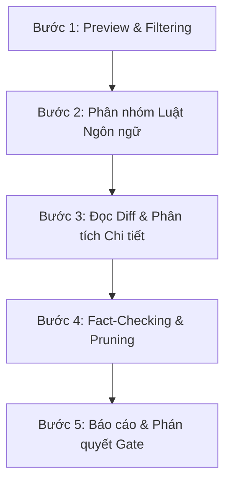

# Open Code Review (Alibaba OCR Standard)

Kỹ năng thực hiện kiểm định và đánh giá mã nguồn (Code Review) chuyên nghiệp, kế thừa toàn bộ triết lý thiết kế và quy chuẩn từ [alibaba/open-code-review](https://github.com/alibaba/open-code-review).

---

## 1. Triết Lý Cốt Lõi (Core Philosophy)

> **"Favor precision over recall: only raise an issue when you are confident it is a real defect, and stay silent when the surrounding context is unclear — a false alarm costs more reviewer trust than a missed minor issue."**

1. **Chính xác trên hết (Precision over Recall)**:
   - Chỉ xuất nhận xét khi chắc chắn 100% đó là lỗi logic, lỗ hổng bảo mật, suy giảm hiệu năng hoặc vi phạm hợp đồng thiết kế.
   - Khi ngữ cảnh chưa rõ ràng hoặc đoạn code còn nhiều giả định, ưu tiên giữ im lặng hoặc dùng công cụ tra cứu ngữ cảnh sâu (`file_read`, `grep_search`) trước khi phán xét.
2. **Phân biệt rạch ròi Blocking vs Non-Blocking Gate**:
   - **Blocking (`severity: critical | high`)**: Lỗi logic sai lệch tính đúng đắn, rò rỉ secret/credential, RCE (`eval`/`exec`), SQL Injection, mutable default arguments gây side-effect cross-call. **Bắt buộc từ chối merge PR** cho đến khi được sửa.
   - **Non-Blocking (`severity: medium | low`)**: Đề xuất cải thiện hiệu năng (chuỗi nối trong vòng lặp), bắt ngoại lệ cụ thể thay vì bare except, phong cách viết code. Đóng vai trò cảnh báo tham khảo.
3. **Line-Level Structured Feedback**:
   - Mọi nhận xét phải định vị chính xác tệp (`path`), dòng bắt đầu/kết thúc (`start_line`, `end_line`), đoạn code lỗi hiện tại (`existing_code`), và đoạn code giải pháp khắc phục ăn ngay (`suggestion_code`).

---

## 2. Hai Chế Độ Vận Hành (Operating Modes)

### Chế độ A: Delegation Mode (Mặc định cho Antigravity / Kilo)
- **Không tốn API key bên ngoài**: Không cần cài đặt cồng kềnh `npm install -g` hay cấu hình endpoint LLM phụ trợ.
- **Tận dụng động cơ Python nội bộ**: Sử dụng module `src/eval/code_reviewer.py` để thực hiện deterministic preprocessing:
  - Lọc bỏ file rác/nhạy cảm: `.env`, `vendor/`, `node_modules/`, `package-lock.json`, minified, build binaries.
  - Phân giải bộ luật ngôn ngữ: ánh xạ từng tệp sang quy chuẩn tương ứng tại `agents/knowledge/review-rules/`.
  - Host Agent dùng chính trí tuệ nhân tạo của mình để đọc diff và xuất báo cáo line-level.

### Chế độ B: CLI Mode (Khi máy đã cài sẵn `ocr` CLI)
```bash
ocr review --audience agent --background "Mục đích tính năng" [cờ bổ sung]
```
- `--audience agent`: Tắt thanh progress bar đồ họa để chỉ xuất JSON/Markdown có cấu trúc cho AI.
- `--preview`: Xem trước danh sách tệp được review mà không gọi LLM.
- `--from <ref> --to <ref>`: So sánh diff giữa 2 branch/commit.

---

## 3. Quy Trình Review 5 Bước Chuẩn Alibaba



### Bước 1: Preview & Lọc tệp (Pre-dispatch Selection)
Loại trừ các tệp thuộc danh mục sau theo đúng chuẩn `model/preview.go` của Alibaba:
- `secret_exclude`: File nhạy cảm (`.env`, `id_rsa`, `*.pem`, `*.key`, `.netrc`, `.npmrc`).
- `provider_directory`: Thư mục bên thứ 3 (`node_modules/`, `vendor/`, `target/`, `dist/`, `__pycache__/`).
- `default_path`: File test (`*_test.go`, `*.test.js`), snapshots (`*.snap`), generated code (`*.pb.go`, `*.min.js`), lockfiles (`package-lock.json`, `pnpm-lock.yaml`).
- `binary`: Ảnh, video, archive, compiled binaries.

### Bước 2: Phân giải Quy chuẩn Ngôn ngữ (Rule Resolution)
Ánh xạ tệp vào cẩm nang kiến thức tương ứng tại `agents/knowledge/review-rules/`:
- Python (`*.py`): [python.md](file:///agents/knowledge/review-rules/python.md) (Mutable defaults, bare except, float `==`, string `+=` loop, `eval`/`exec`).
- TypeScript / JavaScript: [ts_js_tsx_jsx.md](file:///agents/knowledge/review-rules/ts_js_tsx_jsx.md) (XSS `dangerouslySetInnerHTML`, loose equality `==`, unhandled promise).
- Go (`*.go`): [go.md](file:///agents/knowledge/review-rules/go.md) (Goroutine leaks, unchecked error, nil pointer deref, race conditions).
- Java (`*.java`): [java.md](file:///agents/knowledge/review-rules/java.md) (NullPointer, stream resource leaks, SQL concat).
- GitHub CI (`.github/workflows/*.yml`): [github_workflows.md](file:///agents/knowledge/review-rules/github_workflows.md) (Script injection, unpinned actions).
- Mặc định: [default.md](file:///agents/knowledge/review-rules/default.md).

### Bước 3: Đọc Diff & Khảo sát Sâu
- Chỉ đánh giá các dòng được thêm mới (`+`) hoặc sửa đổi (`-` và `+`). Dòng bị xóa (`-`) chỉ dùng làm ngữ cảnh tham chiếu, không bình luận lên code đã xóa.
- Kiểm tra tính nhất quán liên tệp (Cross-file contracts): Nếu đổi signature ở interface, các implementation có được cập nhật đồng bộ không?

### Bước 4: Thẩm định Tính xác thực (Fact-Checking & Pruning)
- Học hỏi từ prompt `review_filter_task_system.md` của Alibaba:
  - Loại bỏ các nhận xét nếu phát hiện diff đã chứng minh nhận xét đó sai sự thật.
  - Loại bỏ các nhận xét nitpick vụn vặt không mang lại giá trị (`severity: low` mang tính chủ quan).

### Bước 5: Báo cáo & Phán quyết Gate
- Xuất báo cáo theo cấu trúc chuẩn.
- Nếu có bất kỳ lỗi **Critical** hoặc **High**, gắn cờ **⛔ BLOCKED** để ngăn chặn merge.

---

## 4. Cấu Trúc Nhận Xét Chuẩn (Line-Level Schema)

Mỗi nhận xét code phải chứa đủ các trường sau:

```json
{
  "path": "src/services/auth.py",
  "start_line": 42,
  "end_line": 42,
  "category": "security",
  "severity": "critical",
  "blocking": true,
  "content": "Phát hiện hàm eval() nhận chuỗi dữ liệu chưa qua kiểm duyệt, tiềm ẩn nguy cơ Remote Code Execution (RCE).",
  "existing_code": "res = eval(user_input)",
  "suggestion_code": "res = ast.literal_eval(user_input)",
  "thinking": "user_input comes directly from HTTP payload and executing it via eval allows arbitrary code execution."
}
```

---

## 5. Tích Hợp Lập Trình (Python API)

Trong mã nguồn Python, gọi trực tiếp bộ đánh giá:

```python
from src.eval import CodeReviewer

reviewer = CodeReviewer()

# 1. Preview và lọc file
preview_result = reviewer.preview(["src/main.py", "package-lock.json", ".env"])
print(preview_result["reviewable_files"]) # Chỉ còn src/main.py

# 2. Phân tích mã nguồn
comments = reviewer.analyze_source("src/main.py", source_code)

# 3. Xuất báo cáo chuẩn Markdown
report = reviewer.generate_report(comments, total_files=1)
print(report)
```
