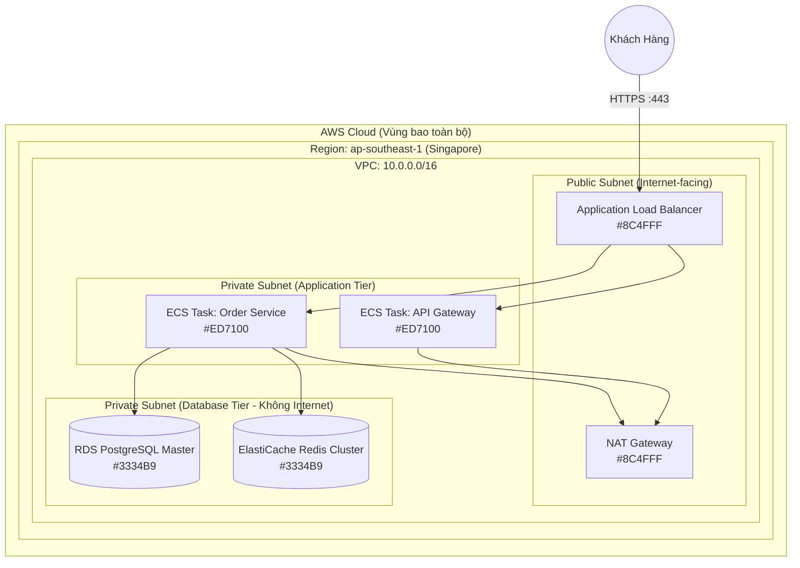

# Quy Chuẩn AWS Architecture Icons & Bố Cục Hạ Tầng Đám Mây (AWS 2024 Standard)

> **Loại: tham khảo.** Hướng dẫn công cụ vẽ sơ đồ, không phải nguồn luật. Khi khác `AGENTS.md`, vai trò hoặc `agents/protocols/` thì theo các nơi đó (`agents/protocols/source-precedence.md`).
> **Khác với chuẩn:** Chỉ áp dụng cho sơ đồ hạ tầng AWS; dự án không dùng AWS thì bỏ qua. Số liệu màu và icon theo bộ AWS 2024, cần đối chiếu bản mới nhất của AWS trước khi dùng cho tài liệu chính thức. Chuẩn nội dung sơ đồ: `../srs/chuan-ve-so-do.md`; công cụ nguồn của dự án: `quy-uoc-draw-io-va-archify.md`; phần chữ đi kèm sơ đồ: `mo-ta-hoat-dong-so-do.md`.

> **Mã định danh:** `aws-architecture-icons-guide`  
> **Chuyên mục:** Kiến trúc, Trực quan hóa & Vẽ sơ đồ tự động  
> **Trạng thái:** `draft` (Chờ nghiệm thu con người)  

Tài liệu này chuẩn hóa việc sử dụng biểu tượng, màu sắc và bố cục theo đúng **AWS Architecture Icon Guidelines (Bộ nhận diện chính thức 2024 của Amazon Web Services)**.

---

## 1. Bảng Màu Tiêu Chuẩn Các Nhóm Dịch Vụ AWS (Category Colors)

Mỗi nhóm dịch vụ trên AWS được gán một dải màu hex chuẩn để người xem nhận diện chức năng ngay lập tức:

| Nhóm Dịch Vụ AWS | Màu Hex Chính Thức | Tên Màu | Các Dịch Vụ Tiêu Biểu |
|---|---|---|---|
| **Compute (Điện toán)** | `#ED7100` | Cam AWS | EC2, Lambda, ECS, EKS, Fargate, Batch |
| **Database (Cơ sở dữ liệu)** | `#3334B9` | Xanh Lam Đậm | RDS (PostgreSQL/MySQL), DynamoDB, Aurora, ElastiCache |
| **Storage (Lưu trữ)** | `#277116` | Xanh Lá Cây | S3 (Simple Storage Service), EBS, EFS, Glacier |
| **Networking & CDN** | `#8C4FFF` | Tím | VPC, API Gateway, CloudFront, Route 53, ALB/NLB |
| **Security & Identity** | `#CC2264` | Đỏ Hồng | IAM, Cognito, KMS, Secrets Manager, AWS WAF, Shield |
| **Analytics (Phân tích dữ liệu)** | `#92278F` | Tím Mận | Athena, EMR, Redshift, Kinesis, OpenSearch |
| **Application Integration** | `#E7157B` | Hồng Đậm | SQS, SNS, EventBridge, Step Functions, Amazon MQ |
| **Management & Governance** | `#FF4F8B` | Hồng Phấn | CloudWatch, CloudTrail, Config, Systems Manager |

---

## 2. Quy Tắc Bố Cục Nhóm & Vành Đai Bảo Mật (Groups & Boundaries)

Trong thiết kế kiến trúc AWS chuẩn, hệ thống luôn được chia thành các vành đai lồng nhau:



### Quy Tắc Thiết Kế:
1. **Public Subnet:** Chỉ chứa các thành phần đón nhận lưu lượng từ bên ngoài (ALB, API Gateway, NAT Gateway, Bastion Host).
2. **Private Application Subnet:** Chứa các ứng dụng nghiệp vụ (ECS, EKS, EC2, Lambda). Tuyệt đối không gán Public IP.
3. **Private Database Subnet:** Chứa dữ liệu (RDS, Redis, DynamoDB VPC Endpoint). Hoàn toàn cách ly, không có đường ra Internet kể cả qua NAT Gateway.

---

## 3. Đoạn Mã Mẫu Draw.io CSV Chuẩn Bảng Màu AWS 2024

Đoạn mã sau áp dụng chính xác mã màu hex của AWS 2024 để dán vào Draw.io (`Arrange -> Insert -> Advanced -> CSV...`):

```csv
## AWS Production Architecture 2024
# label: <b style="color:%textcolor%;font-size:12px;">%name%</b><br><span style="font-size:10px;color:#666;">%tier%</span>
# style: shape=%shape%;fillColor=%fill%;strokeColor=%stroke%;html=1;whiteSpace=wrap;verticalLabelPosition=bottom;verticalAlign=top;
# namespace: aws-prod-
# connect: {"from":"refs", "to":"id", "style":"curved=1;endArrow=block;strokeWidth=1.5;strokeColor=#4A90E2;"}
# width: 65
# height: 65
# nodespacing: 50
# levelspacing: 60
# layout: horizontaltree
# ignore: id,shape,fill,stroke,refs,textcolor
id,name,tier,shape,fill,stroke,textcolor,refs
1,Client Traffic,External,mxgraph.aws4.mobile,#ffffff,#666666,#333333,
2,CloudFront CDN,Edge Network,mxgraph.aws4.cloudfront,#8C4FFF,#ffffff,#8C4FFF,1
3,ALB Load Balancer,Public Subnet,mxgraph.aws4.application_load_balancer,#8C4FFF,#ffffff,#8C4FFF,2
4,Order Microservice,App Private Subnet,mxgraph.aws4.ecs,#ED7100,#ffffff,#ED7100,3
5,RDS PostgreSQL,Data Private Subnet,mxgraph.aws4.rds_postgresql,#3334B9,#ffffff,#3334B9,4
6,ElastiCache Redis,Data Private Subnet,mxgraph.aws4.elasticache_redis,#3334B9,#ffffff,#3334B9,4
7,S3 Static Assets,Storage Tier,mxgraph.aws4.s3,#277116,#ffffff,#277116,2
```
