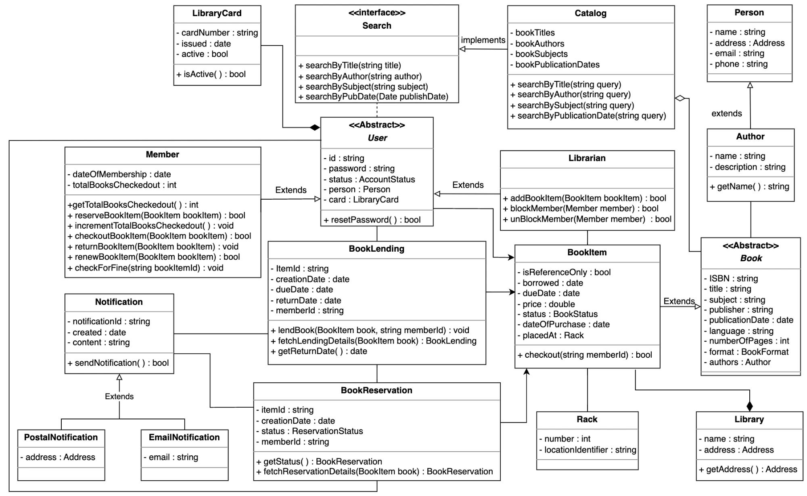
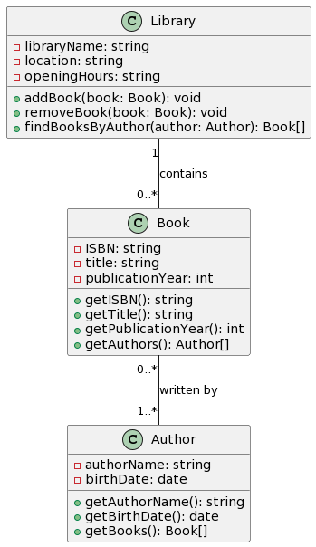
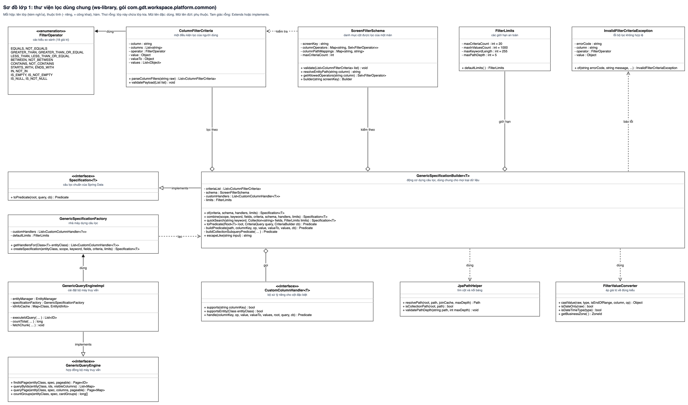
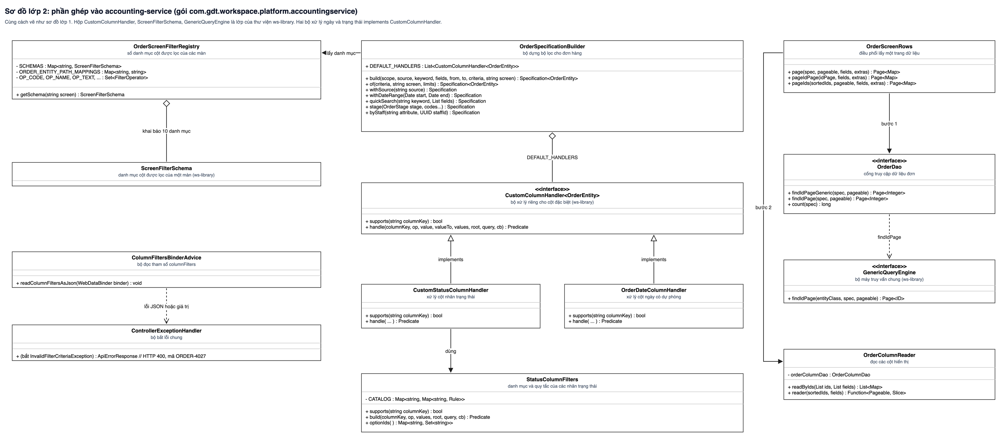
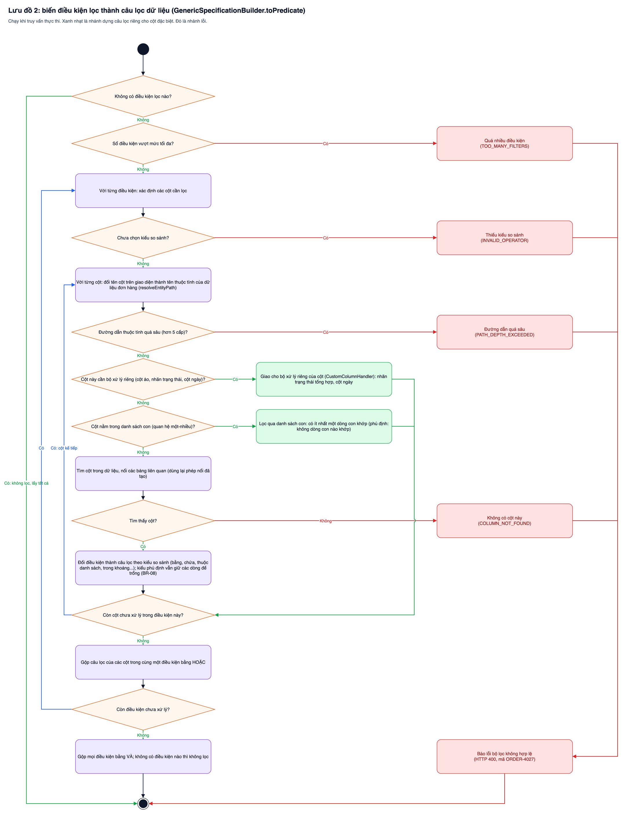
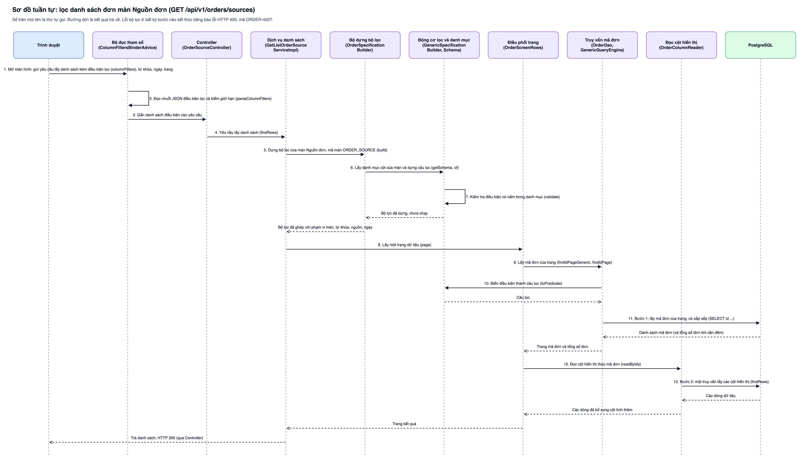
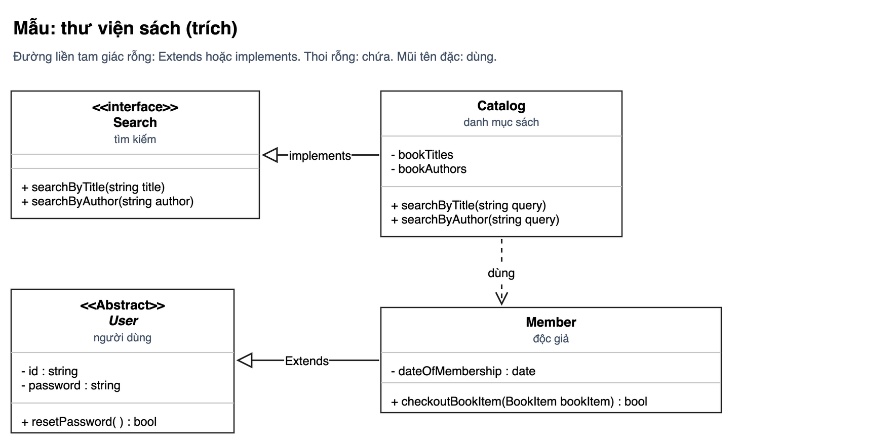

# Bài học viết tài liệu thiết kế, vẽ sơ đồ và bàn giao (rút từ chức năng xuất đơn sang đối tác vận chuyển)

> **Loại: tham khảo.** Tổng hợp bài học từ thực tế dự án, không phải nguồn luật. Khi khác `AGENTS.md`, vai trò hoặc `agents/protocols/` thì theo các nơi đó.

Áp dụng cho **mọi agent** (Claude, Gemini, Codex...) khi viết đặc tả thiết kế, vẽ sơ đồ `.drawio` và đưa tài liệu cho người khác đọc. Rút ra từ một chức năng tích hợp API đối tác dùng hàng đợi, nhiều consumer và tiến độ thời gian thực. Phần nào còn mang tên dự án riêng nằm ở `.ai-rules/` của dự án đó, không ở đây.

## 1. Vì sao có agent vẽ xong rồi tự xem và sửa, có agent không

Không phải do một mô hình "giỏi hơn". Do ba điều, và **điều nào thiếu thì agent dừng sau lần vẽ đầu**:
1. **Có công cụ mở ảnh.** Agent xem được PNG thì thấy chữ đè, mũi tên xuyên ô, nhãn bị cắt.
2. **Có vòng lặp được giao:** vẽ, xuất ảnh, mở ảnh, liệt kê lỗi, sửa, lặp. Lần vẽ đầu hầu như luôn có lỗi bố cục; hình sạch là kết quả của 2 đến 3 vòng.
3. **Quy tắc ghi rõ là bắt buộc**, kèm cách xử lý khi không làm được.

Quy tắc cho mọi agent:
- Vẽ xong **phải xuất ảnh và xem từng ảnh** (chi tiết `quy-uoc-draw-io-va-archify.md` mục 7).
- Agent không xem được ảnh: chạy kiểm tra bằng máy (`scripts/diagram-describe.py <file> --page "<tên>" --check`, và kiểm tên có trong code nếu dự án có) rồi **ghi rõ "chưa kiểm tra bằng mắt"**. Cấm nói "sơ đồ đẹp". Kiểm tra bằng máy chỉ bắt lỗi cấu trúc và tên; **không bắt được** chữ đè hay đường xuyên ô, nên người dùng vẫn là cổng cuối.
- Không báo xong khi mới "xuất được file".

## 2. Sửa sơ đồ mà người dùng đã chỉnh tay

1. Người dùng thường mở `.drawio` và chỉnh định dạng. **Không sinh lại cả tab** để sửa một chữ: mất định dạng của họ.
2. Sửa tại chỗ: đọc bằng `xml.etree.ElementTree`, chỉ đổi thuộc tính `value` của ô cần sửa, giữ nguyên `id`, tọa độ, `style`. Ký tự `&` viết `&amp;`. Ghi xong `ET.parse` lại để chắc file hợp lệ, rồi xuất ảnh.
3. Chỉ vẽ lại nguyên tab khi người dùng nói rõ ("vẽ lại cho chuẩn"), và nói rõ tab nào bị thay.
4. Khi người dùng đổi thiết kế (bỏ một nút, bỏ một khái niệm), **quét mọi sơ đồ, tài liệu, danh sách câu hỏi mở** để bỏ khái niệm cũ. Đừng chỉ sửa file đang mở. Lỗi hay gặp: còn nút "Dừng", màn đã bỏ, bảng "đợt xuất" đã loại.

## 3. Vẽ luồng có hàng đợi và nhiều consumer

- Làn tối thiểu: người dùng, giao diện, API, **hàng đợi**, **consumer**, hệ thống ngoài, bảng dữ liệu nguồn sự thật. Không gộp "API gọi hệ thống ngoài" thành một nút.
- Mũi tên vào hàng đợi ghi **nội dung tin**: mã bản ghi, người thực hiện, thời điểm đưa vào và **loại việc** (ví dụ tạo mới hay làm lại), để consumer biết xử lý thế nào khi nhiều tin cùng hàng.
- Luật cũ (19/10/2026), chỉ còn đúng cho `flow` và `swimlane`: mỗi sơ đồ có **một chấm bắt đầu và đúng một chấm kết thúc**, nhánh lỗi tô đỏ có chữ "LỖI". Từ 09/11/2026 sơ đồ hoạt động chính là `type: activity` (làn theo lớp, nhiều chấm đầu và cuối, đen trắng, nhánh lỗi viền đậm): xem `quy-trinh-ve-so-do-bang-json.md` mục 4.6.
- Kết quả của từng bản ghi ghi **vào bảng nguồn sự thật**, không giữ trong bộ nhớ hay bảng "lô" phụ khi người dùng đã chọn bỏ.
- Hạn mức của đối tác (số yêu cầu mỗi giây, mỗi ngày) là một thành phần riêng (bộ điều tiết) và xuất hiện trong luồng.

## 4. Viết tài liệu thiết kế khi chưa có code

- **Không nhắc code:** không tên lớp, gói, hàm. Viết hiện trạng (As-Is), mục tiêu (To-Be) và bảng "dùng lại, thay thế, bỏ, thêm mới".
- **Dùng đúng tên của tài liệu đối tác** (tên API, tên trường, mã lỗi) lấy từ trang tài liệu gốc, không tự đặt tên A, B, C.
- Mỗi API ngoài có: mô tả (khi nào gọi, để làm gì), bảng request (trường, kiểu, bắt buộc, ghi chú), bảng response, mã lỗi và cách xử lý. Mỗi API nội bộ có request và response mẫu. Thiếu mô tả hoặc thiếu response là chưa đạt.
- Webhook hay callback của đối tác: **mỗi loại có khóa và bộ mã riêng**. Đọc từng trang, không gộp về một mẫu tự nghĩ. Cùng một số mã có thể khác nghĩa ở hai loại; lập bảng đối chiếu các bộ mã với trạng thái nội bộ.
- Điều chưa chắc: gắn nhãn `[CHƯA KIỂM CHỨNG]` (chưa chạy sandbox) hoặc `[ĐỀ XUẤT]` (thiết kế mới, cần duyệt). Điều này gồm cả điều tài liệu đối tác không nêu (ví dụ API in nhãn có trả link không).
- **Trước khi khẳng định "code chưa có xử lý X", phải tra cứu qua XERJ (kèm `prefix`) và đọc code.** Từng khẳng định sai rằng code không xử lý mã trùng đơn trong khi code có.
- **Câu hỏi chờ xác nhận** là danh sách để chốt, mỗi câu có giá trị đề xuất và trạng thái; không viết như đã quyết. Câu nào chặn việc code thì nói rõ (cần hỏi nghiệp vụ, cần chạy sandbox).

## 5. Ảnh sơ đồ và link nguồn trong tài liệu

- Một file `.drawio` nhiều tab cho một chức năng; tên tab ổn định.
- Có tệp ánh xạ tên tab sang tên ảnh (ví dụ `_anh.json`) để tài liệu dẫn ảnh theo tên cố định, và xuất lại chỉ tab đã đổi (so băm). Màn hình mockup trong một tab lớn thì cắt theo khung.
- Dưới mỗi ảnh có dòng "Sơ đồ nguồn" trỏ tới tab trong draw.io. Link dạng `https://app.diagrams.net/?page-id=<id tab>#G<ID file Drive>` **chưa kiểm chứng** là nhảy đúng tab; `page-id` đổi nếu draw.io lưu lại file, khi đó gắn lại link.

## 6. Bàn giao lên Google Drive và Google Docs

Chi tiết lỗi định dạng: `agents/knowledge/srs/md-to-office-fidelity.md`. Thêm các điểm đã chạy thật:
- md là nguồn duy nhất; dựng docx ở máy; **chèn link tab trước khi dựng docx**.
- Không có CLI `gdrive` và công cụ Drive không tải được file vài MB: dùng trình duyệt (extension), bấm Mới, Tải tệp lên, tìm ô `input[type=file]` ẩn rồi gửi file. Không đọc cookie hay chuỗi truy vấn bằng JavaScript (bị chặn).
- Mở docx trong Google Docs, Tệp, Lưu dưới dạng Google Tài liệu. Kiểm bằng công cụ Drive: `mimeType` là Google Docs; đọc nội dung và đếm `§§`, `Table of Contents`, `{{`, `| ---` đều bằng 0, số dòng "Sơ đồ nguồn" khớp số ảnh. Xem trang, bảng, ảnh vừa trang vẫn phải nhìn; chưa nhìn thì ghi "chưa kiểm tra bằng mắt".
- Không commit, không đẩy khi chưa được nói rõ. Không xóa file người dùng đã tải lên.

## 7. Viết tài liệu kỹ thuật cho người không đọc code

Người đọc tài liệu thiết kế (kế toán, PO, QA, lập trình viên mới) không đọc được tên lớp, tên hàm, tên biến. Người dùng từng chê thẳng: "viết như này ai hiểu được". Quy tắc:
- **Viết nghĩa trước, tên kỹ thuật sau, đặt trong ngoặc.** Ví dụ: "Danh mục cột được lọc của một màn (`ScreenFilterSchema`)". Áp dụng cho tiêu đề bảng, nhãn sơ đồ, bước giải thích, tên mục.
- **Bảng lớp, bảng hàm** có cột "Việc làm" bằng lời thường. Cột "Lỗi" nêu **tình huống gây lỗi**, mã nội bộ để trong ngoặc.
- **Mỗi lưu đồ:** một câu nêu mục đích, rồi các bước đánh số bằng lời thường, có ví dụ số cụ thể (ví dụ "đúng ngày 8/11" là từ 0h ngày 8/11 đến trước 0h ngày 9/11).
- **Mục hướng dẫn mở rộng (cookbook)** mở bằng bảng "Nói thường, Nghĩa, Tên trong code", rồi mới tới các bước. Mỗi bước: làm gì, sửa ở đâu, cách kiểm. Không kể lịch sử code cũ, không dán đoạn mã dài; chỉ khung mã ngắn có chú thích. Cuối mục có danh sách kiểm trước khi bàn giao.
- Khi giải thích một quy tắc, nói **lý do** (ví dụ vì sao kiểu phủ định phải giữ dòng để trống), không chỉ nêu quy tắc.

## 8. Sơ đồ lớp: mẫu chuẩn của dự án (có ảnh mẫu)

Ảnh mẫu chuẩn, người dùng xác nhận "cái này mới đúng" (thư viện sách):



Quy tắc rút ra từ mẫu:
- **Hộp trắng ba ngăn:** tên lớp in đậm giữa hộp; ngăn thuộc tính; ngăn hàm. Các ngăn ngăn nhau bằng vạch xám mảnh. **Không có biểu tượng C, I, E.**
- **Cách ghi:** thuộc tính `- tên : kiểu`; hàm `+ tên(kiểu tham số) : kiểu trả về`. Có khoảng trắng quanh dấu hai chấm; hàm không tham số ghi `( )`. `-` là riêng, `+` là công khai.
- **Interface và lớp trừu tượng:** dòng `<<interface>>` hoặc `<<Abstract>>` in đậm phía trên tên; tên lớp trừu tượng in nghiêng.
- **Quan hệ:**
  - Kế thừa, cài đặt interface: đường **liền**, tam giác rỗng, kèm nhãn `Extends` hoặc `implements`.
  - Phụ thuộc: đường đứt, không bắt buộc nhãn.
  - Kết tập (chứa nhưng sống độc lập): hình thoi **rỗng** ở phía chứa.
  - Hợp thành (chứa, cùng vòng đời): hình thoi **đặc** ở phía chứa.
  - Liên kết có hướng: mũi tên đặc.
  - **Không ghi số lượng** (`1`, `0..*`) trên đường.
- **Bố cục dày:** các lớp có quan hệ đặt kề nhau, đường vuông góc; khi không kề thì đi vòng quanh ngoài; không để đường cắt qua hộp khác.
- **Nghĩa tiếng Việt** (mục 7): dòng nhỏ thứ hai dưới tên lớp. Nghĩa từng hàm nằm ở bảng hàm trong tài liệu, không nhồi vào hộp.
- **Lỗi đã mắc, đừng lặp lại:** (0) ERD nối bảng với bảng (phải nối đúng cột khóa ngoại với cột khóa chính, mỗi cột một đường; khai báo `from_col`, `to_col`); (1) hộp chữ chạy dài; (2) bảng ba cột kiểu ERD (ERD chỉ dành cho bảng cơ sở dữ liệu); (3) vẽ theo mẫu PlantUML đơn giản có biểu tượng C, I và số lượng hai đầu, người dùng báo sai. Khi người dùng đưa ảnh mẫu, **nhìn kỹ từng chi tiết** (kiểu đầu mũi tên, biểu tượng, số lượng, cách ghi hàm) rồi mới vẽ; có hai ảnh mẫu khác nhau thì hỏi lại ảnh nào là chuẩn.
- Mẫu đơn giản cũ, **chỉ để tham khảo**, không phải chuẩn: 
- **Kỹ thuật draw.io:** tiêu đề dùng `html=1` thì phải thoát `<` thành `&lt;`, `>` thành `&gt;`, nếu không `<T>` biến mất khỏi tên lớp. Nối các hộp bằng điểm neo 4 pixel thay vì nối vào ô, để tự chọn điểm đầu cuối. Hộp lớp gồm một khung ngoài và các ô chữ không viền bên trong, ngăn nhau bằng ô cao 1 pixel màu xám.
- **Bản áp dụng:**  và . Mã vẽ: `scripts/ve_uc04_lop_bang.py` của dự án gdt-workspace (hàm `uml`, `line`; các loại quan hệ `ext`, `agg`, `comp`, `assoc`, `dep`).

## 9. Lưu đồ thuật toán và sơ đồ tuần tự theo hàm

- **(Luật cũ, đã thay từ 09/11/2026: không tách mỗi thuật toán thành một lưu đồ hay một tab riêng; thuật toán chi tiết thành làn và nhánh của MỘT sơ đồ `activity`, xem `quy-trinh-ve-so-do-bang-json.md` mục 4.7.)** Cách cũ: một lưu đồ cho một thuật toán (kiểm danh mục cho phép, dựng điều kiện, phân trang...), mỗi lưu đồ một chấm bắt đầu, một chấm kết thúc, nhánh lỗi tô đỏ dồn về một nút lỗi chung.
- **Điểm gộp hai nhánh dùng hình tròn nhỏ, không dùng hình thoi.** `srs-check.py` coi mọi hình thoi là nút quyết định và báo thiếu nhánh có nhãn.
- **Nhãn bằng lời thường**, tên hàm hoặc mã lỗi nội bộ trong ngoặc.
- **Sơ đồ tuần tự:** chỉ đánh số lời gọi, không đánh số dòng trả về; nhãn đặt phía trên đường (`verticalAlign=bottom`), nếu để giữa đường thì nhãn dài che mất mũi tên.
- **Xem từng ảnh sau mỗi lần xuất.** Lỗi hay gặp: đường xuyên qua nút khác, hai đường chồng nhau (tách bằng điểm gộp hoặc dời đường chạy chung ra khoảng trống), nhãn cắt mép trang.
- Bản áp dụng:  và .

## 10. Bài học khi đối chiếu thiết kế với code

- Đọc cả cách **tra danh mục cho phép**: nếu mã màn lạ hoặc trống mà hàm tra trả `null` và bộ lọc chạy không có danh mục thì đó là lỗ hổng (mặc định mở). Ghi vào câu hỏi mở kèm đề xuất từ chối; không im lặng.
- Giới hạn của kiểu có sẵn (ví dụ `Map.of` chỉ tối đa 10 cặp, mà danh mục màn đã đủ 10) phải ghi vào hướng dẫn thêm màn.
- Số thứ tự màn trong chú thích code có thể lệch số trên mockup; ghi câu hỏi mở thay vì tự chọn.
- Trước khi ghi tên lớp vào bảng truy vết (RTM), kiểm lớp có thật; đã gặp tên lớp bịa trong bảng.
- Khi gọi `xerj_def` / `xerj_search`, **luôn truyền `prefix` dự án** (ví dụ `prefix="gdt"`, thiếu `prefix` sẽ tìm trên `ax-*` ra 0 kết quả). Nếu chỉ mục chưa phủ thư mục cần đọc: đọc thẳng từng file theo đường dẫn (`read_file`), và nói rõ chỉ mục chưa phủ thư mục đó; chỉ dùng `safe-search.py` (giới hạn 10 dòng, max 20) cho chuỗi text thuần/i18n/nhãn UI, không dùng thay `xerj` để tìm class/enum.

## 11. Công cụ vẽ chung cho mọi agent (kể cả agent không xem được ảnh)

**Đây là quy trình BẮT BUỘC, đã ghim vào `AGENTS.md` mục 21 (agent-base) và `AGENTS.md` của gdt-workspace:** đọc mẫu chuẩn, lập bảng sự thật, **viết JSON trước**, kiểm `--check-only`, sinh draw.io và ảnh, xem ảnh (hoặc ghi "chưa xem ảnh"), nhúng vào tài liệu, báo cáo. Không viết XML draw.io hay tính tọa độ bằng tay cho sơ đồ lớp. Sai thì sửa JSON rồi chạy lại.

**Agent làm tốt (Claude) vẽ bằng gì:** viết một script Python tính tọa độ và ghi file `.drawio` (XML), xuất ảnh bằng dòng lệnh draw.io Desktop, **mở ảnh PNG bằng công cụ đọc ảnh**, thấy lỗi rồi sửa script và vẽ lại, lặp đến khi sạch. Không có thao tác "vẽ tay" nào.

**Vì sao agent khác (ví dụ Gemini) vẽ không ra:** chưa kiểm chứng nguyên nhân riêng của từng mô hình. Theo mục 1, có ba nguyên nhân khả dĩ: không có công cụ mở ảnh, không có vòng lặp xuất ảnh rồi sửa, và phải tự tính tọa độ từng hộp từng đường nên sai ngay lần đầu mà không biết. Giải pháp là **bỏ việc tính tọa độ khỏi agent** và thay bằng công cụ có kiểm lỗi bằng chữ.

**Công cụ:** `scripts/ve-so-do.py` (agent-base), dùng cho sơ đồ lớp, lưu đồ, tuần tự, ERD. Agent chỉ viết một file JSON mô tả; script tự bố trí hộp theo cột, nối đường, ghi `.drawio`, xuất `.png`, và in danh sách lỗi.

```bash
python3 ~/Documents/agent-base/scripts/ve-so-do.py --mau > so-do.json     # lấy file mẫu
python3 ~/Documents/agent-base/scripts/ve-so-do.py so-do.json             # vẽ, xuất ảnh, kiểm
python3 ~/Documents/agent-base/scripts/ve-so-do.py so-do.json --check-only # chỉ kiểm bằng chữ
```

Mẫu JSON và ảnh kết quả: `agents/knowledge/diagrams/mau-so-do-lop.json`, 

| Trường | Ý nghĩa |
|---|---|
| `title`, `note`, `out`, `png`, `page` | Tiêu đề, dòng chú thích, tên file `.drawio`, tên file ảnh, tên trang |
| `classes[].id`, `name`, `sub` | Mã lớp (để nối), tên lớp, nghĩa tiếng Việt |
| `classes[].stereo`, `abstract` | `interface`, `enumeration`, `Abstract` (in `<<...>>`); `abstract: true` in nghiêng tên |
| `classes[].attrs`, `methods` | Dòng thuộc tính `- tên : kiểu`, dòng hàm `+ tên(kiểu tham số) : kiểu` (đúng mẫu mục 8) |
| `classes[].col` | Cột từ trái sang phải (0, 1, 2...); trong cột xếp từ trên xuống theo thứ tự khai báo. Lớp có quan hệ đặt cột kề nhau |
| `classes[].w`, `x`, `y` | Tùy chọn: chiều rộng, hoặc ép vị trí |
| `relations[].from`, `to`, `kind`, `label` | `kind`: `ext` (Extends, implements), `agg` (thoi rỗng, `from` là phía chứa), `comp` (thoi đặc), `assoc` (mũi tên đặc), `dep` (đứt, mũi tên mở) |
| `relations[].via` | Tùy chọn: hoành độ của đường vòng ngoài khi hai lớp không kề nhau |

Cách làm cho agent **không xem được ảnh:**
1. Viết JSON, chạy lệnh, đọc phần in ra. `LỖI` (hộp chồng nhau, quan hệ trỏ lớp không có) phải sửa. `CẢNH BÁO` (đường cắt qua hộp, dòng quá dài) phải sửa bằng cách đổi cột, thêm `via`, hoặc tăng `w`, hoặc ghi rõ trong báo cáo vì sao chấp nhận.
2. Lặp đến khi `KIỂM: đạt (0 cảnh báo)`.
3. Báo cáo ghi rõ **"chưa xem ảnh, mới kiểm bằng script"**; không báo "đã kiểm hình". Nhờ người hoặc agent khác xem ảnh nếu có thể.

Cách làm cho agent **xem được ảnh:** như trên, rồi mở PNG xem từng hộp và đường, sửa JSON, vẽ lại.

Chuẩn từng loại, JSON mẫu của lưu đồ, tuần tự, ERD và quy trình đầy đủ: `quy-trinh-ve-so-do-bang-json.md` (cùng thư mục). Các bảng JSON ở trên là của sơ đồ lớp. Loại chưa có công cụ JSON (use case, hoạt động nhiều làn bơi, mockup, kiến trúc) theo mục 6 của file đó. Cần draw.io Desktop để xuất ảnh (`brew install --cask drawio`); không có thì script vẫn ghi `.drawio` và kiểm lỗi, chỉ không xuất ảnh. **Chưa kiểm chứng** bằng agent Gemini.

## 12. Báo cáo trung thực khi nộp

Nói rõ: đã kiểm cái gì, chưa kiểm cái gì, còn lỗi gì chấp nhận được (ví dụ thiếu mục kiểm thử khi chưa viết test case), điều nào chặn việc tiếp theo. Không khẳng định điều chưa kiểm chứng.
