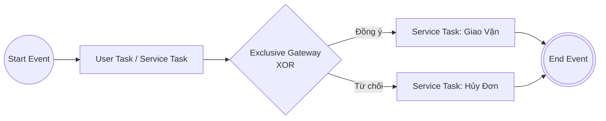

# Cẩm Nang Quy Trình Nghiệp Vụ Chuẩn BPMN 2.0 (Camunda Standard)

> **Loại: tham khảo.** Hướng dẫn công cụ vẽ sơ đồ, không phải nguồn luật. Khi khác `AGENTS.md`, vai trò hoặc `agents/protocols/` thì theo các nơi đó (`agents/protocols/source-precedence.md`).
> **Khác với chuẩn:** BPMN 2.0 là chuẩn quy trình nghiệp vụ rộng; sơ đồ nghiệp vụ nhiều bộ phận của dự án hiện vẽ bằng draw.io bơi làn. Cần Camunda Modeler hoặc công cụ BPMN riêng, chưa có trong khung. Chuẩn nội dung sơ đồ: `../srs/chuan-ve-so-do.md`; công cụ nguồn của dự án: `quy-uoc-draw-io-va-archify.md`; phần chữ đi kèm sơ đồ: `mo-ta-hoat-dong-so-do.md`.

> **Mã định danh:** `bpmn-20-camunda-guide`  
> **Chuyên mục:** Kiến trúc, Trực quan hóa & Vẽ sơ đồ tự động  
> **Trạng thái:** `draft` (Chờ nghiệm thu con người)  

---

## 1. Giới Thiệu Chuẩn BPMN 2.0

**BPMN 2.0** (Business Process Model and Notation - chuẩn ISO/IEC 19510 quản lý bởi tổ chức OMG) là ngôn ngữ đồ họa chuẩn quốc tế để mô hình hóa các quy trình nghiệp vụ doanh nghiệp. Chuẩn này được hỗ trợ toàn diện bởi các workflow engine hàng đầu thế giới như **Camunda (Camunda 7 & Camunda 8 Zeebe)**, Flowable, Activiti và jBPM.

---

## 2. Các Khối Cốt Lõi Trong BPMN 2.0



### 2.1. Nhóm Sự Kiện (Events)
- **Start Event (Sự kiện bắt đầu):** Vòng tròn nét đơn mảnh `○`. Kích hoạt khi có tín hiệu mới (Timer, Message, HTTP Request).
- **Intermediate Event (Sự kiện trung gian):** Vòng tròn nét đôi `◎`. Tạm dừng quy trình để đợi một sự kiện (ví dụ: chờ webhook bưu cục sau 24h).
- **End Event (Sự kiện kết thúc):** Vòng tròn nét đậm `●`. Kết thúc nhánh quy trình hoặc toàn bộ quy trình.
- **Boundary Event (Sự kiện biên bắt lỗi/hết hạn):** Gắn trên cạnh của một Task (ví dụ: bắt lỗi Timeout khi gọi API J&T).

### 2.2. Nhóm Tác Vụ (Tasks / Activities)
- **Service Task:** Hình chữ nhật có biểu tượng bánh răng ⚙️. Tự động thực thi bằng mã nguồn Java/Spring hoặc Worker (không cần can thiệp con người).
- **User Task:** Hình chữ nhật có biểu tượng người 👤. Giao diện chờ nhân viên thao tác (ví dụ: Kế toán duyệt đối soát thủ công).
- **Script Task / Business Rule Task:** Tác vụ chạy script tính toán hoặc bảng quyết định DMN.

### 2.3. Nhóm Cổng Phân Nhánh (Gateways)
- **Exclusive Gateway (XOR - Ký hiệu `X`):** Chỉ chọn DUY NHẤT một nhánh thỏa mãn điều kiện.
- **Parallel Gateway (AND - Ký hiệu `+`):** Kích hoạt ĐỒNG THỜI tất cả các nhánh song song và chờ gom đủ mới đi tiếp.
- **Inclusive Gateway (OR - Ký hiệu `O`):** Kích hoạt một hoặc nhiều nhánh thỏa mãn điều kiện.

### 2.4. Phân Làn (Pools & Lanes)
- **Pool (Bể chứa):** Đại diện cho một tổ chức hoặc hệ thống độc lập (ví dụ: Pool Khách Hàng, Pool Hệ Thống GDT, Pool Bưu Cục J&T).
- **Lane (Làn đường):** Đại diện cho một phòng ban hoặc vai trò bên trong tổ chức (ví dụ: Lane Nhân Viên Bán Hàng, Lane Kế Toán Kho).

---

## 3. Mẫu Quy Trình Nghiệp Vụ: Xử Lý Đơn Hàng & Giao Vận J&T

### 3.1. Mô Tả Luồng Nghiệp Vụ
1. Khách hàng tạo đơn hàng qua Web/Mobile (`Start Event: OrderPlaced`).
2. Hệ thống tự động kiểm tra tồn kho (`Service Task: CheckInventory`).
3. Cổng điều kiện XOR:
   - Nếu hết hàng $\rightarrow$ Hủy đơn, hoàn tiền (`Service Task: RefundOrder`) $\rightarrow$ Kết thúc thất bại.
   - Nếu còn hàng $\rightarrow$ Khóa tồn kho và tạo vận đơn đối tác J&T (`Service Task: PushJnTWaybill`).
4. Chờ sự kiện webhook trạng thái từ bưu cục (`Intermediate Catch Event: JntStatusUpdated`).
5. Cổng điều kiện XOR theo trạng thái giao hàng:
   - Giao thành công $\rightarrow$ Kế toán ghi nhận doanh thu COD (`Service Task: RecordRevenue`) $\rightarrow$ Kết thúc thành công.
   - Giao thất bại / Hoàn hàng $\rightarrow$ Nhập kho lại (`Service Task: RestockInventory`) $\rightarrow$ Kết thúc hoàn đơn.

### 3.2. Đoạn Mã XML BPMN 2.0 Chuẩn Cho Camunda Engine

```xml
<?xml version="1.0" encoding="UTF-8"?>
<bpmn:definitions xmlns:bpmn="http://www.omg.org/spec/BPMN/20100524/MODEL"
                  xmlns:camunda="http://camunda.org/schema/1.0/bpmn"
                  targetNamespace="http://example.com/bpmn/orders">
  
  <bpmn:process id="Process_OrderFulfillment" name="Quy Trình Xử Lý Đơn Hàng" isExecutable="true">
    
    <!-- 1. Sự kiện bắt đầu -->
    <bpmn:startEvent id="Start_OrderCreated" name="Đơn hàng được tạo">
      <bpmn:outgoing>Flow_1</bpmn:outgoing>
    </bpmn:startEvent>

    <!-- 2. Kiểm tra kho tự động -->
    <bpmn:serviceTask id="Task_CheckStock" name="Kiểm tra tồn kho" 
                      camunda:delegateExpression="${checkInventoryDelegate}">
      <bpmn:incoming>Flow_1</bpmn:incoming>
      <bpmn:outgoing>Flow_2</bpmn:outgoing>
    </bpmn:serviceTask>

    <!-- 3. Cổng phân nhánh XOR -->
    <bpmn:exclusiveGateway id="Gateway_StockCheck" name="Đủ hàng?">
      <bpmn:incoming>Flow_2</bpmn:incoming>
      <bpmn:outgoing>Flow_StockYes</bpmn:outgoing>
      <bpmn:outgoing>Flow_StockNo</bpmn:outgoing>
    </bpmn:exclusiveGateway>

    <!-- Nhánh còn hàng: Đẩy sang J&T -->
    <bpmn:serviceTask id="Task_PushJnT" name="Đẩy vận đơn sang J&T"
                      camunda:delegateExpression="${pushJntWaybillDelegate}">
      <bpmn:incoming>Flow_StockYes</bpmn:incoming>
      <bpmn:outgoing>Flow_ToEndSuccess</bpmn:outgoing>
    </bpmn:serviceTask>

    <!-- Nhánh hết hàng: Hủy đơn -->
    <bpmn:serviceTask id="Task_CancelOrder" name="Hủy đơn &amp; Báo khách"
                      camunda:delegateExpression="${cancelOrderDelegate}">
      <bpmn:incoming>Flow_StockNo</bpmn:incoming>
      <bpmn:outgoing>Flow_ToEndFail</bpmn:outgoing>
    </bpmn:serviceTask>

    <!-- 4. Các sự kiện kết thúc -->
    <bpmn:endEvent id="End_Success" name="Đã giao cho bưu cục">
      <bpmn:incoming>Flow_ToEndSuccess</bpmn:incoming>
    </bpmn:endEvent>

    <bpmn:endEvent id="End_Cancelled" name="Đơn hàng đã hủy">
      <bpmn:incoming>Flow_ToEndFail</bpmn:incoming>
    </bpmn:endEvent>

  </bpmn:process>
</bpmn:definitions>
```

---

## 4. Công Cụ Làm Việc Chuẩn Với BPMN 2.0

- **Camunda Modeler (Desktop):** Công cụ thiết kế trực quan mở, cho phép cấu hình Java Delegate, Form Data và xuất file `.bpmn`.
- **bpmn-js (Web Viewer/Editor):** Thư viện JavaScript mã nguồn mở cho phép nhúng trực tiếp giao diện xem và chỉnh sửa BPMN vào Single-Page App (React).
