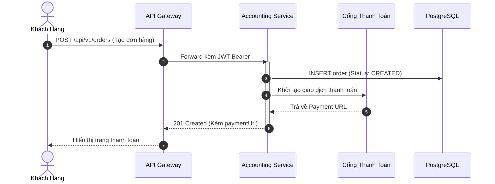
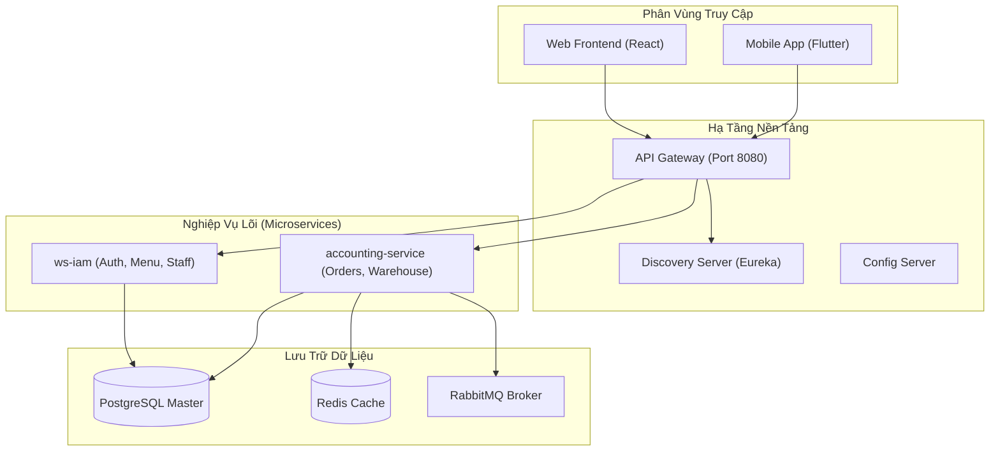
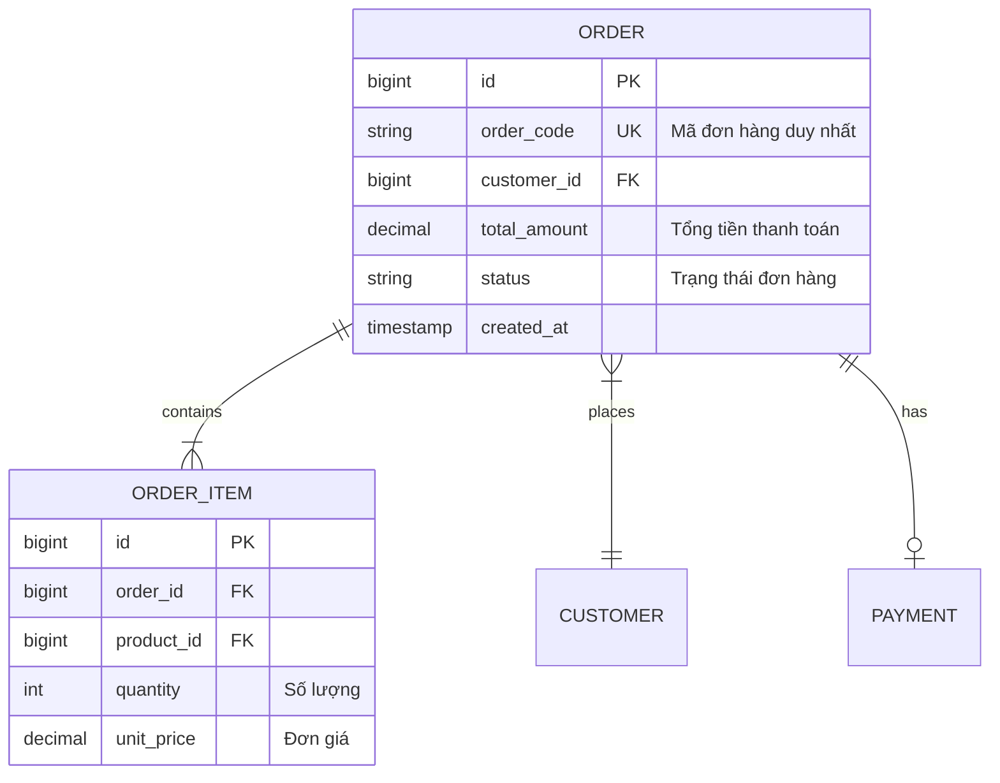

# Cẩm Nang Cú Pháp Mermaid & Tích Hợp Draw.io

> **Loại: tham khảo.** Hướng dẫn công cụ vẽ sơ đồ, không phải nguồn luật. Khi khác `AGENTS.md`, vai trò hoặc `agents/protocols/` thì theo các nơi đó (`agents/protocols/source-precedence.md`).
> **Khác với chuẩn:** Dùng cho sơ đồ nhỏ nằm trong md. Khung xem md có thể không vẽ Mermaid, nên luôn kèm mô tả chữ (`mo-ta-hoat-dong-so-do.md`). Chuẩn nội dung sơ đồ: `../srs/chuan-ve-so-do.md`; công cụ nguồn của dự án: `quy-uoc-draw-io-va-archify.md`; phần chữ đi kèm sơ đồ: `mo-ta-hoat-dong-so-do.md`.

> **Mã định danh:** `mermaid-syntax-guide`  
> **Chuyên mục:** Kiến trúc, Trực quan hóa & Vẽ sơ đồ tự động  
> **Trạng thái:** `draft` (Chờ nghiệm thu con người)  

---

## 1. Tổng Quan & Cơ Chế Import Vào Draw.io

Mermaid.js là ngôn ngữ vẽ sơ đồ bằng văn bản (Text-to-Diagram) phổ biến nhất hiện nay, được hỗ trợ nguyên bản trên GitHub, GitLab, Notion, Obsidian và Antigravity Markdown Artifacts.

**Tích hợp với Draw.io:**
Người dùng có thể vẽ nhanh bằng Mermaid rồi chuyển sang Draw.io để kéo thả chỉnh sửa nâng cao:
👉 **`Arrange` $\rightarrow$ `Insert` $\rightarrow$ `Advanced` $\rightarrow$ `Mermaid`** $\rightarrow$ Dán mã Mermaid vào và bấm Insert. Draw.io sẽ tự động dựng hình và dàn trang hoàn chỉnh.

---

## 2. Các Mẫu Sơ Đồ Mermaid Phổ Biến

### 2.1. Sequence Diagram (Luồng Giao Dịch / API Gọi Nhau)

### 2.2. Flowchart & Subgraphs (Phân Vùng Kiến Trúc)

> [!IMPORTANT]
> **Quy tắc an toàn Mermaid:** Luôn bọc nhãn có dấu ngoặc đơn hoặc ký tự đặc biệt trong dấu ngoặc kép: `id["Nhãn (Chi tiết)"]`. Tránh dùng thẻ HTML phức tạp bên trong node.

---

## 3. Mermaid v11: Architecture Diagram (architecture-beta)

Từ phiên bản Mermaid v11+, cú pháp `architecture-beta` cho phép mô tả kiến trúc hạ tầng trực tiếp kết hợp bộ biểu tượng Iconify:

---

## 4. Entity-Relationship Diagram (ERD / Database Schema)

