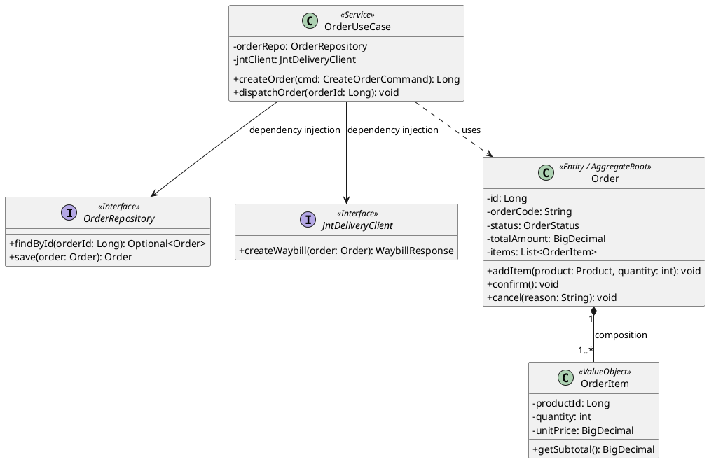
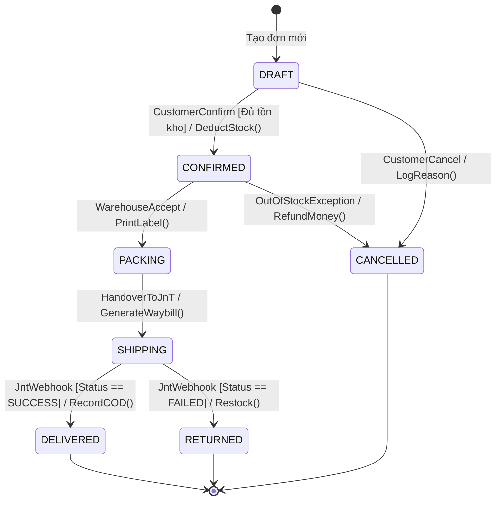
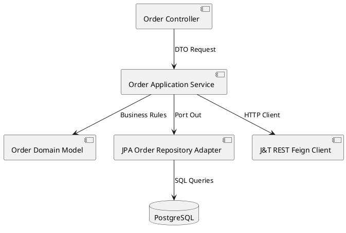

# Cẩm Nang Cú Pháp UML 2.5.1 (Chuẩn OMG & Tra Cứu Thực Chiến)

> **Loại: tham khảo.** Hướng dẫn công cụ vẽ sơ đồ, không phải nguồn luật. Khi khác `AGENTS.md`, vai trò hoặc `agents/protocols/` thì theo các nơi đó (`agents/protocols/source-precedence.md`).
> **Khác với chuẩn:** Tra cứu cú pháp UML; loại sơ đồ nào bắt buộc cho một chức năng quyết định ở `../srs/chuan-ve-so-do.md` mục 1. Chuẩn nội dung sơ đồ: `../srs/chuan-ve-so-do.md`; công cụ nguồn của dự án: `quy-uoc-draw-io-va-archify.md`; phần chữ đi kèm sơ đồ: `mo-ta-hoat-dong-so-do.md`.

> **Mã định danh:** `uml-25-guide`  
> **Chuyên mục:** Kiến trúc, Trực quan hóa & Vẽ sơ đồ tự động  
> **Trạng thái:** `draft` (Chờ nghiệm thu con người)  

---

## 1. Tổng Quan Chuẩn UML 2.5.1 (OMG Specification)

UML 2.5.1 (Unified Modeling Language - Tổ chức OMG) phân chia hệ thống thành 2 nhánh lớn với tổng cộng 14 loại biểu đồ:
- **Biểu đồ Cấu trúc (Structure Diagrams):** Class, Component, Deployment, Package, Object, Composite Structure.
- **Biểu đồ Hành vi (Behavior Diagrams):** Use Case, Activity, State Machine, và nhóm tương tác (Sequence, Communication, Timing, Interaction Overview).

Trong kỹ nghệ phần mềm thực chiến, Agent tập trung vào **4 biểu đồ cốt lõi**: Class Diagram, Sequence Diagram, State Machine và Component Diagram.

---

## 2. Class Diagram & Chuẩn Ký Hiệu Mối Quan Hệ (Relationships)

Ký hiệu mối quan hệ giữa các lớp trong UML 2.5.1 phải tuân thủ nghiêm ngặt chuẩn hình học:

| Mối quan hệ | Tên gọi chuẩn | Ký hiệu mũi tên | Ý nghĩa & Vòng đời | Ví dụ thực tế |
|---|---|---|---|---|
| **Inheritance** | Kế thừa (Generalization) | `──▷` (Mũi tên tam giác rỗng, nét liền) | Lớp con kế thừa lớp cha (`is-a`) | `Dog` kế thừa `Animal` |
| **Realization** | Triển khai Interface | `╌╌▷` (Mũi tên tam giác rỗng, nét đứt) | Class cài đặt Interface (`implements`) | `OrderServiceImpl` implements `OrderService` |
| **Composition** | Hợp thành chặt chẽ | `──◆` (Hình thoi đen đặc, nét liền) | Phần tử con không thể tồn tại độc lập nếu phần tử cha bị hủy (`part-of`) | `Order` chứa `OrderItem` (xóa Order thì xóa luôn Items) |
| **Aggregation** | Thu nạp lỏng lẻo | `──◇` (Hình thoi trắng rỗng, nét liền) | Phần tử con có thể tồn tại độc lập với phần tử cha (`has-a`) | `Department` có `Employee` (giải tán phòng ban, nhân viên vẫn còn) |
| **Association** | Liên kết thông thường | `──>` (Mũi tên đơn, nét liền) | Một đối tượng giữ tham chiếu đến đối tượng khác | `Order` liên kết với `Customer` |
| **Dependency** | Phụ thuộc tạm thời | `╌╌>` (Mũi tên đơn, nét đứt) | Sử dụng qua tham số hàm hoặc biến cục bộ (`uses-a`) | `OrderService` phụ thuộc `PaymentClient` |

### 2.1. Mã Mẫu Class Diagram Trong Clean Architecture (PlantUML)

---

## 3. State Machine Diagram (Vòng Đời Trạng Thái Đơn Hàng)

Mô tả sự chuyển đổi trạng thái của thực thể kèm **Sự kiện (Event)**, **Điều kiện bảo vệ (Guard `[condition]`)** và **Hành động (Action `/action`)**.

---

## 4. Component Diagram (Ranh Giới Thành Phần Phần Mềm)

