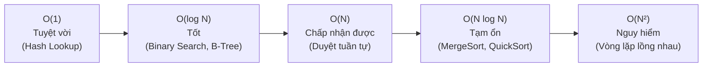

# Cẩm Nang Tối Ưu Độ Phức Tạp Thuật Toán (Big-O) & JVM Performance Tuning (Java 21)

> **Loại: tham khảo.**  
> **Mã định danh:** `big-o-and-jvm-performance-tuning`  
> **Chuyên mục:** Tối Ưu Hóa Thuật Toán, Cấu Trúc Dữ Liệu & Quản Trị Bộ Nhớ JVM  
> **Nguồn gốc:** Big-O Cheatsheet, Oracle JVM Garbage Collection Tuning Guide (Java 21 LTS)  
> **Trạng thái:** `draft` (Chờ nghiệm thu con người)  

---

## 1. Bản Đồ Độ Phức Tạp Thuật Toán & Cấu Trúc Dữ Liệu (Big-O Cheatsheet)

Việc lựa chọn đúng cấu trúc dữ liệu quyết định phần mềm chạy trong vài mili-giây hay bị nghẽn CPU hàng chục phút khi dữ liệu phình to.



### 1.1. Bảng Tra Cứu Hiệu Năng Các Cấu Trúc Dữ Liệu Java Phổ Biến

| Cấu trúc dữ liệu Java | Truy cập theo Index | Tìm kiếm theo Giá trị | Thêm phần tử | Xóa phần tử | Ứng dụng thực tế |
|---|---|---|---|---|---|
| **`ArrayList`** | $\mathcal{O}(1)$ | $\mathcal{O}(N)$ | $\mathcal{O}(1)$ khấu hao | $\mathcal{O}(N)$ | Danh sách đọc nhiều, ít xóa giữa chừng |
| **`LinkedList`** | $\mathcal{O}(N)$ | $\mathcal{O}(N)$ | $\mathcal{O}(1)$ đầu/cuối | $\mathcal{O}(1)$ khi có con trỏ | Hàng đợi hoặc danh sách thêm/xóa liên tục ở đầu |
| **`HashMap` / `HashSet`** | N/A | $\mathcal{O}(1)$ trung bình | $\mathcal{O}(1)$ | $\mathcal{O}(1)$ | Tra cứu nhanh theo khóa, lọc dữ liệu trùng lặp |
| **`TreeMap` / `TreeSet`** | N/A | $\mathcal{O}(\log N)$ | $\mathcal{O}(\log N)$ | $\mathcal{O}(\log N)$ | Duyệt phần tử theo thứ tự tự nhiên (Red-Black Tree) |
| **`PriorityQueue`** | $\mathcal{O}(1)$ xem đỉnh | $\mathcal{O}(N)$ | $\mathcal{O}(\log N)$ | $\mathcal{O}(\log N)$ lấy đỉnh | Hàng đợi ưu tiên, thuật toán lập lịch tác vụ |

### 1.2. Mẫu Chuyển Đổi Tối Ưu: Triệt Tiêu Vòng Lặp Lồng $\mathcal{O}(N^2) \rightarrow \mathcal{O}(N)$

**❌ Mã nguồn kém hiệu năng ($\mathcal{O}(N \times M)$ - Treo CPU khi có 10.000 phần tử):**
```java
// Duyệt lồng 2 danh sách để ghép thông tin khách hàng vào đơn hàng
for (Order order : orders) {
    for (Customer customer : customers) {
        if (order.getCustomerId().equals(customer.getId())) {
            order.setCustomerName(customer.getName());
            break;
        }
    }
}
```

**✅ Mã nguồn tối ưu ($\mathcal{O}(N + M)$ - Chạy dưới 10 mili-giây):**
```java
// Bước 1: Đưa danh sách khách hàng vào HashMap tra cứu O(1)
Map<Long, String> customerMap = customers.stream()
    .collect(Collectors.toMap(Customer::getId, Customer::getName));

// Bước 2: Duyệt danh sách đơn một lần duy nhất
for (Order order : orders) {
    String name = customerMap.get(order.getCustomerId());
    if (name != null) {
        order.setCustomerName(name);
    }
}
```

---

## 2. Quản Trị Bộ Nhớ JVM & Thuật Toán Thu Gom Rác (Java 21 LTS)

### 2.1. Phân Vùng Bộ Nhớ JVM Runtime
1. **Heap Memory:** Nơi lưu trữ toàn bộ các đối tượng (`new Object()`) và mảng dữ liệu.
   - **Young Generation:** Chứa đối tượng mới tạo (phân vùng Eden và hai vùng đệm Survivor S0, S1).
   - **Old / Tenured Generation:** Chứa các đối tượng sống sót qua nhiều chu kỳ Garbage Collection (như Spring Beans, Singletons, Cache).
2. **Metaspace:** Lưu trữ siêu dữ liệu của các Class được nạp (Class metadata, bytecode). Nằm ngoài Heap, sử dụng RAM tự nhiên của hệ điều hành.
3. **Thread Stack:** Lưu trữ các biến nguyên thủy cục bộ và con trỏ khung hàm (Frame) cho từng Thread.

### 2.2. So Sánh Hai Bộ Thu Gom Rác Hiện Đại: G1GC vs ZGC

| Tiêu chí | G1GC (Garbage-First GC - Mặc định) | Generational ZGC (Low-Latency GC) |
|---|---|---|
| **Cơ chế** | Chia Heap thành hàng ngàn vùng nhỏ, ưu tiên gom vùng chứa nhiều rác nhất | Thu gom rác song song đồng thời (Concurrent), dừng ứng dụng dưới 1ms |
| **Độ trễ dừng (STW Pause)** | Thường từ 50ms – 200ms | **Dưới 1 mili-giây**, độc lập với kích thước Heap |
| **Phù hợp với** | Ứng dụng nghiệp vụ thông thường, thông lượng cao (Throughput-oriented) | Hệ thống tài chính, giao dịch thời gian thực đòi hỏi độ trễ cực thấp (SLA < 10ms) |
| **Cờ kích hoạt** | `-XX:+UseG1GC -XX:MaxGCPauseMillis=100` | `-XX:+UseZGC -XX:+ZGenerational` |

### 2.3. Bốn Điểm Gây Rò Rỉ Bộ Nhớ (Memory Leak) Phổ Biến Trong Ứng Dụng Java
1. **Bộ sưu tập Static không giới hạn (Unbounded Static Collections):** Thêm dữ liệu vào `public static List<Event> list` mà không có cơ chế xóa hoặc TTL.
2. **Không đóng tài nguyên I/O (Unclosed Streams/Connections):** Quên đóng `InputStream`, `Connection` gây treo socket hệ điều hành $\rightarrow$ Luôn dùng cú pháp `try-with-resources`.
3. **Rò rỉ `ThreadLocal` trong Thread Pool:** Khi dùng Tomcat Thread Pool, nếu đặt dữ liệu vào `ThreadLocal` mà không gọi `threadLocal.remove()` trong khối `finally`, dữ liệu sẽ tồn tại vĩnh viễn trên luồng được tái sử dụng.
4. **Listener hoặc Callback không hủy đăng ký (Unregistered Observers):** Đăng ký lắng nghe sự kiện nhưng không hủy khi đối tượng hết vòng đời.
