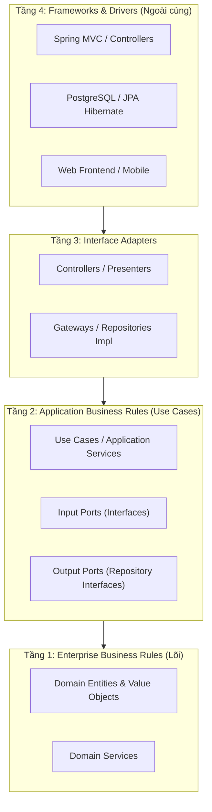

# Cẩm Nang Clean Architecture, Domain-Driven Design (DDD) & Mẫu Thiết Kế GoF

> **Loại: tham khảo.** Không phải nguồn luật; khi khác `AGENTS.md`, vai trò hoặc `agents/protocols/` thì theo các nơi đó.
> **Khác với chuẩn:** Bổ sung cho quy ước tầng ở `agents/stacks/java.md`; kiến trúc thực tế của từng dịch vụ theo tài liệu của dịch vụ đó.

> **Mã định danh:** `clean-architecture-and-ddd`  
> **Chuyên mục:** Kỹ thuật Phần mềm & Kiến trúc Hệ thống  
> **Nguồn gốc:** Robert C. Martin (Uncle Bob), Eric Evans (DDD), Microsoft Microservices Architecture, Refactoring.Guru  
> **Trạng thái:** `draft` (Chờ nghiệm thu con người)  

---

## 1. Clean Architecture (Robert C. Martin - Uncle Bob)

Mục tiêu tối thượng của Clean Architecture là tạo ra hệ thống **độc lập với Framework, độc lập với UI, độc lập với Database và độc lập với các tác nhân bên ngoài**, cho phép kiểm thử toàn bộ nghiệp vụ mà không cần bật Web Server hay CSDL.

### 1.1. Quy Tắc Phụ Thuộc Bất Biến (The Dependency Rule)
> **Mọi mũi tên phụ thuộc mã nguồn CHỈ ĐƯỢC PHÉP trỏ vào trong (Inward Dependency).**  
> Tầng bên trong TUYỆT ĐỐI không được biết bất kỳ điều gì về tầng bên ngoài:
- **Tầng 1 (Entities):** Chứa các quy tắc nghiệp vụ cốt lõi của doanh nghiệp. Không chứa annotation của Spring, JPA (`@Entity`, `@Table`) hay JSON (`@JsonProperty`).
- **Tầng 2 (Use Cases):** Chứa luồng điều phối nghiệp vụ ứng dụng. Định nghĩa các `Port In` (cho Controller gọi) và `Port Out` (Interface để gọi CSDL/Bưu cục).
- **Tầng 3 (Interface Adapters):** Chuyển đổi dữ liệu giữa định dạng thuận tiện cho Use Case và định dạng của công nghệ ngoài (DTO sang Domain Entity, Domain Entity sang JPA Entity).
- **Tầng 4 (Frameworks & Drivers):** Công nghệ cụ thể: Spring Boot, PostgreSQL, Redis, HTTP Clients, Kafka.

---

## 2. Domain-Driven Design (DDD) — Mô Hình Hóa Nghiệp Vụ Thực Tế

DDD (Eric Evans & Microsoft eShopOnContainers) giúp giải quyết độ phức tạp của phần mềm bằng cách bám sát **Ngôn ngữ chung (Ubiquitous Language)** và chia ranh giới theo **Bounded Context**.

### 2.1. Các Khái Niệm Chiến Thuật Cốt Lõi (Tactical Patterns)

| Khái niệm | Đặc điểm nhận dạng | Quy tắc thiết kế | Ví dụ thực tế |
|---|---|---|---|
| **Aggregate Root** | Entity đầu đàn kiểm soát toàn bộ vòng đời của một cụm đối tượng | Mọi truy cập, thêm/sửa/xóa từ bên ngoài BẮT BUỘC phải đi qua Aggregate Root | `Order` (gốc) kiểm soát danh sách `OrderItem` |
| **Entity** | Đối tượng có **định danh duy nhất (ID)** không đổi qua thời gian | So sánh bằng ID, trạng thái bên trong có thể biến đổi | `Customer` (có `customerId`), `Order` (có `orderId`) |
| **Value Object** | Đối tượng **KHÔNG CÓ ID**, đại diện cho một giá trị đo lường | **Bất biến (Immutable)**, so sánh bằng toàn bộ giá trị các trường. Muốn đổi phải tạo đối tượng mới | `Money(amount, currency)`, `Address(street, city)` |
| **Domain Event** | Ghi nhận một sự kiện nghiệp vụ quan trọng ĐÃ XẢY RA trong quá khứ | Dùng thì quá khứ, bất biến, mang theo dữ liệu sự kiện để lan tỏa ra bên ngoài | `OrderPlacedEvent`, `PaymentReceivedEvent` |
| **Repository** | Cổng trừu tượng để truy xuất và lưu trữ Aggregate Root | 1 Aggregate Root chỉ có tối đa 1 Repository; không tạo repo cho Entity con | `OrderRepository` (không tạo `OrderItemRepository`) |

### 2.2. CQRS Pattern (Command Query Responsibility Segregation)
Tách biệt hoàn toàn hai luồng:
- **Command (Ghi/Cập nhật):** Đi qua Domain Model, kiểm tra chặt chẽ Business Invariants và phát sinh Domain Events.
- **Query (Đọc/Hiển thị):** Bỏ qua Domain Model, dùng View DTO hoặc query trực tiếp từ Read Replica để tối ưu hóa hiệu năng và độ trễ.

---

## 3. Các Mẫu Thiết Kế GoF (Gang of Four) Thực Chiến

| Mẫu thiết kế | Nhóm GoF | Ứng dụng thực tế trong Clean Architecture | Ví dụ code Spring Boot |
|---|---|---|---|
| **Strategy** | Behavioral | Thay đổi thuật toán tính giá/vận chuyển lúc runtime mà không sửa code gọi | `@Component class JntShippingStrategy implements ShippingStrategy` |
| **Factory Method** | Creational | Đóng gói việc khởi tạo Aggregate Root phức tạp đảm bảo tính toàn vẹn | `OrderFactory.createNewOrder(customerId, items)` |
| **Adapter** | Structural | Kết nối Port Out của Domain với thư viện/API bên thứ 3 (Hexagonal Architecture) | `JntDeliveryAdapter implements DeliveryPort` |
| **Observer / Pub-Sub** | Behavioral | Xử lý Domain Events bất đồng bộ không làm chậm luồng chính | Spring `@EventListener` hoặc `ApplicationEventPublisher` |
| **Builder** | Creational | Khởi tạo các đối tượng có nhiều thuộc tính tùy chọn một cách an toàn | `@Builder` của Lombok hoặc Fluent Builder Pattern |
| **Decorator / Proxy** | Structural | Bổ sung tính năng Logging, Tracing, Retry, Caching mà không sửa logic gốc | Spring AOP (`@Transactional`, `@Cacheable`) |