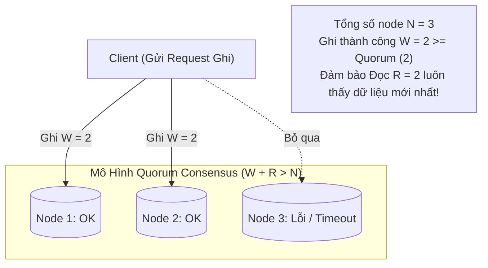

# Cẩm Nang Hệ Thống Phân Tán & Thiết Kế Dữ Liệu Quy Mô Lớn (DDIA - Martin Kleppmann)

> **Loại: tham khảo.**  
> **Mã định danh:** `distributed-systems-and-ddia`  
> **Chuyên mục:** Kiến Trúc Hệ Thống Phân Tán, Mô Hình Lưu Trữ & Đồng Thuận Dữ Liệu  
> **Nguồn gốc:** Martin Kleppmann ("Designing Data-Intensive Applications" - DDIA), O'Reilly Media  
> **Trạng thái:** `draft` (Chờ nghiệm thu con người)  

---

## 1. Bản Chất Lưu Trữ Dữ Liệu: B-Trees vs LSM-Trees

Mọi hệ thống cơ sở dữ liệu đều được xây dựng dựa trên một trong hai cấu trúc lưu trữ cốt lõi:

| Tiêu chí so sánh | Cây B-Tree (PostgreSQL, MySQL InnoDB, Oracle) | Cây LSM-Tree & SSTables (Cassandra, RocksDB, LevelDB, Bigtable) |
|---|---|---|
| **Cơ chế ghi** | Ghi đè trực tiếp tại chỗ (In-place update) trên trang đĩa 8KB | Ghi nối tiếp vào cuối file (Append-only write) vào MemTable trên RAM rồi flush thành SSTable |
| **Hiệu năng Ghi (Write)** | Thấp hơn do phải tìm trang đĩa ngẫu nhiên (Random Disk I/O) | **Cực cao** do biến mọi thao tác ghi thành ghi tuần tự (Sequential I/O) |
| **Hiệu năng Đọc (Read)** | **Rất nhanh** vì duyệt cây B-Tree trực tiếp tới đúng trang dữ liệu | Chậm hơn vì có thể phải kiểm tra nhiều file SSTable (cần dùng Bloom Filter hỗ trợ) |
| **Hiện tượng phình đĩa** | Phình đĩa (Bloat) do Dead Tuples sau khi UPDATE | Được giải phóng định kỳ thông qua tiến trình nén gộp Compaction |
| **Phù hợp nhất với** | Hệ thống giao dịch tài chính đọc nhiều (OLTP, Kế toán) | Hệ thống ghi nhật ký thời gian thực, Log, Event Streaming khổng lồ |

---

## 2. Nhân Bản Dữ Liệu & Tính Đồng Thuận (Replication & Consensus)

Trong hệ thống phân tán, sự cố đứt kết nối mạng (Network Partition) là điều không thể tránh khỏi.

### 2.1. Điều Kiện Quorum Đảm Bảo Nhất Quán Mạnh ($W + R > N$)
Trong mô hình Leaderless (Amazon Dynamo, Cassandra):
- $N$: Tổng số bản sao dữ liệu (Replication Factor).
- $W$: Số lượng node phải xác nhận GHI thành công trước khi trả về cho client.
- $R$: Số lượng node phải ĐỌC và so sánh version trước khi trả lời client.
> **Quy tắc vàng:** Chỉ cần **$W + R > N$**, tập hợp các node ghi và tập hợp các node đọc chắc chắn sẽ giao nhau tại ít nhất một node có dữ liệu mới nhất (Overlap node) $\rightarrow$ Ngăn chặn hiện tượng đọc phải dữ liệu cũ (Stale Read).

### 2.2. Các Cấp Độ Cô Lập Giao Dịch (Transaction Isolation Levels)
1. **Read Committed:** Ngăn ngừa Dirty Reads (không đọc dữ liệu chưa commit) và Dirty Writes.
2. **Snapshot Isolation / MVCC (Multi-Version Concurrency Control):** Mỗi giao dịch nhìn thấy một bức ảnh chụp nhất quán tại thời điểm nó bắt đầu. Ngăn ngừa Non-repeatable Read. **Người đọc không bao giờ chặn người ghi, người ghi không bao giờ chặn người đọc.**
3. **Serializable:** Cấp độ cao nhất, mô phỏng như thể các giao dịch được thực thi tuần tự từng cái một. Giải quyết triệt để lỗi **Write Skew** (Hiện tượng hai bác sĩ cùng trực xin nghỉ cùng lúc do kiểm tra điều kiện độc lập) và Phantom Reads.

---

## 3. Sự Khác Biệt Giữa 2PC và Thuật Toán Đồng Thuận Raft / Paxos

| Tiêu chí | Two-Phase Commit (2PC / XA) | Thuật toán đồng thuận Raft / Paxos |
|---|---|---|
| **Cơ chế điều phối** | Dựa vào một Điều Phối Viên trung tâm (Coordinator) | Bầu chọn Leader phân tán tự động qua Quorum Vote |
| **Điểm nghẽn lỗi (SPOF)** | Nếu Coordinator sập giữa Phase 1 và Phase 2, toàn bộ hệ thống bị **treo cứng (Blocking)** | Nếu Leader sập, các node còn lại tự động bầu Leader mới trong vài mili-giây |
| **Khả năng chịu lỗi** | Yêu cầu 100% các node phải sống (0% chịu lỗi) | Chỉ cần đa số quá bán hoạt động (Cụm 3 node chịu được 1 node sập, cụm 5 node chịu được 2 node sập) |
| **Ứng dụng thực tế** | Cơ sở dữ liệu nguyên khối cũ | etcd (Kubernetes), CockroachDB, Apache Kafka KRaft |
