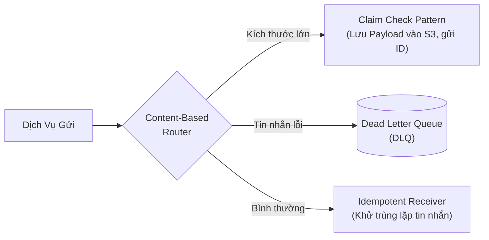
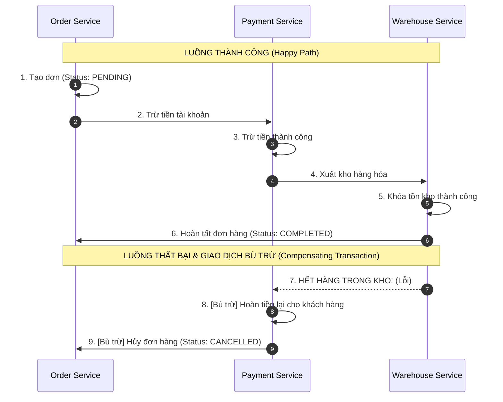
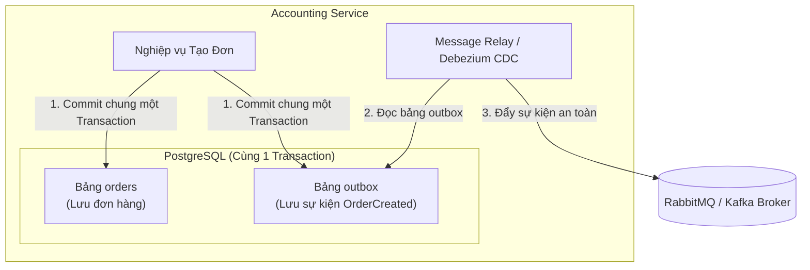

# Cẩm Nang Enterprise Integration Patterns (EIP) & Microservices Patterns (Saga, Outbox)

> **Loại: tham khảo.**  
> **Mã định danh:** `enterprise-integration-and-microservices-patterns`  
> **Chuyên mục:** Kiến Trúc Phân Tán, Tích Hợp Doanh Nghiệp & Giao Dịch Microservices  
> **Nguồn gốc:** Gregor Hohpe (Enterprise Integration Patterns - EIP), Chris Richardson (Microservices Patterns - microservices.io)  
> **Trạng thái:** `draft` (Chờ nghiệm thu con người)  

---

## 1. Enterprise Integration Patterns (EIP) — Xử Lý Bất Đồng Bộ & Xếp Hàng Đợi

Trong hệ thống hướng sự kiện (Event-Driven Architecture) với RabbitMQ hoặc Kafka, việc truyền nhận tin nhắn giữa các dịch vụ phải tuân thủ các mẫu tích hợp EIP để đảm bảo **tính toàn vẹn dữ liệu, khả năng mở rộng và chống mất mát tin nhắn**.

### 1.1. Các Mẫu EIP Thực Chiến Quan Trọng Nhất
1. **Idempotent Receiver (Bên nhận bất biến / Khử trùng lặp):**
   - **Thực tế:** Mạng phân tán chỉ đảm bảo cơ chế phân phối *At-least-once (Ít nhất một lần)*, tin nhắn có thể bị gửi lặp lại 2 lần do mạng chập chờn hoặc timeout.
   - **Giải pháp:** Bên nhận bắt buộc phải lưu `message_id` hoặc `event_id` vào Redis/PostgreSQL với ràng buộc Unique. Nếu thấy ID đã tồn tại thì bỏ qua (Ack thành công), không xử lý lại nghiệp vụ trừ tiền/tạo đơn.
2. **Dead Letter Queue (Hàng đợi tin nhắn chết - DLQ):**
   - Khi một tin nhắn bị lỗi cú pháp hoặc xử lý thất bại quá $N$ lần (ví dụ: 3 lần thử lại thất bại), tin nhắn được tự động đẩy vào DLQ để đội ngũ vận hành phân tích thủ công, **tuyệt đối không để tin nhắn lỗi gây nghẽn hàng đợi chính (Blocking Queue)**.
3. **Claim Check Pattern (Phiếu gửi hành lý):**
   - Khi tin nhắn có kích thước quá lớn (như file hóa đơn PDF, ảnh chứng từ 20MB), việc nhồi trực tiếp vào RabbitMQ/Kafka sẽ làm sập RAM của broker.
   - **Giải pháp:** Dịch vụ lưu file vào Amazon S3/MinIO, chỉ gửi một tin nhắn nhẹ chứa đường dẫn `s3_key` qua hàng đợi. Bên nhận sẽ dùng key đó tải dữ liệu về.
4. **Content-Based Router & Message Filter:**
   - Định tuyến tin nhắn đến các hàng đợi khác nhau dựa trên nội dung thuộc tính (ví dụ: đơn hàng Philippines đi qua hàng đợi J&T, đơn hàng Việt Nam đi qua ViettelPost).

---

## 2. Microservices Patterns (Chris Richardson) — Xử Lý Giao Dịch Phân Tán

Trong kiến trúc Microservices, mỗi service sở hữu cơ sở dữ liệu riêng (**Database-per-service**). Việc sử dụng 2-Phase Commit (2PC / XA Transactions) là bất khả thi vì gây nghẽn và phụ thuộc khóa dữ liệu giữa các dịch vụ độc lập.

### 2.1. Saga Pattern — Chuỗi Giao Dịch Bù Trừ (Compensating Transactions)
Saga là một chuỗi các giao dịch cục bộ (Local Transactions). Mỗi bước cập nhật CSDL của một service và phát sinh sự kiện để kích hoạt bước tiếp theo.

- **Choreography-based Saga (Dựa trên sự kiện):** Các service tự lắng nghe sự kiện của nhau. Phù hợp cho quy trình đơn giản (2–3 bước).
- **Orchestration-based Saga (Có nhạc trưởng điều phối):** Sử dụng một Saga Orchestrator trung tâm (hoặc Camunda Zeebe) gửi lệnh tới từng service và xử lý bù trừ khi gặp lỗi. Phù hợp cho quy trình phức tạp, dễ theo dõi trạng thái.

### 2.2. Transactional Outbox Pattern — Tiêu Diệt Vấn Nạn Ghi Kép (Dual-Write Problem)
> **Vấn nạn Ghi Kép:** Nếu bạn vừa `INSERT INTO orders` vào PostgreSQL, vừa gọi `rabbitTemplate.send(event)`:
- Nếu CSDL ghi thành công nhưng RabbitMQ bị ngắt kết nối $\rightarrow$ Mất sự kiện, kho không xuất hàng.
- Nếu gửi RabbitMQ trước nhưng CSDL bị rollback $\rightarrow$ Bắn sự kiện ma, sai lệch dữ liệu.

**Cách hoạt động chuẩn:**
1. Tạo bảng `outbox` ngay trong cùng CSDL PostgreSQL của service.
2. Trong **cùng một Transaction CSDL duy nhất**, lưu cả bản ghi `orders` và bản ghi sự kiện vào `outbox`. Đảm bảo tính toàn vẹn 100%.
3. Một tiến trình nền (Message Relay hoặc Debezium Change Data Capture - CDC) đọc bảng `outbox` và đẩy sang RabbitMQ. Đẩy xong đánh dấu bản ghi đã gửi hoặc xóa đi.
