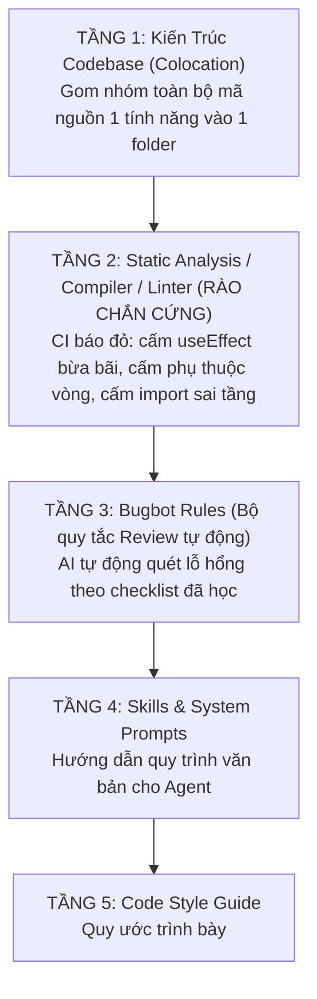

# Eval Playbook, Agent Tái hiện Bug (Benny) & 5 Tầng Ràng buộc Cứng

> **Loại: tham khảo.** Tổng hợp từ tra cứu của người dùng để làm tri thức cho agent, không phải nguồn luật. Khi khác `AGENTS.md`, vai trò hoặc `agents/protocols/` thì theo các nơi đó (`agents/protocols/source-precedence.md`).
> **Khác với chuẩn:** Luật cứng chuẩn nằm ở `protocols/hard-rules.md`; năm tầng ràng buộc ở đây là mô hình tham khảo.

Tài liệu này đúc kết phương pháp quản trị kiểm thử AI Agent, tự động hóa tái hiện lỗi và thiết lập hệ thống rào chắn kiến trúc cứng từ bài học thực chiến của **Lauren Tan (SpaceX / Cursor)**. Áp dụng cho các vai trò `ai-eng`, `qa`, `reviewer`, `architect`, và `dev`.

---

## I. Eval Playbook (Unit Test cho Kỹ năng & Prompt của Agent)

### 1. Khái niệm Evals
Trong khi kiểm thử phần mềm truyền thống dùng Unit Test để kiểm tra hàm/code logic, **Evals** là bộ bài kiểm thử tự động dành riêng để đánh giá chất lượng của **Câu lệnh (Prompts)** và **Kỹ năng (Skills)** của AI Agent.

### 2. Quy trình 4 Bước của Eval Playbook

```mermaid
sequenceDiagram
    autonumber
    participant Coord as Coordinator Agent
    participant Blind as Blind Sub-agent (Isolated)
    participant Judge as Judge Agent (Independent Model)
    participant Loop as Optimization Loop (/loop)

    Coord->>Coord: 1. Tạo Tiêu chí Đánh giá (Rubric 0 - 10)
    Coord->>Blind: 2. Giao task trong Thư mục Cách ly (Blind Execution)
    Note over Blind: Sub-agent thực thi task bình thường<br>(Không biết mình đang bị chấm thi)
    Blind-->>Judge: Xuất sản phẩm (Code / Báo cáo / Dữ liệu)
    Judge->>Judge: 3. Chấm điểm độc lập theo Rubric (Tránh thiên vị)
    Judge-->>Loop: Trả về Điểm số & Điểm thiếu sót
    Note over Loop: 4. Leo dốc tự động (Hill Climbing):<br>Lặp lại tinh chỉnh Prompt/Skill<br>đến khi đạt 10/10 điểm
```

- **Thư mục Cách ly (Blind Isolation):** Sub-agent thực hiện bài kiểm tra trong một thư mục tạm thời được đặt tên ngẫu nhiên. Agent không được biết mình đang trong bài test Eval để tránh việc AI "học vẹt" hoặc thay đổi hành vi đối phó.
- **Judge Agent Độc lập:** Sử dụng một mô hình AI khác với mô hình của Sub-agent (ví dụ: Sub-agent chạy Claude, Judge Agent chạy Gemini hoặc GPT-4o) để đảm bảo tính khách quan tuyệt đối.
- **Tối ưu hóa Leo dốc (Hill Climbing):** Chạy vòng lặp tự động `/loop` để AI tự sửa prompt/hướng dẫn cho đến khi bài kiểm thử đạt điểm tuyệt đối 10/10 trên ma trận nhiều ca kiểm thử khác nhau.

---

## II. Agent Tái hiện Bug Tự động (Mô hình Benny)

### 1. Nỗi đau
Kỹ sư thường mất từ 30% đến 50% thời gian chỉ để đọc báo cáo lỗi mơ hồ, tải môi trường và cố gắng tái hiện lại lỗi (Repro).

### 2. Luồng Vận hành của Agent Benny
1. **Tiếp nhận Tín hiệu:** Lắng nghe báo cáo lỗi từ Slack, Mantis, Issue Tracker hoặc log hệ thống.
2. **Khởi tạo Môi trường:** Tự động mở một máy ảo/container hoặc phiên trình duyệt headless trên môi trường Staging/Test.
3. **Thao tác Mô phỏng:** Kết hợp **Feature Map** và **Verification Skill** để tự động bấm các nút, điền form theo mô tả lỗi của người dùng.
4. **Kết luận & Báo cáo:**
   - Nếu lỗi xuất hiện: Chụp màn hình, trích xuất log lỗi, xuất tệp kịch bản tái hiện chuẩn (`bug-repro.md`).
   - Nếu không có lỗi: Kiểm tra nhánh `main` và thông báo cho kỹ sư biết lỗi đó đã được fix trước đó hay do người dùng thao tác sai.

---

## III. 5 Tầng Ràng buộc Cứng (Hard Constraints) & Thoát khỏi "Code Review Land"

### 1. Triết lý
> *"Đừng tốn thời gian con người để ngồi tranh cãi về style, format hay convention trong các buổi Code Review ('Code Review Land'). Mọi thứ có thể tự động hóa được đều phải chuyển thành **Lỗi Biên dịch (Compiler/Linter Error)** khiến CI báo đỏ ngay lập tức."*

### 2. 5 Tầng Kiểm soát Ràng buộc



- **Tầng 1 — Colocation (Gom nhóm tính năng):** Thay vì chia code theo kiểu `components/`, `hooks/`, `services/` nằm rải rác khắp dự án, toàn bộ UI, State, Service, Test của 1 tính năng được gom chung vào 1 thư mục. Agent chỉ cần mở 1 thư mục là có đủ toàn bộ ngữ cảnh, không sửa nhầm sang tính năng khác.
- **Tầng 2 — Ràng buộc Cứng (Hard Constraints):** 
  * Cấm các pattern nguy hiểm trực tiếp bằng rule linter (ví dụ: cấm `useEffect` gây re-render vô hạn, cấm gọi DB trực tiếp từ Presentation layer).
  * Vi phạm là CI báo đỏ ngay lập tức, chặn merge tự động mà không cần đợi con người nhắc nhở.
- **Tầng 3, 4, 5 — Ràng buộc Mềm:** Sử dụng prompt và hướng dẫn ngữ cảnh để định hướng hành vi sáng tạo của Agent trong phạm vi an toàn mà Tầng 1 và Tầng 2 đã thiết lập.
