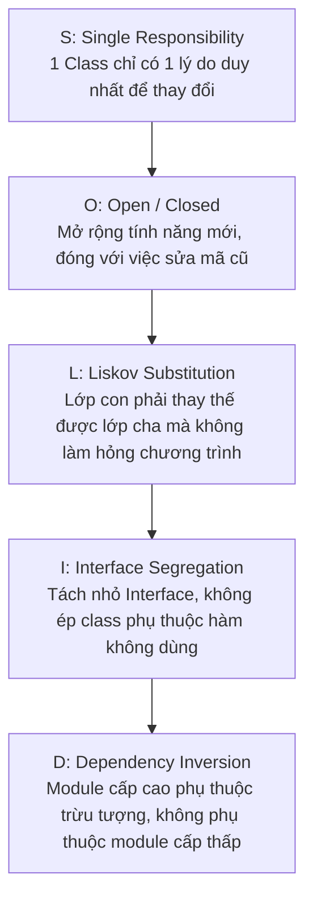

# Cẩm Nang Chi Tiết 23 Mẫu Thiết Kế GoF, Nguyên Lý SOLID & GRASP

> **Loại: tham khảo.**  
> **Mã định danh:** `gof-design-patterns-and-solid`  
> **Chuyên mục:** Kiến Trúc Phần Mềm Hướng Đối Tượng, Design Patterns & Nguyên Lý SOLID  
> **Nguồn gốc:** Gang of Four (GoF), Refactoring.Guru, Robert C. Martin (SOLID), Craig Larman (GRASP)  
> **Trạng thái:** `draft` (Chờ nghiệm thu con người)  

---

## 1. Năm Nguyên Lý Thiết Kế Hướng Đối Tượng SOLID

| Nguyên lý | Bản chất kỹ thuật | Dấu hiệu vi phạm thường gặp | Cách khắc phục chuẩn |
|---|---|---|---|
| **S (Single Responsibility)** | Một lớp chỉ nên phục vụ một tác nhân duy nhất | Lớp `OrderService` vừa tính tiền, vừa gửi email, vừa xuất PDF | Tách thành `OrderService`, `EmailNotificationService`, `PdfExportService` |
| **O (Open / Closed)** | Mở để mở rộng, đóng để chỉnh sửa | Thêm loại thanh toán mới phải vào sửa `switch-case` trong code lõi | Dùng `PaymentStrategy` interface và đa hình |
| **L (Liskov Substitution)** | Lớp con không được làm thay đổi kỳ vọng hành vi của lớp cha | Lớp con ném ngoại lệ `UnsupportedOperationException` cho hàm lớp cha | Tái cấu trúc phân cấp kế thừa hoặc dùng Composition |
| **I (Interface Segregation)** | Nhiều interface chuyên biệt tốt hơn 1 interface khổng lồ | Interface chứa 20 hàm, class chỉ cần 2 hàm nhưng vẫn phải `@Override` rỗng | Tách nhỏ thành các interface hẹp (`Printable`, `Exportable`) |
| **D (Dependency Inversion)** | Phụ thuộc vào Interface trừu tượng, không phụ thuộc Class cụ thể | Class `OrderUseCase` khởi tạo trực tiếp `new PostgresOrderRepository()` | Tiêm phụ thuộc qua Constructor (`Dependency Injection` của Spring) |

---

## 2. Toàn Bộ 23 Mẫu Thiết Kế GoF (Gang of Four Catalog)

### 2.1. Nhóm Khởi Tạo (Creational Patterns - 5 Mẫu)
Quản lý cơ chế khởi tạo đối tượng, giúp hệ thống độc lập với cách đối tượng được tạo ra.

1. **Factory Method:** Định nghĩa interface tạo đối tượng trong lớp cha, để lớp con quyết định class cụ thể nào được khởi tạo.
2. **Abstract Factory:** Cung cấp interface tạo ra các họ đối tượng liên quan (ví dụ: họ nút bấm và hộp thoại giao diện Light/Dark).
3. **Builder:** Tách quá trình dựng đối tượng phức tạp khỏi biểu diễn của nó, cho phép tạo các biến thể bằng cùng một quy trình từng bước.
4. **Prototype:** Sao chép một đối tượng sẵn có mà không phụ thuộc vào class cụ thể của nó (`clone()`).
5. **Singleton:** Đảm bảo một class chỉ có duy nhất một instance toàn cục (cần thận trọng để tránh gây khó khăn khi viết unit test).

### 2.2. Nhóm Cấu Trúc (Structural Patterns - 7 Mẫu)
Xây dựng mối liên kết giữa các class và đối tượng thành các cấu trúc lớn hơn, linh hoạt hơn.

1. **Adapter:** Cầu nối trung gian cho phép các interface không tương thích có thể làm việc được với nhau.
2. **Bridge:** Tách trừu tượng (Abstraction) khỏi hiện thực (Implementation) để cả hai phát triển độc lập (ví dụ: Hình dạng và Màu sắc).
3. **Composite:** Gom các đối tượng thành cấu trúc cây đệ quy biểu diễn quan hệ Một - Nhiều (ví dụ: Thư mục và Tệp tin).
4. **Decorator:** Bổ sung hành vi mới cho đối tượng một cách linh hoạt lúc runtime mà không làm thay đổi các đối tượng khác.
5. **Facade:** Cung cấp giao diện đơn giản hóa che giấu sự phức tạp của toàn bộ hệ thống con phía sau.
6. **Flyweight:** Tiết kiệm RAM bằng cách chia sẻ trạng thái chung giữa nhiều đối tượng nhỏ tương tự nhau.
7. **Proxy:** Đối tượng thay thế đóng vai trò kiểm soát truy cập, tải lười (Lazy loading), ghi log hoặc lưu đệm (Caching).

### 2.3. Nhóm Hành Vi (Behavioral Patterns - 11 Mẫu)
Phân bổ trách nhiệm và thuật toán giao tiếp hiệu quả giữa các đối tượng.

1. **Chain of Responsibility:** Truyền request dọc theo chuỗi các bộ xử lý; mỗi bộ xử lý quyết định xử lý hoặc chuyển cho bộ tiếp theo.
2. **Command:** Đóng gói một yêu cầu thành một đối tượng độc lập, hỗ trợ Undo/Redo, xếp hàng đợi và lập lịch thực thi.
3. **Iterator:** Duyệt tuần tự các phần tử của một tập hợp mà không làm lộ cấu trúc lưu trữ bên trong (List, Tree, Graph).
4. **Mediator:** Giảm thiểu sự phụ thuộc chéo giữa các thành phần bằng cách bắt chúng giao tiếp qua một đối tượng điều phối trung gian.
5. **Memento:** Chụp lại và khôi phục trạng thái nội bộ của đối tượng mà không phá vỡ tính bao đóng (Encapsulation).
6. **Observer:** Cơ chế đăng ký thông báo cho phép nhiều đối tượng tự động nhận cập nhật khi đối tượng quan sát thay đổi trạng thái.
7. **State:** Cho phép đối tượng thay đổi hành vi khi trạng thái nội bộ của nó thay đổi (ví dụ: Luồng trạng thái Đơn hàng).
8. **Strategy:** Đóng gói một họ thuật toán thành các class riêng biệt, cho phép hoán đổi thuật toán lúc runtime.
9. **Template Method:** Định nghĩa khung sườn của thuật toán trong lớp cha, cho phép lớp con ghi đè các bước cụ thể mà không đổi cấu trúc.
10. **Visitor:** Tách thuật toán khỏi cấu trúc đối tượng mà thuật toán đó tác động lên.

---

## 3. Bảng Phân Tích Thực Chiến: Khi Nào Dùng & Khi Nào Tránh (Chống Over-Engineering)

| Mẫu thiết kế | Khi NÀO NÊN DÙNG | Khi NÀO KHÔNG NÊN DÙNG (Cảnh báo Over-Engineering) |
|---|---|---|
| **Strategy** | Khi có từ 3 thuật toán tính toán trở lên có thể thay thế nhau (tính phí ship, tính thuế, thuật toán gợi ý) | Khi chỉ có 2 điều kiện cố định `if-else` đơn giản không bao giờ mở rộng thêm |
| **Builder** | Khi đối tượng có từ 5 tham số trở lên hoặc nhiều cấu hình tùy chọn | Khi đối tượng chỉ có 2–3 trường dữ liệu đơn giản |
| **Observer** | Khi cần kích hoạt nhiều tác vụ phụ bất đồng bộ sau một sự kiện chính (gửi email, trừ kho, ghi audit log) | Khi các luồng công việc cần thực thi tuần tự nghiêm ngặt và yêu cầu cùng một transaction CSDL |
| **Decorator** | Khi cần gắn thêm Caching, Rate Limiting, Metrics cho các API Client mà không sửa mã gốc | Khi chỉ cần thêm một câu lệnh log đơn giản |
| **Factory** | Khi logic khởi tạo đối tượng phức tạp, phụ thuộc vào cấu hình hoặc môi trường | Khi việc khởi tạo chỉ đơn thuần là gọi `new MyClass()` |
