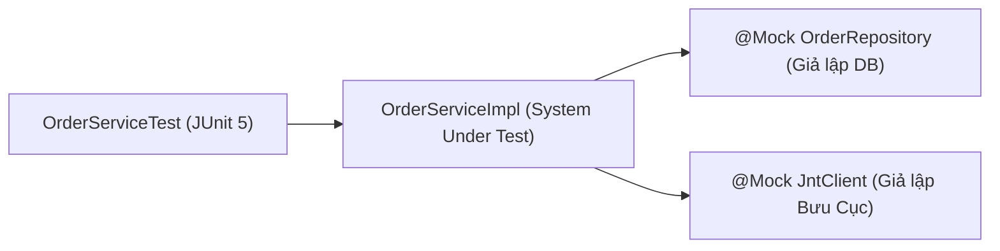

# Cẩm Nang Kiểm Thử Toàn Diện: JUnit 5, Mockito, Testcontainers & Jest

> **Loại: tham khảo.**  
> **Mã định danh:** `junit5-mockito-testcontainers-and-jest`  
> **Chuyên mục:** Kiểm Thử Đơn Vị (Unit Test), Kiểm Thử Tích Hợp (Integration Test) & TDD  
> **Nguồn gốc:** JUnit 5 Official User Guide, Mockito.org, Testcontainers.org, Jest Official Docs  
> **Trạng thái:** `draft` (Chờ nghiệm thu con người)  

---

## 1. JUnit 5 & Mockito — Chuẩn Unit Test Cô Lập Tầng Dịch Vụ (Backend Java)

Unit Test tầng Service phải chạy trong **vài chục mili-giây**, không bật Spring Context, không kết nối mạng hay CSDL thật mà dùng Mockito để cô lập ranh giới.



### 1.1. Bản Mẫu Unit Test Chuẩn Với JUnit 5 & Mockito

```java
@ExtendWith(MockitoExtension.class)
class OrderServiceTest {

    @Mock
    private OrderRepository orderRepository;

    @Mock
    private JntDeliveryClient jntDeliveryClient;

    @InjectMocks
    private OrderServiceImpl orderService;

    @Test
    @DisplayName("Tạo đơn hàng thành công khi dữ liệu hợp lệ")
    void shouldCreateOrderSuccessfully() {
        // Given: Chuẩn bị dữ liệu và hành vi giả lập (Stubbing)
        CreateOrderCommand cmd = new CreateOrderCommand(1001L, "Áo Polo", 2, new BigDecimal("200000"));
        Order mockSavedOrder = Order.builder().id(501L).totalAmount(new BigDecimal("400000")).build();
        
        when(orderRepository.save(any(Order.class))).thenReturn(mockSavedOrder);

        // When: Thực thi phương thức cần kiểm thử
        Long orderId = orderService.createOrder(cmd);

        // Then: Kiểm chứng kết quả và hành vi gọi hàm
        assertEquals(501L, orderId);
        verify(orderRepository, times(1)).save(any(Order.class));
    }

    @ParameterizedTest(name = "Số lượng mua {0} không hợp lệ thì phải ném ngoại lệ")
    @ValueSource(ints = {0, -1, -100})
    void shouldThrowExceptionWhenQuantityIsInvalid(int invalidQuantity) {
        CreateOrderCommand cmd = new CreateOrderCommand(1001L, "Áo", invalidQuantity, BigDecimal.TEN);

        assertThrows(IllegalArgumentException.class, () -> orderService.createOrder(cmd));
        // Đảm bảo không có câu lệnh lưu CSDL nào bị gọi nếu dữ liệu sai!
        verifyNoInteractions(orderRepository);
    }
}
```

---

## 2. Testcontainers — Kiểm Thử Tích Hợp Với Database Thật (PostgreSQL & Redis)

> [!WARNING]
> **Thảm họa H2 In-Memory Database:** Nhiều dự án dùng H2 để chạy test, nhưng H2 không hỗ trợ các tính năng thực tế của PostgreSQL như: cột kiểu `JSONB`, `Partial Index`, hàm `DATE_TRUNC`, cấu trúc `PARTITION` và lệnh khóa `SELECT ... FOR UPDATE`. Khi deploy lên Production thì câu lệnh SQL bị lỗi cú pháp!

**Giải pháp:** **Testcontainers** tự động khởi động một Docker Container chứa PostgreSQL và Redis thật 100%, tự động hủy khi test xong.

### 2.1. Bản Mẫu Integration Test Với Spring Boot & Testcontainers

```java
@SpringBootTest(webEnvironment = SpringBootTest.WebEnvironment.RANDOM_PORT)
@Testcontainers
class OrderIntegrationTest {

    // 1. Tự động bật Docker container PostgreSQL 16 thật
    @Container
    static PostgreSQLContainer<?> postgres = new PostgreSQLContainer<>("postgres:16-alpine")
            .withDatabaseName("test_db")
            .withUsername("test_user")
            .withPassword("test_pass");

    // 2. Tiêm port và URL động của Docker vào cấu hình Spring Boot
    @DynamicPropertySource
    static void configureProperties(DynamicPropertyRegistry registry) {
        registry.add("spring.datasource.url", postgres::getJdbcUrl);
        registry.add("spring.datasource.username", postgres::getUsername);
        registry.add("spring.datasource.password", postgres::getPassword);
    }

    @Autowired
    private OrderRepository orderRepository;

    @Test
    @DisplayName("Lưu và truy vấn đơn hàng với cột JSONB trên PostgreSQL thật")
    void shouldPersistAndRetrieveOrder() {
        Order order = new Order("ORD-2026", new BigDecimal("500000"), "{\"note\":\"Giao gio hanh chinh\"}");
        orderRepository.save(order);

        Optional<Order> found = orderRepository.findByOrderCode("ORD-2026");
        assertTrue(found.isPresent());
        assertEquals("ORD-2026", found.get().getOrderCode());
    }
}
```

---

## 3. Jest & Node.js Native Test Runner (Kiểm Thử Frontend JavaScript/TypeScript)

Áp dụng phương pháp TDD cho Frontend: viết bài test kiểm tra giao diện Component hiển thị đúng dữ liệu trước khi bắt tay vào code React.

### 3.1. Test Mẫu Với Jest & React Testing Library

```typescript
// components/__tests__/OrderCard.test.tsx
import { render, screen } from '@testing-library/react';
import userEvent from '@testing-library/user-event';
import { OrderCard } from '../OrderCard';

describe('OrderCard Component', () => {
  const mockOrder = {
    orderCode: 'ORD-999',
    totalAmount: 350000,
    status: 'SHIPPING'
  };

  it('Hiển thị chính xác mã đơn và trạng thái', () => {
    render(<OrderCard order={mockOrder} onCancel={jest.fn()} />);

    expect(screen.getByText('Mã đơn: ORD-999')).toBeInTheDocument();
    expect(screen.getByText('Đang vận chuyển')).toBeInTheDocument();
  });

  it('Kích hoạt callback onCancel khi bấm nút Hủy đơn', async () => {
    const handleCancel = jest.fn();
    render(<OrderCard order={mockOrder} onCancel={handleCancel} />);

    const cancelButton = screen.getByRole('button', { name: 'Hủy đơn hàng' });
    await userEvent.click(cancelButton);

    expect(handleCancel).toHaveBeenCalledTimes(1);
    expect(handleCancel).toHaveBeenCalledWith('ORD-999');
  });
});
```

### 3.2. Native Node.js Test Runner (`node:test`)
Khi cần kiểm thử nhanh các module tiện ích (Utils, Helper) mà không cần cài đặt thư viện Jest nặng nề:
```javascript
// test/utils.test.mjs (Chạy bằng: node --test)
import test from 'node:test';
import assert from 'node:assert/strict';
import { formatCurrency } from '../src/utils.mjs';

test('Format tiền tệ định dạng VND chuẩn', () => {
  assert.equal(formatCurrency(500000), '500.000 ₫');
});
```
