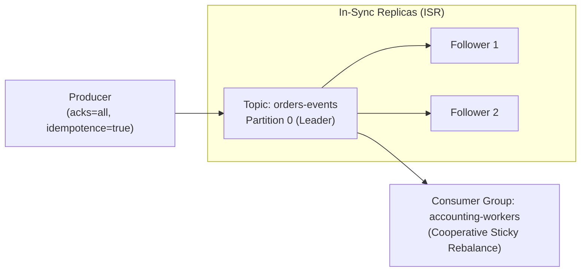
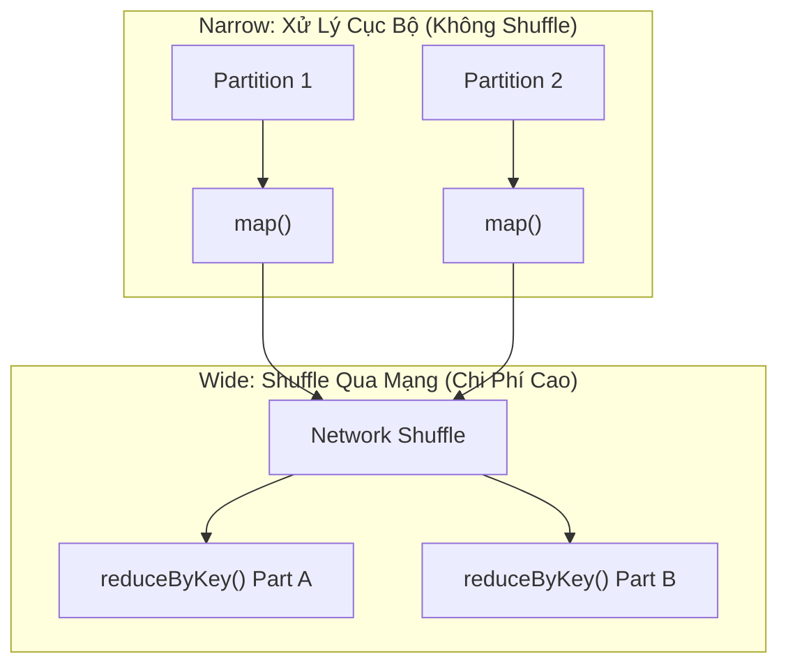

# Cẩm Nang Apache Kafka, Apache Spark & Apache Iceberg (Data Lakehouse)

> **Loại: tham khảo.**  
> **Mã định danh:** `kafka-spark-and-iceberg-lakehouse`  
> **Chuyên mục:** Xử Lý Dữ Liệu Lớn, Streaming Realtime & Kiến Trúc Data Lakehouse  
> **Nguồn gốc:** Apache Kafka Docs, Apache Spark Docs, Apache Iceberg Docs  
> **Trạng thái:** `draft` (Chờ nghiệm thu con người)  

---

## 1. Apache Kafka — Nền Tảng Streaming & Nhật Ký Phân Tán (Distributed Commit Log)

Kafka đạt tốc độ hàng triệu tin nhắn mỗi giây nhờ triệt để tận dụng **Sequential Disk I/O (Ghi đĩa tuần tự)** và công nghệ **Zero-Copy (`sendfile` syscall)** đẩy dữ liệu thẳng từ OS Pagecache ra card mạng mà không qua User Space.



### 1.1. Cấu Hình Producer Chuẩn Doanh Nghiệp (Không Mất Dữ Liệu)
```properties
# 1. Bắt buộc toàn bộ bản sao trong ISR xác nhận ghi thành công
acks=all
# 2. Bật Idempotent Producer: Kafka tự cấp Producer ID (PID) và Sequence Number để loại trừ trùng lặp
enable.idempotence=true
# 3. Số lần thử lại tối đa khi gặp sự cố mạng tạm thời
retries=2147483647
max.in.flight.requests.per.connection=5
# 4. Tối ưu gom nhóm và nén để tiết kiệm băng thông mạng
compression.type=snappy
linger.ms=20
batch.size=65536
```

### 1.2. Consumer & Cơ Chế Exactly-Once Semantics (EOS)
- **Tắt Auto-Commit:** Đặt `enable.auto.commit=false`. Chỉ commit offset vào `__consumer_offsets` **sau khi đã xử lý xong nghiệp vụ và ghi CSDL thành công**.
- **Cooperative Sticky Rebalance:** Tránh hiện tượng "Stop-the-World" ngắt toàn bộ consumer khi có pod mới gia nhập; chỉ tái phân bổ các partition bị ảnh hưởng.
- **Kafka Transactions (EOS):** Kết hợp đọc-xử lý-ghi nguyên tử qua `KafkaProducer.sendOffsetsToTransaction()`.

---

## 2. Apache Spark — Tính Toán Phân Tán & Tối Ưu Hóa Catalyst Engine

Spark xử lý tính toán trên RAM thông qua **Tungsten Engine** (quản lý bộ nhớ Off-heap và sinh mã máy nhị phân Whole-Stage Code Generation) và bộ tối ưu hóa truy vấn **Catalyst Optimizer**.

### 2.1. Phân Biệt Biến Đổi Hẹp (Narrow) vs Biến Đổi Rộng (Wide / Shuffle)
- **Narrow Transformations (`map`, `filter`):** Dữ liệu của 1 partition đầu vào chỉ phục vụ 1 partition đầu ra $\rightarrow$ Xử lý hoàn toàn cục bộ trên Executor, cực nhanh, không tốn tài nguyên mạng.
- **Wide Transformations (`groupByKey`, `distinct`, `join`):** Cần gom dữ liệu từ nhiều node khác nhau $\rightarrow$ Bắt buộc kích hoạt **Shuffle qua mạng** (tốn đĩa, nghẽn I/O và mạng).



### 2.2. Hai Kỹ Thuật Tối Ưu Hiệu Năng Spark Thực Chiến
1. **Broadcast Hash Join (Triệt tiêu Shuffle khi Join bảng nhỏ):**  
   Khi join một bảng lớn (100 triệu đơn hàng) với một bảng nhỏ (< 100MB danh mục sản phẩm), thay vì shuffle cả 2 bảng, hãy phát tán bảng nhỏ tới toàn bộ các Executor:
   ```python
   from pyspark.sql.functions import broadcast
   # Tránh hoàn toàn việc Shuffle bảng lớn qua mạng!
   joined_df = orders_df.join(broadcast(products_df), "product_id")
   ```
2. **Xử Lý Lệch Dữ Liệu (Data Skew) Bằng Kỹ Thuật "Salting":**  
   Nếu 80% đơn hàng tập trung vào 1 khách hàng lớn (gây nghẽn 1 Executor duy nhất), hãy thêm một số ngẫu nhiên (Salt: 0..N) vào khóa join để phân tán đều dữ liệu ra nhiều partition, join xong mới gộp lại.

---

## 3. Apache Iceberg — Định Dạng Bảng Chuẩn Mực Cho Data Lakehouse

Apache Iceberg giải quyết triệt để các điểm yếu chết người của Apache Hive trên các hệ thống lưu trữ đối tượng đám mây (Amazon S3, MinIO).

### 3.1. Cấu Trúc Siêu Dữ Liệu 3 Tầng (3-Tier Metadata Tree)
Thay vì theo dõi dữ liệu bằng thư mục như Hive (dễ gây lỗi đọc dở dang khi ghi file), Iceberg quản lý trạng thái bằng cây con trỏ Snapshot nguyên tử:
1. **Iceberg Catalog:** Trỏ tới file `metadata.json` hiện tại.
2. **Metadata File:** Lưu lịch sử các bức ảnh chụp (Snapshots), Schema và quy tắc phân vùng.
3. **Manifest List & Manifest Files:** Quản lý danh sách các tệp dữ liệu vật lý (Parquet/ORC) kèm thông số Min/Max của từng cột.

### 3.2. Bốn Tính Năng Đột Phá Của Apache Iceberg
1. **ACID Transactions:** Hỗ trợ đầy đủ `INSERT`, `UPDATE`, `DELETE`, `MERGE INTO` trên S3 thông qua cơ chế Optimistic Concurrency Control.
2. **Hidden Partitioning (Phân vùng ẩn):** Người dùng không cần tự tính cột phân vùng giả `event_date`. Chỉ cần truy vấn `WHERE event_time >= '2026-10-28'`, Iceberg tự động ánh xạ tới phân vùng mà không cần người dùng nhớ cấu trúc thư mục.
3. **Schema & Partition Evolution:** Thêm, xóa, đổi tên cột hoặc đổi phân vùng từ Ngày sang Tháng mà **không cần viết lại (rewrite) dữ liệu cũ**.
4. **Time Travel (Du hành thời gian):** Truy vấn dữ liệu ở một thời điểm chính xác trong quá khứ:
   ```sql
   -- Đọc dữ liệu tại thời điểm trước khi chạy batch job lỗi
   SELECT * FROM prod.accounting.orders 
   TIMESTAMP AS OF '2026-10-28 08:00:00';
   ```
