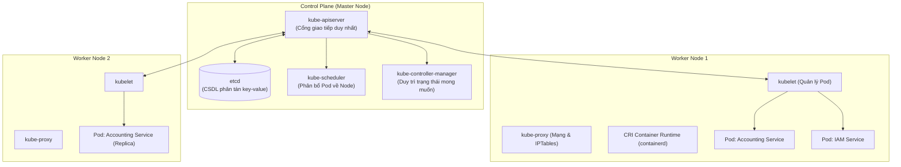

# Cẩm Nang Kiến Trúc Kubernetes & Chuẩn Khai Báo Manifests Production

> **Loại: tham khảo.** Không phải nguồn luật; khi khác `AGENTS.md`, vai trò hoặc `agents/protocols/` thì theo các nơi đó.
> **Khác với chuẩn:** Ví dụ manifest dùng tên dịch vụ mẫu; chưa xác nhận dự án triển khai bằng Kubernetes (có thể là docker-compose). Đừng áp dụng khi chưa hỏi.


> **Mã định danh:** `kubernetes-architecture-and-manifests`  
> **Chuyên mục:** Hạ tầng, Điều phối Container & DevOps  
> **Nguồn gốc:** Kubernetes Official Documentation (kubernetes.io)  
> **Trạng thái:** `draft` (Chờ nghiệm thu con người)  

---

## 1. Kiến Trúc Cốt Lõi Của Kubernetes (K8s Cluster Architecture)

Một cụm Kubernetes phân chia thành 2 phân vùng rõ rệt:



---

## 2. Chuẩn Khai Báo Deployment Production Cho Microservice Spring Boot

Dưới đây là bản mẫu Manifest hoàn chỉnh áp dụng các tiêu chuẩn an toàn cao nhất trong Production:
- **Zero-Downtime Rolling Update**: Đảm bảo luôn có ít nhất 100% số Pod sống trong quá trình cập nhật phiên bản.
- **Resource Requests & Limits**: Ngăn chặn hiện tượng Out-Of-Memory (OOM) làm sập Node.
- **Bộ 3 Healthcheck Probes**: `startupProbe` $\rightarrow$ `readinessProbe` $\rightarrow$ `livenessProbe`.
- **Graceful Shutdown**: Cho phép các request đang xử lý dở được hoàn tất trước khi pod bị hủy.

```yaml
apiVersion: apps/v1
kind: Deployment
metadata:
  name: accounting-service
  namespace: production
  labels:
    app.kubernetes.io/name: accounting-service
    app.kubernetes.io/part-of: gdt-platform
    app.kubernetes.io/version: "1.2.0"
spec:
  replicas: 3
  strategy:
    type: RollingUpdate
    rollingUpdate:
      maxSurge: 1        # Cho phép sinh thêm tối đa 1 pod mới khi đang rollout
      maxUnavailable: 0  # Tuyệt đối không cho phép pod nào bị ngắt trước khi pod mới sẵn sàng
  selector:
    matchLabels:
      app: accounting-service
  template:
    metadata:
      labels:
        app: accounting-service
    spec:
      terminationGracePeriodSeconds: 45 # Chờ tối đa 45s để xử lý xong request dở
      containers:
        - name: app
          image: registry.gdttech.net/business/accounting-service:v1.2.0
          imagePullPolicy: IfNotPresent
          ports:
            - containerPort: 8200
              name: http
          
          # 1. Phân bổ tài nguyên bắt buộc
          resources:
            requests:
              cpu: "500m"      # Đảm bảo tối thiểu 0.5 Core
              memory: "1024Mi"  # Đảm bảo tối thiểu 1GB RAM
            limits:
              cpu: "2000m"     # Tối đa 2 Cores
              memory: "2048Mi"  # Tối đa 2GB RAM (tránh OOM)

          # 2. Bộ 3 Đầu Dò Sức Khỏe (Probes)
          # Startup Probe: Dành riêng cho Spring Boot khởi động chậm (chờ tối đa 90s)
          startupProbe:
            httpGet:
              path: /actuator/health/liveness
              port: http
            initialDelaySeconds: 15
            periodSeconds: 5
            failureThreshold: 15

          # Readiness Probe: Khi nào pod sẵn sàng nhận traffic từ Service/Ingress
          readinessProbe:
            httpGet:
              path: /actuator/health/readiness
              port: http
            periodSeconds: 10
            timeoutSeconds: 3
            successThreshold: 1
            failureThreshold: 3

          # Liveness Probe: Tự động restart container nếu luồng bị Deadlock
          livenessProbe:
            httpGet:
              path: /actuator/health/liveness
              port: http
            periodSeconds: 15
            timeoutSeconds: 3
            failureThreshold: 3

          # 3. Môi trường & Secrets
          envFrom:
            - configMapRef:
                name: accounting-config
            - secretRef:
                name: accounting-secrets

          # 4. Graceful Shutdown Hook
          lifecycle:
            preStop:
              exec:
                command: ["sh", "-c", "sleep 10"] # Ngắt routing trước khi gửi SIGTERM
```

---

## 3. Khai Báo Service & Ingress Tương Ứng

```yaml
---
apiVersion: v1
kind: Service
metadata:
  name: accounting-service
  namespace: production
spec:
  type: ClusterIP
  ports:
    - port: 8200
      targetPort: http
      protocol: TCP
      name: http
  selector:
    app: accounting-service

---
apiVersion: networking.k8s.io/v1
kind: Ingress
metadata:
  name: accounting-ingress
  namespace: production
  annotations:
    kubernetes.io/ingress.class: nginx
    nginx.ingress.kubernetes.io/proxy-body-size: "20m"
    nginx.ingress.kubernetes.io/proxy-read-timeout: "60"
spec:
  rules:
    - host: api.gdttech.net
      http:
        paths:
          - path: /api/v1/orders
            pathType: Prefix
            backend:
              service:
                name: accounting-service
                port:
                  number: 8200
```