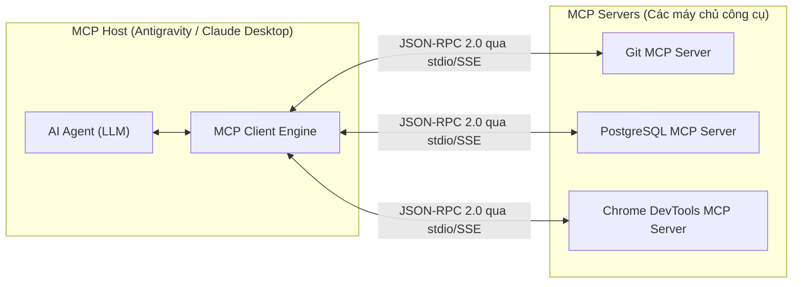
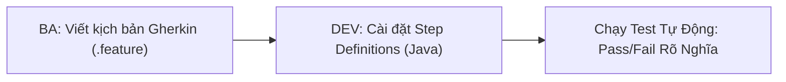

# Cẩm Nang Model Context Protocol (MCP) & Kiểm Thử Hành Vi BDD (Cucumber)

> **Loại: tham khảo.**  
> **Mã định danh:** `mcp-and-bdd-testing`  
> **Chuyên mục:** Chuẩn Kết Nối Công Cụ AI (MCP) & Kiểm Thử Hành Vi Nghiệp Vụ (BDD Gherkin)  
> **Nguồn gốc:** Anthropic (Model Context Protocol Specification), Cucumber.io Official Docs  
> **Trạng thái:** `draft` (Chờ nghiệm thu con người)  

---

## 1. Model Context Protocol (MCP) — Chuẩn Kết Nối Mở Cho AI Agent

Model Context Protocol (MCP) là giao thức mở chuẩn hóa cách các mô hình AI Agent (Gemini, Claude, GPT) kết nối an toàn với thế giới bên ngoài (mã nguồn, CSDL, công cụ dòng lệnh, trình duyệt).



### 1.1. Ba Trụ Cột Tài Nguyên Của MCP
1. **Tools (Công cụ có thể thực thi):**
   - Các hàm mà mô hình có thể gọi kèm tham số được kiểm định chặt chẽ bằng JSON Schema.
   - *Ví dụ:* `mcp_git_commit(message, files)`, `mcp_postgres_query(sql)`.
2. **Resources (Tài nguyên thụ động):**
   - Dữ liệu dạng đọc (Read-only) được định danh bằng URI (như `file:///path/to/file`, `postgres://schema/orders`). Mô hình đọc nội dung để nạp ngữ cảnh mà không gây tác dụng phụ (no side-effects).
3. **Prompts (Mẫu hướng dẫn cấu hình sẵn):**
   - Các prompt được tham số hóa do máy chủ MCP cung cấp (ví dụ: prompt review code, prompt phân tích log lỗi).

### 1.2. Vòng Đời Kết Nối JSON-RPC 2.0 Giữa Client và Server
- **Khởi tạo (`initialize`):** Đàm phán phiên bản giao thức và khả năng (Capabilities) của đôi bên.
- **Khám phá (`tools/list`, `resources/list`):** Client lấy danh mục các công cụ sẵn sàng phục vụ.
- **Thực thi (`tools/call`):** Agent gửi tên công cụ và tham số; Server chạy lệnh và trả về kết quả (Text hoặc Media).

---

## 2. Cucumber BDD — Biến Đặc Tả Nghiệp Vụ Thành Bài Test Tự Động (Gherkin)

Behavior-Driven Development (BDD) giải quyết triệt để sự lệch pha giữa Business Analyst (BA) và Developer bằng cách viết kịch bản bằng ngôn ngữ **Gherkin** (tiếng Việt hoặc tiếng Anh) tự nhiên nhưng có thể thực thi tự động 100%.



### 2.1. Cấu Trúc File Gherkin Mẫu: `dat_hang.feature`

```gherkin
# language: vi
Tính năng: Đặt hàng và xử lý thanh toán khi nhận hàng (COD)
  Là một khách hàng thân thiết của GDT
  Tôi muốn đặt mua sản phẩm và thanh toán khi nhận hàng
  Để tôi có thể nhận hàng tại nhà an toàn

  Ngữ cảnh:
    Có sẵn sản phẩm "Áo Polo Nam" với số lượng tồn kho là 10 và đơn giá 250000

  Kịch bản: Khách hàng đặt mua thành công khi còn đủ hàng tồn kho
    Cho một khách hàng có số điện thoại "0912345678" và địa chỉ "Hà Nội"
    Khi khách hàng đặt mua 2 chiếc sản phẩm "Áo Polo Nam" với phương thức "COD"
    Thì hệ thống phải tạo đơn hàng thành công với trạng thái "DRAFT"
    Và tổng tiền của đơn hàng phải bằng 500000
    Và số lượng tồn kho của "Áo Polo Nam" phải giảm xuống còn 8 chiếc

  Kịch bản: Đặt hàng thất bại khi số lượng mua vượt quá tồn kho
    Cho một khách hàng có số điện thoại "0912345678" và địa chỉ "Hà Nội"
    Khi khách hàng cố tình đặt mua 15 chiếc sản phẩm "Áo Polo Nam"
    Thì hệ thống phải từ chối đơn hàng với thông báo lỗi "Sản phẩm không đủ số lượng tồn kho"
    Và số lượng tồn kho của "Áo Polo Nam" vẫn giữ nguyên 10 chiếc
```

### 2.2. Cài Đặt Step Definitions Trong Java (Spring Boot + Cucumber-JVM)

```java
package net.gdttech.accounting.bdd;

import io.cucumber.java.vi.*;
import org.springframework.beans.factory.annotation.Autowired;
import static org.junit.jupiter.api.Assertions.*;

public class OrderStepDefinitions {

    @Autowired
    private OrderUseCase orderUseCase;
    
    @Autowired
    private ProductRepository productRepository;

    private Long createdOrderId;
    private Exception thrownException;

    @Cho("một khách hàng có số điện thoại {string} và địa chỉ {string}")
    public void setupCustomer(String phone, String address) {
        // Chuẩn bị dữ liệu khách hàng
    }

    @Khi("khách hàng đặt mua {int} chiếc sản phẩm {string} với phương thức {string}")
    public void placeOrder(int quantity, String productName, String paymentMethod) {
        try {
            this.createdOrderId = orderUseCase.createOrder(productName, quantity, paymentMethod);
        } catch (Exception e) {
            this.thrownException = e;
        }
    }

    @Thì("hệ thống phải tạo đơn hàng thành công với trạng thái {string}")
    public void verifyOrderStatus(String expectedStatus) {
        assertNotNull(createdOrderId, "Đơn hàng phải được tạo thành công!");
        Order order = orderUseCase.getOrder(createdOrderId);
        assertEquals(expectedStatus, order.getStatus().name());
    }

    @Và("tổng tiền của đơn hàng phải bằng {long}")
    public void verifyTotalAmount(long expectedTotal) {
        Order order = orderUseCase.getOrder(createdOrderId);
        assertEquals(BigDecimal.valueOf(expectedTotal), order.getTotalAmount());
    }
}
```
