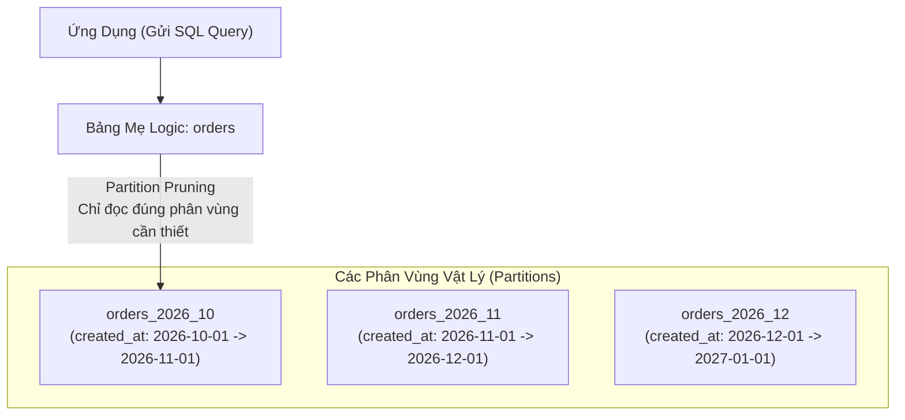

# Cẩm Nang PostgreSQL Partitioning, Tối Ưu Hóa & Keyset Pagination (Use The Index, Luke)

> **Loại: tham khảo.**  
> **Mã định danh:** `postgresql-partitioning-and-performance`  
> **Chuyên mục:** Cơ sở Dữ liệu & Tối Ưu Hóa Hiệu Năng Quy Mô Lớn  
> **Nguồn gốc:** PostgreSQL Official Documentation (DDL Partitioning & Performance Tips), Markus Winand ("Use The Index, Luke!")  
> **Trạng thái:** `draft` (Chờ nghiệm thu con người)  

---

## 1. Phân Vùng Bảng Trong PostgreSQL (Declarative Table Partitioning)

Khi một bảng đạt quy mô hàng chục triệu bản ghi (như bảng `orders` hoặc `order_audit_logs`), các thao tác quét bảng (Seq Scan) hoặc bảo trì index trở nên rất chậm. **Table Partitioning (Phân vùng khai báo)** chia bảng logic lớn thành nhiều bảng vật lý nhỏ hơn mà ứng dụng vẫn truy vấn qua một tên bảng duy nhất.



### 1.1. Ba Cơ Chế Phân Vùng Chính
1. **Range Partitioning (Theo khoảng giá trị - Phổ biến nhất):** Phân vùng theo ngày tháng hoặc dải ID:
   ```sql
   -- 1. Tạo bảng mẹ
   CREATE TABLE orders (
       id BIGSERIAL,
       order_code VARCHAR(50) NOT NULL,
       customer_id BIGINT NOT NULL,
       total_amount DECIMAL(15,2) NOT NULL,
       status VARCHAR(20) NOT NULL,
       created_at TIMESTAMP WITH TIME ZONE NOT NULL,
       PRIMARY KEY (id, created_at) -- Cột phân vùng bắt buộc nằm trong Primary Key
   ) PARTITION BY RANGE (created_at);

   -- 2. Tạo các phân vùng theo tháng
   CREATE TABLE orders_2026_10 PARTITION OF orders
       FOR VALUES FROM ('2026-10-01 00:00:00+00') TO ('2026-11-01 00:00:00+00');

   CREATE TABLE orders_2026_11 PARTITION OF orders
       FOR VALUES FROM ('2026-11-01 00:00:00+00') TO ('2026-12-01 00:00:00+00');
   ```
2. **List Partitioning (Theo danh sách giá trị):** Phân vùng theo mã quốc gia hoặc kênh bán hàng (ví dụ: `PARTITION BY LIST (country_code)`: `PH`, `VN`, `TH`).
3. **Hash Partitioning (Theo hàm băm):** Phân tán đều dữ liệu sang $N$ phân vùng để giải tỏa nghẽn I/O ghi (ví dụ: `PARTITION BY HASH (customer_id)`).

### 1.2. Cơ Chế Loại Trừ Phân Vùng (Partition Pruning)
Khi bật `SET enable_partition_pruning = on;`, nếu câu truy vấn chứa điều kiện `WHERE created_at >= '2026-10-15' AND created_at <= '2026-10-20'`, PostgreSQL sẽ **bỏ qua hoàn toàn các phân vùng khác**, chỉ mở duy nhất bảng `orders_2026_10` $\rightarrow$ Tốc độ truy vấn tăng gấp nhiều lần, giảm tải I/O bộ nhớ đệm.

---

## 2. Tiêu Diệt Thảm Họa `OFFSET / LIMIT` Bằng Keyset Pagination (Cursor Pagination)

### 2.1. Tại Sao `OFFSET` Là Ác Mộng Của Cơ Sở Dữ Liệu?
Khi bạn truy vấn trang số 10.000 với câu lệnh:
```sql
SELECT * FROM orders ORDER BY id DESC LIMIT 20 OFFSET 200000;
```
CSDL bắt buộc phải **đọc và quét qua 200.020 bản ghi**, sau đó vứt bỏ 200.000 bản ghi đầu tiên và chỉ trả về 20 bản ghi cuối cùng. Trang càng xa, hệ thống càng chậm và có thể gây nghẽn CPU toàn bộ máy chủ.

### 2.2. Giải Pháp Chuẩn: Keyset Pagination (Dựa Trên Con Trỏ Cuối)
Thay vì dùng `OFFSET`, ta lưu lại giá trị của bản ghi cuối cùng trên trang trước (Keyset Cursor):
```sql
-- Lấy 20 đơn tiếp theo sau đơn hàng id = 154200
SELECT * FROM orders 
WHERE id < 154200 
ORDER BY id DESC 
LIMIT 20;
```
- **Tốc độ:** Duyệt cây B-Tree với độ phức tạp $O(\log N)$, trang số 1 hay trang số 1.000.000 đều phản hồi dưới **2 mili-giây**!
- **Tính nhất quán:** Không bị hiện tượng trùng lặp hoặc nhảy cóc bản ghi khi có đơn hàng mới được tạo trong lúc người dùng đang cuộn trang.

---

## 3. Cấu Hình Hiệu Năng & Chống Bệnh Phình Bảng (Table Bloat) Trong PostgreSQL

| Tham số cấu hình | Giá trị khuyến nghị Production | Mục đích kỹ thuật |
|---|---|---|
| `shared_buffers` | 25% tổng RAM của máy chủ | Bộ nhớ đệm chính để cache dữ liệu bảng và index |
| `effective_cache_size` | 50% – 75% tổng RAM | Ước lượng bộ nhớ khả dụng cho Planner tính toán chi phí quét đĩa |
| `work_mem` | 16MB – 64MB (tính theo mỗi phép sort) | Bộ nhớ dành cho các lệnh `ORDER BY`, `DISTINCT`, Hash Join (tránh tràn ra ổ cứng tạm) |
| `maintenance_work_mem` | 1GB – 2GB | Bộ nhớ phục vụ việc tạo Index (`CREATE INDEX`) và chạy `VACUUM` |
| `autovacuum_vacuum_scale_factor` | 0.05 (mặc định 0.2) | Kích hoạt hút rác khi 5% dữ liệu bảng bị sửa/xóa, ngăn ngừa phình đĩa (Bloat) |

> [!TIP]
> Trong PostgreSQL, lệnh `UPDATE` thực chất là `INSERT` phiên bản hàng mới và đánh dấu phiên bản cũ là chết (Dead Tuple). Cơ chế **Autovacuum** có nhiệm vụ thu hồi không gian của các Dead Tuple này để tái sử dụng. Luôn theo dõi số lượng Dead Tuples qua view `pg_stat_user_tables`.
