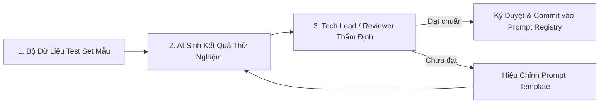
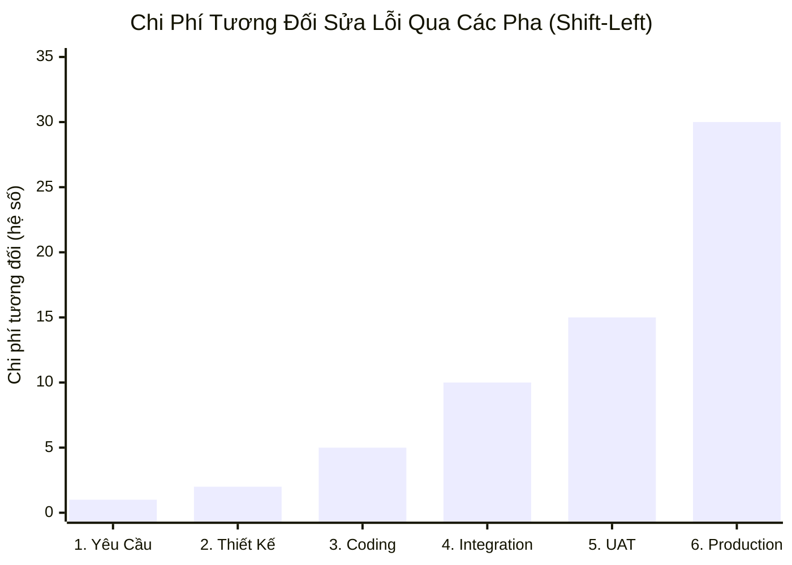

# Quản trị Prompt as Code, Thư viện Golden Prompts & Chỉ số Shift-Left

> **Loại: tham khảo.** Tổng hợp từ tra cứu của người dùng để làm tri thức cho agent, không phải nguồn luật. Khi khác `AGENTS.md`, vai trò hoặc `agents/protocols/` thì theo các nơi đó (`agents/protocols/source-precedence.md`).
> **Khác với chuẩn:** Sổ prompt chuẩn nằm ở `protocols/ai-provenance.md` mục 2. Mục Release Train: số người duyệt và nhánh theo `protocols/git-rules.md`, không lấy số trong file này làm quy định.

Tài liệu này chuẩn hóa quy trình quản trị Prompt coi như mã nguồn phần mềm (**Prompt as Code**), xây dựng thư viện **Golden Prompts** và áp dụng chỉ số **Shift-Left** trong kiểm soát chi phí lỗi. Áp dụng cho các vai trò `ai-eng`, `architect`, `lead`, `reviewer`, và `devops`.

---

## I. Triết lý Prompt as Code & Thư viện Golden Prompts

### 1. Triết lý Cốt lõi
> *"Prompt trong hệ thống AI Agent không phải là câu lệnh chat vu vơ của người dùng, mà là **Tài sản Trí tuệ (IP)** và là một thành phần logic nghiệp vụ quan trọng. Mọi thay đổi trong Prompt phải được lưu trữ trong Git, đánh phiên bản (`v1.0`, `v1.1`) và kiểm thử hồi quy (Regression Test) nghiêm ngặt như mã nguồn phần mềm."*

### 2. Cấu trúc một Chuẩn Golden Prompt (Prompt Registry Standard)

Mỗi Golden Prompt được lưu trữ dưới định dạng `.yaml` hoặc `.json` với 4 thành phần bắt buộc:

```yaml
id: "PRM-BACKEND-API-GEN-001"
version: "1.2.0"
title: "Sinh API Endpoint & DTO chuẩn Clean Architecture"
author: "architect"
model_target: "claude-3-5-sonnet"
state: "approved"
updated_at: "2026-10-28T00:00:00Z"

metadata:
  purpose: "Chuyển đổi Use-case Spec thành mã nguồn Controller, Service Interface và DTO"
  temperature: 0.1
  max_tokens: 4096

template: |
  Bạn là Kỹ sư Backend cấp cao. Nhiệm vụ của bạn là hiện thực hóa Endpoint sau:
  - Ngữ cảnh hệ thống: {{system_context}}
  - Tiêu chuẩn code: {{coding_conventions}}
  - Đặc tả nghiệp vụ: {{usecase_spec}}
  
  Ràng buộc bất biến:
  1. Không viết code logic trong Controller, chỉ ủy quyền cho UseCase.
  2. Bắt buộc có Unit Test đi kèm với độ phủ 100%.

test_cases:
  - id: "TC-01-HAPPY-PATH"
    inputs:
      system_context: "IAM Service"
      coding_conventions: "Java 21 / Spring Boot 3"
      usecase_spec: "Đăng nhập bằng Email và Password"
    expected_assertions:
      - contains: "class LoginController"
      - contains: "interface AuthenticateUseCase"
      - not_contains: "password_hash in plain text"
```

### 3. Quy trình 3 Bước Nghiệm thu Golden Prompt



---

## II. Bảng Chi phí Sửa lỗi theo Pha (Shift-Left Metric)

Nguyên tắc **Shift-Left** yêu cầu phát hiện và khắc phục lỗi càng sớm càng tốt (dịch chuyển kiểm thử về phía bên trái của chu trình phát triển).



| Pha Phát hiện Lỗi (Detection Phase) | Chi phí Tương đối (Relative Cost) | Mức độ Ảnh hưởng & Tác động |
|---|---|---|
| **1. Yêu cầu (Requirements)** | **$1\times$ (Mức gốc)** | Rẻ nhất; chỉ sửa đổi câu chữ trên file Markdown/SRS. |
| **2. Thiết kế (Architecture/Design)** | **$2\times$** | Chỉnh sửa lại sơ đồ và interface, chưa tốn công code. |
| **3. Coding (Lập trình TDD)** | **$5\times$** | Sửa trực tiếp trong chu trình Red $\rightarrow$ Green của Dev. |
| **4. Integration Test** | **$10\times$** | Ảnh hưởng đến giao tiếp giữa các module, cần test lại luồng. |
| **5. Acceptance Test (UAT)** | **$15\times$** | Tốn công chạy lại toàn bộ test suite và làm chậm tiến độ Sprint. |
| **6. Production** | **$30\times$ – $50\times$** | Thảm họa: sập hệ thống, mất dữ liệu, vá khẩn cấp (Hotfix). |

> [!TIP]
> **Chỉ tiêu chất lượng:** Dự án bắt buộc phải phát hiện và triệt tiêu **ít nhất 50% tổng số lỗi** ngay từ pha Yêu cầu và Thiết kế (nhờ BA, Architect và Reviewer soát lỗi trước).

---

## III. Chu kỳ Agile Release Train & GitFlow

Hệ thống vận hành theo chu kỳ Release Train liên tục:
$$\text{Continuous Exploration} \longrightarrow \text{Continuous Integration} \longrightarrow \text{Continuous Deployment} \longrightarrow \text{Release on Demand}$$

### Quy chuẩn Nhánh & Cổng Duyệt
- `main`: Nhánh production. Chỉ deploy khi có Release Tag (`vX.Y.Z`).
- `release/*`: Nhánh chuẩn bị phát hành trên môi trường Staging.
- `develop`: Nhánh tích hợp các tính năng đã qua kiểm thử cơ bản.
- `feature/*` & `hotfix/*`: Nhánh làm việc riêng lẻ theo từng task.

**Cổng kiểm soát bắt buộc trước khi Merge:**
1. **Tự động:** Pass 100% CI (Unit/Integration Test, Linter, Security scan không còn lỗi High/Critical).
2. **Con người:** Bắt buộc tối thiểu **$\ge 2$ Approvals** từ Maintainers (Tech Lead + Reviewer chuyên trách).
3. **Cổng duyệt Production:** Pipeline tự động dừng lại trước môi trường Production, bắt buộc Tech Lead hoặc PM bấm phê duyệt thủ công mới được kích hoạt deploy.
