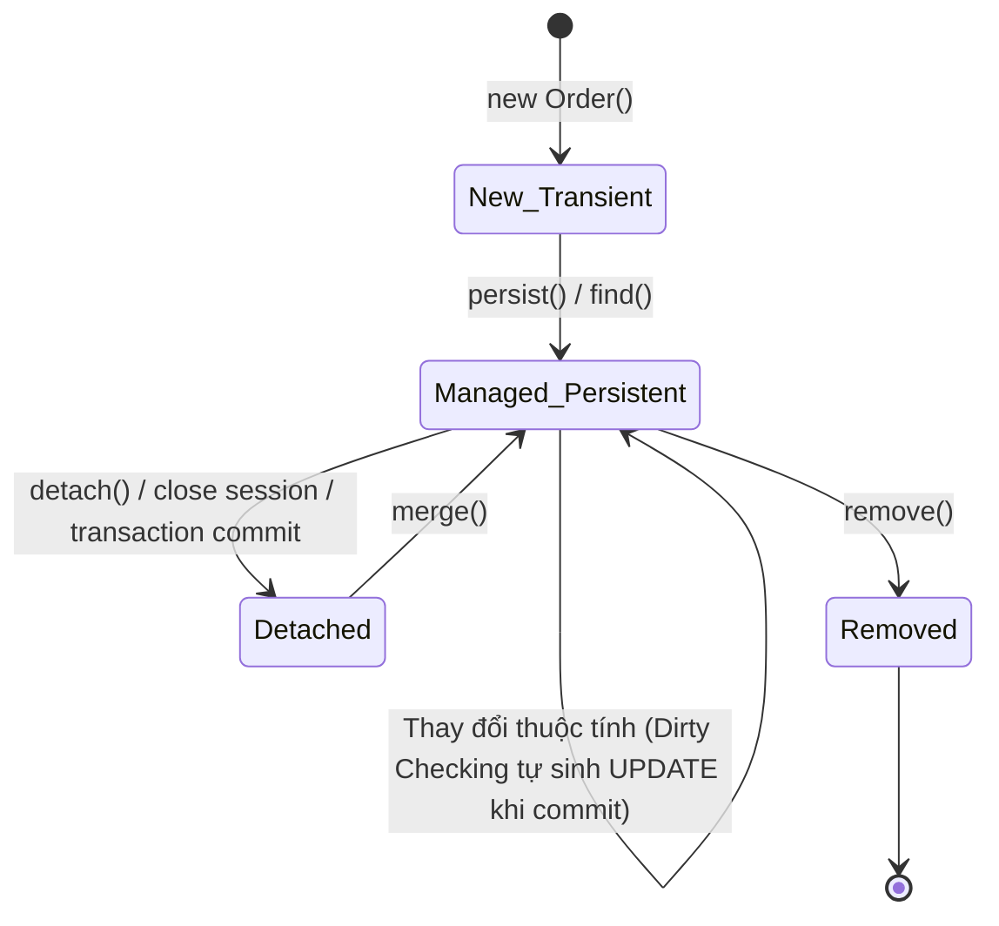

# Cẩm Nang Tối Ưu Hóa PostgreSQL & Thực Hành Chuẩn JPA / Hibernate

> **Loại: tham khảo.** Không phải nguồn luật; khi khác `AGENTS.md`, vai trò hoặc `agents/protocols/` thì theo các nơi đó.
> **Khác với chuẩn:** Trùng một phần với `chuan-sql-va-loi.md` (chuẩn dự án đi trước) và các skill `postgres-patterns`, `jpa-patterns`; mâu thuẫn thì theo chuẩn dự án.


> **Mã định danh:** `sql-postgresql-and-jpa-hibernate`  
> **Chuyên mục:** Cơ sở Dữ liệu & Java Persistence  
> **Nguồn gốc:** PostgreSQL Official Docs, "Use The Index, Luke!" (Markus Winand), Vlad Mihalcea (High-Performance Java Persistence)  
> **Trạng thái:** `draft` (Chờ nghiệm thu con người)  

---

## 1. Tối Ưu Hóa SQL & Chỉ Mục PostgreSQL (Use The Index, Luke!)

Chỉ mục (Index) là một cây tìm kiếm B-Tree cân bằng. Việc hiểu cách cơ sở dữ liệu duyệt cây là chìa khóa để đạt tốc độ truy vấn mili-giây trên hàng triệu bản ghi.

### 1.1. Thứ Tự Cột Trong Composite Index (Chỉ Mục Kết Hợp)
> **Quy tắc vàng:** Đặt cột có điều kiện **So Sánh Bằng (Equality `=`)** lên đầu tiên, sau đó mới đến các cột **Khoảng (Range `<`, `>`, `BETWEEN`)** và **Sắp Xếp (`ORDER BY`)**.

Ví dụ với truy vấn tìm đơn hàng:
```sql
SELECT * FROM orders 
WHERE customer_id = 12345 
  AND created_at >= '2026-10-01' 
ORDER BY created_at DESC;
```
- ❌ **Index sai:** `CREATE INDEX idx_bad ON orders(created_at, customer_id);`  
  *(CSDL phải quét toàn bộ cây từ ngày 2026-10-01 rồi lọc customer_id $\rightarrow$ Chậm).*
- ✅ **Index chuẩn:** `CREATE INDEX idx_good ON orders(customer_id, created_at DESC);`  
  *(CSDL nhảy thẳng tới customer_id = 12345 trong một bước duyệt B-Tree, sau đó đọc liên tục dải ngày $\rightarrow$ Cực nhanh).*

### 1.2. Các Loại Scan Trong `EXPLAIN (ANALYZE, BUFFERS)`
1. **Seq Scan (Sequential Scan):** Quét toàn bộ bảng từ đầu đến cuối. Chấp nhận được với bảng nhỏ (< 1.000 dòng), nhưng là thảm họa với bảng hàng triệu dòng.
2. **Index Scan:** Duyệt cây index để lấy con trỏ hàng (TID), sau đó nhảy sang trang bảng (Heap page) để đọc dữ liệu.
3. **Index Only Scan:** Toàn bộ cột cần lấy đều nằm sẵn trong Index; CSDL **hoàn toàn không cần đọc bảng dữ liệu** $\rightarrow$ Tốc độ tối thượng. Dùng mệnh đề `INCLUDE`:
   ```sql
   CREATE INDEX idx_orders_covering ON orders(customer_id, status) INCLUDE (total_amount, order_code);
   ```
4. **Bitmap Index Scan:** Quét index thu thập danh sách trang dữ liệu, sau đó gom nhóm lại để đọc tuần tự tránh nhảy đĩa ngẫu nhiên.

### 1.3. Bảy Cạm Bẫy Phá Hỏng Index Thường Gặp
1. **Dùng hàm trên cột được đánh index:** `WHERE DATE(created_at) = '2026-10-28'` phá hỏng index trên `created_at`. Sửa thành: `WHERE created_at >= '2026-10-28 00:00:00' AND created_at < '2026-10-29 00:00:00'`.
2. **Ép kiểu ngầm định (Implicit Type Casting):** So sánh chuỗi với số (`WHERE phone = 987654321` trong khi `phone` là `VARCHAR`).
3. **Tìm kiếm chuỗi chứa wildcard đầu:** `WHERE name LIKE '%gdt%'` không thể dùng B-Tree index (phải dùng `pg_trgm` GIN index).
4. **Quên Partial Index cho trạng thái hiếm:** Nếu 95% đơn là `COMPLETED`, chỉ có 5% là `PENDING_REVIEW`, hãy tạo Partial Index:
   ```sql
   CREATE INDEX idx_pending_orders ON orders(created_at) WHERE status = 'PENDING_REVIEW';
   ```

---

## 2. Thực Hành Chuẩn JPA / Hibernate & Spring Data JPA

Hibernate là một Object-Relational Mapper (ORM) mạnh mẽ, nhưng việc trừu tượng hóa SQL dễ dẫn đến các lỗi hiệu năng nghiêm trọng nếu dùng sai cách.

### 2.1. Giải Quyết Triệt Để Vấn Nạn N+1 Queries
Khi truy vấn 1 danh sách 100 Đơn hàng (`orders`), nếu mỗi đơn hàng lại kích hoạt 1 câu query để load Danh sách sản phẩm (`order_items`), hệ thống sẽ phát sinh $1 + 100 = 101$ câu query SQL.

**Ba giải pháp triệt để:**
1. **Dùng `JOIN FETCH` trong JPQL:**
   ```java
   @Query("SELECT o FROM Order o JOIN FETCH o.items WHERE o.customerId = :customerId")
   List<Order> findWithItemsByCustomerId(@Param("customerId") Long customerId);
   ```
2. **Dùng `@EntityGraph` của Spring Data JPA:**
   ```java
   @EntityGraph(attributePaths = {"items", "customer"})
   List<Order> findByStatus(OrderStatus status);
   ```
3. **Cấu hình `@BatchSize` cấp Entity (Chữa cháy cho collection lười nạp):**
   ```java
   @BatchSize(size = 50)
   @OneToMany(mappedBy = "order", fetch = FetchType.LAZY)
   private List<OrderItem> items;
   ```

### 2.2. Vòng Đời Entity & Cơ Chế Dirty Checking

> [!TIP]
> Trong một phương thức có `@Transactional`, bạn **KHÔNG CẦN gọi `repository.save(order)`** sau khi thay đổi dữ liệu của một Managed Entity. Cơ chế **Dirty Checking** của Hibernate sẽ tự động so sánh bản sao Snapshot và tự sinh câu lệnh `UPDATE` trước khi commit transaction!

### 2.3. Khóa Lạc Quan (Optimistic) vs Khóa Bi Quan (Pessimistic)

| Tiêu chí | Khóa Lạc Quan (Optimistic Lock) | Khóa Bi Quan (Pessimistic Lock) |
|---|---|---|
| **Cơ chế** | Sử dụng cột `@Version private Long version;` | Phát sinh lệnh `SELECT ... FOR UPDATE` giữ khóa ở mức CSDL |
| **Khi nào dùng** | Hệ thống đọc nhiều, ít xung đột ghi (sửa thông tin khách hàng, profile) | Cạnh tranh tài nguyên cao, mất mát dữ liệu là nghiêm trọng (Kho hàng, Trừ số dư ví) |
| **Xử lý xung đột** | Ném ngoại lệ `OptimisticLockException`, ứng dụng retry | Các luồng khác phải xếp hàng chờ cho đến khi transaction kết thúc |
| **Cách dùng Spring Data** | Khai báo `@Version` trong Entity | Thêm `@Lock(LockModeType.PESSIMISTIC_WRITE)` trên Repository Method |

```java
// Ví dụ khóa bi quan trừ kho an toàn:
@Lock(LockModeType.PESSIMISTIC_WRITE)
@Query("SELECT p FROM Product p WHERE p.id = :id")
Optional<Product> findByIdWithLock(@Param("id") Long id);
```