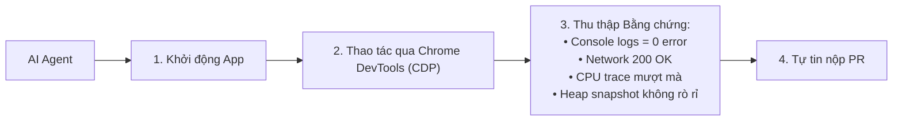
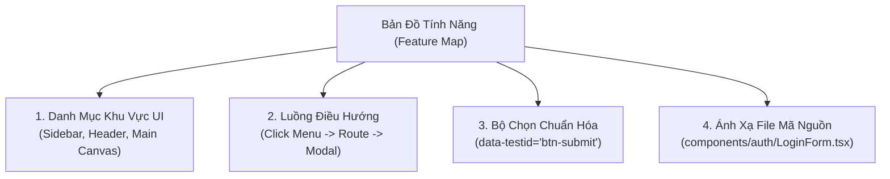

# Kỹ năng Tự Xác minh (Verification Skills), Feature Map & PR Nguyên tử

> **Loại: tham khảo.** Tổng hợp từ tra cứu của người dùng để làm tri thức cho agent, không phải nguồn luật. Khi khác `AGENTS.md`, vai trò hoặc `agents/protocols/` thì theo các nơi đó (`agents/protocols/source-precedence.md`).
> **Khác với chuẩn:** Điều khiển trình duyệt qua CDP chưa được khai báo cho vai nào ngoài `researcher` (`AGENTS.md` quy tắc 12). Chỉ dùng khi người dùng cho phép trong phiên.

Tài liệu này tổng hợp phương pháp thực chiến từ **Lauren Tan (Kỹ sư AI tại SpaceX / Cursor)** giúp nâng cao sản lượng phát triển của AI Agent từ vài PR lên **hơn 1.000 PRs/tháng** mà vẫn đảm bảo độ tin cậy tuyệt đối. Áp dụng cho các vai trò `dev`, `mobile`, `reviewer`, `qa`, và `architect`.

---

## I. Kỹ năng Tự Xác minh (Verification Skills)

### 1. Vấn đề cốt tử
Nếu Agent chỉ viết code xong và dựa hoàn toàn vào việc con người review bằng mắt, con người sẽ trở thành **Điểm nghẽn Xác minh (Verifier Bottleneck)**. Agent bắt buộc phải có **Kỹ năng Tự Xác minh**: tự chạy ứng dụng, tự thao tác và tự thu thập bằng chứng chứng minh mã nguồn hoạt động.

### 2. Các Kỹ thuật Xác minh Cốt lõi
- **Chrome DevTools Protocol (CDP) / Browser Automation:**
  Agent sử dụng Playwright / Patchright hoặc kết nối trực tiếp cổng CDP để:
  * Mở trang web hoặc ứng dụng desktop (Electron).
  * Giả lập thao tác click, nhập liệu người dùng thực tế.
  * Lắng nghe sự kiện `console.error` và network failures. Nếu phát hiện ngoại lệ $\rightarrow$ tự động debug sửa code ngay trong phiên.
- **Đo lường CPU Traces & Heap Snapshots:**
  * Chụp Heap Snapshot trước và sau khi thực hiện thao tác UI lặp lại 10 lần.
  * Nếu dung lượng bộ nhớ tăng liên tục không giải phóng $\rightarrow$ phát hiện sớm rò rỉ bộ nhớ (Memory Leak / Event Listener chưa tháo).
- **Mobile Simulator:**
  * Với vai trò `mobile`: tự động khởi chạy iOS Simulator / Android Emulator, build debug và xác nhận màn hình render đúng bố cục.

---

## II. Bản đồ Tính năng (Feature Map)

### 1. Tại sao cần Feature Map?
Khi codebase phát triển lớn, AI Agent thường gặp hiện tượng **"chạy lòng vòng" (flailing around / churning)** do không biết component UI nào nằm ở file nào, hoặc không biết đường dẫn điều hướng đến tính năng cần sửa.

**Feature Map** là tệp ngữ cảnh bản đồ cấu trúc giao diện cung cấp cho Agent:
- Vị trí các khu vực UI (Sidebar, Settings tab, Data table).
- Lối tắt bàn phím (Keyboard shortcuts).
- Bộ chọn DOM / CDP selectors chính xác (`id`, `data-testid`).
- Đường dẫn file mã nguồn phụ trách từng khối component.

### 2. Ứng dụng Giải quyết Báo cáo Lỗi Mơ hồ
Khi người dùng chỉ gửi một bức ảnh chụp màn hình kèm câu hỏi ngắn (ví dụ: *"Nút này bấm không ăn?"*):
- Agent đối chiếu ảnh với **Feature Map** để định vị ngay component và file mã nguồn tương ứng.
- Agent kích hoạt **Verification Skill** để tự điều hướng tới màn hình đó và tái hiện lỗi mà không cần hỏi lại người dùng nhiều lần.

---

## III. Quy tắc PR Nguyên tử (Atomic PRs)

### 1. Triết lý
> *"Không có giới hạn số dòng cứng nhắc (từ 50 đến 1,000 dòng), nhưng một PR bắt buộc phải là một **Thay đổi Nguyên tử (Atomic Change)**: làm đúng một việc trọn vẹn, chạy được, kiểm thử được và hoàn tác được an toàn."*

### 2. 4 Tiêu chuẩn của một Atomic PR
1. **Một Ý định Độc lập (Single Intent):** Một PR chỉ giải quyết duy nhất 1 mục tiêu (hoặc 1 refactor, hoặc 1 feature mới, hoặc 1 bugfix; không gộp chung).
2. **Luôn Xanh CI (Green Builds):** Mọi commit trong PR đều phải build thành công và pass toàn bộ test suite.
3. **Dễ Rollback (Revertible):** Khi xảy ra sự cố trên production, có thể revert PR bằng 1 lệnh git mà không làm gãy các tính năng khác.
4. **Không Tạo Breaking Change Ngầm:** Nếu thay đổi API contract, phải có giai đoạn chuyển tiếp (Deprecation Phase) hoặc cập nhật đồng bộ các caller.
