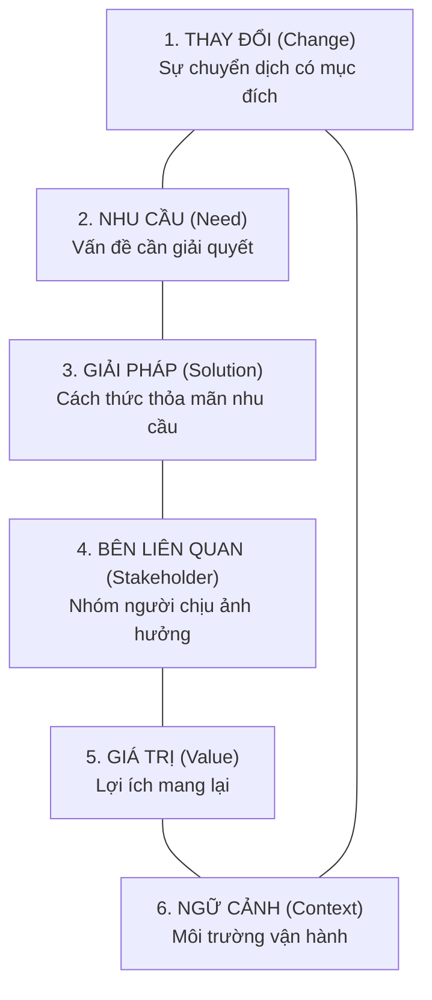
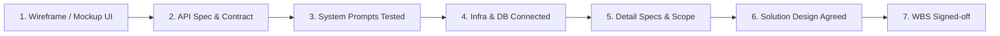
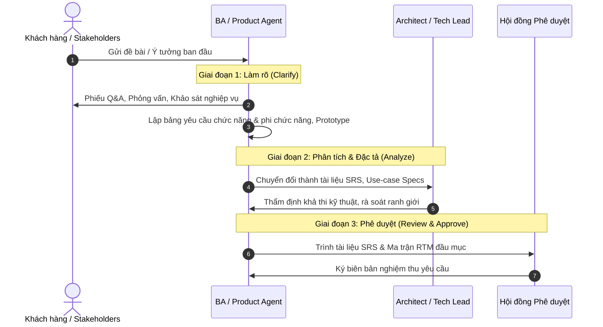

# Mô hình BACCM, Quản lý Yêu cầu (RD) & Yêu cầu Thay đổi (CR)

> **Loại: tham khảo.** Tổng hợp từ tra cứu của người dùng để làm tri thức cho agent, không phải nguồn luật. Khi khác `AGENTS.md`, vai trò hoặc `agents/protocols/` thì theo các nơi đó (`agents/protocols/source-precedence.md`).
> **Khác với chuẩn:** Bảy tiêu chí DoR đã đưa vào `protocols/task-loop.md` mục 2b. Quy trình CR chuẩn nằm ở `protocols/change-request.md`.

Tài liệu này chuẩn hóa quy trình phân tích nghiệp vụ, quản lý yêu cầu đặc tả (Requirement Development - RD), yêu cầu thay đổi (Change Request - CR) và tiêu chuẩn sẵn sàng (**Definition of Ready - DoR**). Áp dụng cho các vai trò `ba`, `product`, `analyst`, `architect`, và `lead`.

---

## I. Mô hình BACCM (Business Analysis Core Concept Model)

Mô hình BACCM định nghĩa 6 khái niệm cốt lõi tạo nên nền tảng của mọi phân tích nghiệp vụ:

1. **Change (Thay đổi):** Hành vi cải tiến hệ thống để tạo ra sự khác biệt tích cực.
2. **Need (Nhu cầu):** Vấn đề, thách thức hoặc cơ hội kinh doanh mà tổ chức phải đối mặt.
3. **Solution (Giải pháp):** Phương thức cụ thể (phần mềm, quy trình, mô hình AI) để đáp ứng nhu cầu.
4. **Stakeholder (Bên liên quan):** Nhóm người có quyền lợi, vai trò hoặc bị tác động bởi giải pháp.
5. **Value (Giá trị):** Lợi ích định lượng hoặc định tính thu được từ việc áp dụng giải pháp.
6. **Context (Ngữ cảnh):** Môi trường kỹ thuật, văn hóa, tổ chức và giới hạn hạ tầng bao quanh.

---

## II. 7 Tiêu chí Sẵn sàng (Definition of Ready - DoR)

Trước khi chuyển giao bất kỳ yêu cầu nào sang cho đội ngũ thiết kế kỹ thuật hoặc Agent thực thi (`dev`), yêu cầu đó bắt buộc phải đạt đủ **7 tiêu chuẩn DoR**:

1. **UI/UX Design:** Đã có Wireframe hoặc Mockup giao diện, thể hiện rõ các trạng thái (Normal, Loading, Error, Empty).
2. **Technical Contract / API Spec:** Xác định rõ ràng cấu trúc Endpoint, Schema Input/Output, mã lỗi và kiểu dữ liệu.
3. **Prompt Engineering:** Đối với module AI, các Prompt mẫu đã được thử nghiệm độc lập trên dữ liệu thực tế và đạt độ chính xác kỳ vọng.
4. **Dependencies & Infrastructure:** Cơ sở dữ liệu, dịch vụ bên thứ 3 và môi trường thực thi đã sẵn sàng kết nối.
5. **Detail Requirements & Root Cause:** Mục tiêu nghiệp vụ, phạm vi giới hạn (In-Scope / Out-of-Scope) và nguyên nhân gốc rễ được làm rõ.
6. **Functional & Solution Design:** Kiến trúc sư (`architect`) và Trưởng nhóm (`lead`) đã thống nhất phương án kỹ thuật.
7. **Breakdown Approval:** Danh mục công việc (WBS) được bóc tách hạt mịn và được các bên liên quan ký duyệt.

---

## III. Quy trình Quản lý Yêu cầu Đặc tả (Requirement Development - RD)

Quy trình phát triển yêu cầu chuẩn hóa qua 3 giai đoạn:

---

## IV. Quy trình Quản lý Yêu cầu Thay đổi (Change Request - CR)

Khi có thay đổi phát sinh sau khi baseline yêu cầu đã đóng:

1. **Khởi tạo CR:** Bên yêu cầu điền biểu mẫu `Change_Request_Form` (mô tả thay đổi, lý do, mức độ ưu tiên).
2. **Phân tích Tác động (Impact Analysis):** 
   - Đánh giá ảnh hưởng tới Tam giác Quản trị: Phạm vi (Scope), Chi phí (Cost), Thời gian (Time), và Chất lượng (Quality).
   - Đánh giá tác động mã nguồn: Rà soát các module bị ảnh hưởng qua `Function_RTM`.
3. **Phê duyệt qua Hội đồng Kiểm soát Thay đổi (CCB - Change Control Board):**
   - Thành phần CCB: Product Owner, Tech Lead, PM, QA Lead.
   - Các mức quyết định:
     * `APPROVED`: Đưa vào Schedule của Sprint tiếp theo.
     * `REJECTED`: Ghi rõ lý do từ chối và lưu trữ vào hồ sơ.
     * `DEFERRED`: Tạm hoãn sang giai đoạn sau (Backlog).
4. **Cập nhật & Thực thi:**
   - Cập nhật phiên bản tài liệu SRS, cập nhật ma trận truy vết yêu cầu qua `scripts/rtm.py` (`build/rtm/RTM.md`).
   - Phân rã task mới vào WBS và thông báo cho đội ngũ thực thi.
5. **Nghiệm thu & Đóng CR:** Kiểm thử UAT tính năng thay đổi $\rightarrow$ Ký biên bản $\rightarrow$ Đóng CR.
