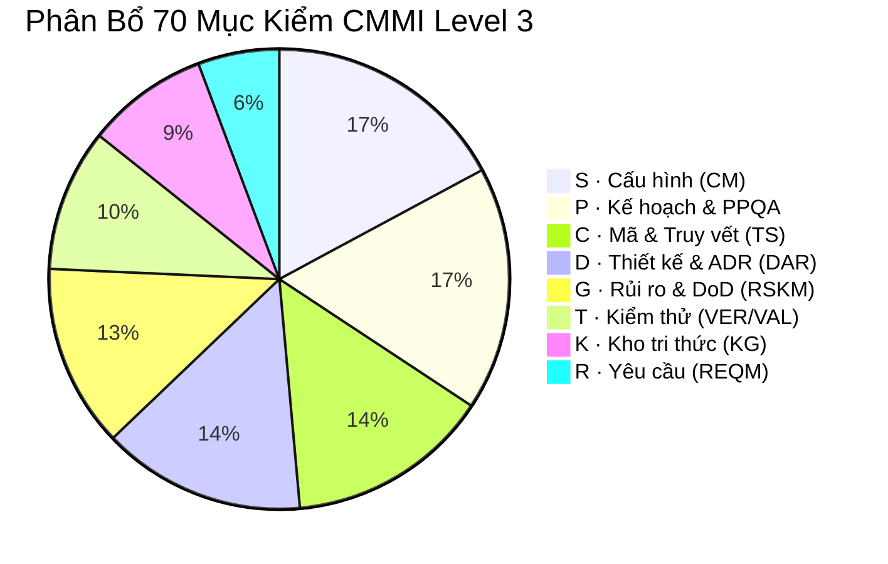

# Bộ 70 Mục kiểm CMMI Level 3 & PMBOK cho QA/Reviewer

> **Loại: tham khảo.** Tổng hợp từ tra cứu của người dùng để làm tri thức cho agent, không phải nguồn luật. Khi khác `AGENTS.md`, vai trò hoặc `agents/protocols/` thì theo các nơi đó (`agents/protocols/source-precedence.md`).
> **Khác với chuẩn:** Danh mục kiểm tham khảo cho việc cỡ lớn hoặc khi cần nghiệm thu theo CMMI; không phải mục bắt buộc của mọi task.

Tài liệu này cung cấp khung kiểm định chất lượng toàn diện theo chuẩn **CMMI Level 3** kết hợp **PMBOK**, được chuẩn hóa thành **70 mục kiểm** phân bổ qua 8 nhóm chỉ số. Vai trò `qa`, `reviewer`, và `runner` bắt buộc sử dụng bộ tiêu chí này để rà soát mã nguồn và quy trình.

---

## I. Phân bổ 8 Nhóm Chỉ số (70 Mục kiểm)



---

## II. Chi tiết 70 Mục kiểm theo từng Nhóm

### Nhóm S · Quản lý Cấu hình (Configuration Management - CM): 12 Mục
- [ ] **S01:** Nhánh Git được tạo đúng quy chuẩn (`task-branch.py`, format `feat/<task>-<slug>`).
- [ ] **S02:** Không commit trực tiếp vào các nhánh bảo vệ (`main`, `develop`, `release/*`).
- [ ] **S03:** Lịch sử commit sạch, không có commit rác, merge commit ngoài ý muốn.
- [ ] **S04:** Không sử dụng các lệnh nguy hiểm (`commit --amend`, force push, reset hard).
- [ ] **S05:** Định dạng commit message chuẩn: có `STT: <task_id>` và tiền tố (`feat:`, `fix:`, `refactor:`).
- [ ] **S06:** Không commit file cấu hình môi trường bí mật (`.env*`, token, chứng thư số).
- [ ] **S07:** File `.gitignore` và `.gitattributes` được cấu hình đầy đủ cho stack hiện tại.
- [ ] **S08:** Hash nội dung commit và tree khớp với kiểm toán chuỗi băm (Audit Hash-chain).
- [ ] **S09:** Các file phụ thuộc (lockfile: `package-lock.json`, `poetry.lock`) đồng bộ với manifest.
- [ ] **S10:** Không có file sinh tự động (`dist/`, `build/`, `__pycache__/`) trong commit diff.
- [ ] **S11:** Kế hoạch commit (Commit Plan) được lập chi tiết trước khi thực hiện.
- [ ] **S12:** Tag phiên bản (Release Tag) tuân thủ Semantic Versioning (`vMAJOR.MINOR.PATCH`).

### Nhóm P · Kế hoạch & Đảm bảo Chất lượng (PMC / PPQA): 12 Mục
- [ ] **P01:** Task card trong `tasks/` được điền đầy đủ các trường bắt buộc.
- [ ] **P02:** Phân cỡ việc chính xác (`nhỏ`, `vừa`, `lớn`) theo quy chuẩn `AGENTS.md §2`.
- [ ] **P03:** Việc từ cỡ "vừa" trở lên đã có `[x] Plan Approved` từ người thẩm định chuyên trách.
- [ ] **P04:** Subtask được chia hạt mịn: mỗi subtask có một mục đích duy nhất, kiểm tra được.
- [ ] **P05:** Mỗi Subtask được giao cho 1 Subagent mới tinh (Fresh Subagent per Subtask).
- [ ] **P06:** Giới hạn số tool calls của Subagent không vượt trần 8–10 bước.
- [ ] **P07:** Có Micro Handoff Note tại `docs/notes/inbox/` sau khi kết thúc subtask.
- [ ] **P08:** Không để xảy ra sự cố tràn context (`Compaction exhausted` / `gateway_timeout`).
- [ ] **P09:** Có kịch bản hoàn tác (Rollback Plan) cho các tác vụ thay đổi hạ tầng/CSDL.
- [ ] **P10:** Báo cáo tiến độ cập nhật đúng mốc, không báo cáo khống.
- [ ] **P11:** Thực hiện Audit độc lập định kỳ (PPQA Audit checklist).
- [ ] **P12:** Mọi điểm không phù hợp (Non-conformance) được ghi nhận vào sổ nợ `DEBT.md`.

### Nhóm C · Mã nguồn & Truy vết (Technical Solution / Coding - TS): 10 Mục
- [ ] **C01:** Có thẻ `@rtm-ref` ở đầu mỗi file mã nguồn mới hoặc chỉnh sửa.
- [ ] **C02:** Tuân thủ chuẩn đặt tên (Naming Conventions) của ngôn ngữ/framework.
- [ ] **C03:** Áp dụng nguyên tắc Deep Modules: giao diện ngoài đơn giản, cài đặt trong mạnh mẽ.
- [ ] **C04:** Không có Hardcoded Credentials, API keys, URLs cứng trong code.
- [ ] **C05:** Không có Dead Code, hàm không sử dụng, biến thừa (Unused Variables).
- [ ] **C06:** Không sửa chéo file ngoài phạm vi đã khai báo trong kế hoạch tệp.
- [ ] **C07:** Tuân thủ quy tắc Surgical Patching: chỉ sửa đúng chỗ cần sửa, giữ nguyên comment/docstring cũ.
- [ ] **C08:** Xử lý ngoại lệ đầy đủ, không nuốt lỗi (No empty catch/except blocks).
- [ ] **C09:** Mã nguồn pass 100% các công cụ Static Analysis / Linter (ESLint, Flake8).
- [ ] **C10:** Không còn chú thích nợ kỹ thuật kiểu `# TODO` chưa khai báo vào `DEBT.md`.

### Nhóm D · Thiết kế & Đánh giá Quyết định (Design & DAR): 10 Mục
- [ ] **D01:** Tài liệu thiết kế kỹ thuật (System Design) được lập trước khi code.
- [ ] **D02:** Lập hồ sơ quyết định kiến trúc (**ADR**) khi có từ 2 phương án kỹ thuật trở lên.
- [ ] **D03:** API Spec đặc tả đầy đủ Request/Response Schema, Status Codes, và Error Contracts.
- [ ] **D04:** Lược đồ cơ sở dữ liệu (ERD) có khóa chính, chỉ mục (Index) và ràng buộc toàn vẹn.
- [ ] **D05:** Phân tách ranh giới rõ ràng giữa các tầng (Layer Boundaries / Clean Architecture).
- [ ] **D06:** Áp dụng nguyên tắc Colocation: gom nhóm mã nguồn tính năng vào một thư mục.
- [ ] **D07:** Kiểm tra cây phụ thuộc (Dependency Graph): không có phụ thuộc vòng (Circular Dependency).
- [ ] **D08:** Sơ đồ luồng (Sequence/Flowchart) vẽ đúng chuẩn SVG/Mermaid.
- [ ] **D09:** Tính toán khả năng mở rộng (Scalability) và chịu tải dưới 100 QPS.
- [ ] **D10:** Hồ sơ ADR được Reviewer và Tech Lead phê duyệt chính thức.

### Nhóm G · Rủi ro & Tiêu chí Hoàn thành (Risk & DoD - RSKM): 9 Mục
- [ ] **G01:** Bảng đánh giá rủi ro (Risk Register) được cập nhật khi có thay đổi lớn.
- [ ] **G02:** Đạt đầy đủ 11 tiêu chí Definition of Done (DoD).
- [ ] **G03:** Kiểm soát rủi ro bảo mật: rà soát lỗ hổng thư viện (Snyk / Dependabot / Trivy).
- [ ] **G04:** Kịch bản xử lý sự cố khẩn cấp (Hotfix Protocol) được chuẩn bị sẵn.
- [ ] **G05:** Kiểm toán an ninh 4 chiều theo khung CSO (`cso.py`).
- [ ] **G06:** Không có vi phạm quy định cấp quyền tối thiểu (Least Privilege).
- [ ] **G07:** Độ trễ phản hồi hệ thống nằm trong ngưỡng cho phép (SLA/SLO).
- [ ] **G08:** Đảm bảo tính sẵn sàng cao và không gây gián đoạn dịch vụ (Zero-Downtime).
- [ ] **G09:** Báo cáo rủi ro tồn đọng được Lead xác nhận trước khi phát hành.

### Nhóm T · Kiểm thử & Nghiệm thu (Verification & Validation - VER/VAL): 7 Mục
- [ ] **T01:** 100% Unit Test pass thành công, không có test bị bỏ qua (`skip`/`ignore`).
- [ ] **T02:** 100% Integration Test pass trên môi trường tích hợp.
- [ ] **T03:** Kiểm thử kịch bản biên (Boundary testing) và dữ liệu không hợp lệ.
- [ ] **T04:** Không có flaky tests (test chạy chập chờn khi chạy lặp lại 5 lần).
- [ ] **T05:** Áp dụng Verification Skills: kiểm thử qua Chrome DevTools/CDP/Simulator khi có UI.
- [ ] **T06:** Mọi lỗi phát hiện đều có kịch bản tái hiện lỗi độc lập (`bug-repro.md`).
- [ ] **T07:** Người dùng/PO ký nghiệm thu chấp nhận người dùng (UAT Sign-off).

### Nhóm K · Quản lý Kho Tri thức (Knowledge Graph - KG): 6 Mục
- [ ] **K01:** Tệp `knowledge-manifest.json` vượt qua 11 bộ kiểm tra (V00–V10) với 0 lỗi.
- [ ] **K02:** Hash sha256 của các file tri thức trong manifest khớp 100% với file vật lý.
- [ ] **K03:** Không có liên kết gãy (Dangling Relations) hoặc trỏ tới node không tồn tại.
- [ ] **K04:** Ngữ cảnh trích xuất cho từng Role nằm trong định mức ngân sách token (`ContextBudget`).
- [ ] **K05:** Tri thức mới được cập nhật và liên kết vào Đồ thị tri thức ngay sau khi nghiệm thu task.
- [ ] **K06:** Các tài liệu lỗi thời được đánh dấu trạng thái `deprecated` hoặc `stale`.

### Nhóm R · Quản lý Yêu cầu (Requirement Management - REQM): 4 Mục
- [ ] **R01:** Đáp ứng 7 tiêu chí Definition of Ready (DoR) trước khi phân bổ task.
- [ ] **R02:** Ma trận truy vết 2 chiều giữa Yêu cầu $\leftrightarrow$ Thiết kế $\leftrightarrow$ Code $\leftrightarrow$ Test đầy đủ.
- [ ] **R03:** Mọi yêu cầu thay đổi (CR) đều được Hội đồng Kiểm soát Thay đổi (CCB) phê duyệt.
- [ ] **R04:** Không có tình trạng phình phạm vi ngoài kế hoạch (Scope Creep).

---

## III. Mẫu Báo cáo Đánh giá Nghiệm thu của QA

Khi thực hiện kiểm tra 70 mục, vai `qa` / `reviewer` xuất báo cáo theo mẫu sau:

```markdown
# Báo cáo Thẩm định Tuân thủ CMMI Level 3 (Task: T-XX)

- **Người thực hiện:** qa / reviewer
- **Thời gian thẩm định:** <ISO UTC>
- **Số mục đạt:** X / 70 mục (Y%)

### Phân loại Kết luận:
- [ ] **PASS:** Đạt 70/70 mục (hoặc không có lỗi Critical/Major). Đủ điều kiện merge.
- [ ] **PASS_WITH_PENDING:** Đạt $\ge 90\%$, không có lỗi bảo mật/kiến trúc. Cần khắc phục việc nhỏ trước release.
- [ ] **FAIL:** Vi phạm bất kỳ mục nào thuộc S02, S06, C01, C06, D02, T01, K01. Dừng merge, trả về Dev sửa.

### Danh sách Lỗi / Khuyến nghị:
1. [Mã_Mục]: Chi tiết lỗi phát hiện và cách khắc phục.
```
