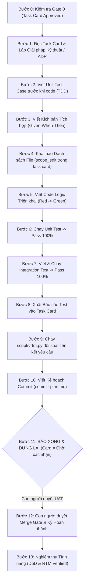

# Quy trình 13 Bước TDD/ATDD & Tiêu chuẩn DoD

> **Loại: tham khảo.** Tổng hợp từ tra cứu của người dùng để làm tri thức cho agent, không phải nguồn luật. Khi khác `AGENTS.md`, vai trò hoặc `agents/protocols/` thì theo các nơi đó (`agents/protocols/source-precedence.md`).
> **Khác với chuẩn:** Cách đánh số bước và Cổng 0 khác `protocols/task-loop.md` (chuẩn: bước 11 là ghi chú bàn giao, bước 13 là dừng chờ xác nhận; Cổng 0 là nhật ký phiên trước đã duyệt). "Chờ xác nhận" tương ứng `review`, "Hoàn thành" tương ứng `done` (`protocols/task-card.md`). 11 tiêu chí DoD ở đây là danh mục tham khảo; chuẩn theo cỡ việc ở `protocols/definition-of-done.md`. Thẻ `@rtm-ref` và `STT:` trong commit chưa là quy định bắt buộc; commit theo `protocols/git-rules.md`.

Tài liệu này quy chuẩn hóa chu trình thực thi công việc (task execution) bằng phương pháp **Test-Driven Development (TDD)** và **Acceptance Test-Driven Development (ATDD)** kết hợp mô hình kiểm soát cổng chặn (Gatekeeper). Mọi Agent thực thi (`dev`, `mobile`) và `reviewer`/`qa` bắt buộc tuân thủ.

---

## I. Chu trình 13 Bước Thực thi Task (Tương thích với agent-base)



### Chi tiết 13 Bước:

- **Bước 0 — Kiểm tra Gate 0:** Rà soát task card trong `tasks/`. Task phải ở trạng thái hợp lệ, có kế hoạch rõ ràng và được thẩm định (`[x] Plan Approved`).
- **Bước 1 — Phân tích Kỹ thuật & ADR:** Đọc task card. Bóc tách kiến trúc; nếu có $\ge 2$ phương án kỹ thuật thì bắt buộc lập hồ sơ quyết định kiến trúc (**ADR**) tại `docs/adr/`.
- **Bước 2 — Viết Unit Test Cases trước:** Viết test case kiểm tra biên, ngoại lệ và luồng nghiệp vụ chính vào bộ test trước khi viết bất kỳ dòng code logic nào.
- **Bước 3 — Lập Kịch bản Kiểm thử Tích hợp:** Định nghĩa kịch bản kiểm thử theo cấu trúc Given-When-Then trong test suite.
- **Bước 4 — Khai báo Phạm vi Tệp (`scope_edit`):** Khai báo chính xác danh sách file dự kiến sửa đổi trong task card. Tuyệt đối cấm sửa file ngoài phạm vi đã khai báo.
- **Bước 5 — Lập trình Logic Triển khai:** Viết mã nguồn tối thiểu để vượt qua các test case đã viết ở Bước 2 (chu trình Red $\rightarrow$ Green $\rightarrow$ Refactor).
- **Bước 6 — Hoàn thiện Unit Test:** Chạy test suite và sửa code cho đến khi **Pass 100%**, độ phủ dòng và nhánh đạt yêu cầu.
- **Bước 7 — Chạy Integration Test:** Kết nối cơ sở dữ liệu thật hoặc môi trường mô phỏng để kiểm tra luồng end-to-end $\rightarrow$ **Pass 100%**.
- **Bước 8 — Xuất Báo cáo Kiểm thử:** Ghi nhận kết quả test (thời gian chạy, số lượng test case, tỷ lệ thành công) vào mục Nghiệm thu của task card.
- **Bước 9 — Cập nhật Ma trận Truy vết:** Chạy `python scripts/rtm.py` để cập nhật ma trận truy vết yêu cầu `build/rtm/RTM.md` và kiểm tra độ phủ.
- **Bước 10 — Lập Kế hoạch Commit:** Viết kế hoạch commit chi tiết vào task card theo chuẩn `agents/protocols/commit-plan.md` (không tự ý chạy git commit trừ khi người dùng yêu cầu rõ).
- **Bước 11 — DỪNG LẠI BẮT BUỘC:** 
  > [!IMPORTANT]
  > Agent báo cáo: "Task đã hoàn thành, server local đã sẵn sàng", chuyển trạng thái task trên card sang **"Chờ xác nhận"** và **DỪNG LẠI NGAY LẬP TỨC**. Tuyệt đối cấm tự ý chuyển sang làm task tiếp theo.
- **Bước 12 & 13 — Nghiệm thu Con người:** Con người tiến hành UAT, ký chuyển task card sang "Hoàn thành" (Gate 6) và nghiệm thu tính năng (Gate 7).

---

## II. Quy ước Thẻ Truy vết (Code Traceability)

### 1. Thẻ Header bắt buộc trên mọi File Mã nguồn
Mọi file mã nguồn mới tạo hoặc sửa đổi bắt buộc có thẻ định danh ở dòng đầu tiên:
```typescript
/**
 * @rtm-ref REQ-AUTH-001 | TASK: T-57 | MODULE: IAM
 * @owner dev
 */
```

### 2. Định dạng Commit Message chuẩn
Commit message phải gắn mã định danh task để phục vụ đối soát tự động:
```text
feat(auth): STT: 57 Triển khai middleware xác thực JWT với Refresh Token

- Viết Unit Test cho JWT expiration
- Cài đặt token blacklist trên Redis
- Cập nhật Function_RTM và TDD_TestCases
```

---

## III. 11 Tiêu chí Hoàn thành (Definition of Done - DoD)

Một task chỉ được coi là hoàn thành khi đáp ứng đầy đủ 11 tiêu chí sau:

1. **Code Quality:** Đã qua Code Review (AI Review hoặc Peer Review), không còn lỗi mức `Critical` hoặc `Major`.
2. **Unit Testing:** 100% Unit Test cho module/class pass thành công.
3. **Integration Testing:** 100% Integration Test cho luồng liên module pass thành công.
4. **Acceptance Verification:** Toàn bộ tiêu chí nghiệm thu (Acceptance Criteria - AC) được kiểm chứng.
5. **Performance Threshold:** Thời gian xử lý đáp ứng ngưỡng quy định (ví dụ: API phản hồi $<200\text{ms}$, tác vụ AI $<5\text{s}$).
6. **Documentation Updated:** Cập nhật tài liệu API Spec, README, cấu hình liên quan.
7. **Title Standardization:** Tiêu đề task/PR chuẩn hóa đúng định dạng tracking.
8. **TDD / ATDD Compliant:** Có bằng chứng test case được viết trước code logic.
9. **Knowledge Sharing:** Ghi chú kỹ thuật, bẫy lỗi (gotchas) được gộp vào `docs/notes/inbox/`.
10. **Code Traceability:** Gắn đủ thẻ `@rtm-ref` và cập nhật đường dẫn file vào `Function_RTM`.
## IV. Hệ thống 8 Cổng Phê duyệt của Con người (Gates 0 – 7)

Để đảm bảo con người luôn giữ vai trò **Kiến trúc sư trưởng** và loại bỏ hoàn toàn mô hình "công nhân dọn rác" (Janitor Model), Agent chỉ được phép tiếp tục công việc khi vượt qua 8 cổng kiểm soát sau:

| Cổng | Tên cổng duyệt | Điều kiện & Tiêu chí để vượt qua | Người duyệt |
|---|---|---|---|
| **Gate 0** | **Khởi tạo An toàn** | Task trước đó đã hoàn tất, không còn nợ kỹ thuật tồn đọng chưa khai báo. | `lead` / Người dùng |
| **Gate 1** | **Duyệt Danh mục Tài liệu** | Danh mục tài liệu yêu cầu (SRS, PRD) đã được lập đầy đủ theo chuẩn. | `product` / `ba` |
| **Gate 2** | **Duyệt Thiết kế Chi tiết** | System Design, API Spec, Schema CSDL đã được thẩm định tính khả thi. | `architect` |
| **Gate 3** | **Duyệt Quyết định Kiến trúc (ADR)** | Khi có $\ge 2$ phương án kỹ thuật, hồ sơ ADR được lập và chọn phương án tối ưu. | `architect` / Tech Lead |
| **Gate 4** | **Duyệt Phân quyền & Actor** | Ma trận Actor/Role và ranh giới quyền hạn được phê duyệt rõ ràng. | `security` / `lead` |
| **Gate 5** | **Duyệt Kế hoạch Phân rã (Plan Approved)** | Subtasks được chia hạt mịn (2–5 phút), có tiêu chí nghiệm thu rõ ràng. | `reviewer` / `lead` |
| **Gate 6** | **Nghiệm thu Mã nguồn & Test** | Pass 100% Unit/Integration Test, đạt 11 tiêu chí DoD, con người ký Hoàn thành. | `reviewer` / Người dùng |
| **Gate 7** | **Nghiệm thu Tính năng Phát hành** | Chạy thử UAT thực tế thành công, ma trận truy vết RTM đạt độ phủ 100%. | Product Owner / Người dùng |

> [!WARNING]
> **Quy định pháp lý của hệ thống:** Việc người dùng gõ "OK" hoặc "tiếp tục đi" trong cửa sổ chat **không có giá trị nghiệm thu**. Bắt buộc phải có dấu phê duyệt chính thức bằng file (đóng dấu `[x] Plan Approved` hoặc ký duyệt task card).

