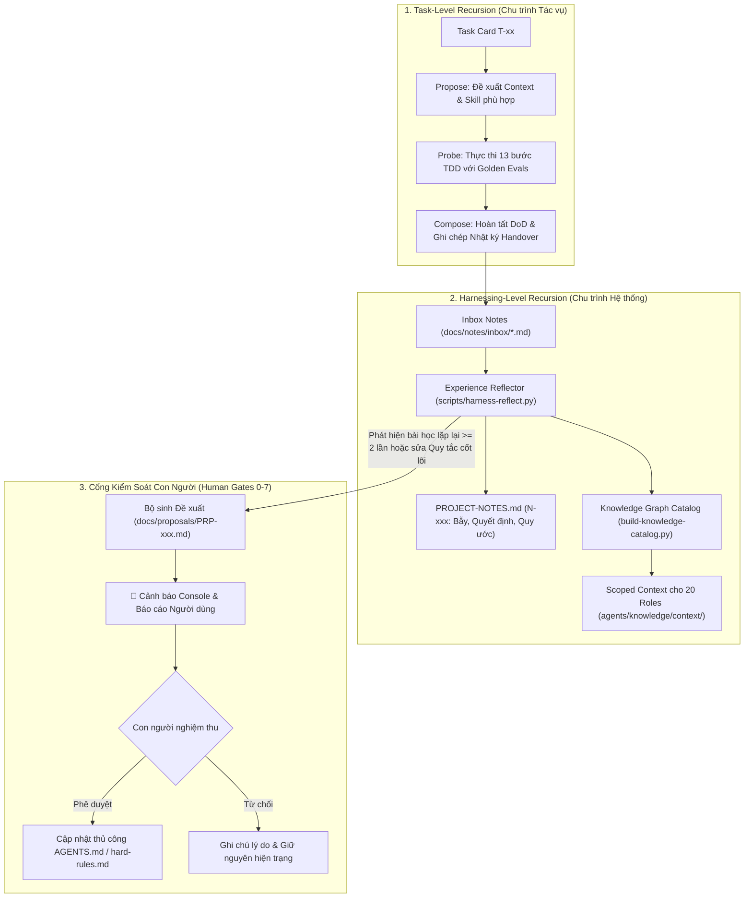

# Nghiên cứu & Áp dụng Framework Harness² (Google Research)

> **Mã định danh:** `harness2-framework`  
> **Nguồn gốc:** Google Research, Paper arXiv:2610.14224 (Harness²: Recursive Agent Harnessing for an Open World)  
> **Mã nguồn cục bộ (Kho kiểm dịch):** `/Users/ducnvh/Documents/skill/repos/harness2`  
> **Trạng thái:** `draft` (Chờ nghiệm thu con người)  
> **Ngày tích hợp:** 2026-10-28  

---

## 1. Tổng quan về Harness²

Trong kiến trúc trí tuệ nhân tạo hiện đại, một **Harness** (bộ cương / khung bao bọc) là toàn bộ hệ thống xung quanh mô hình ngôn ngữ lớn (LLM) để nó có thể hành động hiệu quả như một Agent thực thụ. Harness bao gồm:
- **System Prompts & Personas**: Định hình vai trò và nguyên tắc ứng xử.
- **Tools & MCP Servers**: Công cụ giao tiếp với thế giới bên ngoài (mã nguồn, browser, API, CSDL).
- **Skills & Knowledge Graph**: Cẩm nang hướng dẫn chuyên môn và đồ thị tri thức ngữ cảnh.
- **Memory & Orchestration**: Bộ nhớ ngắn hạn/dài hạn, nhật ký công việc và cơ chế điều phối.

**Harnessing** là quá trình tối ưu hóa liên tục hệ thống bao bọc này mà **không thay đổi trọng số mô hình (model weights)**.

Framework **Harness²** của Google Research thiết lập mô hình **đệ quy hai cấp độ (two-level recursion)**:
1. **Task-level recursion (Cấp độ Tác vụ)**: Tinh chỉnh harness ngay trong lúc thực hiện tác vụ thông qua chu trình tương phản **Propose – Probe – Compose** (Đề xuất thay đổi $\rightarrow$ Thử nghiệm probe $\rightarrow$ Tổng hợp harness tối ưu).
2. **Harnessing-level recursion (Cấp độ Khung)**: Cập nhật bền vững một *Improvement Harness* (thư viện tri thức & bài học `EXPERIENCE.md`, `INDEX.md`) sau mỗi tác vụ để tích lũy kinh nghiệm lâu dài cho các tác vụ tương lai.

---

## 2. Áp dụng Harness² vào Hệ Thống Agent Base (20 Roles)

Dự án `agent-base` áp dụng nguyên bản triết lý đệ quy của Harness² nhưng được bản địa hóa và siết chặt theo chuẩn CMMI Level 3 và Agile SDLC:

---

## 3. Bốn Ràng Buộc Cốt Lõi Bất Biến (Immunity & Safety Constraints)

Để ngăn ngừa nguy cơ tự diễn biến nguy hại (hallucination drift hoặc tự nới lỏng an ninh), quá trình tự học của Harness² trong `agent-base` bị khóa chặt bởi 4 quy tắc sắt:

### 3.1. Tuyệt Đối Không Tự Sửa Quy Tắc Cốt Lõi (Hard Rules Immunity)
- Mô hình tự học **KHÔNG ĐƯỢC PHÉP** tự ý ghi đè hoặc chỉnh sửa:
  - `AGENTS.md` (Quy tắc workspace và chỉ mục tri thức cốt lõi).
  - `hard-rules.md` (Các lệnh cấm bảo mật, secret scanning, git push permissions).
  - Các cấu hình phân quyền Git, token, secret.
- **Cơ chế Báo lại (Alert & Proposal)**: Khi hệ thống phát hiện một quy ước hoặc bẫy lặp lại nhiều lần đòi hỏi phải thay đổi quy tắc cốt lõi, hệ thống **bắt buộc phải dừng lại**, lập tài liệu đề xuất tại `docs/proposals/PRP-xxx.md` kèm 3 phương án và in cảnh báo ra màn hình để con người trực tiếp xem xét và sửa đổi.

### 3.2. Tri Thức Mới Luôn Bắt Đầu ở Trạng Thái An Toàn (Draft-by-Default)
- Mọi Node tri thức mới được sinh tự động hoặc đề xuất đều phải mang nhãn `state: "draft"`.
- Node `draft` phải vượt qua 11 Validators tĩnh (V00–V10) của `build-knowledge-catalog.py`.
- Chỉ sau khi có chữ ký phê duyệt của con người (Gate 2 / Gate 6), Node mới được chuyển sang `state: "approved"` để trở thành tri thức chuẩn.

### 3.3. Độ Bền Vững của Bộ Nhớ (Memory Immutability & Strikethrough Deprecation)
- Thông tin, quy ước hoặc ghi chú cũ **tuyệt đối không được xóa bỏ âm thầm** khỏi `docs/PROJECT-NOTES.md`.
- Nếu một quy ước không còn chính xác hoặc bị thay thế bởi quyết định mới:
  - Gạch ngang nội dung cũ: `~~[N-xxx] Quy ước cũ...~~`
  - Bổ sung lý do điều chỉnh và liên kết đến quyết định mới: `*(Đã điều chỉnh theo ADR-yyy / PRP-zzz vì lý do...)*`

### 3.4. Giữ Nguyên 100% Bộ 20 Roles
- Quá trình tự học và cập nhật tri thức chỉ tối ưu hóa **Scoped Context** (`agents/knowledge/context/<role>.json`), **Skill selection** và **Knowledge Graph**, tuyệt đối không tự ý xóa, gộp hoặc thay đổi tên định danh của 20 roles hiện có.

---

## 4. Cấu Trúc Đề Xuất Sửa Đổi (Proposal Template `PRP-xxx`)

Mỗi khi phát hiện cần sửa đổi quy tắc cốt lõi, hệ thống tự động sinh file đề xuất với cấu trúc chuẩn:
- **Header**: Mã định danh `PRP-xxx`, Tiêu đề, Ngày tạo, Tác giả (Agent), Trạng thái (`PENDING_HUMAN_APPROVAL`).
- **Mục 1: Bằng chứng thực tế (Evidence)**: Trích xuất các sự cố, bẫy lặp lại ($\ge 2$ lần) từ `PROJECT-NOTES.md` hoặc các note bàn giao.
- **Mục 2: Ba Phương Án & Một Khuyến Nghị (3 Options & 1 Recommendation)**:
  - Phương án 1 (Giữ nguyên hiện trạng & bổ sung cảnh báo nhẹ).
  - Phương án 2 (Thay đổi cục bộ trong skill/context của từng role).
  - Phương án 3 (Khuyến nghị dứt khoát: Sửa đổi quy tắc cốt lõi kèm lý do phản biện sâu sắc).
- **Mục 3: Đánh Giá Rủi Ro & Cách Khắc Phục (Risk Mitigation)**: Phân tích tác động phụ tiềm ẩn và biện pháp ngăn chặn.
- **Mục 4: Checklist Hành Động Cho Con Người (Human Action Items)**: Các bước cụ thể con người cần làm để áp dụng thay đổi.
