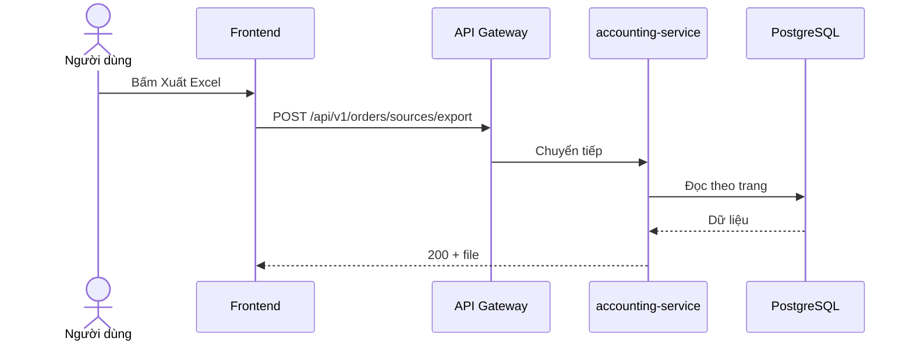
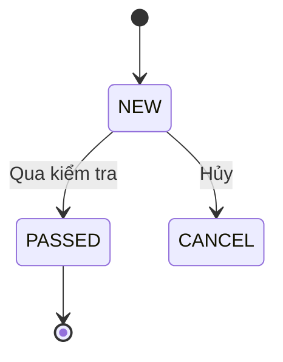

# Chuẩn vẽ sơ đồ

> **Loại: tham khảo.** Chép từ dự án gdt-workspace để làm tri thức cho agent, không phải nguồn luật. Khi khác `AGENTS.md`, vai trò hoặc `agents/protocols/` thì theo các nơi đó (`agents/protocols/source-precedence.md`).
> **Khác với chuẩn:** Bổ sung cho `docs/design/diagram-guide.md`; còn nhắc công cụ và đường dẫn của gdt. Viết phần chữ đi kèm sơ đồ: `../diagrams/mo-ta-hoat-dong-so-do.md`. Công cụ nguồn và cách vẽ `.drawio`: `../diagrams/quy-uoc-draw-io-va-archify.md`. Đọc nhanh `.drawio`: `python scripts/diagram-describe.py`.

**Công cụ, lệnh, file nguồn của từng loại sơ đồ (draw.io, archify): xem `huong-dan-ve-so-do.md`.** Nếu mục 5, 8, 9 dưới đây mâu thuẫn với file đó thì theo file đó.

Nguồn: phân tích các sơ đồ trong mẫu SRS_FDD v3.0 và file Copilot (`doc/quy-trinh/template/03-srs-fdd-template-v3/md/so-do-trong-mau.md`) và tài liệu Detail Design (`doc/quy-trinh/huong-dan/tong-hop/02-viet-detail-design-document.md`). Mục "Đề xuất" là chưa có quy định chính thức của công ty.

## 1. Chọn loại sơ đồ

| Cần thể hiện | Sơ đồ | Công cụ | Ghi chú |
|---|---|---|---|
| Quy trình nghiệp vụ nhiều bộ phận | Business flow (BPMN: pool, lane) | draw.io | Lane theo bộ phận hoặc tác nhân; có Start, End, hình thoi quyết định |
| Luồng một chức năng có rẽ nhánh | Activity hoặc flowchart | Mermaid `flowchart` | Swimlane theo vai nếu có từ hai vai |
| Ai làm gì với hệ thống | Use-case | draw.io | Tác nhân ở ngoài; ghi rõ Include, Extend |
| Các thành phần gọi nhau theo thời gian | Sequence | Mermaid `sequenceDiagram` | Dùng khi có từ hai thành phần gọi nhau |
| Bảng và quan hệ | ERD | archify `erd` | Bắt buộc cho mọi màn/ chức năng đọc hoặc ghi DB, kể cả không thêm bảng. Chỉ bảng thật và các cột được dùng: khoá chính, khoá ngoại, kiểu, bội số |
| Lớp, giao diện | Class | Mermaid `classDiagram` | Dùng khi cấu trúc lớp là điểm thiết kế |
| Vòng đời trạng thái (đơn hàng) | State | Mermaid `stateDiagram-v2` | Mỗi chuyển ghi điều kiện và tác nhân |
| Thành phần hệ thống, ranh giới | Component | draw.io hoặc Mermaid | Mũi tên "use" một chiều, ghi giao thức qua ranh giới |
| Luồng màn hình | Screen flow + wireframe | draw.io, mockup | Mỗi màn một ID; mũi tên ghi điều kiện (Success, Fail, Cancel) |
| Triển khai | Deployment | draw.io | Ghi tên server thật |
| Backlog theo giá trị | User-Story Map | Bảng | Activity, Task, Release 1 (MVP), Release 2 |

Tối thiểu cho một chức năng: luồng (use-case hoặc activity), sequence (khi có từ hai thành phần), ERD các bảng chạm tới (hoặc ghi "không thêm bảng"), wireframe (dẫn mockup), state (khi đổi trạng thái).

## 2. Quy tắc bắt buộc

1. **Một sơ đồ một ý.** Quá lớn thì tách theo chức năng hoặc tầng.
2. **Có tiêu đề và chú thích**, và nối với văn bản: số bước trong sơ đồ bằng số bước trong bảng use-case (`1.1`, `1.2`); số vòng ①–⑦ trong mockup bằng số service trong mục API.
3. **Dùng dữ liệu thật:** tên bảng, endpoint, trạng thái, màn hình lấy từ code hoặc tài liệu. Không dùng ví dụ của dự án khác.
4. **Luôn có đường lỗi:** nhánh thất bại, từ chối, hết hạn.
5. **Tên thống nhất** với văn bản: một thuật ngữ một tên.
6. **Mũi tên có nhãn** là hành động hoặc điều kiện. Mũi tên trả về vẽ nét đứt (sequence).
7. **Mã trạng thái đơn đúng `doc/thiet-ke/05-process-status`.**
8. Không tô màu để truyền nghĩa duy nhất; nhánh lỗi dùng màu đỏ kèm nhãn chữ.
9. **Giữ nguyên thuật ngữ tiếng Anh chuẩn:** Dùng *Swimlane Diagram* (hoặc *Swimlane*), tuyệt đối không dịch thành "bơi làn". Mọi thành phần kỹ thuật (Controller, Service, Worker, Consumer, Producer, Queue, Payload, Webhook, State Machine...) giữ nguyên tiếng Anh chuẩn công nghệ phần mềm, không dịch ép sang tiếng Việt khi gây ngô nghê hoặc tối nghĩa.

## 3. Quy tắc theo loại

### Sequence
- Lifeline theo thứ tự: Người dùng, Frontend, Gateway, Controller, Service, DAO/ DB, Hệ thống ngoài (Pancake, J&T, address-parser).
- Gom bước trong cùng giao dịch bằng ghi chú `transaction`.
- Dùng `alt` cho if-else, `opt` cho if, `loop` cho lặp.
- Không vẽ gọi mạng bên trong giao dịch DB (xem `chuan-sql-va-loi.md`).

### ERD
- Tên bảng và cột thật, kiểu thật, `PK`, `FK`, `UK`, bội số `1`, `0..n`.
- Chú thích ý nghĩa cột khi không hiển nhiên.

### State
- Mọi trạng thái trong `doc/thiet-ke/05-process-status`.
- Chuyển trạng thái ghi: sự kiện kích hoạt, tác nhân, điều kiện.
- Có trạng thái kết thúc và chỉ rõ chuyển không được phép (nếu quan trọng).

### Activity và flowchart
- **Một điểm bắt đầu và đúng MỘT điểm kết thúc** (người dùng chốt 19/10/2026, theo sơ đồ mẫu). Mọi nhánh kết thúc (lỗi, từ chối, hoàn tất) dồn về chấm kết thúc duy nhất ở cuối sơ đồ; không vẽ mỗi nhánh một chấm. Đường dồn đi theo lề của sơ đồ hoặc theo khe giữa hai hàng, không chui qua nút nào.
- Nhánh lỗi, từ chối, thất bại **bắt buộc dùng đường kẻ màu đỏ (`#EF4444`)** kèm nhãn điều kiện rõ ràng `[Lỗi...]`.
- Mỗi hình thoi có từ hai nhánh, nhãn đầy đủ.

### Component phân tầng (3-Tier)
- Chia 3 tầng rõ ràng: Presentation Layer -> Application/Domain Layer -> Infrastructure Layer.
- Phân biệt trực quan: Thành phần đã có dùng **khung viền liền + Dấu tích xanh (✔)**; thành phần mới phát triển dùng **khung viền nét đứt**.
- Cột bên trái có 2 hộp text: "Chức năng cần chuyên sâu" & "API cần xây dựng".

### Sequence phân khối Transaction
- Lifeline: Actor -> Frontend -> Gateway -> Controller -> Service -> DB / External API.
- Gom cụm bước thành từng khối **Transaction** có khung ngoặc vuông bên trái (vd: *Transaction 1: Validate -> Transaction 2: Xử lý -> Transaction 3: Ghi DB*).
- Số thứ tự mũi tên `1.1, 1.2, 2.1...` **khớp 100% với số bước trong bảng Use-case**.

### Wireframe Mockup chú thích số API
- Màn hình giao diện chuẩn ở giữa. Các nút bấm, ô tìm kiếm, bảng dữ liệu có **vòng tròn đánh số đỏ `①, ②, ③, ④...`**.
- Bên dưới hoặc bên cạnh có bảng đối chiếu 1-1: Vòng tròn số nào gọi đến Endpoint API nào (Method, Path, Event).

### Mô tả màn hình kiểu Nhật (Screen Items & Events)
- Ảnh chụp form giao diện đánh số ô `[1], [2], [3]...`.
- Bảng Screen Items liệt kê: Tên ô, Loại ô (Button, Textbox, Dropdown), IOE (Input/Output/Event), Bắt buộc, Kiểu dữ liệu, Min/Max digits, Giá trị mặc định.
- Bảng Event Action: Hành động khi Click/Change, API gọi, chuyển màn, thông báo lỗi/thành công nguyên văn câu chữ.

## 4. Mermaid trong md

Quy tắc Mermaid: nhãn tiếng Việt viết trực tiếp, không dấu `;` hay ngoặc trong nhãn không bọc dấu nháy kép; mỗi khối tối đa khoảng 30 nút.

**Đã kiểm chứng 18/10/2026:** khung xem md của người dùng **không vẽ được Mermaid** (hiện thành mã chữ). Vì vậy sơ đồ trong SRS vẽ bằng skill `archify` (xem mục 8), xuất ảnh PNG gắn vào md. Mermaid chỉ dùng làm bản nháp, không để lại trong file md nộp.

## 5. File nguồn và nơi lưu

- Sơ đồ nhỏ: nằm ngay trong md bằng Mermaid, nguồn là chính khối mã.
- Sơ đồ lớn: file `.drawio` trong `doc/srs/hinh/` đặt tên `UC-<nn>-<loại>-<tên>.drawio`, kèm bản xuất `.png`.
- Ghi đường dẫn file nguồn vào RTM.
- Sơ đồ có sẵn của dự án (Business Flow, Stage Machine, Component, DuplicateOrder-AlgorithmFlow) nằm ở `doc/thiet-ke/03-business-process-mockup`. Dẫn tới, không vẽ lại.

## 6. Ai vẽ

Chưa có quy định chính thức trong tài liệu đã tải. **Đề xuất:** người viết chức năng vẽ và chịu trách nhiệm đúng-sai; người review thiết kế (Solution-Pair) soát; AI đề xuất bản nháp Mermaid từ đặc tả và code, người duyệt. Cần người dùng xác nhận.

## 7. Checklist trước khi nộp sơ đồ

- [ ] Có tiêu đề, loại sơ đồ đúng mục 1.
- [ ] Số bước khớp văn bản.
- [ ] Tên bảng, endpoint, trạng thái là thật.
- [ ] Có nhánh lỗi.
- [ ] Mỗi nhãn mũi tên có nghĩa.
- [ ] Có file nguồn và đường dẫn trong RTM.
- [ ] Đọc được ở kích thước thường, không chữ siêu nhỏ.

## 8. Vẽ bằng skill archify và gắn ảnh vào md (chốt 18/10/2026)

1. Viết file nguồn `doc/srs/hinh/UC-<nn>-<loại>-<tên>.json` theo schema của loại sơ đồ: `workflow` (luồng nghiệp vụ), `sequence`, `class`, `architecture` (thành phần), `lifecycle` (trạng thái), `erd`. Schema và ví dụ nằm ở `~/.claude/skills/archify/schemas` và `examples`.
2. Chạy `finalize` (lệnh trong `doc/srs/hinh/README.md`) đến khi qua cả bốn cổng: validate, deliver, check, browser-check. Lỗi bố cục thường gặp: hai thông điệp sequence cách nhau dưới 28px; hai đường nối lớp cắt nhau (đổi hàng, cột); thành phần nằm trong khung ranh giới mà không thuộc `wraps`.
3. Xuất ảnh: `python3 scripts/archify_png.py doc/srs/hinh/<tên>.html` (hoặc `--all`). Ảnh chỉ gồm phần sơ đồ, nền trắng, gấp đôi độ nét, đã cắt viền thừa. Không dùng ảnh chụp cả trang của `visual-check` vì chữ nhỏ.
4. Trong md: ``, kèm dòng liên kết tới file `.html` (bản tương tác) và `.json` (nguồn).
5. Sửa sơ đồ: sửa `.json`, chạy lại 2 và 3. Không sửa ảnh.
6. Cho sơ đồ dễ đọc: nhãn ngắn (dưới khoảng 25 ký tự); chừa khoảng trống từ 90px trở lên giữa hai nút có nhãn trên đường nối; chỉ định `fromSide`, `toSide` để đường nối không dồn vào cùng một cạnh; sequence để tự canh khung (bỏ `meta.viewBox`) và bỏ các cột không cần thiết; dịch vụ ngoài đặt ngoài khung ranh giới.
7. Ngôn ngữ nhãn là tiếng Việt; giao diện nút của bản `.html` (Export, Still, ROUTE) vẫn là tiếng Anh vì công cụ chưa có bản dịch tiếng Việt.

## 9. Biểu đồ hoạt động có làn (UML activity, chốt 18/10/2026)

Mỗi chức năng phải có biểu đồ hoạt động, như mẫu trong SRS: có điểm bắt đầu (chấm đen), điểm kết thúc (chấm đôi), hình thoi quyết định, và các **làn** (swimlane).
1. **Luồng người dùng:** các làn là Người dùng, Giao diện, Hệ thống (API). Thể hiện thao tác, các nhánh rẽ, trạng thái nút bị vô hiệu, thông báo thành công và lỗi.
2. **Luồng backend:** các làn là thành phần xử lý thật (Frontend, Controller, bộ xuất file, bộ đọc, PostgreSQL...). Thể hiện từng bước kiểm tra, giới hạn, truy vấn, vòng lặp theo trang, nhánh lỗi 400.
3. Vẽ bằng `scripts/activity_png.py` từ file `doc/srs/hinh/<tên>.activity.json` (định dạng ở đầu script): làn, nút (start, action, decision, end) gán `lane` và `row`, cạnh có nhãn và `route` (`hv`, `vh`, `back`, `backleft`). Lệnh: `python3 scripts/activity_png.py doc/srs/hinh/<tên>.activity.json` hoặc `--all`.
4. Quy tắc dễ đọc: mỗi nút một việc, nhãn dưới 60 ký tự; mỗi quyết định có đủ hai nhánh có nhãn ("có", "không"); mọi nhánh kết thúc dồn về một nút kết thúc duy nhất; không để đường nối đi xuyên qua nút khác; sơ đồ cao quá 20 hàng thì tách thành hai.
5. Archify vẫn dùng cho sơ đồ thành phần, sequence, lớp, ERD, trạng thái. Không dùng loại `workflow` của archify thay biểu đồ hoạt động.
