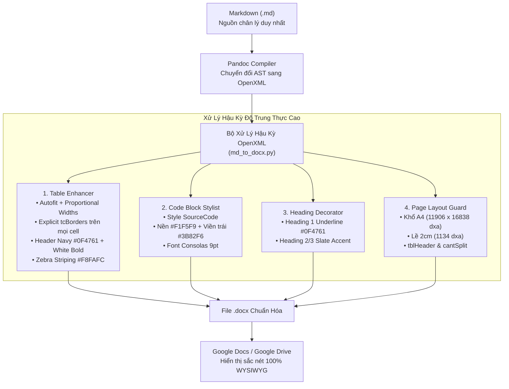

# Chuẩn Mực Chuyển Đổi Markdown Sang Word & Google Docs Độ Trung Thực Cao (High-Fidelity Office Document Conversion)

> **Loại: tham khảo.**  
> **Mã định danh:** `md-to-office-fidelity`  
> **Chuyên mục:** Chuẩn Hóa Tài Liệu, Chuyển Đổi Markdown Sang Word & Google Docs  
> **Nguồn gốc:** Đúc kết thực chiến dự án gdt-workspace (Task C.I.149), Chuẩn OpenXML ECMA-376 & Google Docs Parser Engine  
> **Trạng thái:** `approved`  

---

## 1. Bối Cảnh & Ranh Giới Kỹ Thuật

Trong quy trình phát triển phần mềm theo chuẩn CMMI L3 và Agile/Scrum, tài liệu kỹ thuật (SRS, FDD, Architecture Design, RTM, Test Plan) được viết bằng Markdown (`.md`) để quản lý phiên bản cùng mã nguồn trong Git. Tuy nhiên, khi chuyển giao cho Ban Giám đốc, Kế toán trưởng hoặc đối tác, tài liệu bắt buộc phải được đưa lên **Google Docs** hoặc **Microsoft Word (.docx)**.

Khi sử dụng các công cụ biên dịch mặc định (như `pandoc`), sự khác biệt giữa mô hình hiển thị HTML/CSS của trình duyệt và mô hình tài liệu OpenXML của Microsoft Word / Google Docs thường gây ra các lỗi hiển thị nghiêm trọng:
1. Bảng mất khung viền hoàn toàn, hiển thị rời rạc như văn bản trần.
2. Cột bảng bị chia đều cố định, bẻ dọc chữ ở các cột mã hoặc dồn nén cột nội dung dài.
3. Khối code (SQL, JSON, Bash) bị biến thành văn bản thông thường, không có hộp màu nền và không có font monospace.
4. Hàng tiêu đề bảng không lặp lại khi qua trang mới, dòng bảng bị cắt đôi ngang giữa 2 trang.

Tài liệu này chuẩn hóa toàn bộ nguyên lý kỹ thuật và thuật toán để đảm bảo tài liệu xuất ra đạt độ trung thực 100% (**What You See In Markdown Preview Is What You Get In Google Docs**).

---

## 2. Các Quy Chuẩn OpenXML Cốt Lõi (ECMA-376)

### 2.1 Cơ chế Khắc phục Lỗi Mất Viền Bảng (Table Gridlines)
- **Nguyên nhân gốc rễ**: Trình phân tích cú pháp (Parser) của Google Docs khi mở tệp DOCX chỉ nhận diện đường viền bảng khi có khai báo tường minh. Nếu bảng chỉ dùng style `TableNormal` hoặc `w:tblBorders` ở cấp độ bảng (`w:tblPr`), Google Docs sẽ xem viền giữa các ô là ẩn (`border-width: 0pt`).
- **Giải pháp bắt buộc**:
  1. Gán `<w:tblBorders>` ở cấp độ bảng với mã màu Slate hiện đại (`#94A3B8` viền ngoài, `#CBD5E1` viền lưới bên trong).
  2. Gán tường minh `<w:tcBorders>` trên **từng ô `<w:tc>`** của bảng:
     - Viền trên (`top`): `CBD5E1` sz="4" (hoặc `0F4761` sz="8" cho hàng tiêu đề).
     - Viền dưới (`bottom`): `CBD5E1` sz="4" (hoặc `0F4761` sz="12" dưới tiêu đề, sz="8" ở hàng cuối).
     - Viền trái/phải (`left`/`right`): `94A3B8` sz="6" ở biên ngoài, `CBD5E1` sz="4" ở vách trong.
  3. Bổ sung đệm ô (`tblCellMar`): Trên/dưới 120 dxa (6pt), trái/phải 160 dxa (8pt) để chữ không dính sát đường viền.

### 2.2 Thuật toán Phân bổ Độ rộng Cột Phi Tuyến (Proportional Column Widths)
Pandoc mặc định gán `<w:tblLayout w:type="fixed"/>` và chia đều độ rộng các cột dựa theo số dấu gạch ngang của Markdown (`|---|---|`). Điều này khiến cột `#` (2 ký tự) có độ rộng bằng cột `Lý do` (300 ký tự).

Thuật toán tối ưu:
1. Đặt tổng bề rộng in ấn cho khổ giấy A4 (lề 2cm) là $W_{\text{content}} = 9360\text{ dxa}$ (tương đương 6.5 inch).
2. Đo chiều dài chuỗi dài nhất trong từng cột: $L_c = \max_{r} (\text{length}(cell[r, c]))$.
3. Áp dụng trọng số phi tuyến căn bậc hai có bậc thang:
   $$W_c = \begin{cases} 
   1.0 & \text{khi } L_c \le 4 \text{ (Cột số thứ tự, mã, tick)}\\
   1.8 & \text{khi } 5 \le L_c \le 12 \text{ (Cột loại, ngày, trạng thái)}\\
   3.0 & \text{khi } 13 \le L_c \le 30 \text{ (Cột tên trường, endpoint)}\\
   5.0 & \text{khi } 31 \le L_c \le 80 \text{ (Cột mô tả ngắn)}\\
   8.0 & \text{khi } L_c > 80 \text{ (Cột nội dung dài, giải thích, bước làm)}
   \end{cases}$$
4. Thiết lập sàn độ rộng tối thiểu: $w_c \ge 700\text{ dxa}$ (~0.48 inch) để đảm bảo các chuỗi ký tự không dấu cách như `C.I.149`, `HP_01`, `applied=18000` không bao giờ bị bẻ dọc chữ.
5. Đặt `<w:tblLayout w:type="autofit"/>` để bảng co giãn linh hoạt theo nội dung thực tế.

### 2.3 Định dạng Khối Code (SourceCode) Chuẩn Markdown Preview
Khối mã lệnh (SQL, JSON, YAML, Bash) trong Markdown cần hiển thị như một khung hộp kỹ thuật:
- **Font chữ**: `Consolas` hoặc `Courier New`, kích thước 9pt (`<w:sz w:val="18"/>`).
- **Màu nền (Background Shading)**: Xám nhạt `#F1F5F9` (`<w:shd w:fill="F1F5F9"/>`).
- **Viền nhấn (Callout Accent)**: Đường kẻ dọc bên trái màu xanh dương `#3B82F6` độ dày 2.25pt (`<w:left w:val="single" w:sz="18" w:space="12" w:color="3B82F6"/>`).
- **Lề thụt (Indentation)**: Thụt lề trái và phải 240 dxa (0.17 inch), khoảng cách dòng 240 dxa.

### 2.4 Tiêu đề & Nhấn mạnh Thị giác (Visual Hierarchy)
- **Heading 1**: Màu xanh sẫm `#0F4761`, kích thước 18pt bold, kèm đường kẻ chân phân cách trang trí:
  `<w:pBdr><w:bottom w:val="single" w:sz="12" w:space="6" w:color="0F4761"/></w:pBdr>`.
- **Heading 2**: Màu xanh Navy `#1E3A8A`, kích thước 14pt bold, cách trên 240 dxa, cách dưới 80 dxa.
- **Tiêu đề bảng (Header Row)**: Nền xanh sẫm `#0F4761`, chữ trắng in đậm (`#FFFFFF`), lặp lại trên mọi trang (`<w:tblHeader/>`).
- **Chống xé dòng (Row Integrity)**: Gán `<w:cantSplit/>` trên toàn bộ các hàng bảng để chống việc một hàng bị ngắt đôi qua trang mới.

---

## 3. Quy Chuẩn Đóng Gói Hồ Sơ & Đặt Tên Lên Google Drive

Khi phát hành tài liệu một chức năng hoặc Use Case:
1. **Cấu trúc Thư mục**:
   - Thư mục chính: `C.I.<Mã>-<Tên-Tính-Năng>` (Ví dụ: `C.I.149-TMP-anh-xa-user`).
2. **Quy chuẩn Tên Tệp**:
   - Google Tài liệu: `SRS_FDD_<Tên-Tính-Năng>` (Ví dụ: `SRS_FDD_TMP-anh-xa-user`).
   - Tệp Word tải về: `SRS_FDD_<Tên-Tính-Năng>.docx`.
   - Tệp Ma trận Excel: `SRS_FDD_<Tên-Tính-Năng>.xlsx`.
   - Tệp TestLink XML: `<Tên-Tính-Năng>-testlink-cases.xml`.
3. **Bảng Metadata Quản Trị Bắt Buộc (Ở đầu tài liệu)**:
   - Mã chức năng / Tên Task chuẩn.
   - Trạng thái: `Code Merged (develop) - Sẵn sàng nghiệm thu UAT`.
   - Người thực hiện / Người phê duyệt (Lead Approver).
   - Ngày cập nhật & Phiên bản phát hành (`Release package`).
   - Số hiệu Merge Request GitLab (kèm mã commit SHA).

---

## 4. Lỗi bổ sung khi md lên Google Docs và cách xử lý (đã có script)

Script `scripts/md_to_docx.py` (pandoc cộng hậu xử lý OpenXML, mẫu kiểu chữ `scripts/assets/reference-srs.docx`) xử lý các lỗi sau. Dùng: `python scripts/md_to_docx.py <file.md> <file.docx>`, rồi mở docx trong Google Docs và chọn **Tệp, Lưu dưới dạng Google Tài liệu**.

| Lỗi trên Google Doc | Nguyên nhân | Cách xử lý |
|---|---|---|
| Bảng hiện thành chữ trần `\| a \| b \|` | Bảng md dính ngay dưới dòng chữ, thiếu dòng trống. GitHub vẫn hiển thị nhưng pandoc không nhận | Chèn dòng trống trước dòng bắt đầu bằng `\|` |
| Chữ dính liền trong ô bảng | ` ` bị pandoc bỏ | Đổi ` ` thành xuống dòng thật |
| Dòng "Table of Contents" trống đầu doc | Trường mục lục không có nội dung, Docs không tự điền | Không sinh mục lục; dùng Outline của Docs |
| Cột mã (`D10`, `YC4`) bị bẻ từng chữ | Cột chia đều | Chia cột theo độ dài chữ, có độ rộng tối thiểu theo từ dài nhất |
| Bảng hẹp, trang gần trống, ảnh bị đẩy xuống | Trang mặc định Letter; ảnh cao hơn trang | Khổ A4, lề 2 cm, thu ảnh vừa trang, giữ ảnh dính chú thích |

Viết md để không lỗi: luôn có dòng trống trước bảng và danh sách; ` ` chỉ trong ô bảng; ảnh dùng đường dẫn tương đối; không gõ `[TOC]`; bảng khổ A4 dọc vừa khoảng 5 đến 6 cột chữ ngắn.

Kiểm sau khi mở trên Google Docs: xem đầu doc, một bảng nhiều cột, một trang ảnh, một khối code; tìm `| ---`, `§§`, `Table of Contents` phải bằng 0; số trang hợp lý, dòng tiêu đề bảng lặp mỗi trang. Dung lượng docx dưới 9,5 MB (Google chỉ xuất tối đa 10 MB). Đổi tên task sau khi đã lên Drive: Cmd+Shift+H trong Doc, không cần dựng lại.
