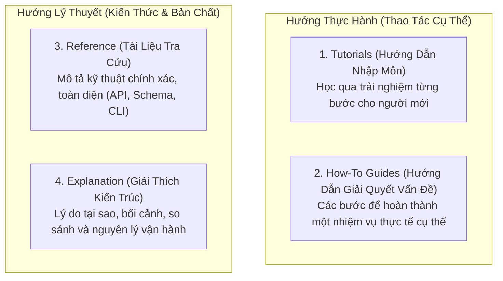
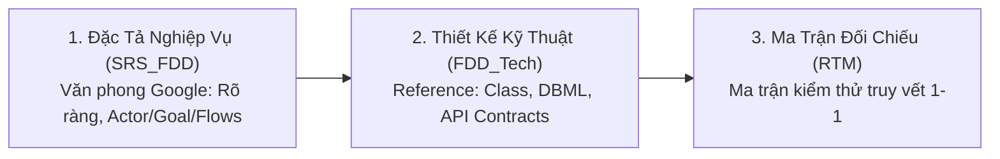

# Cẩm Nang Chuẩn Mực Viết Tài Liệu Kỹ Thuật (Google, Microsoft & The Good Docs Project)

> **Loại: tham khảo.**  
> **Mã định danh:** `technical-writing-and-doc-standards`  
> **Chuyên mục:** Kỹ Nghệ Viết Tài Liệu Kỹ Thuật, Đặc Tả SRS/FDD & Sổ Tay Vận Hành  
> **Nguồn gốc:** Google Developer Documentation Style Guide, Microsoft Writing Style Guide, The Good Docs Project  
> **Trạng thái:** `draft` (Chờ nghiệm thu con người)  

---

## 1. Khung 4 Trụ Cột Tài Liệu Diátaxis (The Good Docs Project)

The Good Docs Project chuẩn hóa tài liệu phần mềm thành 4 góc nhìn phục vụ các nhu cầu khác nhau của người đọc:

| Loại tài liệu | Trọng tâm | Đối tượng phục vụ | Ví dụ trong dự án GDT |
|---|---|---|---|
| **Tutorial** | Học tập | Người mới bắt đầu | Hướng dẫn dựng môi trường dev cục bộ lần đầu |
| **How-To Guide** | Hoàn thành mục tiêu | Người đã biết cơ bản | Hướng dẫn kết nối và cấu hình bưu cục J&T |
| **Reference** | Thông tin chính xác | Kỹ sư tra cứu nhanh | Danh mục API REST OpenAPI, từ điển dữ liệu DB |
| **Explanation** | Hiểu biết sâu sắc | Kiến trúc sư & Lead | Tài liệu ADR tại sao chọn Clean Architecture |

---

## 2. Văn Phong Kỹ Thuật Chuẩn Google (Google Developer Documentation Style)

Google đặt trọng tâm vào **tính trực diện, ngắn gọn và khả năng quét nhanh (Scannability)**:

### 2.1. Năm Quy Tắc Viết Của Google
1. **Dùng thể chủ động (Active Voice):**
   - ❌ Bị động: *"Lệnh `mvn test` nên được chạy bởi lập trình viên trước khi tạo commit."*
   - ✅ Chủ động: *"Chạy lệnh `mvn test` trước khi tạo commit."*
2. **Dùng thì hiện tại (Present Tense):**
   - ❌ Tương lai: *"Sau khi nhận đơn, hệ thống sẽ gửi thông báo đến bộ phận kho."*
   - ✅ Hiện tại: *"Khi nhận đơn, hệ thống gửi thông báo đến bộ phận kho."*
3. **Xưng hô ngôi thứ hai ("Bạn" / "You"):**
   - ❌ Ngôi thứ ba xa cách: *"Người dùng phải nhập mã đơn hàng..."*
   - ✅ Trực tiếp: *"Bạn nhập mã đơn hàng vào ô tìm kiếm..."*
4. **Cấu trúc song song trong danh sách (Parallel Structure):** Các gạch đầu dòng phải cùng bắt đầu bằng một dạng ngữ pháp (cùng là động từ mệnh lệnh hoặc cùng là danh từ).
5. **Tiêu đề theo dạng câu (Sentence Case):** Viết hoa chữ cái đầu tiên của tiêu đề, không viết hoa từng từ: `Tối ưu hóa chỉ mục cơ sở dữ liệu` thay vì `Tối Ưu Hóa Chỉ Mục Cơ Sở Dữ Liệu`.

---

## 3. Văn Phong Kỹ Thuật Chuẩn Microsoft (Microsoft Writing Style Guide)

Microsoft bổ sung chiều sâu về **sự thấu cảm (Empathy), tính tự nhiên và quy chuẩn giao diện người dùng**:

### 3.1. Nguyên Tắc Thấu Cảm & Trực Quan Của Microsoft
1. **Giải quyết vấn đề trước, giải thích kỹ thuật sau:** Người đọc mở tài liệu vì họ đang gặp khó khăn hoặc muốn làm xong một việc. Luôn đưa bước giải quyết lên đầu.
2. **Quy chuẩn gọi tên phần tử giao diện (UI Elements):**
   - Nút bấm (Button): Dùng từ **chọn (select)** hoặc **bấm (click)**, in đậm tên nút: `Bấm **Lưu thay đổi**`.
   - Hộp kiểm (Checkbox): Dùng từ **chọn (select)** hoặc **bỏ chọn (clear)**: `Chọn ô kiểm **Kích hoạt webhook**`.
   - Trường nhập liệu: Dùng từ **nhập (enter)**: `Nhập địa chỉ email vào ô **Email**`.
3. **Phân cấp cảnh báo trực quan (Alert Callouts):**
   - `> [!NOTE]`: Thông tin nền tảng hoặc giải thích thêm.
   - `> [!TIP]`: Mẹo tối ưu hoặc cách làm nhanh hơn.
   - `> [!IMPORTANT]`: Thông tin bắt buộc phải biết để không làm sai.
   - `> [!CAUTION] / [!WARNING]`: Rủi ro gây mất dữ liệu hoặc lỗi hệ thống.

---

## 4. Áp Dụng Thực Chiến Cho Tài Liệu Đặc Tả SRS / FDD

Kết hợp tinh hoa từ Google, Microsoft và The Good Docs Project vào bộ 3 tài liệu SRS chuẩn của dự án:

### Checklist Tự Kiểm Tra Tài Liệu Cho AI Agent (Quality Gate)
- [ ] Mọi bước thao tác đều bắt đầu bằng động từ mệnh lệnh hành động.
- [ ] Không có câu dài quá 30 từ; câu phức tạp đã được tách thành danh sách gạch đầu dòng.
- [ ] Mọi thông số kỹ thuật (URL, mã lỗi, tên biến, tên cột) đều được bọc trong backticks (`` `cột_id` ``).
- [ ] Các rủi ro hoặc bẫy tiềm ẩn đều có hộp cảnh báo `> [!WARNING]` hoặc `> [!IMPORTANT]`.
- [ ] Tài liệu có bảng tra cứu tóm tắt ở đầu trang để người đọc nắm bắt trong 10 giây.
