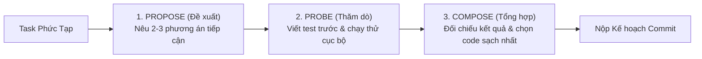
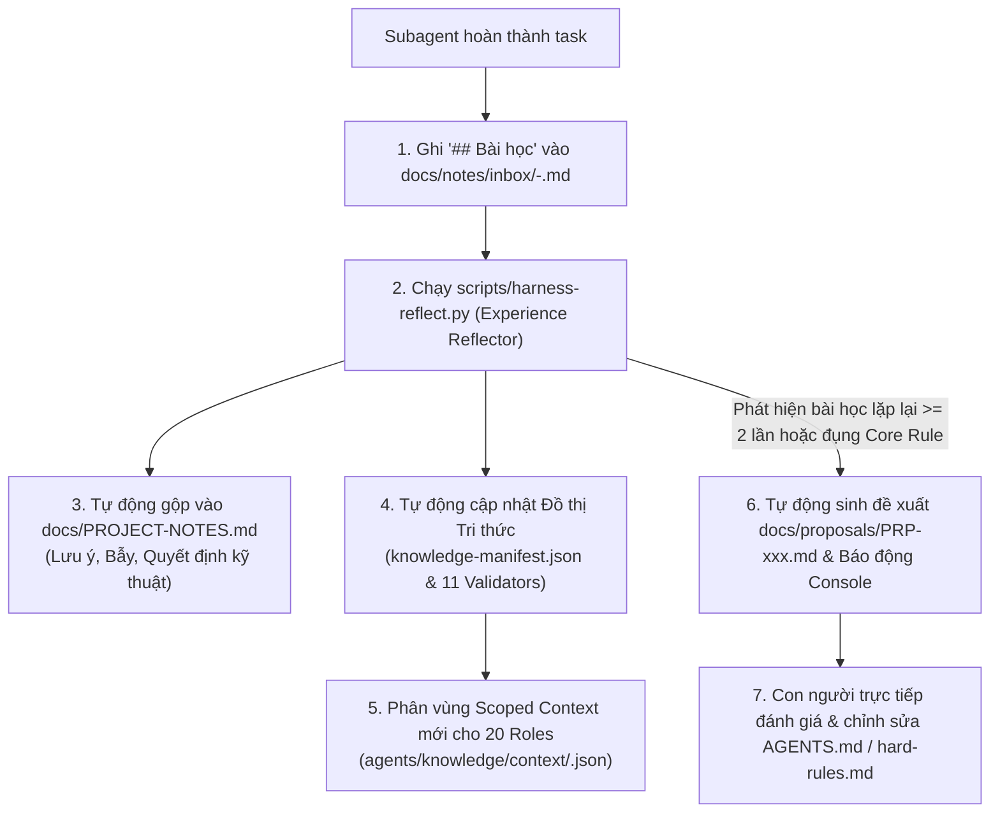
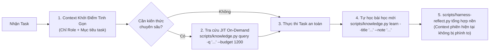

# Giao thức Tối ưu hóa Đệ quy Agent (Harness² Recursion Protocol)

Giao thức này quy chuẩn hóa cơ chế **Tối ưu hóa Đệ quy (Recursive Agent Harnessing - Harness²)** từ Google Research (arXiv:2610.14224) tích hợp vào `agent-base`. Mục tiêu: giúp hệ thống tác tử vừa tự tối ưu hóa giải pháp trong từng task, vừa tự động tích lũy bài học và nâng cấp kho tri thức sau mỗi task.

---

## I. Cấp độ 1: Đệ quy Cấp Task (Task-level Recursion: Propose – Probe – Compose)

Áp dụng cho các vai trò thực thi (`dev`, `mobile`, `architect`, `ai-eng`) khi giải quyết các task có độ phức tạp cao, thuật toán khó, hoặc bug chập chờn.



### 1. Chu trình 3 Bước Propose – Probe – Compose

1. **Bước 1 — PROPOSE (Đề xuất các biến thể):**
   - Không vội vàng đâm đầu vào một cách giải duy nhất.
   - Đề xuất ít nhất 2 phương án tiếp cận (ví dụ: Phương án A tối ưu tốc độ/bộ nhớ vs Phương án B tối ưu tính mở rộng/dễ bảo trì).
2. **Bước 2 — PROBE (Thăm dò trong Sandbox):**
   - Viết các test case kiểm tra biên và ngoại lệ (TDD).
   - Chạy thử nghiệm cả 2 phương án trong nhánh task riêng biệt.
   - Thu thập dữ liệu thực nghiệm: kết quả test, log lỗi, độ trễ và độ phức tạp mã nguồn.
3. **Bước 3 — COMPOSE (Tổng hợp Tối ưu):**
   - So sánh sự tương phản hành vi giữa các lần chạy (Contrastive Analysis).
   - Tổng hợp giải pháp tối ưu nhất, loại bỏ mã nguồn thử nghiệm thừa và hoàn thiện bài test Pass 100%.

---

## II. Cấp độ 2: Đệ quy Cấp Hệ thống (Harnessing-level Recursion: Reflect & Adopt)

Áp dụng sau khi hoàn thành task để **"Học và Cập nhật Tri thức Vĩnh viễn"** cho toàn bộ 20 roles của `agent-base`.



### 1. Ghi nhận Bài học có Bằng chứng (Evidence-supported Lessons)
Trong ghi chú bàn giao `docs/notes/inbox/<Task>-<agent>.md`, Agent bắt buộc điền mục `## Bài học` theo cấu trúc 3 dòng (tuân thủ `agents/protocols/lesson-learned.md`):
- **Chuyện gì xảy ra:** Sự việc cụ thể, có số liệu, mã lỗi hoặc hành vi bất thường.
- **Nguyên nhân gốc:** Bản chất kỹ thuật hoặc ranh giới module chưa rõ.
- **Lần sau làm gì:** Hành động cụ thể, có thể kiểm chứng được bằng bài test hoặc linter.

### 2. Tự động hóa qua `scripts/harness-reflect.py`
Công cụ Reflector tự động thực hiện các nhiệm vụ:
- **Nhiệm vụ 1 (Cập nhật Bộ nhớ Sống):** Đọc các note trong `docs/notes/inbox/`, đánh mã định danh duy nhất (`N-xxx`) và phân loại vào các bảng của `docs/PROJECT-NOTES.md` (Bẫy đã gặp, Quyết định quan trọng, Quy ước phát hiện thêm). Tuyệt đối không xóa âm thầm; mục cũ không còn dùng phải gạch ngang (`~~cũ~~`) và ghi rõ lý do.
- **Nhiệm vụ 2 (Cập nhật Ánh xạ Skill & Role):** Ghi nhận kỹ năng (Skill) nào đã áp dụng hiệu quả cho vai trò nào để các Agent sau tự động kế thừa.
- **Nhiệm vụ 3 (Làm giàu Knowledge Graph):** Đồng bộ vào `knowledge-manifest.json`, tính toán lại sha256 và chạy 11 Validators V00–V10 để bảo đảm Catalog đạt 0 lỗi tuyệt đối.
- **Nhiệm vụ 4 (Cơ chế Báo Cáo & Lập Đề Xuất Cho Con Người - PRP):** Tự động phát hiện các bài học lặp lại $\ge 2$ lần hoặc đề xuất chạm đến Quy tắc cốt lõi / Bảo mật git $\rightarrow$ lập file `docs/proposals/PRP-xxx.md` và in cảnh báo console nổi bật để con người biết đi sửa.

---

## III. Cơ chế Bảo Vệ Context: Tra Cứu Tri Thức Theo Yêu Cầu (JIT Knowledge & Token Budget Guard)

Để ngăn chặn hiện tượng vỡ Context (Context Rot / Lost in the Middle) và lãng phí token, mọi Agent bắt buộc tuân thủ nguyên tắc:



1. **Nguyên tắc Zero-Clutter:** Không nạp toàn bộ các file tri thức vào prompt cùng một lúc. Giữ context window luôn nhẹ và tập trung vào mã nguồn cần sửa.
2. **Tra cứu JIT On-Demand:** Khi gặp bài toán đặc thù (JPA Lock, Redis Stampede, Draw.io CSV, K8s Manifest, Playwright...), Agent chủ động chạy:
   ```bash
   python3 scripts/knowledge.py query -q "<từ khóa>" --budget 1200
   ```
   Lệnh này tự động tính toán điểm phù hợp, kiểm soát ngân sách token nghiêm ngặt ($\le 1200$ tokens), chỉ trích xuất đúng nội dung cốt lõi và mẫu code thực chiến.
3. **Tự học không làm rác Context (Safe Self-Learning):** Khi giải quyết xong một lỗi mới phát sinh, Agent không nhồi nhét nhật ký dài dòng vào cuộc hội thoại mà gọi:
   ```bash
   python3 scripts/knowledge.py learn --title "<Tên bài học>" --note "<Mô tả lỗi và cách né>" --role <vai>
   ```
   Lệnh này tự động lưu bài học vào `docs/notes/inbox/` và đồng bộ chỉ mục `INDEX.md`, chờ chu trình Harness² tổng hợp định kỳ mà hoàn toàn không làm vỡ context của phiên làm việc.

---

## III. Bốn Quy Tắc Bất Biến (Hard Invariants)

1. **Không Tự Sửa Quy tắc Cốt lõi:** Quá trình tự học không được phép tự động sửa `AGENTS.md`, `hard-rules.md` hoặc các quyền bảo mật git.
2. **Tri thức Mới Luôn ở Trạng thái An toàn:** Mọi Node tri thức mới được tạo tự động đều ở trạng thái `state: "draft"`, vượt qua kiểm chuẩn và chờ con người nghiệm thu trước khi trở thành luật bất biến.
3. **Độ Bền Vững của Bộ Nhớ:** Thông tin cũ không được xóa bỏ âm thầm; nếu không còn đúng thì gạch ngang và ghi rõ lý do.
4. **Cơ chế Báo Lại Thay Vì Âm Thầm Bỏ Qua:** Nếu phát hiện quy tắc cốt lõi cần sửa đổi để ngăn chặn lỗi hệ thống lặp lại, hệ thống phải tự động xuất bản đề xuất `docs/proposals/PRP-xxx.md` (kèm 3 phương án, 1 khuyến nghị, lý do, cách khắc phục rủi ro) và phát cảnh báo để con người đi sửa.
5. **Bảo tồn 100% Danh Sách 20 Roles:** Không tự ý thêm bớt, gộp hoặc đổi tên định danh của 20 roles đã chuẩn hóa.
