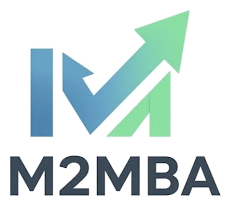
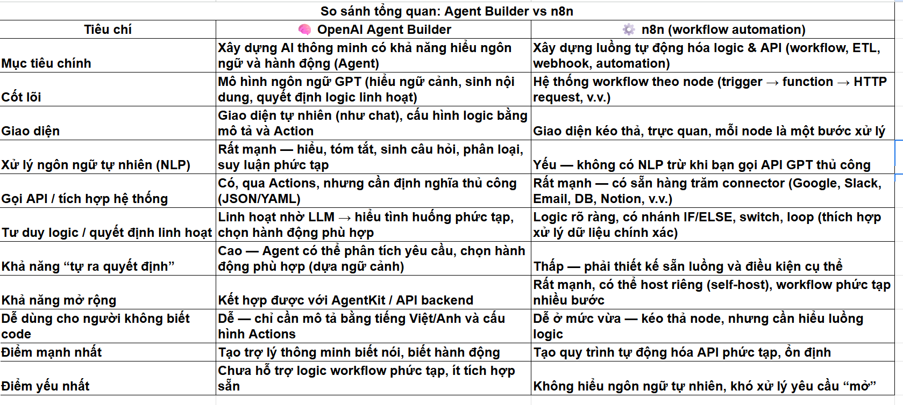
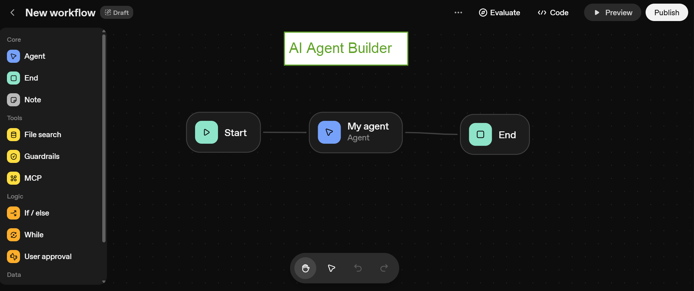
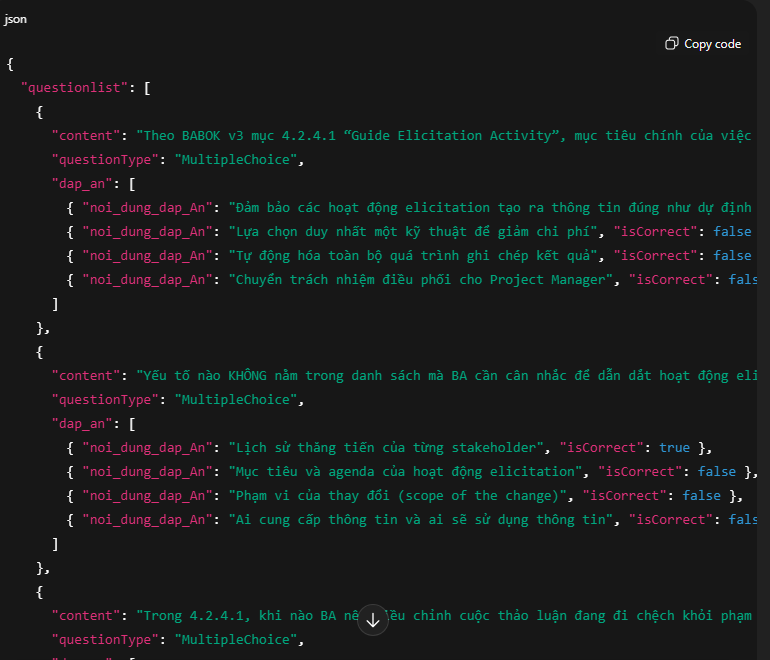
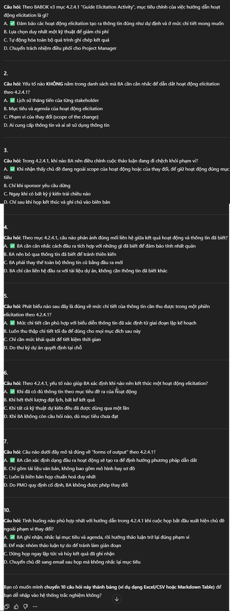

Title: AI Agent Builder của OpenAI

URL Source: https://m2mba.com/blog/articles/ai-agent-builder-openAI

Published Time: 2025-10-08T05:33:34.000Z

Markdown Content:
[Rèn tư duy sâu · Tạo giá trị thật](https://m2mba.com/)

[Trang chủ](https://m2mba.com/)[Khóa học](https://m2mba.com/courses)[Workshop](https://m2mba.com/workshop)[Thư viện](https://m2mba.com/skills)[Blog](https://m2mba.com/blog)[About](https://m2mba.com/about)

[Đăng nhập](https://m2mba.com/login)[Đăng ký →](https://m2mba.com/register)

1.   [Home](https://m2mba.com/)
2.   [Blog](https://m2mba.com/blog)
3.   AI Agent Builder của OpenAI

[Workflow Automation](https://m2mba.com/blog/topics/null)

# AI Agent Builder của OpenAI

Đậu Thị Ngọc Ánh

10/8/2025

283 views

0

Share:

FB linkedin Zalo

(4)

Mấy hôm nay thấy nhiều bài xuất hiện nói về Dev Day của OpenAI quá, mình cũng ko phải là dân chuyên công nghệ (mặc dù làm IT )  
Trong đó mình tò mò về AI Agent Builder (vì nó có nhiều cái tựa n8n – cũng workflow automation), và dưới đây là 1 số thông tin

**Agent AI Builder** của OpenAI là một giao diện (builder tool) trong nền tảng ChatGPT, cho phép người dùng **tạo, cấu hình và triển khai các AI agent có khả năng hành động tự động** — ví dụ: gọi API, thực hiện tác vụ theo workflow, hoặc tương tác với dữ liệu và ứng dụng khác — mà không cần viết code phức tạp.

**⚙️ Chức năng chính của OpenAI Agent Builder:**

1.   **🧩 Workflow-based design (thiết kế theo luồng công việc)**
    *   Bạn có thể **tạo “workflow” gồm các bước logic**: nhận input → xử lý → hành động → phản hồi.
    *   Mỗi bước có thể là hành động như: gọi API, tra cứu dữ liệu, gửi email, tạo file, hoặc dùng công cụ bên thứ ba.

2.   **📚 Knowledge & Instructions (kiến thức và hướng dẫn riêng)**
    *   Bạn có thể **cung cấp dữ liệu nội bộ, tệp hoặc mô tả chi tiết** để agent hiểu và phản hồi đúng với lĩnh vực của bạn.
    *   Giống như “custom knowledge base”.

3.   **🔗 Actions (Hành động)**
    *   Agents có thể được **kết nối với API hoặc các ứng dụng bên ngoài**.
    *   Ví dụ: “Gửi thông báo qua Slack”, “Tạo record trong Notion”, “Lấy dữ liệu từ Google Sheets”.

4.   **👤 No-code / Low-code builder**
    *   Giao diện xây dựng trực quan trong ChatGPT (dạng “Builder UI”) — bạn **không cần lập trình**, chỉ cần mô tả quy trình hoặc cấu hình từng bước.

5.   **🧠 Runtime intelligence**
    *   Khi người dùng tương tác, Agent có thể **tự động chọn workflow phù hợp**, gọi các hành động, và phản hồi linh hoạt dựa trên ngữ cảnh.

**Agent AI Builder cũng cho phép tích hợp nhiều ứng dụng bên ngoài. Tuy nhiên mình thấy chưa đa dạng được như n8n, ít nhất muốn gửi mail là Agent AI Builder chưa có node Gmail với action SendMail, chỉ có action GetMail thôi**

Dưới đây là bảng so sánh (mình cũng nhờ AI tổng hợp, và có review lại theo những gì mình biết hiện tại)

Và mình cũng thử demo 1 luồng: Cung cấp sách BABOK cho Agent, Sau đó người dùng yêu cầu Agent ra câu hỏi trắc nghiệm cho mục nào đó trong sách. Hiện tại mình chỉ cho yêu cầu đơn giản, còn sau này các bạn nào muốn học mà muốn ra các câu hỏi tình huống ngắn, tình huống dài thì bảo Agent ra (cung cấp instruction cho nó)

Và dưới đây là câu hỏi mà AI ra (mình đang để tiếng việt) cho mục 4.2.4.1 - Guide Elicitation Activity (Prepare Elicitation). Flow này có thể tiếp tục bằng cách tích hợp với gọi API tạo câu hỏi và insert vào hệ thống LMS của m2mba rất đơn giản nhé. Mình muốn demo nhanh nên chưa thực hiện

Kết quả AI Agent trả ra sẽ như sau:

Mình gen ra câu hỏi dạng text cho các bạn dễ nhìn từ response trên kia nhé

Tương lai sẽ còn có nhiều tool lowcode-no code dành cho người ngoại đạo IT sử dụng áp dụng cho công việc. Cái quan trọng nhất vẫn là tư duy, kiến thức ngành để áp dụng các tool đó 1 cách có hiệu quả

### Trung tâm M2MBA

Đăng ký ngay những khóa học chất lượng, được thiết kế để phát triển kỹ năng và tăng tốc con đường sự nghiệp của bạn.

### Liên kết nhanh

*   [Khám phá khóa học](https://m2mba.com/courses)
*   [Về chúng tôi](https://m2mba.com/about)
*   [Liên hệ](https://m2mba.com/contact)

### Hỗ trợ

*   [Điều khoản dịch vụ](https://m2mba.com/terms-of-service)
*   [Chính sách bảo mật](https://m2mba.com/security-policy)

### Học tập

*   [Thư viện](https://m2mba.com/skills)
*   [Blog](https://m2mba.com/blog)

© 2026 Trung tâm M2MBA. Bản quyền thuộc về chúng tôi.

Ease Health design system
