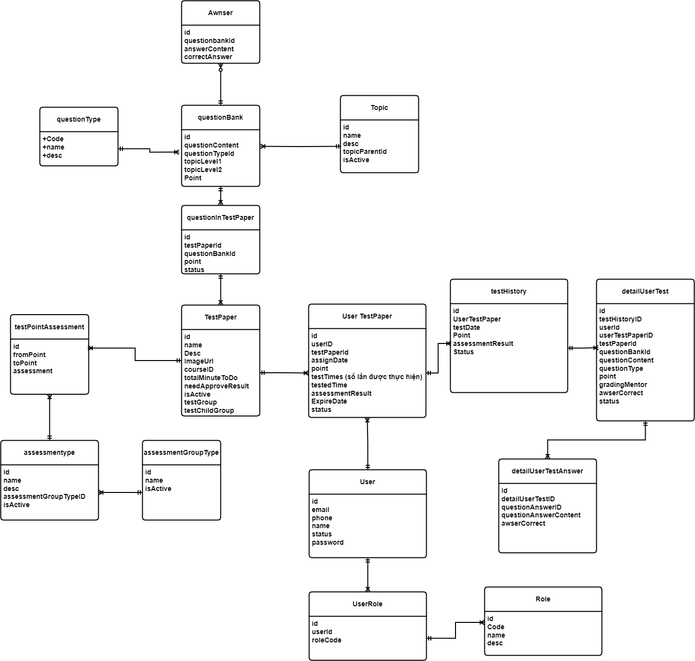

# Bài test mẫu cho khóa IT cơ bản

*Tác giả: Đậu Thị Ngọc Ánh | Ngày đăng: 2023-12-19T13:49:44.000Z*

**BÀI TEST CUỐI KHÓA IT CƠ BẢN CHO BA**

 

**Đầu vào bài test: **Giả sử bạn là BA trong hệ thống trung tâm đào tạo, và hiện tại bạn cần xây dựng hệ thống cho nghiệp vụ test. Cụ thể quy trình nghiệp vụ như ảnh đính kèm

****
**Bước****Người thực hiện****Mô tả bước**1Mentor
Tạo câu hỏi theo từng chủ đề (chính [[ĐNÁ1]](#_msocom_1) là ngân hàng câu hỏi)

Mỗi câu hỏi sẽ cần có các thông tin sau

- Chủ đề cha
- Chủ đề con
- Nội dung câu hỏi
- Kiểu đáp án: Tự luận
- Trắc nghiệp 1 đáp án
- Chọn nhiều đáp án
- Các đáp án (nếu ko phải dạng tự luận)2Mentor
Tạo bài test bằng cách lấy danh sách các câu hỏi từ ngân hàng câu hỏi 

Mỗi bài test sẽ có các thông tin như

- Tên bài test
- Thời gian làm bài
- Cấu hình kết quả test có cần phê duyệt không
- Cấu hình kiểu kết quả đánh giá của bài test, có thể lựa chọn các kiểu (mỗi 1 kết quả sẽ cần cấu hình số điểm cần đạt đối với mức đó – cấu hình dải điểm và mức đạt được của từng giải điểm đó)Đạt/Không đạt
- Xuất sắc/Tốt/khá
- Fresher/junior/senior..3Admin
Gán bài test cho học viên

Có thể gán trực tiếp cho học viên (hay chính là theo từng user) hoặc gán theo khóa học hoặc, theo lớp học để các bạn tham gia và khóa học đó, lớp học đó có thể làm bài test tương ứng
4Học viên
Vào hệ thống xem bài test và thực hiện làm bài test theo thời gian quy định

Với bài dạng tự luận học viên được phép nhập text cũng như đính kèm hình ảnh vào 
6.1,6.2Hệ thống
Sau khi học viên submit bài thì hệ thống sẽ thực hiện chấm điểm với các câu hỏi dạng trắc nghiệm

Còn câu hỏi dạng tự luận thì sẽ chuyển xuống bước 6.4
6.3Hệ thốngVới bài test có câu tự luận thì hệ thống sẽ lưu lại ở trạng thái chờ mentor chấm bài6.4AdminGán mentor thực hiện chấm bài làm của học viên7MentorChấm bài với các câu tự luận8Mentor
Xác định hoàn thành chấm bài

Trước khi xác nhận Mentor hoàn toàn được phép sửa lại nội dung mình đã chấm
10Admin
Duyệt chấm bài

- Nếu bài test được cấu hình cần duyệt trước khi cho học viên xem kết quả thì admin cần review lại kết quả test và duyệt/từ chối tùy theo kết quả test
- Nếu từ chối thì mentor sẽ cần chấm lại bài (nếu do lỗi của mentor)11Học viênVào xem kết quả bài làm của mình
 

Và ERD cho yêu cầu trên được Dev phân tích ra như ảnh đính kèm

**­­­**

 

**Giải thích các thực thể và 1 số trường quan trọng**
**Thực thể/Bảng****Ý nghĩa****1 số trường quan trọng****questionType**Quản lý các dạng câu hỏi, như câu hỏi trắc nghiệm (1 đáp án), câu hỏi trắc nghiệm – nhiều đáp án, câu hỏi dạng trả lời bằng text
Code là key của bảng này

Dựa vào từng loại mà khi view câu hỏi cho học viên, hệ thống sẽ hiển thị cách trả lời phù hợp cho từng câu
**questionBank**
**Ngân hàng câu hỏi**

Trung tâm sẽ tạo ra 1 ngân hàng câu hỏi, theo từng chủ đề khác nhau (có chủ đề cha, chủ đề con). Sau khi có NH câu hỏi thì admin/mentor sẽ tạo bài test bằng cách lấy từ NH câu hỏi này

**TopicLevel1, TopicLevel2:** Mỗi câu hỏi sẽ được gán vào các topic khác nhau, topic cha và topic con

Ví dụ câu hỏi về phần SELECT trong Database thì topicLevel1 là Database, TopicLevel 2 là Select

**Point: **khi tạo ra câu hỏi, admin sẽ thiết lập điểm mặc định cho câu hỏi này
**Topic**
** **Bảng quản lý các topic, nếu topic nào là topic cha thì topicParentID=null

Ngược lại sẽ có giá trị = ID của 1 topic nào đó
Chỉ quản lý 2 level**TestPaper**Là các bài test được admin/mentor tạo ra để test trình độ của các bạn học viên trong trung tâm
**ImageURL**: ảnh đại diện của bài test

**courseId**: Nếu bài test phục vụ cho khóa học nào đó thì coursed khác null, và =ID của khóa học tương ứng (Ví dụ khóa IT cơ bản)

**totalMinuteToDo**: Tổng số thời gian làm bài test

**needApproveResult**: Bài test có cần admin phê duyệt trước khi gửi kết quả cho học viên không

**testGroup**: Bài test này thuộc nhóm nào – Nhóm chứng chỉ BA, Nhóm khóa học BA- Nhóm khóa học IT cơ bản

**testChildGroup**: Bài test thuộc nhóm con nào của nhóm tương ứng  (ví dụ bài test về FrontEnd, Backend trong khóa IT, bài test về Xác định UC trong khóa BA)
**questionInTestPaper**Danh sách các câu hỏi trong bài test
**Point: **Điểm của câu hỏi này trong bài test tương ứng (Có thể bằng questionBank.Point hoặc không)

**Status**: Trạng thái quản lý câu hỏi có nằm trong bài test nữa hay không
**UserTestPaper**Quản lý các bài test của học viên (admin gán bài test cho học viên)
**testTime**: tổng số lần được thực hiện bài test

testedTime: Tổng số lần đã thực hiện

expireDate: Hạn làm bài

**assessmentResult:** Kết quả đánh giá của lần test cao nhất

**Point:** Tổng điểm bài test của lần test cao nhất

**Status:** Trạng thái bài test của học viên
**testHistory**Lưu lại lịch sử các lần làm bài test của user
**Point: **Điểm của lần test đó

**assessmentResult:  **Kết quả đánh giá của lần test đó
**detailUserTest**Chi tiết câu hỏi và điểm của câu hỏi đó của user trong lần thực hiện bài test**Point: **Điểm của câu hỏi đó mà học viên đạt được
**gradingMentor: **Mentor chấm bài
**awserCorrect: **Câu trả lời đúng hay sai
**status: **Trạng thái của câu hỏi (đã được chấm hay chưa được chấm…)**detailUserTestAnswer**Chi tiết câu trả lời của câu hỏi tương ứng**awserCorrect: **đáp án này có đúng không (ví dụ câu hỏi có nhiều đáp án thì khi chọn đáp án này có nằm trong list đáp án đúng ko)**testPointAssessment**
Cấu hình kết quả đánh giá bài test

Mỗi bài test sẽ có cấu hình kết quả riêng, từ bao nhiêu điểm – đến bao nhiêu điểm sẽ đạt level nào
 **assessmentGroupType**
Nhóm kết quả đánh giá, sẽ có các nhóm: 

- Nhóm 1: Đạt/Không đạt
- Nhóm 2Xuất sắc/Tốt/Khá/Trung bình
- Nhóm 3Fresher/Junior/Senior **Assessmentype**Tên các kết quả đánh giá trong từng nhóm đánh giá như ví dụ trên (Ví dụ nhóm 1 có 2 kiểu đánh giá: Đạt/Không đạt) **User**Quản lý user trên hệ thống – bao gồm cả user học viên và user NV vận hành của trung tâm **Role**Quản lý các role trên hệ thống **userRole**
Quản lý role tương ứng của user.

 

Nếu role là Học viên thì trường roleCode=HOCVIEN

Nếu role là admin thì trường roleCode=ADMIN

Nếu role là Mentor thì trường roleCode = MENTOR

 

**Dưới đây là nội dung bài test liên quan tới 3 phần chính của khóa học, FrontEnd, Backend và Database**

 

## PHẦN 1: FRONTEND

**Đây là giao diện của chức năng Xem danh sách bài test của tôi**

****

****

****

 

**Màn hình danh sách các bài test được gán cho user đang login. Và 1 số thông tin lưu ý như sau:**

- Mỗi bài test sẽ được thực hiện tối đa N lần, nếu thực hiện đủ số lần tối đa thì không được thực hiện tiếp
- Bài test nếu bao gồm câu tự luận thì sẽ cần chờ mentor chấm, và lúc đó có thể chưa có điểm, nếu chưa có điểm thì không được làm tiếp bài test đó
**Màn hình thực hiện test**

- Phần summary thể hiện được tổng số câu hỏi, tổng số đã trả lời, và chưa trả lời. Mục đích của user có thể click vào các câu chưa trả lời và thực hiện, tránh bị misst câu hỏi
## Câu 1:

Nếu bạn là BA trong dự án này, bạn hãy thử mô tả riêng cho control số 2 để bạn dev FrontEnd code theo đúng yêu cầu như mô tả ở trên
**STT****Tên control****Loại control****Mô tả ý nghĩa và rang buộc (nếu có)**1Thực hiện testIcon
Cho phép user thực hiện lại bài test

Chỉ hiển thị icon này khi

- Số lần Học viên đã test <Số lần test tối đa
- Ngày hết hạn test>=Ngày hiện tại
- Lần test gần nhất đã hoàn thành chấm điểm (bài test ở trạng thái Đã duyệt điểm)2Điểm sốLabel
Hiển thị điểm của bài test

- Đã thực hiện tối thiểu 1 lần test
- Và điểm của lần test gần nhất đã được chấm điểm. Nếu chưa duyệt điểm thì sẽ hiển thị: Chờ chấm điểm
- Hiển thị điểm cao nhất của bài test theo format: Điểm đạt được/Tổng điểm tối đa của bài đó
 

## Câu 2:

** **Theo bạn, để các bạn dev FE hiển thị thông tin danh sách các bài test như ảnh điểm kèm thì các bạn dev sẽ cần sử dụng câu lệnh gì

**Trả lời: **ở đây các e chỉ cần trả lời dùng lệnh for Loop là được nhé, 1 số bạn nói kỹ hơn vẫn okie

FE gọi API lấy ds bài test, BE trả về ds bài test, và FE sẽ sử dụng vòng lặp for để có thể tạo ra các phần tử chính là các bài test như trên hình

## Câu 3: 

Với điều kiện mô tả như trên, bạn hãy thử viết flow để thể hiện các bạn dev FE thực hiện như thế nào, để có thể hiển thị/không hiển thị Icon Play (Thực hiện test)

## Câu 4: 

User click vào icon Play để thực hiện test, nhưng sau 1 thời gian triển khai thì user có phản ánh là 1 số lúc trong lúc làm thì bị mất mạng(hoặc 1 số sự cố không lường tới), và user bị mất dữ liệu bài đã làm. Vậy theo bạn giải pháp như thế nào để có thể giảm thiểu được vấn đề trên (Biến – Biến dạng mảng)

**Trả lời:** Dữ liệu làm bài của học viên thì chỉ có client là bên nằm chính xác nhất, do đó để tránh việc mất thông tin bài làm thì sẽ lưu lại ở 1 biến trên client, và biến này phải lưu vào local storage, chứ ko thể lưu vào bộ nhớ tạm thời là bộ nhớ ram được, vì nếu lưu vào bộ nhớ ram thì việc mất điện, máy bị tắt khi khởi động lại máy thì dữ liệu bài làm sẽ bị mất điểm

Và giải pháp cụ thể như sau: 
Tạo ra 1 biến dạng mảng object, chứa các ID của các câu hỏi, và khi user trả lời cho 1 câu hỏi nào trong ds câu hỏi, thì sẽ cần tìm tới phần tử mảng tương ứng với questionID đó và update đáp án tương ứng mà user đã chọn[[ĐNÁ2]](#_msocom_2) 

Bước 1: Tạo biến dạng mảng và lưu ds câu hỏi vào mảng tương ứng

Bước 2: Khi user trả lời trên giao diện câu hỏi nào đó thì sẽ tìm tới câu hỏi tương ứng và update answer

**Bước 2.1**: Xây dựng hàm update câu trả lời của câu hỏi tương ứng

Bước 2.2: Gọi hàm trên khi user thực hiện trả lời các câu hỏi tương ứng

## Câu 5: 

Theo bạn, Bạn hãy quan sát phần summary ở màn hình test (control từ 3-5), và trả lời 2 câu hỏi sau

- Phần xử lý hiển thị summary: Theo bạn phần dữ liệu được xử lý trên client hay lấy trên server
- Nếu phần xử lý này chỉ xử lý ở client, bạn hãy giải thích các bạn dev làm như thế nào để hiển thị được như vậy (Liên quan tới biến – biến dạng mảng)
**Trả lời**: Xử lý trên client và cách làm tương tự như ở cách bài 4 , danh sách câu hỏi được lưu vào 1 biến dạng mảng object, tổng số câu đã trả lời được lưu vào biến answer, cứ trả lời cho 1 câu hỏi answer tăng 1, và bỏ trả lời cho 1 câu trả lời answer giảm xuống 1, còn thể hiện câu nào đã trả lời thì dựa vào biến dạng mảng Object chứa các câu hỏi, questionID nào có answer khác rỗng/NULL là đã trả lời, ngược lại thì chưa trả lời 

## Câu 6: 

Theo bạn, các bạn lập trình FE làm thế nào để hiển thị được cách lựa chọn đáp án như màn hình thực hiện test ở trên

- Dựa vào question typeVới dạng trắc nghiệm 1 đáp án thì hiển thị radiobox
- Với dạng trắc nghiệm nhiều đáp án thì hiển thị checkbox
- Với dạng đáp án tự luận thì hiển thị textbox
## PHẦN 2: API

**Câu 1: **Dựa vào luồng màn hình như trên, bạn hãy xác định các API mà Backend cần xây dựng để phục vụ được luồng đó

**1.Danh sách API**
**Tên API****Mục đích**Lấy danh sách bài test của tôiTrả về danh sách bài test gắn với user tương ứngLấy chi tiết bài testTrả về chi tiết thông tin bài test tương ứng mà user chọn để thực hiệnSubmit bài testGửi bài làm của user 
 **2.Mô tả API**

Với từng API liệt kê ra thông tin như sau

## 2.1. API lấy danh sách bài test của tôi

### 2.1.1.Đầu vào: 

- Trong header chứa token của user tương ứng, các bạn BA có thể liệt kê userID trong tham số đầu vào cũng okie nhé**Tham số đầu vào****Kiểu dữ liệu****Require****Mô tả ý nghĩa và Ràng buộc khác (nếu có)**UserID Yes
User thực hiện yêu cầu tương ứng

Note: Sẽ gửi dạng token trong header nhé

### 2.1.2.Đầu ra

Ở đây các bạn cần phải nhìn thông tin trên màn hình, thông tin quản lý trong DB để xem trả về những thông tin gì

Bảng chính cần lấy dữ liệu đó là bảng: UserTestPaper

- Từ Token gửi lên, Backend lấy ra thông tin userID tương ứng 
- Lọc các bài test gán cho userID tương ứng trong bảng UserTestPaper : Một số thông tin sẽ lấy từ bảng này và 1 số lấy ở bảng TestPaper
SELECT

       utp.*,

       tp.NAME,

       tp.imageURL,

       tp.totalMinuteToDo,

       tp.testGroup,

       tp.testChildGroup,

       

FROM

       UserTestPaper utp

       INNER JOIN TestPaper tp ON utp.TestPaperID = tp.id 

WHERE

       utp.STATUS =’ ACTIVE’

 

- Ngoài ra 1 số thông tin khác cần lấy ở bảng khác:Tổng số câu hỏi của bài test: Với mỗi bài test của user trong bảng UserTestPaper, lấy ra được TestPaperId, sau đó count số lượng câu hỏi của bài test tương ứng trong bảng questionInTestPaper với questionInTestPaper. TestPaperId= UserTestPaper. TestPaperIdCụ thể SQL
SELECT

              utp.id,

              count(*) 

FROM

              UserTestPaper utp

              INNER JOIN questionInTestPaper qtp ON utp.TestPaperId = qtp.TestPaperId 

GROUP BY

              utp.id

 

- Điểm tối đa của bài test: Tính sum (questionInTestPaper.point) với các questionInTestPaper. TestPaperId= UserTestPaper. TestPaperIdCâu lệnh SQL
SELECT

       utp.id,

       sum( qtp.point ) 

FROM

       UserTestPaper utp

       INNER JOIN questionInTestPaper qtp ON utp.TestPaperId = qtp.TestPaperId 

GROUP BY utp.id

 

Xem các thông tin ở bảng UserTestPaper đã đủ thông tin hiển thị chưa[[ĐNÁ3]](#_msocom_3) : 
Trường trả vềKiểu dữ liệu   Vì sao cần trả về**Các thông tin lấy từ bảng  UserTestPaper**userTestPaperID (ứng với UserTestPaper.Id)IntĐây là ID định danh cho thông tin bài test tương ứng userID Không cần thiết, vì đang lọc bài test cho userID tương ứngtestPaperIdIntĐây tương ứng là ID của bài test mà học viên được gánassignDateString
Ngày gán bài test cho học viên

Thông tin này ko cần hiển thị lên nên có thể trả về hoặc ko trả về

Trả về theo format dd/mm/yyyy hh24:mi:ss
pointFloat
Điểm bài test gần nhất của học viên

Trả về để hiển thị trên giao diện
testTimes (số lần được thực hiện)Int
Số lần được test tối đa

Trả về để so sánh xem học viên đã làm bài test tối đa chưa
testedTimeint
Số lần đã làm bài test

Trả về để so sánh học viên đã làm bài test tối đa chưa
assessmentResultString
Kết quả đánh giá của lần test cao nhất (Xuất sắc, Trung bình…Đạt/Chưa đạt)

Cần trả về để hiển thị thông tin kết quả đánh giá trên giao diện
ExpireDateString
Hạn làm bài test

Cần trả về để check với ngày hiện tại, để cho phép học viên thực hiện test hay không

Trả về theo format dd/mm/yyyy hh24:mi:ss
statusString
Trả về để check hiển thị icon Play, điểm

Nếu trạng thái là Đã duyệt điểm, chờ thực hiện thì sẽ cho phép hiển thị icon Play

Nếu trạng thái Đã duyệt điểm thì mới hiển thị điểm (nếu bài ko cần duyệt thì cứ chấm điểm xong sẽ chuyển sang trạng thái đã duyệt)
**Các thông tin ở bảng TestPaper**nameString imageURLString testGroupString testChildGroupString **Các thông tin ở trong bảng questionInTestPaper**NumberOfQuestionInt
Cần trả về để hiển thị tổng số câu hỏi của bài test

Nếu ERD như hiện tại thì sẽ cần join sang bảng TestPaper, QuestionTestPaper để tính được tổng số câu hỏi=>Hoặc cách đơn giản hơn là trong DB sẽ lưu lại tổng số câu hỏi trong bảng TestPaper, khi đó chỉ cần lấy dữ liệu trong bảng TestPaper trả về là đủ

Câu SQL c viết mẫu ở trên là ứng với TH không lưu lại số câu hỏi của bài test trong bảng TestPaper
MaxPointFloat
Cần trả về tổng điểm tối đa bài test đó đạt được, để hiển thị trên giao diện dạng điểm đạt/Tổng điểm tối đa

Dữ liệu này cũng tương tự như dữ liệu NumberOfQuestion

Xem cách tính MaxPoint ứng với TH không lưu thông tin này sẵn trong bảng TestPaper ở phần trên

Ví dụ mẫu về response trả về

{

   "status": "success",

   "message": "Request processed successfully",

   "data": [

    {

      "userTestPaperId": 1,

       "testPaperId": 456,

       "assignDate": "2023-11-10",

      "point": 85,

      "testTimes": 2,

      "testedTime": "1",

      "assessmentResult": "Pass",

      "expireDate": "2023-12-01",

      "status": "Completed",

       "status_name": "Đã thực hiện",

      "numberOfQuestion": 20,

      "testGroup": "Group A",

      "testChildGroup": "Child Group 1",

      "maxPoint": 100,

      "name": "Algebra Test 1",

      "imageURL": "https://example.com/algebra_test_1.jpg"

    },

    {

      "userTestPaperId": 2,

      "testPaperId": 457,

      "assignDate": "2023-11-15",

      "point": null,

      "testTimes": 1,

      "testedTime": null,

      "assessmentResult": null,

      "expireDate": "2023-12-10",

      "status": "WaitToDo",

       "status_name": "Chưa thực hiện",

      "numberOfQuestion": 25,

      "testGroup": "Group B",

      "testChildGroup": "Child Group 2",

      "maxPoint": 120,

      "name": "Algebra Test 1",

      "imageURL": "https://example.com/algebra_test_1.jpg"

    },

        {

      "userTestPaperId": 2,

      "testPaperId": 458,

      "assignDate": "2023-11-15",

      "point": 80,

      "testTimes": 2,

      "testedTime": 1,

      "assessmentResult": “MiddleBA”,

      "expireDate": "2023-12-10",

      "status": "WaitToPoint",

      "numberOfQuestion": 25,

      "testGroup": "Group B",

      "testChildGroup": "Child Group 2",

      "maxPoint": 120,

      "name": "Algebra Test 1",

      "imageURL": "https://example.com/algebra_test_1.jpg"

    },

 

   ]

}
 
 

### 2.1.3.HTTP status Code
**HTTP Status Code****Giải thích ý nghĩa**200 OKKhi request data gửi lên hợp lệ về mặt format dữ liệu401 UnauthorizedToken không hợp lệ500 Internal Server Error
Server bị lỗi khi thực hiện yêu cầu

 
503 Service Unavailable
Server đang bảo trì hoặc bị quá tải

 

 

## 2.2. API lấy chi tiết bài test

### 2.2.1.Đầu vào: 

- Trong header chứa token của user tương ứng, các bạn BA có thể liệt kê userID trong tham số đầu vào cũng okie nhé**Tham số đầu vào****Kiểu dữ liệu****Require****Mô tả ý nghĩa và Ràng buộc khác (nếu có)**userTestPaperIDIntYesID của bài test tương ứng của user
### 2.2.2.Đầu ra

Ở đây các bạn cần phải nhìn thông tin trên màn hình, thông tin quản lý trong DB để xem trả về những thông tin gì

Bảng chính cần lấy dữ liệu đó là bảng: questionInTestPaper :

- Lấy TestPaperId từ userTestPaper
- Lấy questionBankId tương ứng từ questionInTestPaper với TestPaperId tương ứng
- Lấy nội dung câu hỏi từ questionBank với id=questionBankId
- Lấy đáp án của câu hỏi tương ứng trong bảng Answer với questionbankID tương ứng
Câu SQL để lấy dữ liệu ra theo yêu cầu

SELECT

              utp.id AS userTestPaperId,

              qtp.totalMinuteToDo,

              qb.id AS questionId,

              qb.QuestionContent,

              qb.questionTypeId,

              a.id as answerId,

              a.answerContent 

FROM

              userTestPaper utp

              INNER JOIN questionInTestPaper qtp ON utp.TestPaperId = qtp.TestPaperId

              INNER JOIN questionBank qb ON qtp.questionBankId = qb.id

              INNER JOIN Answer a ON qb.id = a.questionbankID 

WHERE

              utp.ID =< id truyền từ client qua API>

 

Xem các thông tin ở bảng UserTestPaper đã đủ thông tin hiển thị chưa[[ĐNÁ4]](#_msocom_4) : 
**Trường thông tin****Kiểu dữ liệu****   Vì sao cần trả về**StatusString messageString **Thông tin lấy trong TestPaper**userTestPaperIdIntĐây là ID định danh cho thông tin bài test tương ứng totalMinuteToDoIntTổng thời gian cho phép làm bài **List các câu hỏi, mỗi câu hỏi gồm các thông tin sau, lấy trong bảng questionInBank**questionIdIntID của câu hỏi trong bài test tương ứngQuestionContentStringNội dung câu hỏiquestionTypeIdIntLoại câu hỏi (Trắc nghiệm, tự luận)**Mỗi câu hỏi trả về danh sách các đáp án, lấy trong bảng Answer**answerIdint
ID của đáp án của câu hỏi tương ứng

 
answerContentStringNội dung đáp án
**Chi tiết ví dụ về response**

{

   "status": "success",

   "message": "Request processed successfully",

   "data": {

    "userTestPaperId": 9876,

    "totalMinuteToDo": 60,

    "questions": [

      {

        "questionId": 1,

        "questionContent": "What is the capital of France?",

        "questionTypeId": 1,

        "answers": [

          {

            "answerId": 101,

            "answerContent": "Paris"

          },

          {

            "answerId": 102,

            "answerContent": "Berlin"

          },

          {

            "answerId": 103,

            "answerContent": "London"

          },

          {

            "answerId": 104,

            "answerContent": "Madrid"

          }

        ]

      },

      {

        "questionId": 2,

        "questionContent": "Who wrote 'Romeo and Juliet'?",

        "questionTypeId": 2,

        "answers": [

          {

            "answerId": 201,

            "answerContent": "William Shakespeare"

          },

          {

            "answerId": 202,

            "answerContent": "Jane Austen"

          },

          {

            "answerId": 203,

            "answerContent": "Charles Dickens"

          },

          {

            "answerId": 204,

            "answerContent": "Mark Twain"

          }

        ]

      },

      // More questions can be added here

    ]

   }

}

### 2.2.3.HTTP status Code
**HTTP Status Code****Giải thích ý nghĩa**200 OKKhi request data gửi lên hợp lệ về mặt format dữ liệu400 Bad Request
Lỗi thiếu trường, format dữ liệu, data type không đúng yêu cầu

 
401 UnauthorizedToken không hợp lệ500 Internal Server Error
Server bị lỗi khi thực hiện yêu cầu

 
503 Service Unavailable
Server đang bảo trì hoặc bị quá tải

 

## 2.3. API submit bài test

### 2.3.1.Đầu vào: 

- Trong header chứa token của user tương ứng, các bạn BA có thể liệt kê userID trong tham số đầu vào cũng okie nhé
- Đây là UC submit bài test, nên cần phải submit dc User đã làm câu hỏi nào, đáp án chọn là những đáp án gì của câu hỏi đó (chính là thông tin nhập liệu trên màn hình)**Tham số đầu vào****Kiểu dữ liệu****Mô tả ý nghĩa và Ràng buộc khác (nếu có)**userTestPaperIDIntID của bài test tương ứng của user**Danh sách câu hỏi kèm câu trả lời**questionIdInt answerContentintNếu đáp án dạng trắc nghiệm thì answerContent chứa danh sách các ID của đáp án tương ứng, mỗi đáp án cách nhau dấu ,
**Ví dụ minh họa requestData**

**{**

**  "userTestPaperId": 9876,**

**  "answers": [**

**    {**

**      "questionId": 1,**

**      "answerContent": "101,104"**

**    },**

**    {**

**      "questionId": 2,**

**      "answerContent": "William Shakespeare"**

**    },**

**    // More answers can be added here**

**  ]**

**}**

### 2.3.2.Đầu ra

- Đầu ra của API này chỉ cần thể hiện kết quả submit thành công hay thật bại nên chỉ cần trả về 2 thông tinStatus
- Message**Tham số đầu vào****Kiểu dữ liệu****Require****Mô tả ý nghĩa và Ràng buộc khác (nếu có)**
Status

 
   
Message

 
   
### 2.3.3.HTTP status Code
**HTTP Status Code****Giải thích ý nghĩa**200 OKKhi request data gửi lên hợp lệ về mặt format dữ liệu400 Bad Request
Lỗi thiếu trường, format dữ liệu, data type không đúng yêu cầu

 
401 UnauthorizedToken không hợp lệ500 Internal Server Error
Server bị lỗi khi thực hiện yêu cầu

 
503 Service Unavailable
Server đang bảo trì hoặc bị quá tải

 

 

 

**Câu 2**: Giả sử trong hệ thống có quản lý phân quyền như ERD đính kèm ở trên, user học viên và user NV trung tâm đào tạo sẽ được quản lý trong bảng user, và dựa vào role để biết user đó là học viên hay là NV trung tâm (nếu là học viên thì user đó có mã role là HOCVIEN). Bên trang Admin portal, Admin có thể xem danh sách các bài test của các học viên (nhưng được nhìn với toàn bộ học viên), còn bên web học viên, thì học viên chỉ được nhìn danh sách bài test của mình. Theo bạn, dev Backend có thể xây dựng chung 1 API phục vụ cho cả 2 mục đích: Danh sách bài test của học viên trên admin portal, và Danh sách bài test của tôi trên web portal không? Nếu có, hãy thử vẽ flow để diễn giải cách dev sẽ thực hiện API đó

## Phần 3: Database

## Câu 1: 

Bạn hãy viết câu lệnh SQL để có thể lấy dữ liệu được như màn hình Danh sách bài test của tôi

### Trả lời:

- **Lấy các dữ liệu chính từ 2 bảng UserTestPaper, TestPaper**
SELECT

       utp.id,

        utp.testPaperId,

        utp.assignDate,

        utp.point,

        utp.testTime,

        utp.testedTime,

              utp.assessmentResult,

              utp.expireDate

              utp.status

       tp.NAME,

       tp.imageURL,

       tp.totalMinuteToDo,

       tp.testGroup,

       tp.testChildGroup,

       

FROM

       UserTestPaper utp

       INNER JOIN TestPaper tp ON utp.TestPaperID = tp.id 

WHERE

              utp.STATUS =’ ACTIVE’

- **Lấy ra tổng số câu hỏi của bài test:** 
SELECT

              utp.id,

              count(*)  

FROM

              UserTestPaper utp

              INNER JOIN questionInTestPaper qtp ON utp.TestPaperId = qtp.TestPaperId 

GROUP BY

              utp.id

- **Lấy ra Điểm tối đa của bài test:** 
Câu lệnh SQL

SELECT

              utp.id,

              sum( qtp.point ) 

FROM

              UserTestPaper utp

              INNER JOIN questionInTestPaper qtp ON utp.TestPaperId = qtp.TestPaperId 

GROUP BY

              utp.id

 

## Câu 2: 

Bạn hãy viết câu lệnh để lấy dữ liệu hiển thị ra màn hình thực hiện test, quan sát toàn bộ thông tin để lấy đủ thông tin cho client hiển thị

### Trả lời

Câu SQL để lấy dữ liệu ra theo yêu cầu

SELECT

              utp.id AS userTestPaperId,

              qtp.totalMinuteToDo,

              qb.id AS questionId,

              qb.QuestionContent,

              qb.questionTypeId,

              a.id as answerId,

              a.answerContent 

FROM

              userTestPaper utp

              INNER JOIN questionInTestPaper qtp ON utp.TestPaperId = qtp.TestPaperId

              INNER JOIN questionBank qb ON qtp.questionBankId = qb.id

              INNER JOIN Answer a ON qb.id = a.questionbankID 

WHERE

              utp.ID =< id truyền từ client qua API>

 

## Câu 3: 

Theo bạn, khi submit bài test, dữ liệu được insert vào những bảng nào, hãy liệt kê ra các bảng

### Trả lời
**Bảng dữ liệu****Trường dữ liệu cần note cho dev rõ dữ liệu được insert/update ntn****UserTestPaper**
- Tăng TestedTime lên 1
- Update trường status các giá trị như sau **Trường hợp****Status**Bài test không cần duyệt và gồm toàn bộ câu trắc nghiệmApprovedBài test cần duyệt và gồm toàn bộ câu trắc nghiệmwaitToApproveBài test có câu tự luậnwaitToPoint
 
**testHistory**
- **UserTestPaper:** ID của bài test tương ứng
- **testDate=Thời gian hiện tại**
- **Point=**Null nếu cần chấm tự luận, điểm hệ thống tự chấm nếu đề thi trắc nghiệm
- **assessmentResult=** Null nếu cần chấm tự luận, đánh giá hệ thống tự chấm nếu đề thi trắc nghiệm
- **Status**: Update trường status các giá trị như sau **Trường hợp****Status**Bài test không cần duyệt và gồm toàn bộ câu trắc nghiệmApprovedBài test cần duyệt và gồm toàn bộ câu trắc nghiệmwaitToApproveBài test có câu tự luậnwaitToPoint
-  **DetailUserTest**
**Lưu chi tiết bài làm của User: **các thông tin liên quan đến câu hỏi sẽ phải lưu lại hết, tránh TH sau này câu hỏi trong NH câu bị thay đổi nội dung lẫn đáp án

 
**detailTestAnswer** 
## Câu 4: 

Theo bạn, thực thể **UserTestPaper**, trường status sẽ có những trạng thái nào

### Trả lời
**Trạng thái (ngôn ngữ BA)**
**Trạng thái**

**(Giá trị cụ thể trong DB)**
**Ý nghĩa**Chờ làm bàiwaitToDo Chờ làm bài, khi mà bài test mới gán cho User, và User chưa thực hiện lần test nàoChờ chấm điểmwaitToPointChờ chấm điểm, khi học viên vừa nộp bài test và bài test có câu tự luậnChờ duyệt điểmwaitToApproveChờ duyệt điểm, khi mentor đã chấm bài và chờ duyệt điểm, với bài test cần phải duyệtDuyệt điểmApprovedĐã duyệt điểm (chốt điểm) khi hệ thống tự động duyệt nếu bài test không cần duyệt hoặc khi Admin duyệt nếu bài test cần duyệt 
Chi tiết biểu đồ trạng thái

**Câu 5: **

Bạn hãy thử đưa ra rule validate trên server với API lúc submit bài test (hãy nhớ áp dụng 5 cách đã đưa ra trong khóa học)

**Trả lời: **Để xác định được các rule validate, bạn cần xác định thông tin client truyền lên server, như ở phần API, chúng ta đã xác định có các thông tin sau

- **UserID (từ tokenID)**
- **UserTestPaperId**
- **questionId**
- **answerContent**
**Phân tích các nhóm Rule theo guideline**
**Nhóm rule****Cụ thể**Theo quy định nghiệp vụ
- Số lần test hiện tại <Số lần test cho phép tối đa của user tương ứng
- Ngày hiện tại<=Ngày hết hạn testData thay đổi trong quá trình thực hiện
- Số lần test đạt max : Rule này đã có ở trên phần quy định rồi
- Thay đổi ngày hết hạn: Rule này đã có ở trên phần quy định rồi
- Thay đổi trạng thái bài test: Trạng thái bài test phải đang hoạt động (TestPaper.IsActive=1)
- Thay đổi trạng thái của user: Trạng thái của user phải đang hoạt động
 
Data mapping
- **UserTestPaperId – UserID: **Bài test phải gắn với user tương ứng
- **QuestionID-UserTestPaperId**: Câu hỏi thuộc bài test tương ứng
- **QuestionID- answerContent: **Nếu câu hỏi trắc nghiệm thì danh sách answerID trong answerContent phải nằm trong danh sách đáp án của câu hỏi tương ứng
-  
 
Data Dulicate
- Chỉ được gửi 2 lần submit liên tục nếu trạng thái ở lần trước đang ở trạng thái Đã duyệt điểm: User chưa làm bài test đó hoặc lần làm bài test gần nhất đã được duyệt điểmSo sánh với thông tin hiển thị confirm với user**Không có rule nào cả**
**Vây tổng hợp lại chúng ta có các rule sau:**
**Rule**
**Thông báo lỗi nếu không thỏa mãn rule**

<Chị ví dụ nhé, còn chị cũng ko phải là người wording tốt>

Số lần test hiện tại <Số lần test cho phép tối đa của user tương ứng

 
Bạn đã thực hiện test tối đa số lần cho phépNgày hiện tại<=Ngày hết hạn testThời hạn làm bài test đã kết thúcTrạng thái bài test phải đang hoạt độngBài test không hợp lệ. Vui lòng kiểm tra lạiTrạng thái của user phải đang hoạt độngBạn không được phép thực hiện yêu cầu này
Bài test phải gắn với user tương ứng

 
Bạn không được phép thực hiện bài test này
Câu hỏi thuộc bài test tương ứng

 
Bài test không hợp lệ. Vui lòng kiểm tra lạiNếu câu hỏi trắc nghiệm thì danh sách answerID trong answerContent phải nằm trong danh sách đáp án của câu hỏi tương ứngBài test không hợp lệ. Vui lòng kiểm tra lạiUser chưa làm bài test đó hoặc lần làm bài test gần nhất đã được duyệt điểmVui lòng chờ hệ thống hoàn thành chấm điểm để thực hiện lần test tiếp theo