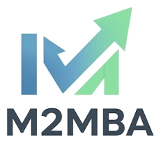
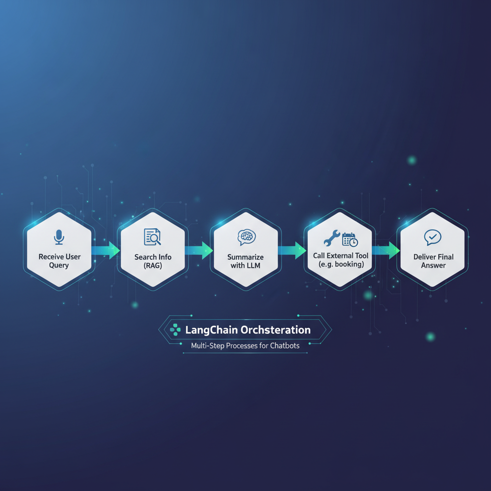
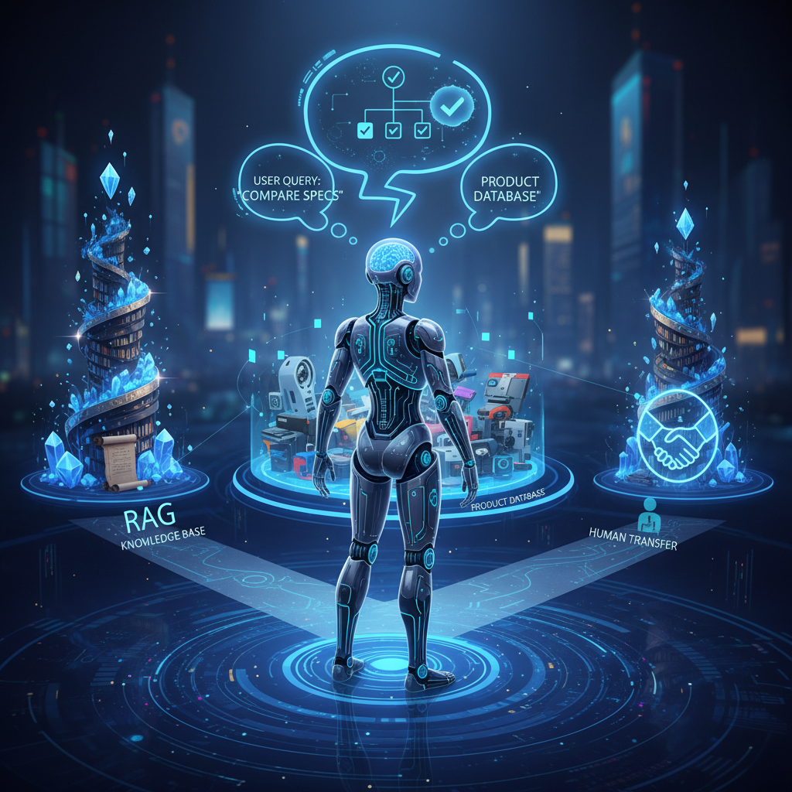

Title: Giải Mã Sức Mạnh của LangChain, RAG và Chatbot: Hướng Dẫn Dành Cho BA

URL Source: https://m2mba.com/blog/articles/c4887a1a-8104-4bc2-82f3-4b5ef5bacd9a

Published Time: 2025-10-10T11:47:45.000Z

Markdown Content:
[Rèn tư duy sâu · Tạo giá trị thật](https://m2mba.com/)

[Trang chủ](https://m2mba.com/)[Khóa học](https://m2mba.com/courses)[Workshop](https://m2mba.com/workshop)[Thư viện](https://m2mba.com/skills)[Blog](https://m2mba.com/blog)[About](https://m2mba.com/about)

[Đăng nhập](https://m2mba.com/login)[Đăng ký →](https://m2mba.com/register)

1.   [Home](https://m2mba.com/)
2.   [Blog](https://m2mba.com/blog)
3.   Giải Mã Sức Mạnh của LangChain, RAG và Chatbot: Hướng Dẫn Dành Cho BA

[Workflow Automation](https://m2mba.com/blog/topics/null)

# Giải Mã Sức Mạnh của LangChain, RAG và Chatbot: Hướng Dẫn Dành Cho BA

Đậu Thị Ngọc Ánh

10/10/2025

258 views

0

Share:

FB linkedin Zalo

(0)

Trong kỷ nguyên số hóa, các doanh nghiệp luôn tìm kiếm những giải pháp tối ưu để cải thiện trải nghiệm khách hàng và nâng cao hiệu quả hoạt động. Một trong những công nghệ đang định hình lại cách chúng ta tương tác là chatbot thông minh. Tuy nhiên, để một chatbot thực sự hữu ích và có khả năng giải quyết các vấn đề phức tạp, chúng cần được trang bị những "công cụ" mạnh mẽ hơn. Bài viết này sẽ giúp các chuyên viên phân tích nghiệp vụ (BA) hiểu rõ về ba khái niệm cốt lõi: Chatbot, RAG (Retrieval-Augmented Generation) và LangChain, cách chúng kết hợp để tạo ra những trợ lý ảo thông minh vượt trội, mở ra những cơ hội mới cho doanh nghiệp của bạn.

## **I. Chatbot là gì và tại sao chúng ta cần chúng?**

### **1. Khái niệm cơ bản về Chatbot**

Chatbot là một chương trình máy tính được thiết kế để mô phỏng cuộc trò chuyện của con người, đặc biệt là qua văn bản hoặc giọng nói. Chúng có thể hoạt động trên nhiều nền tảng khác nhau như website, ứng dụng nhắn tin (Messenger, Zalo), hay các hệ thống hỗ trợ khách hàng.

### **2. Ưu điểm của Chatbot**

*   Hỗ trợ 24/7: Phục vụ khách hàng mọi lúc, mọi nơi, không giới hạn về thời gian.
*   Tiết kiệm chi phí: Giảm tải công việc cho đội ngũ nhân sự, đặc biệt trong các tác vụ lặp đi lặp lại.
*   Phản hồi tức thì: Cung cấp thông tin và giải đáp thắc mắc nhanh chóng, nâng cao sự hài lòng của khách hàng.
*   Tăng hiệu suất: Tự động hóa các quy trình đơn giản, giúp nhân viên tập trung vào các công việc có giá trị cao hơn.

### **3. Hạn chế của Chatbot truyền thống**

Các chatbot đời đầu thường dựa trên kịch bản được lập trình sẵn. Chúng chỉ có thể trả lời các câu hỏi đã được dự đoán và mã hóa. Khi gặp câu hỏi nằm ngoài kịch bản hoặc quá phức tạp, chúng dễ dàng "bó tay", dẫn đến trải nghiệm người dùng không tối ưu và làm giảm độ tin cậy. Đây chính là lúc chúng ta cần đến những công nghệ tiên tiến hơn.

## **II. Giải pháp cho Chatbot thông minh hơn: Kỷ nguyên của LLM và RAG**

### **1. Mô hình Ngôn ngữ Lớn (LLM) – "Bộ não" của AI**

Chắc hẳn bạn đã nghe nói về ChatGPT. Đó chính là một ví dụ điển hình của Mô hình Ngôn ngữ Lớn (Large Language Model - LLM). LLM là các mô hình AI khổng lồ được huấn luyện trên lượng dữ liệu văn bản khổng lồ, cho phép chúng hiểu, tạo ra văn bản mạch lạc, trả lời câu hỏi, tóm tắt thông tin và thậm chí là sáng tạo nội dung. Chúng đóng vai trò như "bộ não" của các chatbot thế hệ mới, giúp chúng có khả năng hiểu ngữ cảnh và phản hồi linh hoạt hơn nhiều so với chatbot truyền thống.

### **2. RAG (Retrieval-Augmented Generation) là gì?**

Mặc dù LLM rất thông minh, chúng vẫn có những hạn chế. Một là, kiến thức của chúng bị giới hạn bởi thời điểm dữ liệu được huấn luyện (ví dụ: ChatGPT có thể không biết thông tin mới nhất sau ngày cắt dữ liệu của nó). Hai là, chúng có thể "bịa đặt" thông tin (hallucinate) nếu không có đủ dữ liệu đáng tin cậy. Đây là lúc RAG phát huy tác dụng.

*   Tại sao RAG lại quan trọng? RAG giúp các LLM truy cập và sử dụng thông tin mới nhất, chính xác từ các nguồn dữ liệu cụ thể của doanh nghiệp (ví dụ: tài liệu nội bộ, cơ sở dữ liệu sản phẩm, hướng dẫn sử dụng). Thay vì chỉ dựa vào kiến thức chung đã được huấn luyện, LLM có thể tham khảo "sách vở" của riêng bạn.
*   RAG hoạt động như thế nào? Hãy hình dung thế này:
    1.   Truy vấn (Retrieval): Khi người dùng đặt câu hỏi, hệ thống RAG sẽ tìm kiếm trong "thư viện" tài liệu của bạn (các file PDF, tài liệu Word, trang web, cơ sở dữ liệu...) để tìm những đoạn văn bản liên quan nhất. Giống như bạn tra cứu một cuốn sách để tìm câu trả lời.
    2.   Tạo sinh (Generation): Sau khi tìm thấy thông tin liên quan, hệ thống sẽ đưa thông tin đó cùng với câu hỏi của người dùng cho LLM. LLM sử dụng cả kiến thức sẵn có của mình và thông tin được cung cấp để tạo ra câu trả lời chính xác, đầy đủ và dễ hiểu. Giống như một chuyên gia đọc tài liệu và tóm tắt, diễn giải cho bạn.

Nhờ RAG, chatbot của bạn có thể trả lời các câu hỏi rất cụ thể về sản phẩm, dịch vụ, chính sách của công ty mà không cần phải huấn luyện lại toàn bộ LLM, giúp tiết kiệm chi phí và đảm bảo tính cập nhật của thông tin.

## **III. LangChain: "Dàn nhạc trưởng" kết nối mọi thứ**

### **1. LangChain là gì?**

Nếu LLM là "bộ não" và RAG là cách để "tra cứu thông tin", thì LangChain chính là "dàn nhạc trưởng" hoặc "bộ công cụ đa năng" giúp bạn kết nối tất cả các thành phần này lại với nhau một cách dễ dàng và hiệu quả. LangChain là một framework (khuôn khổ) giúp các nhà phát triển xây dựng các ứng dụng dựa trên LLM một cách nhanh chóng và có cấu trúc.

Tưởng tượng bạn đang xây một ngôi nhà (ứng dụng chatbot thông minh). Bạn có gạch (LLM), xi măng (cơ chế RAG), cửa sổ, mái nhà (các công cụ khác). LangChain cung cấp sẵn các "bản thiết kế" và "dụng cụ" giúp bạn ghép nối các thành phần này lại với nhau một cách logic và bền vững.

### **2. LangChain giúp ích gì cho RAG và Chatbot?**

*   Kết nối linh hoạt: LangChain cung cấp các module giúp dễ dàng kết nối LLM với các nguồn dữ liệu bên ngoài (qua RAG), các công cụ tìm kiếm, các API của các hệ thống khác.
*   Xây dựng chuỗi hoạt động (Chains): Thay vì chỉ một bước hỏi-đáp đơn giản, LangChain cho phép bạn định nghĩa một chuỗi các bước mà chatbot cần thực hiện. Ví dụ:
    1.   Nhận câu hỏi người dùng.
    2.   Tìm kiếm thông tin liên quan (RAG).
    3.   Tóm tắt thông tin đó bằng LLM.
    4.   Nếu cần, gọi một công cụ bên ngoài (ví dụ: đặt lịch hẹn, kiểm tra trạng thái đơn hàng).
    5.   Đưa ra câu trả lời cuối cùng cho người dùng.

*   Tạo tác nhân thông minh (Agents): LangChain cũng giúp tạo ra các "tác nhân" (agents) có khả năng tự động quyết định công cụ nào cần sử dụng dựa trên câu hỏi của người dùng. Chẳng hạn, một agent có thể tự biết khi nào cần tìm kiếm trong cơ sở kiến thức RAG, khi nào cần truy cập cơ sở dữ liệu sản phẩm, hay khi nào cần chuyển tiếp yêu cầu đến người thật.

Tóm lại, LangChain là một công cụ mạnh mẽ giúp đơn giản hóa quá trình xây dựng các ứng dụng AI phức tạp, đặc biệt là các chatbot sử dụng RAG để mang lại câu trả lời chính xác và đa năng.

## **IV. Ứng dụng thực tiễn cho Chuyên viên Phân tích Nghiệp vụ**

Với sự hiểu biết về LangChain, RAG và Chatbot, các BA có thể đóng vai trò quan trọng trong việc định hình và triển khai các giải pháp AI mang lại giá trị thực cho doanh nghiệp:

*   Nâng cao trải nghiệm khách hàng: Thiết kế chatbot hỗ trợ khách hàng đa năng, trả lời chính xác các câu hỏi về sản phẩm, dịch vụ, chính sách, hướng dẫn sử dụng dựa trên kho tài liệu của công ty, giảm thời gian chờ đợi và tăng sự hài lòng.
*   Tối ưu hóa quy trình nội bộ: Phát triển trợ lý ảo cho nhân viên, giúp họ nhanh chóng tìm kiếm thông tin về quy trình, chính sách nhân sự, tài liệu kỹ thuật, hoặc hỗ trợ các tác vụ hành chính, tiết kiệm thời gian và tăng năng suất làm việc.
*   Ra quyết định dựa trên dữ liệu: Sử dụng các chatbot tích hợp RAG để tổng hợp thông tin từ nhiều nguồn dữ liệu nội bộ khác nhau, cung cấp cái nhìn tổng quan và hỗ trợ ban lãnh đạo đưa ra quyết định chiến lược hiệu quả hơn.

## **V. Kết luận**

Chatbot thông minh, được cung cấp sức mạnh bởi các Mô hình Ngôn ngữ Lớn (LLM) và cơ chế RAG (Retrieval-Augmented Generation), và được kết nối thông qua LangChain, đang mở ra một kỷ nguyên mới về cách chúng ta tương tác với công nghệ. Đối với các chuyên viên phân tích nghiệp vụ, việc nắm bắt những khái niệm này không chỉ là một lợi thế cạnh tranh mà còn là chìa khóa để kiến tạo nên những giải pháp AI đột phá, giúp doanh nghiệp tối ưu hóa hoạt động, nâng cao trải nghiệm khách hàng và đạt được những bước tiến vượt bậc trong hành trình chuyển đổi số. Hãy sẵn sàng để khai thác tiềm năng to lớn mà bộ ba công nghệ này mang lại!

Trong kỷ nguyên số hóa, các doanh nghiệp luôn tìm kiếm những giải pháp tối ưu để cải thiện trải nghiệm khách hàng và nâng cao hiệu quả hoạt động. Một trong những công nghệ đang định hình lại cách chúng ta tương tác là chatbot thông minh. Tuy nhiên, để một chatbot thực sự hữu ích và có khả năng giải quyết các vấn đề phức tạp, chúng cần được trang bị những "công cụ" mạnh mẽ hơn. Bài viết này sẽ giúp các chuyên viên phân tích nghiệp vụ (BA) hiểu rõ về ba khái niệm cốt lõi: Chatbot, RAG (Retrieval-Augmented Generation) và LangChain, cách chúng kết hợp để tạo ra những trợ lý ảo thông minh vượt trội, mở ra những cơ hội mới cho doanh nghiệp của bạn.

### Trung tâm M2MBA

Đăng ký ngay những khóa học chất lượng, được thiết kế để phát triển kỹ năng và tăng tốc con đường sự nghiệp của bạn.

### Liên kết nhanh

*   [Khám phá khóa học](https://m2mba.com/courses)
*   [Về chúng tôi](https://m2mba.com/about)
*   [Liên hệ](https://m2mba.com/contact)

### Hỗ trợ

*   [Điều khoản dịch vụ](https://m2mba.com/terms-of-service)
*   [Chính sách bảo mật](https://m2mba.com/security-policy)

### Học tập

*   [Thư viện](https://m2mba.com/skills)
*   [Blog](https://m2mba.com/blog)

© 2026 Trung tâm M2MBA. Bản quyền thuộc về chúng tôi.

Ease Health design system
