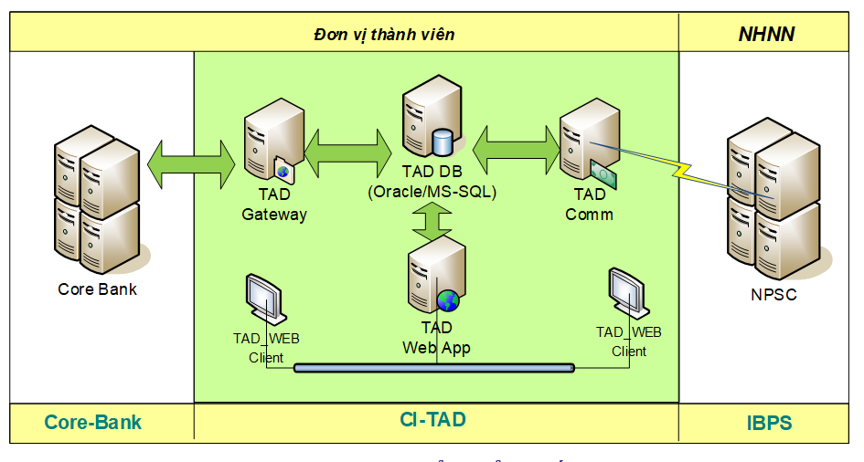

# Luồng GD chuyển tiền qua CITAD

*Tác giả: Đậu Thị Ngọc Ánh | Ngày đăng: 2023-12-20T09:25:48.000Z*

## **1.Hệ thống CITAD**

CITAD là viết tắt của Terminal Access Device for SBV-Branch & Credit Institution là phần mềm dành cho các Chi nhánh ngân hàng nhà nước và các tổ chức tín dụng (TCTD) tham gia vào Hệ thống thanh toán liên ngân hàng (IBPS) với vai trò là các đơn vị thành viên. Phần mềm này được cài đặt và chạy độc lập tại các Ngân hàng 

Tại mỗi Ngân hàng thành viên, Hệ thống CITAD được cài đặt để tiếp nhận, xử lý các yêu cầu chuyển tiền qua CITAD.  Hệ thống nội bộ của bank sẽ giao tiếp với hệ thống CITAD để xử lý các yêu cầu chuyển tiền:

- Nếu NH phát lệnh: Đẩy yêu cầu chuyển tiền sang hệ thống CITAD
- NH nhận lệnh: Nhận yêu cầu từ CITAD để hạch toán cộng tiền vào TK cho KH thụ hưởng
Dưới đây là sơ đồ chi tiết hơn về hệ thống CITAD

**Trong đó:**

- **Gateway (TAD Gateway): **là một tiến trình chạy ngầm của hệ thống, cung cấp các chức năng cho phép xử lý tự động giao dịch giao tiếp với hệ thống CoreBanking qua hai hình thức cơ bản: file Text có cấu trúc hoặc Table trong CSDL.
- **Hệ thống xử lý giao dịch (TAD WEB): **là phần mềm tương tác với người sử dụng được xây dựng trên môi trường Web-base cung cấp các tiện ích cho phép xử lý các nghiệp vụ của hệ thống thanh toán. 
- **Chương trình Truyền thông (TAD COMM): **Chương trình truyền thông cung cấp các chức năng cho phép kết nối và xử lý các yêu cầu gửi nhận và đồng bộ dữ liệu giữa đơn vị thành viên (Hệ thống xử lý giao dịch) và Hệ thống xử lý trung tâm**. **
- **TAD DB **là nơi lưu trữ dữ liệu của các giao dịch chuyển tiền (chuyển đi và chuyển đến): Dữ liệu được cập nhật vào trong DB này qua các cáchNgười dùng nhập liệu trực tiếp trên TAD WEB (Xử lý thủ công)
- Đồng bộ dữ liệu với hệ thống corebank qua TAD GW (xử lý tự động)
## **2.Luồng GD qua CITAD**

Dưới đây thể hiện mô hình kết nối, trao đổi data giữa NH phát lệnh và NH nhận lệnh

**Bước 1**: Bên NH phát lệnh sẽ đẩy giao dịch chuyển tiền vào hệ thống CITAD bằng cách tiến trình chạy tự động hoặc manual, NV trung tâm thanh toán vào nhập liệu trên hệ thống CITAD

**Bước 2**: Sau khi duyệt trên hệ thống CITAD, GD được đẩy sang trung tâm xử lý NHNN (xử lý hàng đợi)

**Bước 3:** Trung tâm xử lý NHNN sẽ xử lý duyệt GD và đẩy vào hàng đợi 

**Bước 4**: Hệ thống CITAD tại ngân hàng thụ hưởng sẽ nhận yêu cầu từ hàng đợi và xử lý GD

- Tự động: Bên Bank có tiến trình xử lý ngầm kết nối với hệ thống CITAD để lấy các GD chuyển đến và hạch toán tài khoản
- Manual: Nhân viên trung tâm thanh toán sẽ vào check giao dịch và thực hiện hạch toán trên corebank
Vì các bước giao dịch như trên, các bạn sẽ hiểu vì sao mà GD chuyển tiền qua CITAD không thể nhận tiền real time được

### **2.1.Luồng xử lý GD thủ công**

Luồng này thì mình nghĩ hiện tại sẽ khá là ít, nhưng mình cứ nêu ra nhé (cái này mình tham khảo trên tài liệu HDSD của hệ thống CITAD, link [tại đây](https://www.sbv.gov.vn/webcenter/ShowProperty?nodeId=/UCMServer/SBV412027//idcPrimaryFile&revision=latestreleased) nhé)

### **2.1.1.GD chuyển đi**

- **Quy trình 3 bước**

**Bước 0: **Không có trên ảnh, GDV tại quầy GD, hoặc KH thực hiện trên các kênh Online.** **GD đã được hạch toán tại corebanking

**Bước 1: **Kế toán GD tại Trung tâm thanh toán tạo GD chuyển tiền theo yêu cầu của KH trên hệ thống TAD WEB

**Bước 2:** Kế toán liên hàng thực hiện kiểm tra các lệnh chuyển tiền được tạo bởi kế toán giao dịch 

**Bước 3:** Kiểm soát liên hàng thực hiện kiểm soát và duyệt các lệnh chuyển tiền đã được duyệt bởi Kế toán liên hàng. Khi duyệt GD, hệ thống CITAD thực hiện ký chữ ký điện tử (CKĐT) lên GD tương ứng. Các giao dịch  được ký CKĐT được đưa vào hàng đợi Tin điện chờ gửi của chương trình TAD_COMM chờ chuyển lên Trung tâm xử lý

- **Quy trình 2 bước**
Cũng tương tự quy trình xử lý 3 bước nhưng sẽ bỏ đi bước Kế toán liên hàng kiểm duyệt giao dịch. Mỗi NH sẽ tự thiết lập chọn đi theo quy trình 2 bước hay 3 bước

Chi tiết các MH giao dịch trên hệ thống TAD WEB, các bạn có thể xem tại [link này](https://www.sbv.gov.vn/webcenter/ShowProperty?nodeId=/UCMServer/SBV412027//idcPrimaryFile&revision=latestreleased)

### **2.1.2.GD chuyển đến**

KS liên hàng vào hệ thống TAD WEB để check danh sách các GD chuyến đến và thực hiện duyệt các lệnh. Sau đó vào hệ thống Corebank Hạch toán tài khoản

****

### **2.2.Luồng xử lý tự động**

 

Bên hệ thống CITAD có TAD **Gateway (TAD Gateway):** là một tiến trình chạy ngầm của hệ thống, cung cấp các chức năng cho phép xử lý tự động giao dịch giao tiếp với hệ thống CoreBanking qua hai hình thức cơ bản: file Text có cấu trúc hoặc Table trong CSDL.

****

Dưới đây là ví dụ với TH đồng bộ thông tin GD qua File Text có cấu trúc (data trong file là mình giả định nhé, còn nếu làm thật sẽ cần phải đọc đặc tả file do CITAD quy định)

Hệ thống NH phát lệnh sẽ có 1 tiến trình để quét các GD chuyển tiền liên NH qua CITAD mà chưa xử lý. Sau đó sẽ thực hiện tạo File Text theo đặc tả yêu cầu của CITAD, trong file này sẽ chứa các GD và có chữ ký điện tử trên đó. Sau đó GD được TAD GW xử lý và đẩy vào TAD DB, và tiếp tục qua TAD COM để đẩy vào hàng đợi (chỗ này cũng là mình tư duy thôi nhé, hy vọng có bạn nào nắm rõ thì mô tả lại kỹ hơn giúp mình nhé)

Tương tự bên GD chuyển đến

File được đẩy từ hệ thống CITAD tại NH nhận lệnh, Hệ thống NH nhận lệnh sẽ thực hiện hạch toán GD theo các GD trong file