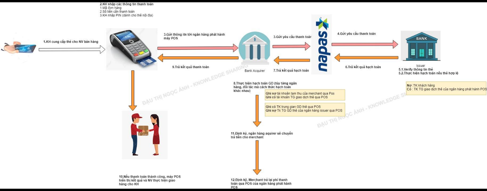

# Luồng giao dịch quẹt thẻ máy POS

*Tác giả: Đậu Thị Ngọc Ánh | Ngày đăng: 2023-12-19T13:41:37.000Z*

Bài trước mình giải thích về 𝐏𝐮𝐥𝐥 𝐏𝐚𝐲𝐦𝐞𝐧𝐭, 𝐏𝐮𝐬𝐡 𝐏𝐚𝐲𝐦𝐞𝐧𝐭. Hôm nay mình đưa ra 1 ví dụ về mô hình 𝐏𝐮𝐥𝐥 𝐏𝐚𝐲𝐦𝐞𝐧𝐭, đó là Thanh toán qua máy quẹt thẻ POS

Giải thích 1 số thuật ngữ:

-  **Accquirer**: Là đơn vị phát hành máy POS, **Accquirer **thường là các bank, ngoài ra hiện tại có 1 số đơn vị như VNPAY, MPOS không phải là bank nhưng cũng phát triển POS.  **Accquirer **có nhiệm vụ phát triển các merchant để hợp tác (là NV của NV sale) để merchant mở rộng thêm 1 hình thức thanh toán qua thẻ. 
- 𝐌𝐞𝐫𝐜𝐡𝐚𝐧𝐭: Là đơn vị cung ứng hàng hóa dịch vụ, sử dụng máy POS. Acquirer thường là các ngân hàng, họ sẽ đi phát triển các merchant hay còn gọi Điểm chấp nhận thanh toán thẻ. Một merchant có thể có 2 máy POS của 2 Acquirer khác nhau.
- 𝐈𝐬𝐬𝐮𝐞𝐫: Là đơn vị phát hành thẻ của KH
Bạn có thể xem chi tiết luồng giao dịch ở ảnh dưới:

Với luồng giao dịch như hình, theo bạn với merchant và Aquirer cần có hệ thống quản lý thông tin ntn

- **Accquirer**: Nhìn vào luồng giao dịch, chúng ta có thể thấy thông tin giao dịch không được lưu trữ trên hệ thống nào của Merchant=>**Accquirer **cần phải có:𝑴𝒆𝒓𝒄𝒉𝒂𝒏𝒕 𝒔𝒊𝒕𝒆 𝑽𝒊𝒆𝒘: hệ thống dành cho Merchant chủ động vào theo dõi giao dịch tại cửa hàng của mình
- Đối với các merchant lớn, họ thường có các chuỗi cửa hàng, **Accquirer**cần phải 𝒒𝒖𝒂̉𝒏 𝒍𝒚́ 𝒈𝒊𝒂𝒐 𝒅𝒊̣𝒄𝒉 đ𝒖̛𝒐̛̣𝒄 đ𝒆̂́𝒏 𝒕𝒖̛̀𝒏𝒈 𝒄𝒖̛̉𝒂 𝒉𝒂̀𝒏𝒈 𝒄𝒖̉𝒂 𝑴𝒆𝒓𝒄𝒉𝒂𝒏𝒕
- Cho phép merchant theo dõi tiền về tài khoản merchant: Thời gian chuyển tiền, số tiền của bên **Accquirer **trả lại cho merchant  (vì khi KH thanh toán thì tiền mới chỉ bị trừ ở bên issuer, tiền chưa về merchant, Accquirer sẽ có nhiệm vụ trả tiền cho merchant, còn bên issuer sẽ có nhiệm vụ trả tiền cho Accquirer  thông qua tổ chức thẻ trung gian (Napas, Mastercard, Visa)
- 𝙈𝙚𝙧𝙘𝙝𝙖𝙣𝙩: Cần quản lý để biết đượcĐơn hàng nào thanh toán qua máy POS
- Thanh toán qua POS của ngân hàng nào => Để theo dõi tiền về trên từng ngân hàng, Để quản lý được thông tin này : Với các Merchant có hệ thống, có thể có 2 cáchNhập thông tin ghi nhận trên từng đơn hàng
- Hoặc kết nối với ngân hàng Acquirer để cập nhật realtime vào hệ thống quản lý bán hàng của merchant
𝐾ℎ𝑖 𝑡ℎ𝑎𝑛ℎ 𝑡𝑜𝑎́𝑛 𝑞𝑢𝑎 𝑚𝑎́𝑦 𝑃𝑜𝑠, 𝑚𝑒𝑟𝑐ℎ𝑎𝑛𝑡 𝑠𝑒̃ 𝑝ℎ𝑎̉𝑖 𝑡𝑟𝑎̉ 1 𝑘ℎ𝑜𝑎̉𝑛 𝑝ℎ𝑖́ 𝑥𝑢̛̉ 𝑙𝑦́ 𝑔𝑖𝑎𝑜 𝑑𝑖̣𝑐ℎ 𝑐ℎ𝑜 đ𝑜̛𝑛 𝑣𝑖̣ 𝐴c𝑞𝑢𝑖𝑟𝑒𝑟, 𝑛ℎ𝑖𝑒̂̀𝑢 𝑚𝑒𝑟𝑐ℎ𝑎𝑛𝑡 𝑣𝑖̀ 𝑡ℎ𝑒̂́ 𝑚𝑎̀ 𝑡ℎ𝑢 𝑡ℎ𝑒̂𝑚 𝑝ℎ𝑖́ 𝐾𝐻 𝑘ℎ𝑖 𝐾𝐻 𝑚𝑢𝑜̂́𝑛 𝑡ℎ𝑎𝑛ℎ 𝑡𝑜𝑎́𝑛 𝑞𝑢𝑎 𝑚𝑎́𝑦 𝑃𝑂𝑆=>𝑀𝑒𝑟𝑐ℎ𝑎𝑛𝑡 đ𝑜́ 𝑡ℎ𝑢̛̣𝑐 ℎ𝑖𝑒̣̂𝑛 𝑠𝑎𝑖 𝑛𝑔𝑢𝑦𝑒̂𝑛 𝑡𝑎̆́𝑐

Đ𝑜̂́𝑖 𝑣𝑜̛́𝑖 𝑐𝑎́𝑐 𝑚𝑒𝑟𝑐ℎ𝑎𝑛𝑡 ,𝑣𝑖𝑒̣̂𝑐 𝑐𝑢𝑛𝑔 𝑐𝑎̂́𝑝 đ𝑢̛𝑜̛̣𝑐 𝑛ℎ𝑖𝑒̂̀𝑢 ℎ𝑖̀𝑛ℎ 𝑡ℎ𝑢̛́𝑐 𝑡ℎ𝑎𝑛ℎ 𝑡𝑜𝑎́𝑛 𝑐ℎ𝑜 𝐾𝐻, 𝑠𝑒̃ 𝑔𝑖𝑢́𝑝 𝑐ℎ𝑜 𝐾𝐻 𝑑𝑒̂̃ 𝑔𝑖𝑎𝑜 𝑑𝑖̣𝑐ℎ ℎ𝑜̛𝑛=>𝑇𝑎̆𝑛𝑔 ℎ𝑖𝑒̣̂𝑢 𝑞𝑢𝑎̉ 𝑏𝑎́𝑛 ℎ𝑎̀𝑛𝑔

𝑁𝑔𝑜𝑎̀𝑖 𝑟𝑎, Đ𝑒̂̉ 𝑘ℎ𝑢𝑦𝑒̂́𝑛 𝑘ℎ𝑖́𝑐ℎ 𝑡ℎ𝑎𝑛ℎ 𝑡𝑜𝑎́𝑛 đ𝑖𝑒̣̂𝑛 𝑡𝑢̛̉, 𝐶𝑎́𝑐 𝑛𝑔𝑎̂𝑛 ℎ𝑎̀𝑛𝑔 𝑐𝑢̃𝑛𝑔 𝑡ℎ𝑢̛𝑜̛̀𝑛𝑔 𝑐𝑜́ 𝑛ℎ𝑖𝑒̂̀𝑢 𝑐ℎ𝑖́𝑛ℎ 𝑠𝑎́𝑐ℎ 𝐾𝑀 𝑛ℎ𝑢̛ ℎ𝑜𝑎̀𝑛 𝑡𝑖𝑒̂̀𝑛 10-20% 𝑘ℎ𝑖 𝑡ℎ𝑎𝑛ℎ 𝑡𝑜𝑎́𝑛 𝑏𝑎̆̀𝑛𝑔 ℎ𝑖̀𝑛ℎ 𝑡ℎ𝑢̛́𝑐 𝑞𝑢𝑒̣𝑡 𝑡ℎ𝑒̉