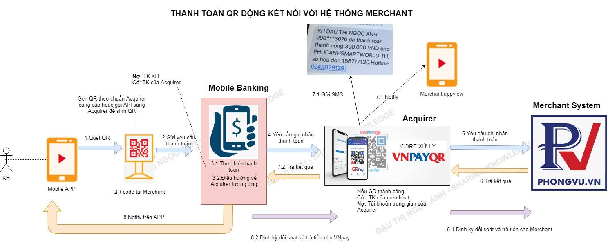

# Luồng thanh toán QR

*Tác giả: Đậu Thị Ngọc Ánh | Ngày đăng: 2023-12-19T13:46:00.000Z*

Hôm trước mình đã nói qua về phương thức thanh toán qua máy POS theo mô hình Pull Payment. Hôm nay mình xin trình bày 1 phương thức thanh toán đang là xu thế hiện nay đó là thanh toán QRcode, là phương thức theo mô hình PushPayment. Thay vì chúng ta cứ phải kè kè cái ví, kèm với các thể loại thẻ (thẻ ATM, thẻ tín dụng...) thì nay chúng ta chỉ cần cầm cái điện thoại để thỏa sức thanh toán mọi lúc mọi nơi 

Thuật ngữ QRcode các bạn có thể tìm kiếm trên mạng rất nhiều. Mình xin tóm tắt lại: QRcode là 1 cách thể hiện thông tin dữ liệu thông qua hình ảnh mã vuông. Thông tin đọc ra từ QRcode là chuỗi text theo quy tắc của đơn vị cung cấp giải pháp thanh toán QR, dưới đây là 1 số thông tin đọc được từ các Điểm chấp nhận thanh toán (ĐCNTT) QR hiện tại trên thị trường:

-  Đ𝐂𝐍𝐓𝐓 𝐕𝐢𝐞𝐭𝐭𝐞𝐥𝐏𝐚𝐲: {"𝑉𝐸𝑅𝑆𝐼𝑂𝑁":"1.0","𝑃𝑅𝐼𝑂𝑅𝐼𝑇𝑌":"𝐵𝑎𝑛𝑘𝑃𝑙𝑢𝑠","𝑇𝑌𝑃𝐸":"𝑃𝐴𝑌_𝑆𝑇𝐴𝑇𝐼𝐶_𝐵𝐼𝐿𝐿","𝑀𝐸𝑅𝐶𝐻𝐴𝑁𝑇_𝐶𝑂𝐷𝐸":"190325-190502"}
-  Đ𝐂𝐍𝐓𝐓 𝐕𝐍𝐩𝐚𝐲: 00020101021126280010𝐴000000775011001014171285204504553037045802𝑉𝑁5907𝑃𝐻𝑈𝐶𝐴𝑁𝐻6005𝐻𝐴𝑁𝑂𝐼62370320𝑃𝐻𝑈𝐶𝐴𝑁𝐻𝑆𝑀𝐴𝑅𝑇𝑊𝑂𝑅𝐿𝐷 𝑇𝐻0709𝑃𝐻𝑈𝐶𝐴𝑁𝐻02630489𝐹𝐶
Để đọc được thông tin QRcode, bạn dùng camera của điện thoại quét ảnh QR là camera sẽ đọc ra được đoạn text của QR nhé 

**Bước 1**: Cầm camera điện thoại quét QR bạn cần đọc thông tin , trong khung chữ nhật màu đỏ đó chính là nội dung của QR

**Bước 2**: Bạn click vào tìm kiếm, để mở ra trình duyệt mặc định trên điện thoại thông tin tìm kiếm của QR đó, mục đích để copy được text QR tương ứng

Và nội dung QR mình quét được có nội dung:  00020101021138530010A0000007270123000697044101096677258880208QRIBFTTA53037045802VN6304FCD6

Nhiệm vụ của BA/dev là phải hiểu cấu trúc của đoạn text này gồm những thông tin gì trong đó, để bắt đầu bóc tách thông tin ra. Hôm sau mình sẽ có bài cụ thể nói về QR chuẩn theo Ngân hàng nhà nước ở thời điểm hiện tại nhé (chính là cấu trúc của QR trên)

𝐃𝐮̛𝐨̛́𝐢 đ𝐚̂𝐲 𝐦𝐢̀𝐧𝐡 𝐧𝐞̂𝐮 𝐭𝐡𝐞̂𝐦 𝟏 𝐬𝐨̂́ 𝐤𝐡𝐚́𝐢 𝐧𝐢𝐞̣̂𝐦 + 𝐭𝐡𝐚̀𝐧𝐡 𝐩𝐡𝐚̂̀𝐧 𝐭𝐡𝐚𝐦 𝐠𝐢𝐚 𝐯𝐚̀𝐨 𝐡𝐞̣̂ 𝐭𝐡𝐨̂́𝐧𝐠:

- 𝐐𝐑 𝐭𝐢̃𝐧𝐡: Là QR chứa các thông số trong QR là cố định như mã của merchant, tên merchant…QR tĩnh thường được đặt tại các Cửa hàng offline. Việc tích hợp thanh toán QR tĩnh rất nhanh do merchant không cần phải phát triển hệ thống để tích hợp với đơn vị cung cấp giải pháp thanh toán QRcode
- 𝐐𝐑 đ𝐨̣̂𝐧𝐠: Là QR có chứa các tham số thay đổi như mã đơn hàng, mã giao dịch, số tiền giao dịch. QRcode có thể được in ra tại các hóa đơn ở cửa hàng offline (tích hợp với hệ thống quản lý bán hàng của cửa hàng) hoặc hiển thị trên app, web online bán hàng của merchant, Với QRcode động, KH không cần phải nhập thông tin số tiền để thanh toán. Tuy nhiên việc tích hợp sẽ mất nhiều thời gian hơn
𝑪𝒂́𝒄 𝒕𝒉𝒂̀𝒏𝒉 𝒑𝒉𝒂̂̀𝒏 𝒕𝒉𝒂𝒎 𝒈𝒊𝒂 𝒗𝒂̀𝒐 𝒉𝒆̣̂ 𝒕𝒉𝒐̂́𝒏𝒈:

- 𝐌𝐨𝐛𝐢𝐥𝐞 𝐛𝐚𝐧𝐤𝐢𝐧𝐠/**Ví điện tử**: Là ứng dụng kết nối với nguồn tiền của KH trên điện thoại (hay còn gọi là Issuer) có thể là mobile banking của các ngân hàng, ví điện tử (ViettelPay, Momo…). Mobile banking được chia làm 2 phần: Mobile banking app (là phần giao diện trên ứng dụng), Mobile banking system (hay còn gọi backend là phần kết nối với core ngân hàng cũng như kết nối với Acquirer)
- **Accquirer**: Đơn vị phát triển merchant cho phép thanh toán QRcode, đơn vị trung gian kết nối giữa Mobile banking và Merchant (trong ví dụ này là Vnpay)
- 𝐌𝐞𝐫𝐜𝐡𝐚𝐧𝐭 𝐚𝐩𝐩𝐯𝐢𝐞𝐰: Là 1 ứng dụng do đơn vi Acquirer phát triển cho merchant, là ứng dụng để acquirer có thể notify kết quả GD khi KH thanh toán thành công và cho phép merchant theo dõi các giao dịch thanh toán QRcode
- 𝐌𝐞𝐫𝐜𝐡𝐚𝐧𝐭 𝐬𝐲𝐬𝐭𝐞𝐦: Là hệ thống quản lý bán hàng của merchant
Mô hình giao tiếp các thành phần trên như sau (với TH QR động, còn nếu trường hợp không phải QR động thì sẽ không có bước 2 và bước 5, bước 2 thay bằng quét QR tĩnh đặt tại cửa hàng)

 

Giải thích chi tiết vai trò từng bên: 

**Phía Merchant: **Sẽ cần xây dựng các ứng dụng bán hàng nội bộ của merchant, trên đó sẽ cần hiển thị QR động khi cần thanh toán và tích hợp với hệ thống merchant, việc tạo QR động này merchant có thể tự sinh ra theo quy định đặc tả của QR, hoặc kết nối với bên accquirer qua API để tạo QR

Khi Accquirer ký HĐ với merchant thì sẽ cần khai báo thông tin merchant trên hệ thống nội bộ của Accquirer, họ sẽ tạo mã merchant, và thông tin trên QR bắt buộc phải có mã merchant này (Accquirer này có thể là các ví phát triển merchant, các bên trung gian như Vnpay)

**Phía Accquirer: **Cần xây dựng ứng dụng quản lý nội bộ để quản lý thông tin merchant. Khi ký HĐ với merchant, Accquirer sẽ cần tạo thông tin trên hệ thống và cung cấp mã merchant cho bên merchant tương ứng. QR sau này tạo ra sẽ bắt buộc phải chứa mã merchant này, để biết GD KH đang quét QR ho bên mã merchant nào. Ngoài ra Accquirer cũng cần xây dựng web merchant view, để cho nhân viên merchant có thể vào theo dõi các GD, báo cáo doanh thu thanh toán qua QR của **Accquirer **tương ứng.Và trong TH thanh toán qua QR tĩnh, merchant không tích hợp với hệ thống **Accquirer, **NV merchant có thể vào web merchant view để check GD của KH quét QR đã được ghi nhận vào hệ thống của Accquirer hay chưa

Với TH merchant tích hợp hệ thống, Bên hệ thống Accquirer sẽ có phần quản lý **mapping mã merchant và thông tin URL của API tích hợp thông báo kết quả thanh toán**. Mục đích mỗi khi **Accquirer  **thì sẽ gọi API thông báo tương ứng của merchatn đó để báo kết quả

**Ngân hàng/Ví điện tử: **Họ cần xây dựng phần QR để đảm bảo đọc được các QR do các bên accquirer mà họ ký HĐ=>Việc của họ là hiểu đặc tả của QR từng bên (trước đây thì có nhiều đặc tả nhưng hiện tại đã theo 1 chuẩn chung của ngân hàng nhà nước, Có thể đọc [tại đây](https://vietqr.net/portal-service/download/documents/QR_Format_T&C_v1.0_VN_092021.pdf) để nắm quy chuẩn của QR NHNN nhé. Trên thông tin QR sẽ có các thông tin:

- **Mã của bên accquier**: Mã này là mã định danh duy nhất toàn cầu, đảm bảo 2 tổ chức ko trùng mã của nhau, các ngân hàng tại Việt Nam sử dụng mã BIN cấp bởi NHNN. Ví dụ của mã định danh của Napas là A000000727, của các NH là 9704xx, ví dụ MB là 970422. Khi đọc QR, dựa vào mã của bên phát triển QR này mà biết thông tin GD cần được đẩy sang cho hệ thống của accquirer nào. Ví dụ trong QR có mã accquirer là A000000727, thì thông tin GD từ bên BANK sẽ cần đẩy sang bên Napas (thông tin đẩy sang sẽ bao gồm mã merchant có trên QR)
- **Mã Merchant: **Mã này là mã do bên accquirer cung cấp cho Merchant khi họ ký HĐ hợp tác thanh toán qua QR. Khi Merchant gent QR phải đảm bảo gen đúng mã merchant mà bên Accquirer cung cấp
- **Số tiền GD** (nếu là QR động)
- **Mã GD **(nếu là QR động)…
và bên Ngân hàng/VĐT sẽ cần có bảng** mapping là Mã accquirer và URL API thông báo kết quả** ,để mỗi khi KH quét QR của bên nào thì sẽ đẩy GD sang bên accquirer  tương ứng

**Dưới đây là giải thích chi tiết từng bước theo mô hình trên**

**Bước 1**: NV merchant tương tác trên ứng dụng bán hàng nội bộ của merchant

**Bước 2**: Ứng dụng hiển thị QR thanh toán (Việc tạo QR có thể merchant tự tạo hoặc gọi API sang accquirer để tạo), QR này đảm bảo theo cấu trúc quy định của bên Accquirer, và giờ thường là theo chuẩn NHNN - EMV)

**Bước 3:** KH dùng ứng dụng bank/VĐT quét QR và GD được đẩy lên backend của bank/VĐT. Thông tin gửi lên backend sẽ được bóc ra từ QR gồm **mã** **accquier, mã merchant, số tiền…**

Bước 4: Dựa vào thông tin  **mã** **accquier, **bank/ví sẽ gửi thông tin sang hệ thống accquier **tương ứng, thông tin gửi sang bắt buộc phải có  mã merchant, số tiền…**

**Bước 5: **Hệ thống **accquier **ghi nhận thông tin GD, nếu merchant có kết nối hệ thống thì dựa vào mã merchant để đẩy thông tin GD sang merchant tương ứng. Và khi đó backend merchant sẽ lưu lại thông tin và refresh màn hình trên ứng dụng bán hàng để thể hiện GD thanh toán thành công

Dưới đây là 2 hình ảnh mô tả luồng thanh toán QRcode tĩnh và QR code động (có kết nối với merchant system)

 

Ảnh đính kèm bên dưới thể hiện luồng chi tiết hơn với thanh toán QR động và QR tĩnh nhé

**Thanh toán qua QR động**

**Thanh toán qua QR tĩnh:**

 

p/s: Mình note thêm giải thích sự khác nhau giữa QR động và QR tĩnh

- **QR tĩnh** là các QR mà các bạn vào các cửa hàng, họ để QR sẵn trên bàn lễ tân/NV bán hàng. Trên QR này chỉ có mỗi Mã Accquirer và Mã merchant do bên Accquirer cung cấp khi bên cửa hàng ký HĐ chấp nhận thanh toán qua QR code của bên accquirer (Quy trình kinh doanh: Bước 1: NV Acquirer tìm các cửa hàng và tư vấn sử dụng dịch vụ chấp nhận thanh toán qua QR, Bước 2: Cửa hàng okie thì 2 bên ký HĐ, Bước 3: NV Acquirer về nhập HĐ trên hệ thống của acquirer và trên hệ thống sinh ra 1 Mã merchant cho bên cửa hàng đó, Bước 4: NV Accquirer In QR để dán tại cửa hàng - Trên QR đó chỉ đơn giản có mã merchant và mã của accquirer): Do đó khi quét QR này thì trên MH của các app sẽ chỉ hiển thị ra được thông tin mã cửa hàng, tên cửa hàng. Còn thông tin về số tiền là KH phải nhậpBước 1: KH quét QR
- Bước 2: App NH/Ví hiển thị thông tin mã merchant, tên merchant trên QR
- Bước 3: App gửi yêu cầu thanh toán lên backend của NH/Ví  (Gửi thông tin mã accquirer - đọc được từ QR nhưng ko hiển thị trên MH, mã merchant, số tiền GD)
- Bước 4: BE của NH/Ví thực hiện trừ tiền TK KH
- Bước 5: ở đây chia 2 trường hợpNếu merchant này do Accquirer chính là NH/Ví của KH đang sử dụng phát triển: Ví dụ KH đang dùng ví momo và Merchant cũng do Momo phát triển thì BE sẽ lưu thông tin GD lại trên BE của mình
- Ngược lại: Dựa vào mã accquirer do App gửi lên, BE sẽ biết đẩy GD sang bên accquirer nào, và đẩy các thông tin như Mã merchant, số tiền GD sang bên accquirer
- Bước 6: NV bán hàng của cửa hàng vào hệ thống merchant view do accquirer xây dựng ra để check xem GD đã có trên hệ thống hay chưa. Nếu có rồi thì giao hàng cho KH 
**QR động**: ở đây cũng chia ra 2 dạng QR động

- Loại 1: Như QR tĩnh nhưng có thêm thông tin số tiền cần thanh toán (Ví dụ như các bạn vào app bank để tự tạo QR theo số tiền ấy), với QR này thì luồng xử lý không khác gì QR tĩnh, chỉ là KH đỡ phải nhập số tiền
- Loại 2:QR động có thêm thông tin mã GD của bên merchant system, luồng chi tiết như bên dưới, hy vọng qua luồng này thì cũng giải thích đc vì sao QR tĩnh lại ko kết nối với merchant system làm gì cả, vì có kết nối thì cũng ko có gì để mapping được
Có bạn nào đặt câu hỏi :

𝐻𝑖𝑒̣̂𝑛 𝑡𝑎̣𝑖 𝑐𝑜́ 𝑛ℎ𝑖𝑒̂̀𝑢 đ𝑜̛𝑛 𝑣𝑖̣ 𝑐𝑢̀𝑛𝑔 𝑝ℎ𝑎́𝑡 𝑡𝑟𝑖𝑒̂̉𝑛 𝑄𝑅𝑐𝑜𝑑𝑒 𝑛ℎ𝑢̛ 𝑉𝑛𝑝𝑎𝑦, 𝑀𝑜𝑀𝑜, 𝑉𝑖𝑒𝑡𝑡𝑒𝑙𝑃𝑎𝑦... 𝑉𝑎̣̂𝑦 𝑡𝑎̣𝑖 𝑐𝑎́𝑐 Đ𝐶𝑁𝑇𝑇 𝑠𝑒̃ 𝑝ℎ𝑎̉𝑖 𝑑𝑎́𝑛 𝑏𝑎𝑜 𝑛ℎ𝑖𝑒̂𝑢 𝑄𝑅𝐶𝑜𝑑𝑒 đ𝑒̂̉ đ𝑎́𝑝 𝑢̛́𝑛𝑔 đ𝑢̛𝑜̛̣𝑐 𝑐𝑎́𝑐 𝑢̛́𝑛𝑔 𝑑𝑢̣𝑛𝑔 𝑀𝑜𝑏𝑖𝑙𝑒 𝑏𝑎𝑛𝑘𝑖𝑛𝑔 đ𝑒̂̉ 𝑡ℎ𝑎𝑛ℎ 𝑡𝑜𝑎́𝑛? Các bạn đọc bài viết này để rõ nhé: [Thảo luận luồng thanh toán QR](https://m2mba.com/admin/posts/62)