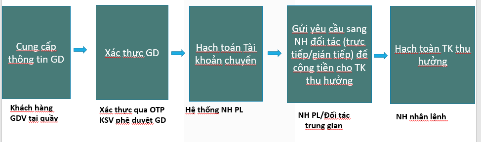

# Luồng giao dịch chuyển tiền

*Tác giả: Đậu Thị Ngọc Ánh | Ngày đăng: 2023-12-20T08:19:14.000Z*

## **1.Luồng GD chung**

 

**Bước 1**: KH thực hiện nhập các thông tin GD trên internet banking/Mobile Banking hoặc GDV nhập thông tin GD trên web nội bộ của Ngân hàng 

**Bước 2**: Xác thực GD

Nếu KH thực hiện trên internet Banking/Mobile Banking thì cần xác thực qua các hình thức như

- SMS OTP
- Digital OTP/Smart OTP
- Token OTP
Chúng ta sẽ tìm hiểu chi tiết từng hình thức xác thực này sau

Nếu GD được thực hiện tại quầy thì KSV sẽ cần phê duyệt giao dịch này 

**Bước 3**: Ngân hàng phát lệnh (NHPL) sẽ thực hiện hạch toán tài khoản

- Ghi giảm tài khoản KH: Số tiền GD+phí GD
- Ghi tăng tài khoản trung gian (tùy từng TH kết nối chuyển tiền qua CITAD/NAPAS/Song phương): Số tiền GD
- Ghi tăng tài khoản doanh thu phí: Phí GD
Phần này bạn nào làm trong Bank có thể nói chính xác hơn thì comment giúp mình nhé

**Bước 4**: NH PL gửi yêu cầu chuyển tiền sang NH nhận lệnh

- Gửi yêu cầu gián tiếp qua hệ thống CITAD/Napas
- Hoặc gửi trực tiếp cho NH Đối tác nếu chuyền song phương
**Bước 5**: NH nhận lệnh thực hiện hạch toán tài khoản

- Ghi tăng tài khoản KH thụ hưởng: Số tiền GD
- Ghi giảm TK trung gian (tùy từng TH kết nối chuyển tiền qua CITAD/NAPAS/Song phương): Số tiền GD
## 2.Các tài khoản liên quan
**Loại chuyển tiền****Tài khoản liên quan**Chuyển tiền qua NapasTất cả các NH tham gia hệ thống Napas: Mở Tài khoản trung gian Napas tại ngân hàng đóChuyển tiền qua CitadTất cả các NH tham gia hệ thống Citad: Mở Tài khoản trung gian Citad tại ngân hàng đóChuyển tiền song phương : TCB kết nối VCB
- Tại TCB: VCB mở tài khoản phục vụ chuyển tiền tại TCB
- Tại VCB: TCB mở tài khoản phục vụ chuyển tiền tại VCB  
 

## 3.Chi tiết hạch toán tài khoản tại các NH

- Giả sử có 1 GD chuyển khoản Từ TK KH A tại **ngân hàng TCB **sang TK KH B ở **ngân hàng** **VCB **
- **số tiền GD** là 100.000.000đ
- **phí GD:** 11.000đ
### 3.1.Chuyển tiền song phương:

### 3.2.Chuyển tiền qua Napas

### 3.3.Chuyển tiền qua CITAD

**P/S: Do mình chưa từng làm ngân hàng bao giờ nên đây chỉ là chia sẻ đứng từ view tư duy bên ngoài (có tham khảo 1 số bạn), nên nếu bạn nào thấy chưa đúng ở đâu thì comment giúp mình để mình sửa lại nhé**