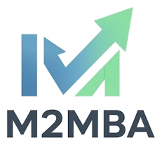
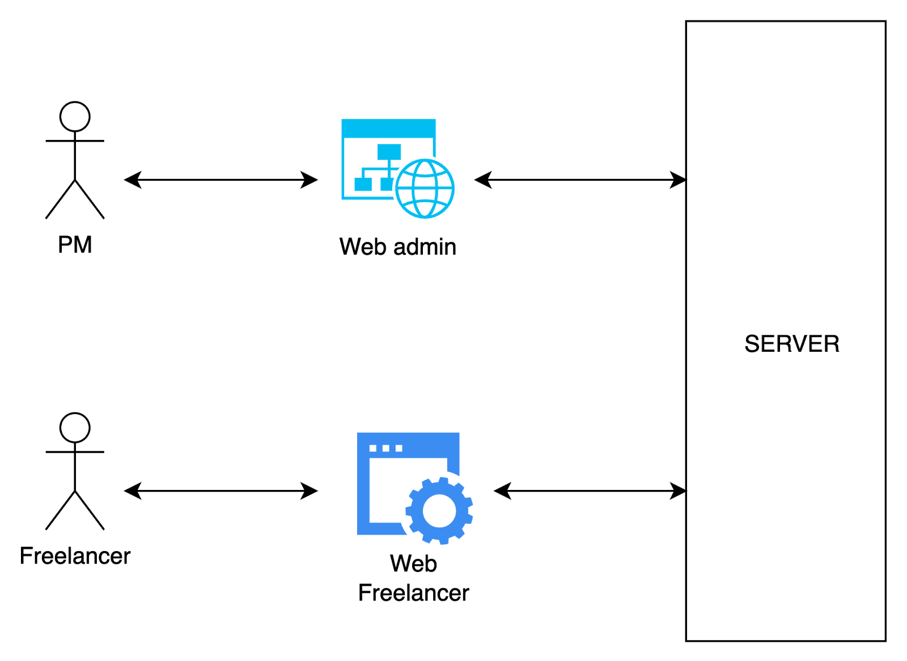
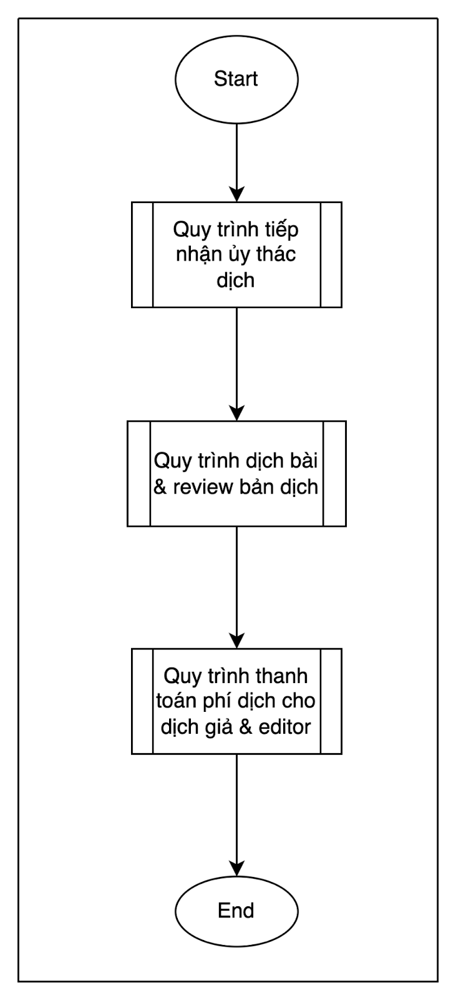
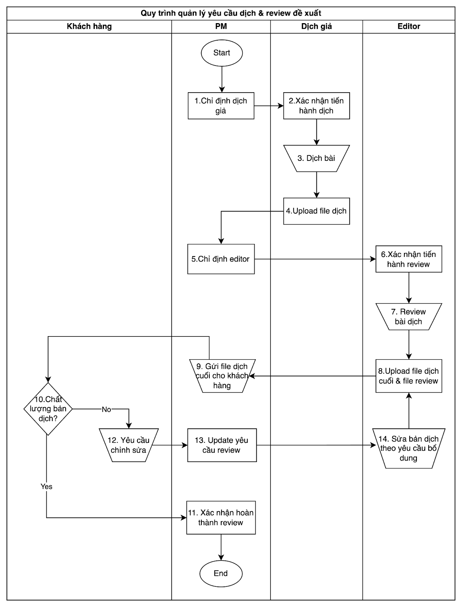
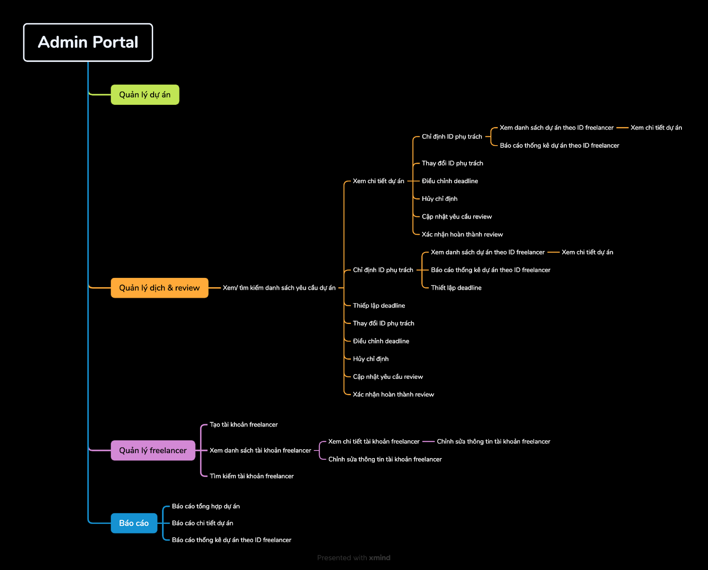
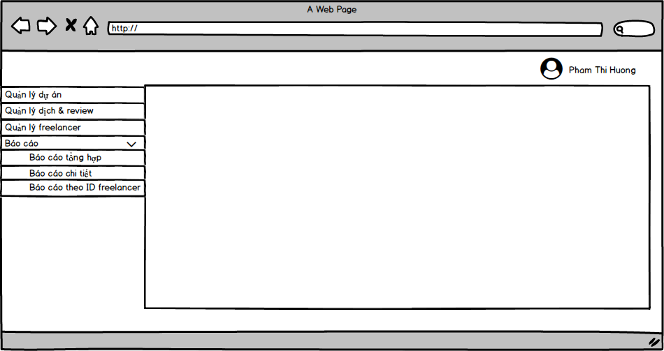
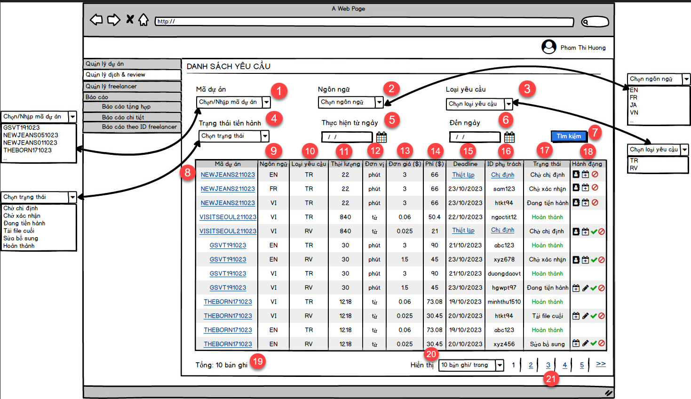
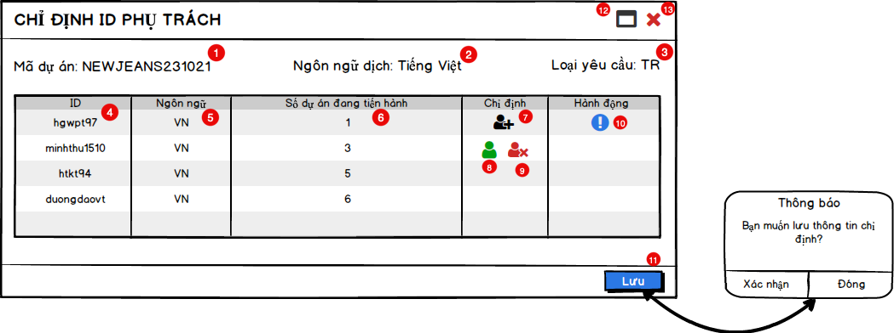
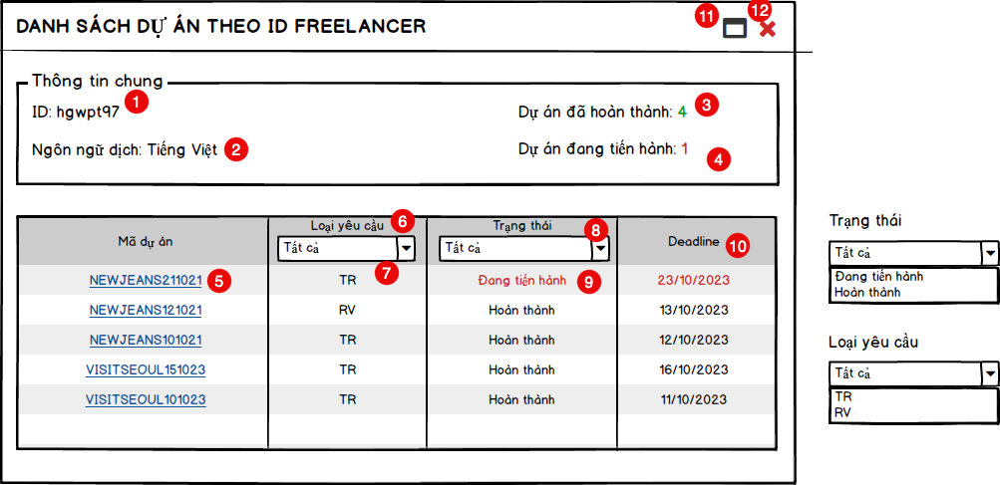
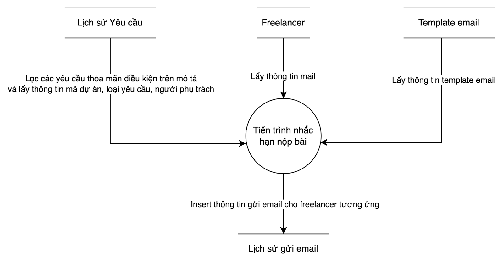

Title: Tài liệu mẫu SRS

URL Source: https://m2mba.com/blog/articles/tai-lieu-mau-srs-cua-hoc-vien

Published Time: 2023-12-22T03:34:33.000Z

Markdown Content:
[Rèn tư duy sâu · Tạo giá trị thật](https://m2mba.com/)

[Trang chủ](https://m2mba.com/)[Khóa học](https://m2mba.com/courses)[Workshop](https://m2mba.com/workshop)[Thư viện](https://m2mba.com/skills)[Blog](https://m2mba.com/blog)[About](https://m2mba.com/about)

[Đăng nhập](https://m2mba.com/login)[Đăng ký →](https://m2mba.com/register)

1.   [Home](https://m2mba.com/)
2.   [Blog](https://m2mba.com/blog)
3.   Tài liệu mẫu SRS

### Tài liệu yêu cầu

#### [Quy định chung về xử lý giao diện 654 views](https://m2mba.com/blog/articles/quy-nh-x-l-giao-din-v-ni-dung-d-n)

#### [Hướng dẫn mô tả màn hình với từng loại control 1632 views](https://m2mba.com/blog/articles/huong-dan-chi-tiet-cach-mo-ta-UI-control-cho-BA)

[Tài liệu yêu cầu](https://m2mba.com/blog/topics/tai-lieu-yeu-cau)

# Tài liệu mẫu SRS

Phạm Thị Hương - BA092023

12/22/2023

16428 views

16

Share:

FB linkedin Zalo

(9)

## **1. Giới thiệu dự án**

Công ty outsourcing chuyên cung cấp dịch vụ dịch thuật từ tiếng Hàn sang các thứ tiếng khác như tiếng Việt, tiếng Anh, tiếng Trung, etc.Hiện tại quy trình tiếp nhận dự án từ khách hàng cũng như phân bổ yêu cầu dịch bài & review bản dịch giữa PM và đội ngũ dịch giả & editor freelancer của công ty chủ yếu được thực hiện thủ công nên còn tồn đọng một số điểm bất cập nhất định. Case study tập trung đưa ra giải pháp hệ thống giúp quy trình này vận hành hiệu quả hơn.

Trong giai đoạn đầu, dự án sẽ tập trung phát triển các tính năng trên Admin Portal trước.

## **2. Khái niệm/ Thuật ngữ**

**STT****Khái niệm/ Thuật ngữ****Mô tả**
1 PM Người điều phối dự án, nhận yêu cầu từ khách hàng và phân bổ đến freelancer tương ứng
2 Dịch giảFreelancer trực tiếp dịch văn bản sang thứ tiếng tương ứng
3 Editor Freelancer kiểm tra chất lượng bản dịch, chỉnh sửa lỗi sai, tạo ra bản dịch cuối gửi cho khách hàng và chỉnh sửa bổ sung khi có yêu cầu từ khách hàng

## **3. Đối tượng sử dụng**

**Tên đối tượng****Mô tả**
PM Là người sử dụng để:

*   Tạo thông tin dự án nhận từ khách hàng, quản lý & theo dõi chung tiến độ dự án
*   Phân bổ yêu cầu dịch & review cho freelancer, quản lý tiến độ yêu cầu
Freelancer Freelancer gồm 2 nhóm đối tượng.

*   Dịch giả: Sử dụng để theo dõi các yêu cầu dịch nhận được, upload file dịch
*   Editor: Sử dụng để theo dõi các yêu cầu review và yêu cầu chỉnh sửa bổ sung nhận được, upload file dịch cuối

## **4. Mô hình tổng quan**

*   **Mô tả các thành phần trong mô hình**

**Tên thành phần****Mô tả**
PM Tham khảo mục 3. Đối tượng sử dụng
Freelancer Tham khảo mục 3. Đối tượng sử dụng
Web admin Là ứng dụng dành cho đội ngũ PM để tạo thông tin về dự án/ khách hàng, tạo tài khoản cho freelancer, chỉ định freelancer phụ trách theo yêu cầu cho các dự án, theo dõi tiến độ tương ứng, etc
Web freelancer Là ứng dụng dành cho freelancer (gồm dịch giả và editor) để theo dõi thông tin yêu cầu nhận được, lấy thông tin dự án liên quan, tải file công việc hoàn thành, etc

## **5. Business Flow**

*   **Quy trình tổng quan**

PM tiếp nhận yêu cầu từ khách hàng, nhận thanh toán và tiến hành nhập các thông tin liên quan đến dự án
PM tiến hành phân bổ yêu cầu dịch & review cho freelancer tương ứng
PM tiến hành xử lý thanh toán phí cho freelancer sau khi gửi bản cuối cho khách hàng

*   **Quy trình quản lý yêu cầu dự án**
*   **Mô tả quy trình**

**Bước****Người thực hiện****Mô tả****Thủ công/**

**Hệ thống**
1 PM PM thực hiện chỉ định dịch giả bằng cách click biểu tượng “Chỉ định” trong ô “Dịch giả phụ trách” ở mục dự án tương ứng.

Lúc này, hệ thống sẽ lọc danh sách các account của freelancer theo thông tin ngôn ngữ đích của dự án rồi hiện danh sách tương ứng.

PM check số lượng dự án/ deadline mà freelancer đang tiến hành để cân nhắc assign yêu cầu dịch. Khi quyết định chỉ định freelancer này làm dịch giả, PM click chọn Giao bài dịch và thiết lập deadline nộp bài.

Hệ thống sẽ tự động cập nhật yêu cầu dịch tương ứng trên trang cá nhân của freelancer được chọn.

Yêu cầu dịch gồm các nội dung:

*   Mã dự án
*   Loại yêu cầu: TR (dịch)
*   Thời hạn nộp bài
*   Lĩnh vực dịch (Dịch video, dịch hợp đồng, dịch menu, v.v.)
*   Ngôn ngữ đích
*   File văn bản gốc
*   Phí dịch

Phí dịch = Số phút * 3 ($)

Phí dịch = Số từ * 0,06 ($)

*   Yêu cầu đặc biệt (nếu có)
*   File guideline dịch (nếu có)Hệ thống
2 Dịch giảDịch giả xác nhận tiến hành dịch trên trang cá nhân ở web dành cho freelancer.Hệ thống
3 Dịch giảDịch giả thực hiện dịch bài.Thủ công
4 Dịch giảDịch giả upload file dịch lên phần dự án tương ứng ở trang cá nhân.Hệ thống
5 PM PM thực hiện chỉ định editor bằng cách click biểu tượng “Chỉ định” trong ô “Editor phụ trách” ở mục dự án tương ứng.

Lúc này, hệ thống sẽ lọc danh sách các account của freelancer theo thông tin ngôn ngữ đích của dự án rồi hiện danh sách lên cửa sổ popup “Chỉ định editor”.

PM check số lượng dự án/ deadline mà freelancer đang tiến hành để cân nhắc assign yêu cầu review. Khi quyết định chỉ định freelancer này làm editor, PM click chọn Giao bài review và thiết lập deadline nộp bài.

Hệ thống sẽ tự động cập nhật yêu cầu review tương ứng trên trang cá nhân của freelancer được chọn.

Yêu cầu review gồm các nội dung:

*   Mã dự án
*   Loại yêu cầu: RV (review)
*   Thời hạn nộp bài review
*   Lĩnh vực dịch
*   Ngôn ngữ đích
*   File văn bản gốc
*   File dịch
*   File review
*   Guideline dịch
*   Phí review

Phí review = Số phút * 1,5 ($)

Phí review = Số từ * 0,025 ($)

*   Yêu cầu đặc biệt (nếu có)Hệ thống
6 Editor Editor xác nhận tiến hành review trên trang cá nhân ở web dành cho freelancer.Hệ thống
7 Editor Editor thực hiện review bản dịch.

Việc review bao gồm:

*   Điền các nội dung sửa vào file review
*   Chỉnh sửa file dịch thành file cuối cùng
*   Tổng hợp các thuật ngữ vào file guideline dịch (nếu có)Thủ công
8 Editor Editor upload file dịch cuối, file review, file guideline dịch lên phần dự án tương ứng ở trang cá nhân.Hệ thống
9 PM PM thực hiện gửi file dịch cuối cho khách hàng.Thủ công
10 Khách hàng Khách hàng thực hiện kiểm tra chất lượng bản dịch nhận từ PM dựa trên các tiêu chí:

*   Văn bản còn sót lỗi dịch nào không?
*   Có thêm nội dung gì cần chỉnh sửa không? (Thường là hiệu đính từ vựng chuyên ngành dùng sai hoặc yêu cầu chỉnh sửa bản dịch theo nội dung thay đổi bổ sung trong văn bản gốc)

Nếu chất lượng bản dịch OK, chuyển sang bước 11.

Nếu chất lượng bản dịch không đảm bảo, khách hàng thực hiện bước 12.Thủ công
11 PM Sau khi khách hàng ok với chất lượng bản dịch, PM thực hiện xác nhận trạng thái “Hoàn thành” ở Tiến độ reivew trong Quản lý dự án.Hệ thống
12 Khách hàng Khách hàng thực hiện gửi yêu cầu chỉnh sửa tương ứng cho PM.Thủ công
13 PM PM update yêu cầu review. Hệ thống sẽ cập nhật yêu cầu này trên mục dự án tương ứng ở trang cá nhân của editor.Hệ thống
14 Editor Editor thực hiện chỉnh sửa bản dịch theo yêu cầu bổ sung.Thủ công

## **6. Danh sách chức năng: Admin Portal**

**Actor****Tên chức năng****Mục đích**
PM Chỉ định dịch giả/ editor Cho phép PM chỉ định một freelancer làm dịch giả/ editor của dự án dịch và thiết lập deadline nộp bài cho người đó
PM Xem danh sách dự án theo ID freelancer Cho phép PM xem danh sách toàn bộ dự án mà một freelancer phụ trách
PM Xem danh sách yêu cầu dự án Cho phép PM xem danh sách toàn bộ dự án theo yêu cầu dịch & review
PM Xem chi tiết dự án Cho phép PM xem thông tin chi tiết của một dự án
PM Thay đổi người phụ trách Cho phép PM thay đổi người phụ trách khi freelancer từ chối yêu cầu
PM Điều chỉnh deadline Cho phép PM điều chỉnh deadline yêu cầu khi khách hàng muốn đẩy sớm lịch giao bài hoặc khi freelancer muốn gia hạn thời hạn nộp bài (chỉ chấp nhận gia hạn tối đa 24h, không quá hạn giao bài với lí do thỏa đáng)
PM Hủy chỉ định Cho phép PM hủy chỉ định yêu cầu khi khách hàng hủy dự án giữa chừng
PM Cập nhật yêu cầu review Cho phép PM bổ sung yêu cầu review khi nhận được yêu cầu chỉnh sửa thêm từ khách hàng
PM Xác nhận hoàn thành review Cho phép PM update trạng thái Hoàn thành review sau khi gửi file dịch cuối cho khách hàng và không cần bổ sung chỉnh sửa thêm
PM CRUD mã dự án Cho phép PM tạo, xem, chỉnh sửa và xóa mã dự án
PM CRUD ngôn ngữCho phép PM tạo, xem, chỉnh sửa và xóa các mã ngôn ngữ
PM CRUD trạng thái tiến hành Cho phép PM tạo, xem, chỉnh sửa và xóa các loại trạng thái tiến hành bao gồm:

*   Chờ chỉ định
*   Chờ xác nhận
*   Đang tiến hành
*   Tải file cuối
*   Sửa bổ sung
*   Hoàn thành
PM CRUD loại yêu cầu Cho phép PM tạo, xem, chỉnh sửa và xóa các loại yêu cầu bao gồm:

*   TR (dịch)
*   RV (review)
PM Tìm kiếm thông tin dự án Cho phép PM tìm kiếm thông tin dự án theo các điều kiện lọc như mã dự án, ngôn ngữ dịch, deadline nộp bài, trạng thái tiến hành, loại yêu cầu
PM Đăng ký tài khoản Cho phép PM đăng ký tài khoản để đăng nhập web admin
PM Đăng nhập Cho phép PM đăng nhập vào hệ thống web admin
PM Xem thông tin cá nhân Cho phép PM xem thông tin cá nhân của tài khoản của mình
PM Chỉnh sửa thông tin cá nhân Cho phép PM chỉnh sửa thông tin cá nhân của tài khoản của mình
PM Reset mật khẩu Cho phép PM reset mật khẩu khi quên
PM Đổi mật khẩu Cho phép PM thay đổi mật khẩu
PM Đăng xuất Cho phép PM đăng xuất khỏi web admin
PM Tạo tài khoản freelancer Cho phép PM chủ động tạo tài khoản cho freelancer qua bài test vào công ty
PM Chỉnh sửa thông tin tài khoản freelancer Cho phép PM chỉnh sửa thông tin tài khoản freelancer
PM Xem danh sách tài khoản freelancer Cho phép PM xem danh sách tài khoản freelancer
PM Xem chi tiết tài khoản freelancer Cho phép PM xem chi tiết tài khoản freelancer
PM Báo cáo tổng hợp dự án Cho phép PM xem báo cáo tổng hợp dự án theo trạng thái tiến hành, ngôn ngữ dịch, khoảng thời gian
PM Báo cáo chi tiết dự án Cho phép PM xem báo cáo chi tiết về dự án
PM Báo cáo thống kê dự án theo ID freelancer Cho phép PM có thể theo dõi tổng hợp số lượng dự án của freelancer theo các tiêu chí: loại yêu cầu, trạng thái tiến hành

## **7. Kiến trúc thông tin Admin Portal**

## **8. Thiết kế tổng quan ứng dụng**

## **9. Usecase 1: Danh sách yêu cầu dự án**

### **9.1. Mô tả chung**

**Tên Usecase****Danh sách yêu cầu dự án**
Actor PM
Mục đích Cho phép PM xem danh sách toàn bộ dự án và tìm kiếm thông tin dự án theo yêu cầu
Precondition PM đã đăng nhập hệ thống
Main flow 1. PM chọn Quản lý dịch & review

2. Hệ thống hiển thị thông tin toàn bộ các dự án

3. PM chọn các thông tin tìm kiếm

4. Hệ thống hiển thị thông tin dự án tương ứng theo yêu cầu
Post Condition Hiển thị danh sách dự án mặc định sau khi PM đăng nhập vào và hiển thị danh sách dự án theo yêu cầu tìm kiếm của PM

### **9.2. Màn hình và Mô tả màn hình**

**STT****Tên control****Loại control****Mô tả & ghi chú**
1 Mã dự án Combo Box- Hiển thị các mã dự án dịch

- Mã dự án được sắp xếp theo thứ tự alphaB của thành phần chữ phía trước, nếu trùng phần chữ này sẽ tiếp tục sắp xếp theo thứ tự giảm dần của 6 chữ số chỉ ngày phía sau

- Cho phép người dùng nhập ngoài
2 Ngôn ngữCombo Box- Hiển thị các mã ngôn ngữ dịch đang hoạt động trên hệ thống

- Ngôn ngữ được sắp xếp theo thứ tự alphaB
3 Loại yêu cầu Combo Box- Hiển thị hai loại yêu cầu của dự án, bao gồm:

*   TR (dịch)
*   RV (review)
4 Trạng thái tiến hành Combo Box- Hiển thị các trạng thái tiến hành tương ứng với loại yêu cầu đang lựa chọn.

*   Với yêu cầu TR hiển thị:
*   Chờ chỉ định
*   Chờ xác nhận
*   Đang tiến hành
*   Hoàn thành
*   Với yêu cầu RV hiển thị:
*   Chờ chỉ định
*   Chờ xác nhận
*   Đang tiến hành
*   Tải file cuối
*   Sửa bổ sung
*   Hoàn thành

- Khi không lựa chọn loại yêu cầu sẽ hiển thị tất cả trạng thái bao gồm:

*   Chờ chỉ định
*   Chờ xác nhận
*   Đang tiến hành
*   Tải file cuối
*   Sửa bổ sung
*   Hoàn thành
5 Thực hiện -

Từ ngày Datepicker- Hiển thị theo định dạng: dd/mm/yyyy

*   Từ ngày <= Ngày hiện tại
*   Mặc định = Ngày hiện tại - 30 ngày
6 Thực hiện - Đến ngày Datepicker- Hiển thị theo định dạng: dd/mm/yyyy, bắt buộc phải nhập

*   Từ ngày <= Đến ngày <= Ngày hiện tại
*   Đến ngày mặc định = Ngày hiện tại
7 Tìm kiếm Button Click vào button sẽ hiển thị danh sách dự án thỏa mãn yêu cầu tìm kiếm
8 Mã dự án Link- Hiển thị mã dự án dưới dạng chữ in hoa

- Click vào link sẽ mở ra màn hình Thông tin chi tiết của dự án tương ứng
9 Ngôn ngữLabel Hiển thị mã ngôn ngữ dịch của yêu cầu tương ứng dưới dạng chữ in hoa
10 Loại yêu cầu Label- Hiển thị loại yêu cầu của dự án dưới dạng chữ in hoa, bao gồm:

*   TR (chỉ dịch)
*   RV (chỉ review)
11 Thời lượng Label Hiển thị thời lượng của dự án theo đơn vị phút hoặc từ
12 Đơn vịLabel- Hiển thị đơn vị thời lượng của dự án, bao gồm:

*   Phút
*   Từ
13 Đơn giáLabel Hiển thị đơn giá tính theo số phút hay số chữ của dự án (USD)
14 PhíLabel Hiển thị chi phí dịch cần trả cho dịch giả hoặc editor tương ứng (USD)
15 Deadline - Thiết lập Link/Label- Hiển thị “Thiết lập” dưới dạng link khi dự án ở trạng thái “Chờ chỉ định”. Ngược lại sẽ hiển thị thời hạn nộp bài theo định dạng dd/mm/yyyy.

- Khi click vào sẽ hiện ra màn hình Thiết lập deadline
16 ID phụ trách - Chỉ định Link/Label- Hiển thị dưới dạng link nếu yêu cầu có trạng thái là “Chờ chỉ định”. Ngược lại sẽ hiển thị ID của người phụ trách tương ứng.

- Khi click vào sẽ hiện ra màn hình Chỉ định ID phụ trách
17 Trạng thái Label- Hiển thị trạng thái hiện tại của từng loại yêu cầu tương ứng với các ngôn ngữ dịch của dự án

- Với yêu cầu TR, chỉ hiển thị một trong các trạng thái:

*   Chờ chỉ định
*   Chờ xác nhận
*   Đang tiến hành
*   Hoàn thành (Hiển thị bằng màu xanh lá cây)

- Với yêu cầu RV, chỉ hiển thị một trong các trạng thái:

*   Chờ chỉ định
*   Chờ xác nhận
*   Đang tiến hành
*   Tải file cuối
*   Sửa bổ sung
*   Hoàn thành
18 Hành động IconThay đổi ID phụ trách- Click vào icon sẽ mở màn hình thay đổi dịch giả/editor phụ trách của dự án tương ứng - Hiển thị với trạng thái Chờ chỉ định và Chờ xác nhận Thay đổi deadline- Click vào icon sẽ mở màn hình thay đổi deadline của dự án tương ứng - Hiển thị với các trạng thái khác “Hoàn thành” Update yêu cầu review- Click vào icon sẽ mở ra màn hình nhập yêu cầu chỉnh sửa bổ sung - Hiển thị với các yêu cầu RV có trạng thái “Đang tiến hành, Sửa bổ sung hoặc Tải file cuối” Xác nhận hoàn thành review- Click vào icon hệ thống sẽ cập nhật trạng thái của yêu cầu RV tương ứng thành “Hoàn thành” - Chỉ hiện thị với loại yêu cầu RV Hủy- Click vào icon sẽ hiển thị popup xác nhận hủy chỉ định tương ứng - Hiển thị với các trạng thái khác “Hoàn thành”
19 Tổng số bản ghi Label Hiển thị tổng số bản ghi dự án thỏa mãn yêu cầu tìm kiếm
20 Tổng số bản ghi/ trang Combo Box Hiển thị tổng số bản ghi hiển thị/ trang, bao gồm:

*   10 (mặc định)
*   20
*   50
*   100
21 Phân trang Pagination Phân trang danh sách tìm kiếm

### **9.3. Business Rule**

**Rule****Chi tiết rule**
Tìm kiếm Tìm kiếm theo điều kiện AND các thông tin nhập vào (thỏa mãn tất cả các đầu vào tìm kiếm có nhập thông tin)

*   Trường thông tin nào chọn Tất cả hoặc không nhập dữ liệu thì không cần tìm kiếm theo tiêu chí đó
*   Thông tin tìm kiếm chính xác
*   Loại yêu cầu
*   Ngôn ngữ
*   Trạng thái tiến hành
*   Thông tin tìm kiếm tương đối
*   Mã dự án
*   Ngày thực hiện tìm kiếm trong khoảng

Từ ngày 00:00:00 <= Ngày hiện tại <= Đến ngày 23:59:59
Sắp xếp- Sắp xếp dựa trên trạng thái tương ứng với loại yêu cầu TR (dịch) theo thứ tự “Chờ chỉ định, Chờ xác nhận, Đang tiến hành, Hoàn thành”.

*   Với các yêu cầu TR có cùng một trong các trạng thái khác “Hoàn thành” sẽ tiếp tục sắp xếp theo mã dự án. Cụ thể sắp xếp theo thứ tự alphaB của thành phần chữ phía trước. Nếu trùng phần chữ này sẽ tiếp tục sắp xếp theo thứ tự giảm dần của 6 chữ số chỉ ngày giao bài phía sau.
*   Với các yêu cầu TR có cùng trạng thái “Hoàn thành”, sẽ sắp xếp dựa trên trạng thái yêu cầu RV (review) tương ứng theo thứ tự “Chờ chỉ định, Chờ xác nhận, Đang tiến hành, Tải file cuối, Sửa bổ sung, Hoàn thành”. Nếu có cùng trạng thái yêu cầu RV sẽ tiếp tục sắp xếp theo mã dự án như rule nêu trên.
*   Yêu cầu RV được hiển thị ngay sau yêu cầu TR của ngôn ngữ tương ứng chỉ khi yêu cầu TR này ở trạng thái “Hoàn thành”.
Màn hình mặc định Hiển thị danh sách tìm kiếm khi load trang theo thông tin mặc định đã mô tả ở phần Mô tả màn hình

## **10. Usecase 2: Chỉ định ID phụ trách**

### **10.1. Mô tả chung**

**Tên Usecase****Chỉ định ID phụ trách**
Actor PM
Mục đích Cho phép PM chỉ định một freelancer làm dịch giả hoặc editor của dự án
Precondition PM đã đăng nhập hệ thống và đang ở màn hình Danh sách yêu cầu
Main flow 1. PM chọn Chỉ định trong ô ID phụ trách

2. Hệ thống hiển thị màn hình Chỉ định ID phụ trách với danh sách ID freelancer theo ngôn ngữ tương ứng

3. PM chọn Chỉ định và chọn Xác nhận

5. Hệ thống lưu thông tin và thông báo kết quả "Chỉ định thành công"
Post Condition Lưu thông tin chỉ định thành công và cập nhật trạng thái "Chờ xác nhận" ở cột ID phụ trách (trong màn hình Danh sách yêu cầu)

### **10.2. Màn hình và Mô tả màn hình**

**STT****Tên control****Loại control****Mô tả & ghi chú**
1 Mã dự án Label Hiển thị mã dự án dưới dạng chữ in hoa
2 Ngôn ngữ dịch Label Hiển thị ngôn ngữ dịch dưới dạng đầy đủ
3 Loại yêu cầu Label Hiển thị hai loại yêu cầu của dự án bao gồm:

*   TR (dịch)
*   RV (review)
4 ID Label- Hiển thị danh sách các account ID của ngôn ngữ dịch tương ứng

- Sắp xếp theo thứ tự tăng dần của số lượng dự án đang tiến hành. Với các ID có cùng số lượng dự án đang tiến hành sẽ sắp xếp theo thứ tự alphaB
5 Ngôn ngữLabel Hiển thị mã ngôn ngữ dịch dưới dạng viết tắt in hoa
6 Số dự án đang tiến hành Label Hiển thị số lượng dự án ở trạng thái “Đang tiến hành” của ID tương ứng
7 Chỉ định Icon- Click vào icon sẽ hiện popup xác nhận chỉ định ID làm dịch giả hoặc editor

- Sau khi có ID được chỉ định, icon sẽ bị disable. Sau khi PM click chọn Hủy chỉ định, icon sẽ được enalbe trở lại
8 Chỉ định thành công Icon Hiển thị sau khi PM click chọn icon Chỉ định trong account ID tương ứng
9 Hủy chỉ định Icon- Hiển thị khi PM đã chỉ định cho một dịch giả

- Click vào icon sẽ hiển thị popup xác nhận hủy chỉ định với ID tương ứng
10 Xem thông tin Icon Click vào icon sẽ hiện màn hình Danh sách dự án theo ID freelancer tương ứng
11 Lưu Button Click vào button sẽ hiện popup xác định lưu thông tin chỉ định
12 Thu nhỏ/ Phóng to Icon Cho phép thu nhỏ/ phóng to màn hình Chỉ định ID phụ trách tùy theo nhu cầu
13 Đóng Icon Đóng màn hình Chỉ định ID phụ trách

### **10.3. Business Rule**

**Rule****Thông báo nếu không thỏa mãn rule**
PM được phép chỉ định ID freelancer nếu ID này có số lượng yêu cầu thỏa mãn 2 điều kiện dưới đây <=10

*   Ở trạng thái “Đang tiến hành”
*   Và Deadline yêu cầu đang chỉ định - Deadline yêu cầu đang tiến hành >=24h Người chỉ định đang thực hiện quá số yêu cầu tối đa, vui lòng chỉ định người khác
Mã yêu cầu còn active trên hệ thống và ở trạng thái “Chờ chỉ định”Yêu cầu chỉ định không hợp lệ, vui lòng kiểm tra lại
Ngôn ngữ dịch của user phải trùng với ngôn ngữ dịch của yêu cầu Ngôn ngữ dịch không hợp lệ, vui lòng kiểm tra lại
Ngôn ngữ dịch của yêu cầu phải ở ngôn ngữ tương ứng thuộc dự án Ngôn ngữ dịch không hợp lệ, vui lòng kiểm tra lại
ID freelancer được chỉ định còn tồn tại và active trên hệ thống Thông tin người chỉ định không hợp lệ, vui lòng chỉ định người khác
Lưu thông tin chỉ định

Trạng thái = Chờ xác nhận

## **11. Usecase 3: Danh sách dự án theo ID freelancer**

### **11.1. Mô tả chung**

**Tên Usecase****Danh sách dự án theo ID freelancer**
Actor PM
Mục đích Cho phép PM xem danh sách toàn bộ dự án mà một freelancer phụ trách
Precondition PM đã đăng nhập hệ thống và đang ở màn hình Chỉ định ID phụ trách
Main flow 1. Chọn Xem thông tin ở màn hình Chỉ định ID phụ trách

2. Hệ thống hiển thị danh sách toàn bộ dự án mà ID tương ứng phụ trách
Post Condition Hiển thị danh sách toàn bộ dự án tương ứng của ID freelancer mà PM chọn Xem thông tin

### **11.2. Màn hình và Mô tả màn hình**

**STT****Tên control****Loại control****Mô tả & ghi chú**
1 ID Label Hiển thị account ID của freelancer được chỉ định
2 Ngôn ngữ dịch Label Hiển thị ngôn ngữ dịch dưới dạng đầy đủ
3 Dự án đã hoàn thành Label Hiển thị số lượng dự án đã hoàn thành bằng màu xanh lá cây
4 Dự án đang tiến hành Label Hiển thị số lượng dự án đang tiến hành bằng màu đỏ
5 Mã dự án Link- Hiển thị mã dự án dưới dạng chữ in hoa theo thứ tự: Đang tiến hành, Hoàn thành.

- Với các dự án cùng trạng thái sẽ sắp xếp theo thứ tự alphaB của thành phần chữ phía trước. Nếu trùng phần chữ này sẽ tiếp tục sắp xếp theo thứ tự giảm dần của 6 chữ số phía sau.

(mã dự án = chủ đề dịch (chữ in hoa) + ngày giao bài (6 chữ số))

- Click vào link sẽ mở ra màn hình Thông tin chi tiết của dự án tương ứng
6 Loại yêu cầu Combo Box- Hiển thị loại yêu cầu của dự án, bao gồm

*   TR (chỉ dịch)
*   RV (chỉ review)

- Cho phép người dùng lọc kết quả theo loại yêu cầu tương ứng
7 Loại yêu cầu Label Hiển thị loại yêu cầu của dự án dưới dạng chữ in hoa, bao gồm:

*   TR (chỉ dịch)
*   RV (chỉ review)
8 Trạng thái Combo Box- Hiển thị các trạng thái tiến hành, bao gồm

*   Đang tiến hành
*   Hoàn thành

- Cho phép người dùng lọc kết quả theo loại trạng thái mong muốn
9 Trạng thái Label- Hiển thị các trạng thái tiến hành, bao gồm

*   Đang tiến hành
*   Hoàn thành

- Hiển thị chữ màu đỏ với trạng thái Đang tiến hành
10 Deadline Label- Hiển thị thời hạn nộp bài theo định dạng dd/mm/yyyy

- Hiển thị chữ màu đỏ với deadline có trạng thái Đang tiến hành
11 Thu nhỏ/ Phóng to Icon Cho phép thu nhỏ/ phóng to màn hình tùy theo nhu cầu
12 Đóng Icon Đóng màn hình Danh sách dự án theo ID freelancer

### **11.3. Business Rule**

**Rule****Chi tiết rule**
Tìm kiếm Tìm kiếm theo điều kiện AND các thông tin nhập vào (thỏa mãn tất cả các đầu vào tìm kiếm có nhập thông tin)

*   Trường thông tin nào chọn Tất cả thì không cần tìm kiếm theo tiêu chí đó
*   Thông tin tìm kiếm chính xác
*   Loại yêu cầu
*   Trạng thái tiến hành
Sắp xếp- Sắp xếp dựa trên trạng thái tiến hành theo thứ tự “Đang tiến hành, Hoàn thành”.

- Khi cùng trạng thái sẽ tiếp tục sắp xếp theo thứ tự giảm dần của deadline
Màn hình mặc định Hiển thị danh sách tìm kiếm khi load trang theo thông tin mặc định đã mô tả ở phần Mô tả màn hình

## **12. Usecase 4:****Tiến trình xử lý đơn giản**

### **12.1. Mô tả chung**

**Tên Usecase****Tiến trình nhắc deadline nộp bài**
Mục đích Hệ thống tự động gửi mail nhắc dịch giả/ editor trước khi đến hạn nộp bài 1 ngày
Tần suất 1h/ lần
Điều kiện quét dữ liệu Quét thông tin yêu cầu có:

*   Thời hạn nộp bài - Thời gian hiện tại <= 24h
*   Trạng thái tiến hành khác “Hoàn thành” hoặc “Tải file cuối”
Post-condition Hệ thống gửi mail nhắc deadline theo mẫu cho ID tương ứng

### **12.2. Mô tả luồng/ Business Rule**

*   Bước 1: Lọc các yêu cầu thoả mãn điều kiện trên
*   Bước 2: Thực hiện lấy các thông tin
*   Template email
*   Email của ID phụ trách tương ứng
*   Bước 3: Gửi email tới địa chỉ email tương ứng trong đó nội dung email theo template đã lấy ra và fill vào các nội dung
*   Tiêu đề: Remind hạn nộp bài
*   Nội dung: Yêu cầu <**Loại yêu cầu Dịch/ Review**> của dự án <**Mã dự án**> sẽ đến hạn nộp bài vào <**Deadline nộp bài dd/mm/yyyy**>. Vui lòng nộp bài đúng thời hạn. Xin cảm ơn!

### **12.3. Biểu đồ luồng dữ liệu**

### Tags:

[#SRS](https://m2mba.com/blog?search=SRS)[#dịch thuật](https://m2mba.com/blog?search=d%E1%BB%8Bch%20thu%E1%BA%ADt)[#quy trình dự án](https://m2mba.com/blog?search=quy%20tr%C3%ACnh%20d%E1%BB%B1%20%C3%A1n)[#tài liệu mẫu](https://m2mba.com/blog?search=t%C3%A0i%20li%E1%BB%87u%20m%E1%BA%ABu)[#quản lý dự án](https://m2mba.com/blog?search=qu%E1%BA%A3n%20l%C3%BD%20d%E1%BB%B1%20%C3%A1n)

## Related Articles

[Hình ảnh bài viết [Tài liệu yêu cầu](https://m2mba.com/blog/topics/tai-lieu-yeu-cau) ### Quy định chung về xử lý giao diện Tìm hiểu các quy định chuẩn giúp tạo sự đồng nhất trong xử lý giao diện và nội dung dự án giữa các BA và dev. Đậu Thị Ngọc Ánh 3 năm trước 654 5 1](https://m2mba.com/blog/articles/quy-nh-x-l-giao-din-v-ni-dung-d-n)

[Hình ảnh bài viết [Tài liệu yêu cầu](https://m2mba.com/blog/topics/tai-lieu-yeu-cau) ### Hướng dẫn mô tả màn hình với từng loại control Bài viết cung cấp hướng dẫn chi tiết cho Business Analyst về cách mô tả các loại control trên giao diện người dùng, bao... Đậu Thị Ngọc Ánh 3 năm trước 1.6K 3](https://m2mba.com/blog/articles/huong-dan-chi-tiet-cach-mo-ta-UI-control-cho-BA)

### Trung tâm M2MBA

Đăng ký ngay những khóa học chất lượng, được thiết kế để phát triển kỹ năng và tăng tốc con đường sự nghiệp của bạn.

### Liên kết nhanh

*   [Khám phá khóa học](https://m2mba.com/courses)
*   [Về chúng tôi](https://m2mba.com/about)
*   [Liên hệ](https://m2mba.com/contact)

### Hỗ trợ

*   [Điều khoản dịch vụ](https://m2mba.com/terms-of-service)
*   [Chính sách bảo mật](https://m2mba.com/security-policy)

### Học tập

*   [Thư viện](https://m2mba.com/skills)
*   [Blog](https://m2mba.com/blog)

© 2026 Trung tâm M2MBA. Bản quyền thuộc về chúng tôi.

Ease Health design system
