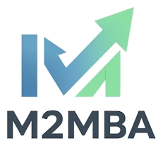
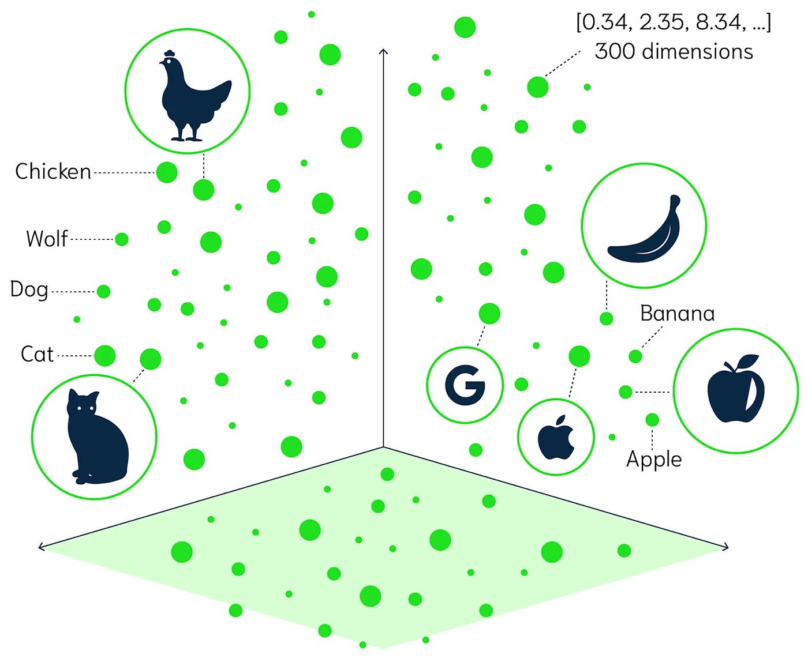
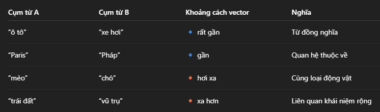
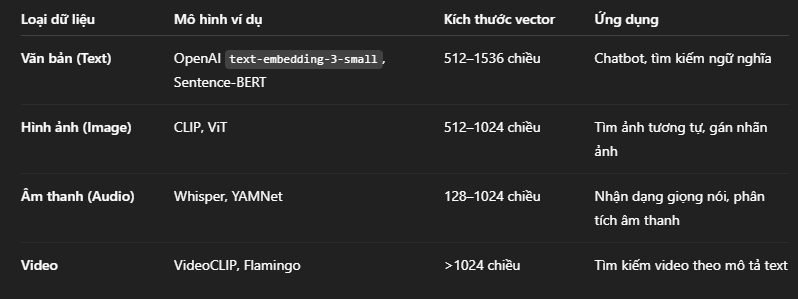
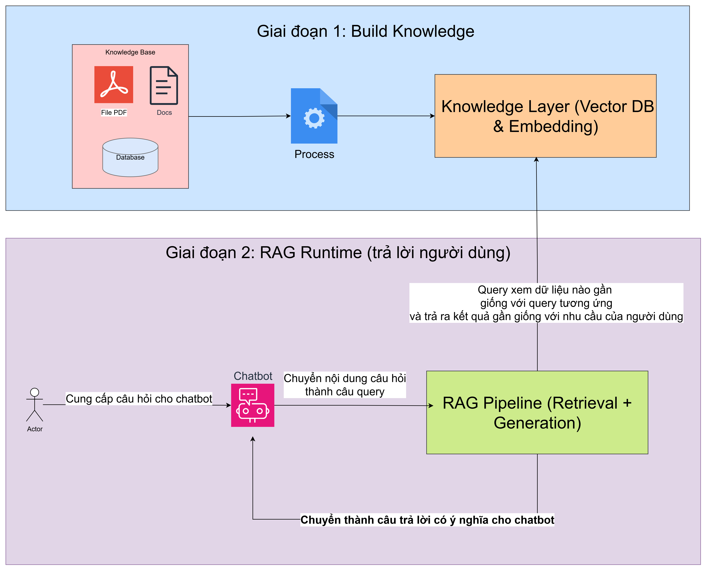
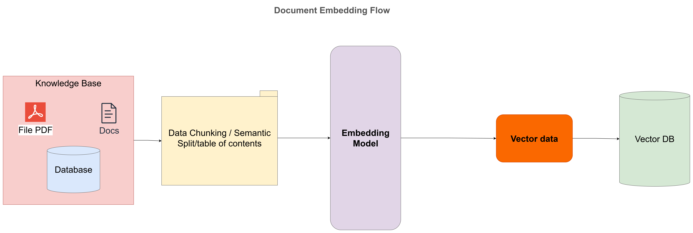
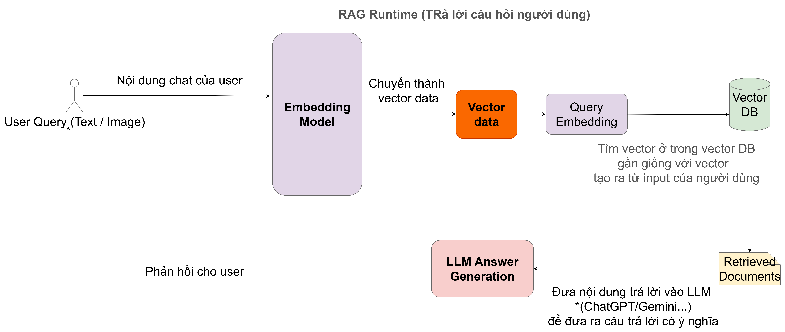

Title: Từ Vector đến Chatbot: Hành trình để AI hiểu và trả lời như con người

URL Source: https://m2mba.com/blog/articles/tu-vector-rag-embeddingmodel-den-chatbot

Published Time: 2025-10-06T12:44:52.000Z

Markdown Content:
[Rèn tư duy sâu · Tạo giá trị thật](https://m2mba.com/)

[Trang chủ](https://m2mba.com/)[Khóa học](https://m2mba.com/courses)[Workshop](https://m2mba.com/workshop)[Thư viện](https://m2mba.com/skills)[Blog](https://m2mba.com/blog)[About](https://m2mba.com/about)

[Đăng nhập](https://m2mba.com/login)[Đăng ký →](https://m2mba.com/register)

1.   [Home](https://m2mba.com/)
2.   [Blog](https://m2mba.com/blog)
3.   Từ Vector đến Chatbot: Hành trình để AI hiểu và trả lời như con người

[Tìm hiểu về AI](https://m2mba.com/blog/topics/null)

# Từ Vector đến Chatbot: Hành trình để AI hiểu và trả lời như con người

Đậu Thị Ngọc Ánh

10/6/2025

445 views

4

Share:

FB linkedin Zalo

(0)

Trong bài này chúng ta sẽ tìm hiểu 1 số khái niệm cơ bản thường dùng trong AI Generative

## 1.Vector

Trong thế giới con người, chúng ta hiểu ngôn ngữ bằng **nghĩa** — ví dụ, “ô tô” và “xe hơi” khác chữ nhưng cùng nghĩa. Máy tính thì không hiểu được ý nghĩa, nó chỉ hiểu **số**.

Vì vậy, để máy “hiểu” ngôn ngữ, hình ảnh hay âm thanh, ta phải **chuyển tất cả thành dạng số học** — cụ thể là **vector**. Đó chính là cách AI “cảm nhận thế giới”.

Trong AI, **vector** là **một dãy các con số (số thực)** biểu diễn **đặc trưng (feature)** của một dữ liệu nào đó: văn bản, hình ảnh, âm thanh, v.v.

Ví dụ: [0.12, -0.45, 0.98, 0.33, ...]

Một câu, một đoạn văn, một bức ảnh hay một file âm thanh — sau khi được mô hình AI xử lý — đều có thể được **mã hóa** thành vector như vậy. Bạn có thể tưởng tượng:

*   Nếu ta vẽ ra trong không gian, mỗi vector là **một điểm**.
*   Những điểm **gần nhau** thì **có nghĩa tương tự nhau**.
*   Những điểm **xa nhau** thì **không liên quan**.
*   Ví dụ ảnh dưới minh họa về vector của các con vật hay các loại hoa quả

🔹 Ứng dụng: AI dùng vector để:

*   So sánh **độ giống nhau giữa các văn bản hoặc hình ảnh**. Tức văn bản/hình ảnh/âm thanh được đưa vào tìm kiếm sẽ thực hiên biến thành vector và sau đó AI sẽ tìm đến vector gần với vị trí của vector đang tìm kiếm
*   **Tìm kiếm ngữ nghĩa: “tìm cái giống nghĩa nhất” chứ không cần giống từ**: Nếu như bình thường chúng ta làm việc với các dự án thông thường, chúng ta hay tìm kiếm chính xác hoặc tương đối thì cũng phải chứa từ ngữ tương ứng, nhưng với AI thì tìm cái giống nghĩa nhất, chứ ko tìm giống từ
*   Phân loại, gom nhóm, khuyến nghị,...

## 2.Mô hình embedding

Khi con người nói hoặc viết, ngôn ngữ của chúng ta là **chuỗi ký tự**, **từ**, **câu** — tất cả đều mang nghĩa. Nhưng với máy tính, mọi thứ chỉ là **bit và số**.  
Vậy làm thế nào để AI hiểu được “ý nghĩa” trong câu chữ? Câu trả lời nằm ở **mô hình embedding**.

### 2.1. Embedding là gì?

**Embedding** nghĩa là **mã hóa ngữ nghĩa của một đoạn văn bản (text)** thành một **vector số học**. Nói cách khác, nó là quá trình **chuyển đổi ngôn ngữ thành hình dạng mà máy hiểu được**. Mỗi vector là một điểm trong không gian nhiều chiều (có thể là 512, 768 hay 1536 chiều).  
Các điểm “gần nhau” thể hiện rằng các đoạn văn bản có **ý nghĩa gần nhau**.

### 2.2. Embedding model học như thế nào?

Các mô hình embedding (như text-embedding-3-small của OpenAI, hay Sentence-BERT, hoặc Cohere Embeddings) được **huấn luyện trên hàng tỷ câu văn bản**. Chúng học cách **nhận ra mối quan hệ ngữ nghĩa giữa các từ, cụm từ và câu**.

Ví dụ, mô hình học được rằng:

Nhờ vậy, AI không chỉ biết **chữ gì**, mà còn hiểu **chữ đó có nghĩa gì trong bối cảnh**.

Phần này chúng ta ko quá cần thiết tìm hiểu sâu, chỉ biết cơ bản từ dữ liệu text của chúng ta, thì qua mô hình embedding sẽ được biến đổi thành vector để phục vụ cho việc tìm kiếm những vector gần với nhu cầu của người dùng nhất

### 2.3. Các loại embedding phổ biến

## 3.Kiến Trúc RAG

Mô hình **Retrieval Augmented Generation (RAG)** là một kỹ thuật kiến trúc quan trọng được thiết kế để vượt qua các giới hạn cố hữu của Mô hình Ngôn ngữ Lớn (LLM -chính là chatGPT, gemini,deepseek…) bằng cách cung cấp cho chúng khả năng truy cập vào kiến thức bên ngoài ví dụ như dữ liệu nội bộ của công ty, ví dụ xây dựng chatbot nội bộ của công ty, xây dựng hệ thống ra ngân hàng câu hỏi dựa vào tài liệu học tập sẵn có.

Để thực hiện mô hình này thì chúng ta cần có 2 giai đoạn riêng biệt: **Xây dựng Kiến thức** và C**hạy RAG**.

*   **Giai đoạn 1:****Xây dựng bộ tri thức của Doanh nghiệp**: Giai đoạn đầu tiên này là quá trình chuẩn bị dữ liệu thô của tổ chức để AI có thể hiểu và truy xuất được.
    *   **Nguồn Kiến thức (Knowledge Base) :** Giai đoạn này bắt đầu từ **Knowledge Base** (Cơ sở Kiến thức), là nơi chứa các nguồn dữ liệu gốc của doanh nghiệp, có thể là các tệp **PDF**, các tài liệu (Docs) nội bộ, hoặc dữ liệu có cấu trúc từ **Database** (Cơ sở dữ liệu). Kiến thức này thường chứa thông tin chuyên ngành, độc quyền hoặc quá mới, chưa được LLM huấn luyện.
    *   **Xử lý (process):** Đây là quá trình chuyển đổi từ tri thức thành vector để lưu vào cơ sở dữ liệu vector DB, phục vụ cho việc truy vấn tìm kiếm dữ liệu để phục vụ cho đoạn sau như ảnh bên dưới
        *   Dữ liệu từ các file pdf, word, hay database của dự án, được qua phần xử lý để chia nhỏ thành các đoạn phù hợp, chứ chúng ta ko thể lưu cả 1 fle thành 1 vector:
            *   Có thể chia nhỏ theo mỗi đoạn gồm bao nhiêu kí tự (Ví dụ 1024 kí tự) , các đoạn sẽ overlap nhau 200 kí tự để đảm bảo ko bị mất ngữ nghĩa
            *   hoặc chia theo từng chỉ mục theo file: ví dụ file chia tới heading 3 thì lưu theo từng mục theo mục lục
            *   hoặc ví dụ như danh mục sản phẩm có thể lưu mỗi danh mục sản phẩm 1 vector hoặc 1 SP 1 vector…, cái này tùy từng bài toán mà mình chọn cách phù hợp
            *   hoặc AI tự chia thành các đoạn có ý nghĩa

*   Lớp Kiến thức (Knowledge Layer: Vector DB & Embedding): ết quả của quá trình này là **Lớp Kiến thức**, bao gồm **Vector DB** (Cơ sở dữ liệu Vector) và các **Embedding** được tạo ra:
    *   **Mô hình Embedding:** Là mô hình AI thực hiện việc chuyển đổi văn bản thành vector.
    *   **Vector DB (Kho Vector):** Là một cơ sở dữ liệu chuyên biệt được tối ưu hóa để lưu trữ và lập chỉ mục các vector embeddings này, đồng thời thực hiện các thao tác **tìm kiếm độ tương đồng** (similarity search) cực nhanh.
    *   Lớp Kiến thức này chính là "bộ nhớ dài hạn" mà LLM sẽ sử dụng để căn cứ câu trả lời của mình, giúp giảm hiện tượng AI bịa đặt thông tin (hallucination). 

*   **Giai đoạn 2: RAG Runtime (Trả lời người dùng)**
    *   **Tương tác Người dùng và Chatbot (Actor và Chatbot):**
        *   **Actor** (Người dùng) cung cấp câu hỏi cho **Chatbot**.
        *   **Chatbot** (hoặc lớp giao diện ứng dụng) tiếp nhận câu hỏi của người dùng và chuyển nó thành một **Query** (truy vấn) để hệ thống RAG xử lý.

    *   **RAG Pipeline (Retrieval + Generation)**
        *   **Bước Truy xuất (Retrieval):**
            *   Truy vấn của người dùng được chuyển thành vector.
            *   Hệ thống truy vấn **Lớp Kiến thức (Vector DB)** để tìm kiếm các **vector gần giống** với vector truy vấn.
            *   Việc tìm kiếm này không dựa trên từ khóa, mà dựa trên ý nghĩa (ngữ nghĩa) của câu hỏi.
            *   **Vector DB** trả về các đoạn văn bản (ngữ cảnh) có liên quan nhất.

        *   **Bước Tăng cường và Tạo phản hồi (Augmentation + Generation):**
            *   Thông tin đã truy xuất (các đoạn văn bản liên quan) được **kết hợp (Incorporate)** vào lời nhắc (prompt) được gửi đến **LLM**. 
            *   LLM nhận lời nhắc bao gồm cả câu hỏi gốc và ngữ cảnh bổ sung.
            *   LLM sử dụng ngữ cảnh này để **tạo ra phản hồi** chính xác, được căn cứ vào dữ liệu nội bộ của tổ chức.

        *   **Đầu ra (Output):**Cuối cùng, câu trả lời do LLM tạo ra sẽ được **chuyển thành câu trả lời có ý nghĩa** (mạch lạc, dễ hiểu) cho **Chatbot** và gửi lại cho **Actor**.

Tổng hợp 2 giai đoạn như ảnh dưới:

Để xây dựng chatbot mình sẽ cần phải dùng kiến trúc này để thực hiện, mình sẽ chia sẻ dần những gì mà mình tìm hiểu được nhé

### Trung tâm M2MBA

Đăng ký ngay những khóa học chất lượng, được thiết kế để phát triển kỹ năng và tăng tốc con đường sự nghiệp của bạn.

### Liên kết nhanh

*   [Khám phá khóa học](https://m2mba.com/courses)
*   [Về chúng tôi](https://m2mba.com/about)
*   [Liên hệ](https://m2mba.com/contact)

### Hỗ trợ

*   [Điều khoản dịch vụ](https://m2mba.com/terms-of-service)
*   [Chính sách bảo mật](https://m2mba.com/security-policy)

### Học tập

*   [Thư viện](https://m2mba.com/skills)
*   [Blog](https://m2mba.com/blog)

© 2026 Trung tâm M2MBA. Bản quyền thuộc về chúng tôi.

Ease Health design system
