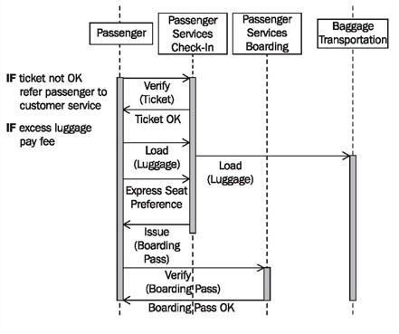

# High-Level Sequence Diagrams

> **Nguồn gốc:** [https://sourcemaking.com/uml/modeling-business-systems/external-view/high-level-sequence-diagrams](https://sourcemaking.com/uml/modeling-business-systems/external-view/high-level-sequence-diagrams)  
> **Phân mục:** SourceMaking UML 2.0 / modeling-business-systems  
> **Số lượng hình ảnh:** 1  

---

/ UML
                                                / Modeling Business Systems

# High-Level Sequence Diagrams

We can use high-level sequence diagrams that span several business use cases to illustrate business processes at a coarse level. High-level sequence diagrams give a good overview of the interactions between customers, partners, and the business system. They serve as the basis for the electronic data transfer between the business system and customers, business partners, and suppliers (seeModeling for System Integration).

Figure 3.27 illustrates passenger services. The entire process spans the business use casescheck-inandboarding:

Figure 3.27 Sequence diagram “Passenger Services”