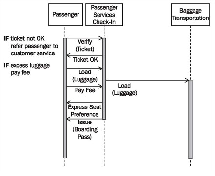

# Sequence Diagrams for Scenarios of Business Use Cases

> **Nguồn gốc:** [https://sourcemaking.com/uml/modeling-business-systems/external-view/sequence-diagrams-for-scenarios-of-business-use-cases](https://sourcemaking.com/uml/modeling-business-systems/external-view/sequence-diagrams-for-scenarios-of-business-use-cases)  
> **Phân mục:** SourceMaking UML 2.0 / modeling-business-systems  
> **Số lượng hình ảnh:** 1  

---

/ UML
                                                / Modeling Business Systems

# Sequence Diagrams for Scenarios of Business Use Cases

Sequence diagrams assist the detailing and specification of business use cases by emphasizing message exchange. The various scenarios of a business use case can be depicted in a sequence diagram. The representation is restricted to the message exchange within each business use case. Generally, the level of detail for these sequence diagrams is higher than for sequence diagrams spanning use cases.

Figure 3.28 shows a sequence diagram of the business use casecheck-in. This sequence diagram shows the scenariopassenger check-in, as can be seen from the communication partners since the check-in representative does not appear. Sequence diagrams, just likeactivity diagrams, show if actors can carry out business use cases together or independently of one another (which cannot be seen in use case diagrams):

Figure 3.28 Sequence diagram of the business use case “Passenger Check-In”