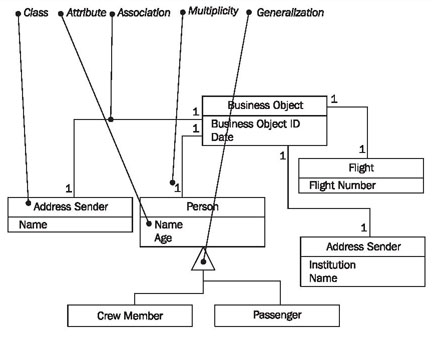
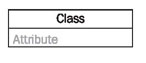

# Class Diagram

> **Nguồn gốc:** [https://sourcemaking.com/uml/modeling-for-system-integration/the-static-view/class-diagram](https://sourcemaking.com/uml/modeling-for-system-integration/the-static-view/class-diagram)  
> **Phân mục:** SourceMaking UML 2.0 / modeling-for-system-integration  
> **Số lượng hình ảnh:** 2  

---

/ UML
                                                / Modeling for System Integration

# Class Diagram

Figure 5.19 Class diagram for a business object

For a more detailed discussion of class modeling, seeStructural View. Below, we will only explain the specifics of the system integration model.

### Class

A class in the class diagram (Figure 5.19) of the system integration model represents a coherent set of information, which is contained in a business object:

## Reading Class Diagrams

Reading class diagrams of business objects is no different from reading class diagrams of IT systems. For this seeClass Diagram.