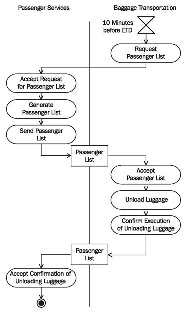
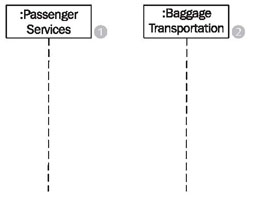
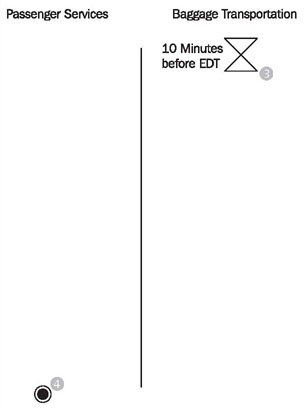
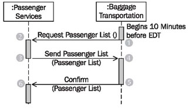
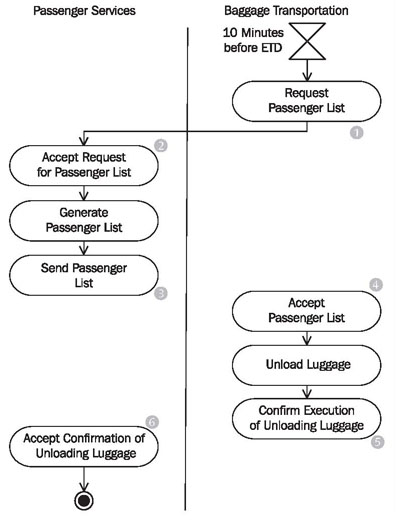
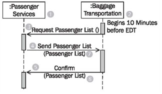
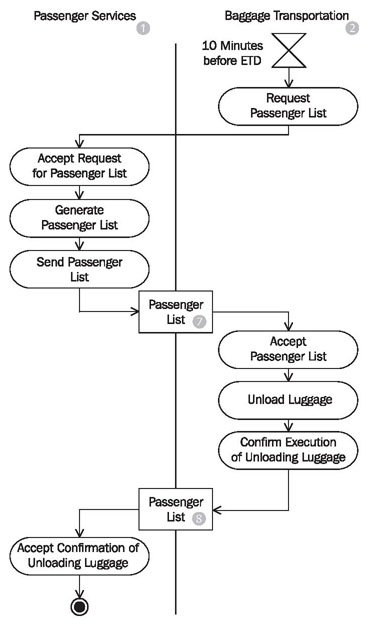

# Constructing Diagrams in the Process View

> **Nguồn gốc:** [https://sourcemaking.com/uml/modeling-for-system-integration/process-view/constructing-diagrams-in-the-process-view](https://sourcemaking.com/uml/modeling-for-system-integration/process-view/constructing-diagrams-in-the-process-view)  
> **Phân mục:** SourceMaking UML 2.0 / modeling-for-system-integration  
> **Số lượng hình ảnh:** 7  

---

/ UML
                                                / Modeling for System Integration

# Constructing Diagrams in the Process View

To construct diagrams in the process view, we chose the interface to baggage transportation from our case study.

The following checklist shows the necessary steps from constructing activity diagrams and sequence diagrams in the process view:

#### Checklist 5.1 Constructing Diagrams in the Process View

- Determine interfaces—Between which IT systems should communication take place?
- Identify involved systems—Which IT systems exchange information?
- Identify activities and control flow—What has to be done and who is responsible for it?
- Define messages—Which messages have to be exchanged?
- Define rules—What influences actions?
- Verify the view—Is everything correct?

### Determine Interfaces—Between Which IT Systems Should Communication Take Place?

To carry out the activityno boarding(Figure 5.11) those business processes or business use cases that require an interaction with the IT system of passenger services in order to be processed are chosen from thebusiness system model. In our case study, this applies to the use caserequest passenger list, which has an interface each to baggage transportation and customs at the destination airport. To illustrate the following steps, we will look at the interface to baggage transportation (see Figure 5.3).

We select the actions from the activityno boardingthat are connected to the exchange of messages:

Figure 5.11 Activity “No Boarding”

On the basis of Figure 5.11, we identify the following actions:

- Request passenger list
- Accept request for passenger list
- Generate passenger list
- Send passenger list
- Accept passenger list
- Confirm execution of unloading luggage
- Accept confirmation of unloading luggage

From the sequence diagram of the business model in Figure 5.8, we can see that the following two messages are exchanged:

- Send passenger list(passenger list)
- Confirm(passenger list)

### Identify Involved Systems—Which IT Systems Exchange Information?

In order for messages to be sent and received, it has to be known which IT systems are involved and what roles they play:

- Which IT systems are needed for the execution of business processes? Certainly, ourpassenger servicesIT system(1)is involved. The IT systems outside the business system can be derived from the actors of the use case diagram of the business model. This is how we found the IT system of the actorbaggage transportation(2)in our case study, as shown in Figure 5.12:

Figure 5.12 Constructing sequence diagram

- Which IT system initiates the process? The process initiator isbaggage transportation(2). Independently from the boarding of passenger services, a timer within baggage transportation (set to 10 minutes before EDT), requests a passenger list of passengers who have not yet boarded, so that the unloading of luggage can take place.
- Which IT system is at the end of the process? In our case study, the activityno boardingis completed whenpassenger services(1)receive a message frombaggage transportationthat all luggage from passengers who are not yet on board has been unloaded from the plane.

With this information we can start constructing the activity diagram (Figure 5.13):

Figure 5.13 Constructing activity diagram

### Identify Activities and Control Flow—What has to be Done and Who is Responsible for It?

The following questions will help identify actions and the control flow:

- What needs to be done so that the IT system can exchange messages?
- In which order are activities processed?
- Are there actions that occur simultaneously?
- Which conditions have to be met for the execution of actions?
- Do all prior actions have to be completed before the next one can be completed?
- Who is responsible for processing the actions? In which partition do the actions belong?

| The action ... | ...is processed by actor... |
| --- | --- |
| Request passenger list (1) | Baggage transportation |
| Accept request for passenger list (2) | Passenger services |
| Send passenger list (3) | Passenger services |
| Accept passenger list (4) | Baggage transportation |
| Confirm execution of unloading luggage (5) | Baggage transportation |
| Accept confirmation of unloading luggage (6) | Passenger services |

This information is documented in the sequence diagram in Figure 5.14 and in the activity diagram in Figure 5.15:

Figure 5.14 Constructing sequence diagram

Figure 5.15 Constructing activity diagram

### Define Messages—Which Messages have to be Exchanged?

We can see in the business system model that two messages are exchanged:

- Send passenger list(passenger list)
- Confirm(passenger list)

In the first messagesend passenger listin Figure 5.16, apassenger list(7)is sent to the IT system ofbaggage transportation(2), which lists all passengers who have checked in, but have not yet boarded the airplane.

Once the affected pieces of luggage have been unloaded,passenger services(1)receive aconfirmation(5). With the confirmation, thepassenger list(8)is sent back topassenger services(1).

Both messages receive thepassenger list(7)(8)as argument. In our case, the passenger list was forwarded frompassenger services(1)tobaggage transportation(2), modified there, and sent back topassenger services(1).

At the end, the passenger list is not exactly the same as it was at the beginning of the activity. However, thestructureof the business object, Passenger List, remains the same:

Figure 5.16 Constructing sequence diagram

You can see in Figure 5.17 that the object flow, which runs just like the control flow, hides the control flow:

Figure 5.17 Constructing activity diagram

### Define Rules—What Influences Actions?

Generally, contracts exist for inter-organization message exchange, which record agreements about responsibilities, regulations, etc. International treaties and statutes further influence this kind of message exchange. On the technical as well as statutory level, standards committees regulate rules about data exchange. (As an example, we recommend the relevant specificationCollaboration-Protocol Profile and Agreement Specification Version 2.0byebXML.)

As another example, we want to mentionInternational Air Transport Association(IATA), which among other things defines messages and their uses for the entire aerospace industry. Such agreements are also becoming more frequent within organizations. The question is:

- Which agreements, contracts, and statutes have to be taken into consideration for the definition of data exchange?

### Verify the View—Is Everything Correct?

Completed sequence diagrams and activity diagrams can be verified with the following checklist:

#### Checklist 5.2 Verifying Sequence Diagram in the Process View

- Are all messages that require confirmation listed with a confirmation in the sequence diagram?
- Is every IT system/every business partner that is involved in the exchange of messages listed in at least one sequence diagram?
- Are all exchanged business objects listed in the sequence diagrams as message arguments?
- Are all important comments inserted into the diagram? Are there perhaps too many comments inserted into the diagram, which reduce the clarity of the diagram?
- Does the message flow correspond to the object flow in the activity diagram?

#### Checklist 5.3 Verifying Activity Diagrams in the Process View

- When you construct activity diagrams in the process view, remember that only the flows that are involved in the message exchange are relevant. Business processes belong in the business model.
- Is the object flow clearly visible? Are all business objects listed in the activity diagram?
- The conditions of different outputs should not overlap. Otherwise, the control flow is ambiguous, meaning that it is not clear where the flow proceeds at a decision node.
- The conditions must include all possibilities. Otherwise, the control flow can get stuck. In case of doubt, insert an output with the condition “else”.
- Forks and joins should be well balanced. The number of flows that leave a fork should match the number of flows that end in the corresponding join.