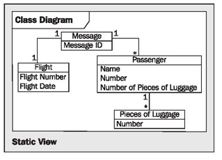

# Elements of the View

> **Nguồn gốc:** [https://sourcemaking.com/uml/modeling-for-system-integration/the-static-view/elements-of-the-view](https://sourcemaking.com/uml/modeling-for-system-integration/the-static-view/elements-of-the-view)  
> **Phân mục:** SourceMaking UML 2.0 / modeling-for-system-integration  
> **Số lượng hình ảnh:** 1  

---

/ UML
                                                / Modeling for System Integration

# Elements of the View

Figure 5.18 Static view

For the illustration of business objects in the static view of the system integration model, we only use the class diagram, as illustrated in Figure 5.18.