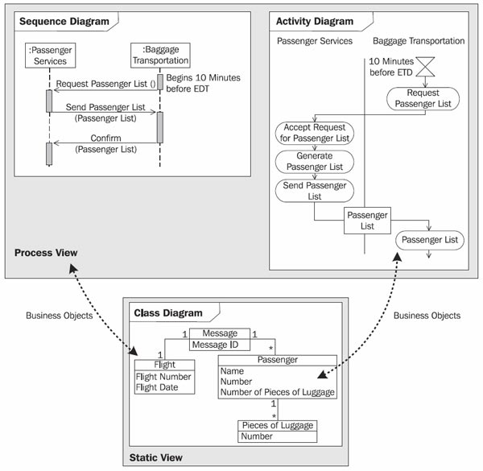

# One Model—Two Views

> **Nguồn gốc:** [https://sourcemaking.com/uml/modeling-for-system-integration/one-model-two-views](https://sourcemaking.com/uml/modeling-for-system-integration/one-model-two-views)  
> **Phân mục:** SourceMaking UML 2.0 / modeling-for-system-integration  
> **Số lượng hình ảnh:** 1  

---

/ UML
                                                / Modeling for System Integration

# One Model—Two Views

For the integration of IT systems, we need to definewhichinformation needs to be exchanged andhowit will be exchanged. For this reason, thesystem integration modelconsists of two different views: theprocess viewand thestatic view.

In system integration, the main focus is on process steps that are significantly important for the interaction, exchange of messages, between IT systems and/or involved parties. Nevertheless, often process steps are described that do not necessarily exchange messages, but are important for the complete comprehension of the process. An example of this could be the unloading of the luggage of passengers who did not board the airplane (actionunload luggagein the activityno boarding).

Thestatic viewdescribes thecontentandstructureof the business objects that are exchanged between partners.

The views we use for the system integration model and the UML diagrams within each view are illustrated in Figure 5.1:

Figure 5.1 Process view and static view of system integration