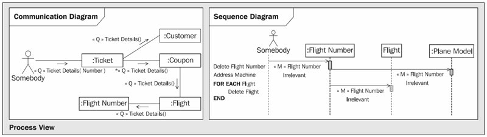

# Elements of the View

> **Nguồn gốc:** [https://sourcemaking.com/uml/modeling-it-systems/interaction-view/elements-of-the-view](https://sourcemaking.com/uml/modeling-it-systems/interaction-view/elements-of-the-view)  
> **Phân mục:** SourceMaking UML 2.0 / modeling-it-systems  
> **Số lượng hình ảnh:** 1  

---

/ UML
                                                / Modeling IT Systems

# Elements of the View

Figure 4.58 Interaction View

The interaction view of IT systems, illustrated in Figure 4.58, consists of two elements:

- Communication diagramsdocument the flow ofquerieswithin the IT system. Each query is part of a use case.
- Sequence diagramsdocument the flow ofmutation eventswithin the IT system. Mutation events are also part of a use case.

Both diagrams show how objects of the IT system cooperate in the processing of events. In this way, each query event from the use cases becomes its own communication diagram, and each mutation event becomes its own sequence diagram.

In reality, we do not document every flow of every query and every mutation. The effort for this would be too much. We only document those flows that are especially important or complex. The following considerations should help making the right choices:

- For each query event we have to verify if all necessary classes, attributes, and associations are present in the class diagram. For simple queries it can be sufficient to check off the necessary data elements on a printout (seeConstructing Communication Diagrams). For such queries a communication diagram is not needed. This work step further helps to verify or complete class diagrams.
- Queries that are very important to the user, or that are very complex, should be documented in a communication diagram.