Title: UML action represents a single atomic step within activity.

URL Source: https://www.uml-diagrams.org/activity-diagrams-actions.html

Warning: Target URL returned error 400: Bad Request

Markdown Content:
Menu►
*   [UML diagrams](https://www.uml-diagrams.org/ "UML graphical notation overview, examples, and reference.")
*   [Activity diagrams](https://www.uml-diagrams.org/activity-diagrams.html "UML activity diagrams show flow of control or object flow with emphasis on the sequence and conditions of the flow.")
*   [Actions](https://www.uml-diagrams.org/activity-diagrams-actions.html "UML activity diagram actions - object, variable, invocation, structural, link, event actions.")
*   [Controls](https://www.uml-diagrams.org/activity-diagrams-controls.html "UML activity diagram controls - initial, flow final, activity final, decision, merge, fork, join.")
*   [Objects](https://www.uml-diagrams.org/activity-diagrams-objects.html "UML activity diagram object nodes - object, pin, parameter, central buffer, data store.")
*   [Activity reference](https://www.uml-diagrams.org/activity-diagrams-reference.html "UML activity diagrams reference.")
*   [Activity examples](https://www.uml-diagrams.org/activity-diagrams-examples.html "UML activity diagrams examples.")
*   [UML index](https://www.uml-diagrams.org/index-references.html "Index of UML elements")

# Actions

**Action** is a [named element](https://www.uml-diagrams.org/uml-core.html#named-element) which represents a single atomic step within [activity](https://www.uml-diagrams.org/activity-diagrams.html#activity), i.e. that is not further decomposed within the activity. **Activity** represents a behavior that is composed of individual elements that are **actions**.

Note, that [call behavior action](https://www.uml-diagrams.org/activity-diagrams-actions.html#call-behavior-action) may reference (call) activity. This action is simple for the activity containing it, but may be complex in its effect. An activity defines a behavior that can be reused in many places.

Explicitly modeled actions as part of activities are new in UML 2.0, and replace action state, call state, and subactivity state in UML 1.5.

Actions are notated as round-cornered rectangles. **Name** or **description** of the action is placed inside of the rectangle.

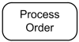
The **Process Order** action.

Name of the action is usually action verb or noun for the action with some explanation. Don't use state names as action names. Some action name examples:

*   Fill Order
*   Review Document
*   Enroll in Course
*   Checkout
*   Show Error Page

Action could also be expressed in some application-dependent **action language**.

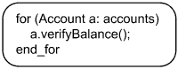
Example of action expressed with tool-dependent **action language**.

An action may have sets of incoming and outgoing **activity edges** that specify **control flow** and **data flow** from and to other nodes.

An action will not begin execution until all of its **input conditions** are satisfied. The completion of the execution of an action may enable the execution of a set of successor nodes and actions that take their inputs from the outputs of the action.

If an **exception** occurs during the execution of an action, the execution of the action is abandoned and no regular output is generated by this action. If the action has an exception handler, it receives the exception object as a token. If the action has no exception handler, the exception propagates to the enclosing node and so on until it is caught by one of them. If an exception propagates out of a nested node (action, structured activity node, or activity), all tokens in the nested node are terminated. The data describing an exception is represented as an object of any class.

**Local pre-conditions** and **local post-conditions** are constraints that should hold when the execution starts and completes, respectively. They hold only at the point in the flow that they are specified, not globally for other invocations of the behavior at other places in the flow or on other diagrams.

How local pre- and postconditions are enforced is determined by the implementation. For example, violations may be detected at compile time or runtime. The effect may be an error that stops the execution or just a warning, and so on.

**Local pre-conditions** and **local post-conditions** are shown as **notes** attached to the invocation with the keywords «localPrecondition» and «localPostcondition», respectively.

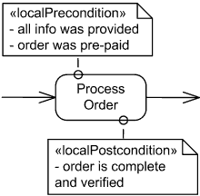
**Local pre-** and **post-conditions** shown as **notes** attached to **Process Order** action.

[Action](https://www.uml-diagrams.org/activity-diagrams-actions.html) subclasses are listed below. Note, that I added [object actions](https://www.uml-diagrams.org/activity-diagrams-actions.html#object-action) and [event actions](https://www.uml-diagrams.org/activity-diagrams-actions.html#event-action), which are not defined explicitly in UML 2.4 specification.

*   [object action](https://www.uml-diagrams.org/activity-diagrams-actions.html#object-action) (not explicit in UML standard)
*   [variable action](https://www.uml-diagrams.org/activity-diagrams-actions.html#variable-action)
*   [invocation action](https://www.uml-diagrams.org/activity-diagrams-actions.html#invocation-action)
*   raise exception action
*   [structural feature action](https://www.uml-diagrams.org/activity-diagrams-actions.html#structural-feature-action)
*   [link action](https://www.uml-diagrams.org/activity-diagrams-actions.html#link-action)
*   [event action](https://www.uml-diagrams.org/activity-diagrams-actions.html#event-action) (not explicit in UML standard)
*   opaque action

## Object Action

**Object actions** include different actions on objects, e.g. create and destroy object, test object identity, specify value, etc. Object action is not defined explicitly by UML standard. In the UML standard all object actions are direct subclasses of [action](https://www.uml-diagrams.org/activity-diagrams-actions.html).

**Object actions**:

*   create object action
*   destroy object action
*   test identity action
*   read self action
*   value specification action
*   start classifier behavior action
*   read is classified object action
*   reclassify object action
*   read extend action

## Variable Action

**Variable actions** include variable read, write, add, remove and clear actions.

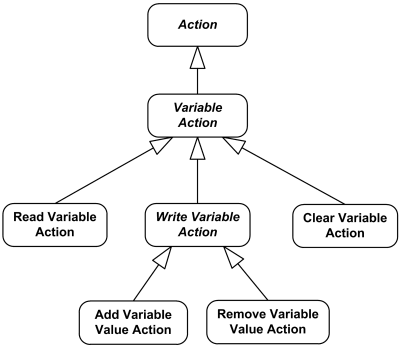
**Variable actions** overview diagram

## Invocation Action

**Invocation actions** include several call actions, signal send and broadcast actions and send object action.

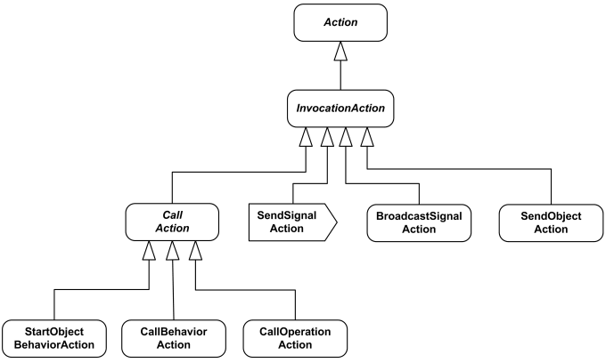
**Invocation actions** overview diagram

### Call Behavior Action

**Call behavior action** is a **call action** that invokes a [behavior](https://www.uml-diagrams.org/common-behaviors.html#behavior) directly rather than invoking an operation that invokes the behavior.

Parameters could be passed by the action to the invoked behavior. The number of argument pins and the number of parameters of the behavior of type in and in-out must be equal. Also equal should be the number of result pins and the number of parameters of the behavior of type return, out, and in-out.

For **synchronous calls** the execution of the call behavior action waits until the execution of the invoked behavior completes. Execution of the calling action is blocked until it receives a reply. The reply includes values for any return, out, or inout parameters. The result values are placed on the result pins of the call behavior action, and the execution of the action is complete after that. If the execution of the invoked behavior throws an exception, the exception is transmitted back to the call behavior action to begin search for some exception handler.

If the call is **asynchronous**, the call action completes immediately after behavior started. Any return or out values from the invoked behavior are not passed back.

**Call behavior action** is shown as action with the **name of the behavior** that is performed by the action or description of the behavior placed inside the action's round-cornered rectangle. If the node name is different than the behavior name, then it appears in the symbol instead.

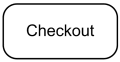
Call behavior action for Checkout behavior

Note, that because it looks exactly the same way as the common action, there is no way just looking at the diagram to say whether the name is common action name, call behavior action name or some behavior name.

As you know, some subclasses of [behavior](https://www.uml-diagrams.org/common-behaviors.html#behavior) are **interaction**, **state machine**, [activity](https://www.uml-diagrams.org/activity-diagrams.html#activity).

**Call activity action** is indicated by placing a rake-style symbol within the action symbol. The rake resembles a miniature hierarchy, indicating that this invocation starts another activity. Note, that though UML provides this notation, there is no official **call activity action** in UML specification.

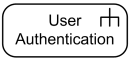
Call activity action for User Authentication activity

An alternative notation for the invoked activity is to show the contents of the invoked activity inside a large round-cornered rectangle. Edges flowing into the invocation connect to the parameter object nodes in the invoked activity. The parameter object nodes are shown on the border of the invoked activity.

Pre- and post-conditions on the behavior can be shown using keywords «precondition» and «postcondition».

### Send Signal Action

**Send signal action** is an [invocation action](https://www.uml-diagrams.org/activity-diagrams-actions.html#invocation-action) that creates a [signal](https://www.uml-diagrams.org/common-behaviors.html#signal) from its inputs, and transmits it to the specified **target** object, where it may cause the firing of a state machine transition or the execution of an activity.

When all the prerequisites of the action execution are satisfied, a signal is generated from the arguments and is transmitted to the identified target object. The target object may be local or remote. If input of the action is already a **signal**, **send object action** should be used instead.

The sender of the signal (aka "requestor") continues execution immediately, without waiting for any response. Send signal action receives no reply from the invoked behavior. Any attempt to reply is simply ignored, and no transmission is performed back to the sender.

The manner of transmitting the signal, the amount of time required to transmit it, the order in which the transmissions reach the various targets, and the path for reaching the targets are **undefined** in . The signal instance may be copied during transmission, so identity might not be preserved.

When a transmission arrives at a target object, it may invoke [behavior](https://www.uml-diagrams.org/common-behaviors.html#behavior) in the target object. The effect of receiving a signal object is specified in [Common Behaviors](https://www.uml-diagrams.org/common-behaviors.html). Such effects include executing activities and firing state machine transitions.

**Send signal action** is notated as **convex pentagon**. Note, that the name of the **action** corresponds to the name of [signal](https://www.uml-diagrams.org/common-behaviors.html#signal) class it sends. **Target** object is not specified with this notation.

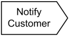
**Notify Customer** send signal action  
 creates and sends **Notify Customer** signal

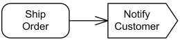
After order is shipped, **Notify Customer** send signal action  
 creates and sends **Notify Customer** signal

## Structural Feature Action

**Structural feature actions** include several actions working on composite structures - read, write, add, remove, clear and reduce actions.

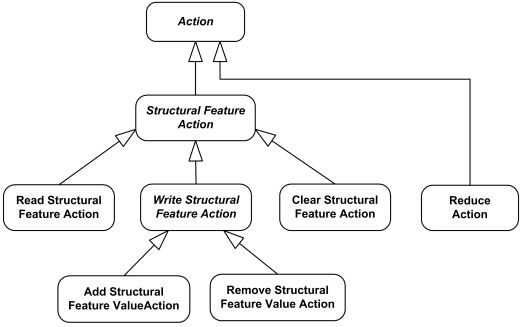
**Structural feature actions** overview diagram

Note, that in UML 2.4 specification **reduce action** is direct subclass of **action**.

## Link Action

**Link actions** include several actions working on links - read, write, create, destroy and clear association actions.

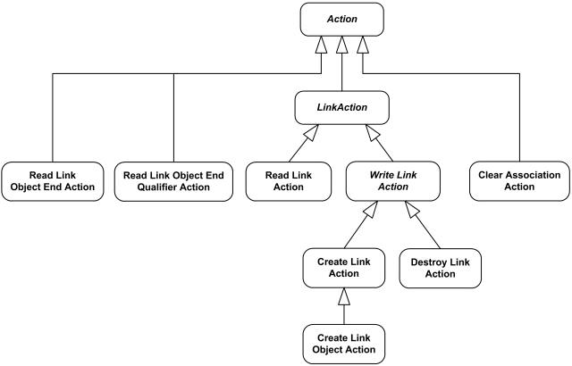
**Link actions** overview diagram

Note, that in UML 2.4 specification **read link object end action**, **read link object end qualifier action**, **clear association action** are direct subclasses of **action**.

## Event Action

**Event actions** include accept event action, accept call, accept time event, reply and unmarshall action. Note, that **event action** is not an explicit part of UML specification, In UML 2.4 all event actions are direct subclasses of [action](https://www.uml-diagrams.org/activity-diagrams-actions.html). I added **event action** here for clarity.

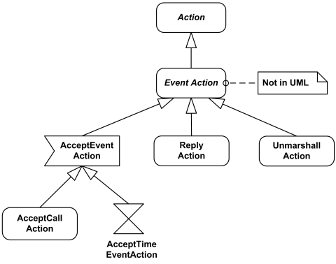
**Event actions** overview diagram

### Accept Event Action

**Accept event action** is action that waits for a specific event to occur. This action handles **asynchronous messages**, including **asynchronous calls**. It cannot be used with **synchronous calls** (except **accept call action**). Accept event action was introduced in UML 2.0.

Accept event action handles events detected by the object owning the executing behavior. Events are stored by the object in some queue. The order of detected events is not defined by the UML specification, but it could be specified in extensions or profiles.

If **accept event action** is executed and object detected event matching one of the [triggers](https://www.uml-diagrams.org/common-behaviors.html#trigger) on the action, then the accept event action outputs a value describing the event. If the event does not match expected event, the action waits for the next event.

In a system with concurrency, several actions or other behaviors might compete for an available event. Only one action accepts event, unless otherwise specified by an extension or profile, even if the event would satisfy multiple concurrently executing actions.

An **accept event action** is notated as a **concave pentagon**. By default, name of the accept event action corresponds to the name of the **event** this action accepts, so that e.g. Accept Order **accept event action** waits for Accept Order **event**.

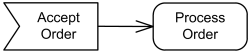
Acceptance of the **Accept Order** event by **Accept Order** action causes  
 an invocation of a **Process Order** action. The **accept event action**  
 is enabled upon entry to the activity containing it

If an accept event action has **no incoming edges**, then the action starts when the containing activity or structured node does, whichever most immediately contains the action. In addition, an accept event action with no incoming edges remains enabled after it accepts an event. It does not terminate after accepting an event and outputting a value, but continues to wait for other events. This semantic is an exception to the normal execution rules in activities. An accept event action with no incoming edges and contained by a structured node is terminated when its container is terminated.

### Accept Signal Action

**Accept signal action** is informal name for the **accept event action** whose trigger is a **signal event**. It corresponds to [send signal action](https://www.uml-diagrams.org/activity-diagrams-actions.html#send-signal-action).

An **accept signal action** is notated the same way as accept event action - as a **concave pentagon**. By default, name of the accept signal action corresponds to the name of the signal this action accepts.

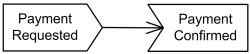
**Payment Requested** signal is sent. The activity then waits  
 to receive **Payment Confirmed** signal. Acceptance of the  
**Payment Confirmed** signal is enabled only after  
 the request for payment is sent.

### Wait Time Action

If the event is a **time event occurrence**, the result value contains the time at which the occurrence happened. Such an action is informally called a **wait time action**.

**Accept time event action** (aka informal: **wait time action**) is notated with an hour glass.

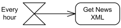
The **Every Hour** accept time event action generates output every hour.  
 There are no incoming edges to this time event action, so it is enabled as long  
 as its containing activity or structured node is enabled.

  

This document describes UML versions up to **[UML 2.5](https://www.uml-diagrams.org/references.html#ref-uml-25 "UML 2.5 Specification")** and is based on the corresponding **OMG™ Unified Modeling Language™ (OMG UML®)** specifications. UML diagrams were created in **Microsoft® Visio®** 2007-2016 using **[UML 2.x Visio Stencils](http://softwarestencils.com/uml/index.html "Visio Stencil and Template for UML 2.5")**. You can send your comments and suggestions to [webmaster](mailto:webmaster@uml-diagrams.org). [Privacy policy](https://www.uml-diagrams.org/privacy-policy.html).

_Copyright © 2009-2026 uml-diagrams.org. All rights reserved. Authored by Kirill Fakhroutdinov._

[How NF1 Command Center Unifies Whole Teams NF1 (NeuroForce One) | [Sponsored](https://popup.taboola.com/en/?template=colorbox&utm_source=uml-diagrams&utm_medium=referral&utm_content=next-up-a-delta:Next%20Up:)[Sponsored](https://popup.taboola.com/en/?template=colorbox&utm_source=uml-diagrams&utm_medium=referral&utm_content=next-up-a-delta:Next%20Up:) Read Next Story](https://commandcenter.neuroforceone.com/ "How NF1 Command Center Unifies Whole Teams")
