Title: UML activity diagram controls are activity nodes coordinating the flows between other nodes: initial node, flow final, activity final, decision, merge, fork, join.

URL Source: https://www.uml-diagrams.org/activity-diagrams-controls.html

Warning: Target URL returned error 400: Bad Request

Markdown Content:
Menu►
*   [UML diagrams](https://www.uml-diagrams.org/ "UML graphical notation overview, examples, and reference.")
*   [Activity diagrams](https://www.uml-diagrams.org/activity-diagrams.html "UML activity diagrams show flow of control or object flow with emphasis on the sequence and conditions of the flow.")
*   [Actions](https://www.uml-diagrams.org/activity-diagrams-actions.html "UML activity diagram actions - object, variable, invocation, structural, link, event actions.")
*   [Controls](https://www.uml-diagrams.org/activity-diagrams-controls.html "UML activity diagram controls - initial, flow final, activity final, decision, merge, fork, join.")
*   [Objects](https://www.uml-diagrams.org/activity-diagrams-objects.html "UML activity diagram object nodes - object, pin, parameter, central buffer, data store.")
*   [Activity reference](https://www.uml-diagrams.org/activity-diagrams-reference.html "UML activity diagrams reference.")
*   [Activity examples](https://www.uml-diagrams.org/activity-diagrams-examples.html "UML activity diagrams examples.")
*   [UML index](https://www.uml-diagrams.org/index-references.html "Index of UML elements")

# UML Activity Diagram Controls

**Control node** is an activity node used to coordinate the flows between other nodes. It includes:

*   [initial node](https://www.uml-diagrams.org/activity-diagrams-controls.html#initial-node)
*   [flow final node](https://www.uml-diagrams.org/activity-diagrams-controls.html#flow-final-node)
*   [activity final node](https://www.uml-diagrams.org/activity-diagrams-controls.html#activity-final-node)
*   [decision node](https://www.uml-diagrams.org/activity-diagrams-controls.html#decision-node)
*   [merge node](https://www.uml-diagrams.org/activity-diagrams-controls.html#merge-node)
*   [fork node](https://www.uml-diagrams.org/activity-diagrams-controls.html#fork-node)
*   [join node](https://www.uml-diagrams.org/activity-diagrams-controls.html#join-node)

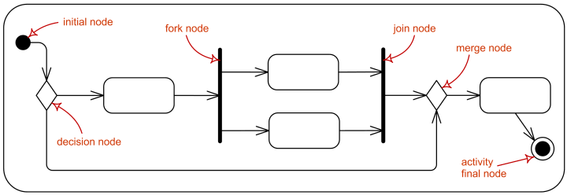
Activity control nodes overview.

Activity controls nodes could be used both in [activity diagrams](https://www.uml-diagrams.org/activity-diagrams.html) as well as in [interaction overview diagrams](https://www.uml-diagrams.org/interaction-overview-diagrams.html).

## Initial Node

**Initial node** is a control node at which flow starts when the activity is invoked.

A control token is placed at the initial node when the activity starts, but not in initial nodes in structured nodes contained by the activity. Tokens in an initial node are offered to all outgoing edges. For convenience, initial nodes are an exception to the rule that control nodes cannot hold tokens if they are blocked from moving downstream, for example, by guards.

Activities may have more than one initial node. In this case, invoking the activity starts multiple flows, one at each initial node.

Note that flows can also start at other nodes, so initial nodes are not required for an activity to start execution.

Initial nodes are shown as a small solid circle.

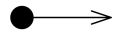
Activity initial node.

## Flow Final Node

**Flow final node** is a control final node that terminates a **flow**. It destroys all tokens that arrive at it but has no effect on other flows in the activity. Flow final was introduced in UML 2.0.

The notation for flow final node is small circle with X inside.

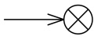
Flow final node.

## Activity Final Node

**Activity final node** is a control final node that stops all flows in an **activity**. Activity final was introduced in UML 2.0.

An activity may have more than one activity final node. The first one reached stops all flows in the activity. A token reaching an activity final node terminates the activity. In particular, it stops all executing actions in the activity, and destroys all tokens in object nodes, except in the output activity parameter nodes. Terminating the execution of synchronous invocation actions also terminates whatever behaviors they are waiting on for return. Any behaviors invoked asynchronously by the activity are not affected. If it is not desired to abort all flows in the activity, use flow final instead.

Activity final nodes are shown as a solid circle with a hollow circle inside. It can be thought of as a goal notated as "bull’s eye," or target.

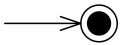
Activity final node.

## Decision Node

**Decision node** is a **control node** that accepts tokens on one or two **incoming edges** and selects one **outgoing edge** from one or more outgoing flows. Decision nodes were introduced in UML to support conditionals in activities.

The edges coming into and out of a decision node, other than the **decision input flow** (if any), must be either all **object flows** or all **control flows**.

Each token arriving at a decision node can traverse **only one** outgoing edge. Tokens are not duplicated. Each token offered by the incoming edge is offered to the outgoing edges.

Which of the edges is actually traversed depends on the evaluation of the **guards** on the outgoing edges. The order in which guards are evaluated is **not defined**, i.e. we should not rely on any visual or text description order.

The notation for a decision node is a diamond-shaped symbol.

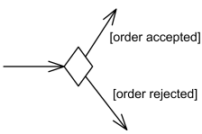
**Decision node** with two **outgoing edges** with guards.

The modeler should arrange that each token only be chosen to traverse **one outgoing edge**. For **decision points**, a predefined guard "**else**" may be defined for at most one outgoing edge.

![Image 6: For decision points, a predefined guard [else] may be defined.](images/decision-ternary.png)
**Decision node** with three **outgoing edges** and [else] guard.

**Decision** can have **decision input behavior** specified. Decision input behaviors were introduced in UML to avoid redundant recalculations in guards.

In this case each data token is passed to the **behavior** before guards are evaluated on the outgoing edges. The behavior is invoked without input for control tokens. The output of the behavior is available to each guard. Because the behavior is used during the process of offering tokens to outgoing edges, it may be run **many times** on the same token before the token is accepted by those edges. This means the behavior cannot have **side effects**.

**Decision input behavior** is specified by the keyword **«decisionInput»** and some decision behavior or condition placed in a **note symbol**, and attached to the appropriate decision node.

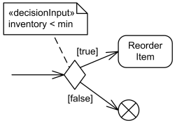
**Decision node** with **decision input behavior**.

**Decision** may also have **decision input flow**. In this case the tokens offered on the decision input flow that are made available to the guard on each outgoing edge determine whether the offer on the regular incoming edge is passed along that outgoing edge.

A **decision input flow** is specified by the keyword **«decisionInputFlow»** annotating that flow.

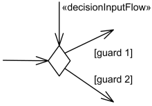
**Decision node** with **decision input flow**.

If there are both a **decision input behavior** as well as **decision input flow**, the token offered on the decision input flow is passed to the behavior (as the only argument if the regular incoming edge is control flow, as the second argument if it is an object flow). Decision nodes with the additional decision input flow offer tokens to outgoing edges only when one token is offered on each incoming edge.

## Merge Node

**Merge node** is a control node that brings together multiple incoming **alternate flows** to accept single outgoing flow. There is no joining of tokens. Merge **should not** be used to synchronize **concurrent flows**.

For example, if a decision is used after a fork, the two flows coming out of the decision need to be merged into one before going to a join; otherwise, the join will wait for **both** flows, only one of which will arrive.

All edges coming into and out of a merge node must be either **object flows** or **control flows**.

The notation for a merge node is a diamond-shaped symbol with two or more edges entering it and a single activity edge leaving it.

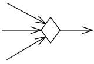
**Merge node** with three incoming edges and a single outgoing edge

The functionality of **merge node** and **decision node** can be combined by using the same node symbol, as illustrated below. This case maps to a model containing a merge node with all the incoming edges shown in the diagram and one outgoing edge to a decision node that has all the outgoing edges shown in the diagram.

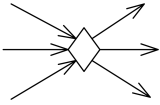
**Merge node** and **decision node** combined using the same symbol

## Fork Node

**Fork node** is a control node that has one incoming edge and multiple outgoing edges and is used to split incoming flow into multiple **concurrent** flows. Fork nodes are introduced to support **parallelism** in **activities**. As compared to **UML 1.5**, **UML 2.0** activity forks model unrestricted parallelism.

Tokens arriving at a fork are duplicated across the outgoing edges. If at least one outgoing edge accepts the token, duplicates of the token are made and one copy traverses each edge that accepts the token. The outgoing edges that did not accept the token due to failure of their targets to accept it, keep their copy in an implicit FIFO queue until it can be accepted by the target. The rest of the outgoing edges do not receive a token.

The notation for a fork node is a line segment with a single activity edge entering it, and two or more edges leaving it.

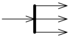
**Fork node** with a single activity edge entering it, and three edges leaving it.

The functionality of **join node** and **fork node** can be combined by using the same node symbol. This case maps to a model containing a join node with all the incoming edges shown in the diagram and one outgoing edge to a fork node that has all the outgoing edges shown in the diagram.

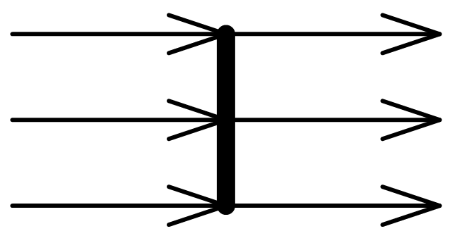
Combined **join node** and **fork node**.

If guards are used on edges outgoing from forks, the modelers should ensure that no downstream joins depend on the arrival of tokens passing through the guarded edge. If that cannot be avoided, then a **decision node** should be introduced to have the guard, and shunt the token to the downstream join if the guard fails.

## Join Node

**Join node** is a control node that has multiple incoming edges and one outgoing edge and is used to synchronize incoming concurrent flows. Join nodes are introduced to support parallelism in activities.

The notation for a join node is a line segment with several activity edges entering it, and only one edge leaving it.

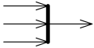
**Join node** with three activity edges entering it, and a single edge leaving it.

The functionality of join node and fork node can be combined by using the same node symbol. This case maps to a model containing a join node with all the incoming edges shown in the diagram and one outgoing edge to a fork node that has all the outgoing edges shown in the diagram.

Combined **join node** and **fork node**.

Join nodes have a **join specification** which is Boolean value specification using the **names of the incoming edges** to specify the conditions under which the join will emit a token.

The join specification is evaluated whenever a new token is offered on any incoming edge. The evaluation is not interrupted by any new tokens offered during the evaluation, nor are concurrent evaluations started when new tokens are offered during an evaluation.

The **default join specification** is the reserved string "**and**". It is equivalent to a specification that requires at least one token offered on each incoming edge.

Join specifications are shown in curly braces near the join node as **joinSpec=...**.

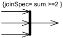
**Join node** with **join specification** shown in curly braces.

This document describes UML versions up to **[UML 2.5](https://www.uml-diagrams.org/references.html#ref-uml-25 "UML 2.5 Specification")** and is based on the corresponding **OMG™ Unified Modeling Language™ (OMG UML®)** specifications. UML diagrams were created in **Microsoft® Visio®** 2007-2016 using **[UML 2.x Visio Stencils](http://softwarestencils.com/uml/index.html "Visio Stencil and Template for UML 2.5")**. You can send your comments and suggestions to [webmaster](mailto:webmaster@uml-diagrams.org). [Privacy policy](https://www.uml-diagrams.org/privacy-policy.html).

_Copyright © 2009-2026 uml-diagrams.org. All rights reserved. Authored by Kirill Fakhroutdinov._

[Hobbit Life on a Budget! Inside My 20sqm Half-Circle Wood Box TheDecorIdeas | [Sponsored](https://popup.taboola.com/en/?template=colorbox&utm_source=uml-diagrams&utm_medium=referral&utm_content=next-up-a-delta:Next%20Up:)[Sponsored](https://popup.taboola.com/en/?template=colorbox&utm_source=uml-diagrams&utm_medium=referral&utm_content=next-up-a-delta:Next%20Up:) Read Next Story](https://www.thedecorideas.com/big-living-in-a-tiny-20-sqm-wooden-box-see-inside "Hobbit Life on a Budget! Inside My 20sqm Half-Circle Wood Box")
