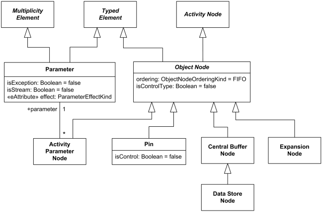
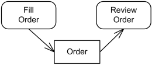
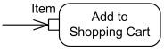
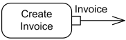
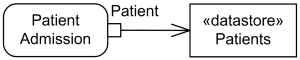

Title: UML activity diagram object nodes

URL Source: https://www.uml-diagrams.org/activity-diagrams-objects.html

Warning: Target URL returned error 400: Bad Request

Markdown Content:
Menu►
*   [UML diagrams](https://www.uml-diagrams.org/ "UML graphical notation overview, examples, and reference.")
*   [Activity diagrams](https://www.uml-diagrams.org/activity-diagrams.html "UML activity diagrams show flow of control or object flow with emphasis on the sequence and conditions of the flow.")
*   [Actions](https://www.uml-diagrams.org/activity-diagrams-actions.html "UML activity diagram actions - object, variable, invocation, structural, link, event actions.")
*   [Controls](https://www.uml-diagrams.org/activity-diagrams-controls.html "UML activity diagram controls - initial, flow final, activity final, decision, merge, fork, join.")
*   [Objects](https://www.uml-diagrams.org/activity-diagrams-objects.html "UML activity diagram object nodes - object, pin, parameter, central buffer, data store.")
*   [Activity reference](https://www.uml-diagrams.org/activity-diagrams-reference.html "UML activity diagrams reference.")
*   [Activity examples](https://www.uml-diagrams.org/activity-diagrams-examples.html "UML activity diagrams examples.")
*   [UML index](https://www.uml-diagrams.org/index-references.html "Index of UML elements")

# Object Nodes

An **object** node is an abstract activity node that is used to define [object flows](https://www.uml-diagrams.org/activity-diagrams.html#object-flow-edge) in an activity. Object nodes include [pin](https://www.uml-diagrams.org/activity-diagrams-objects.html#pin), [central buffer](https://www.uml-diagrams.org/activity-diagrams-objects.html#central-buffer), **parameter**, **expansion** nodes.

Activity object nodes include parameter, pin, central buffer, expansion nodes.

It is a bit strange that though object node is an **abstract** activity node, it is directly used in objects flows using its own notation (see below). It would make sense to have some separate concrete UML metaclass for data nodes.

## Object Node

An **object** node is an abstract activity node that is used to define [object flow](https://www.uml-diagrams.org/activity-diagrams.html#object-flow-edge) in an activity. It indicates that an instance of a particular [classifier](https://www.uml-diagrams.org/classifier.html), possibly in a particular state, may be available at a particular point in the activity. Object nodes can be used in a variety of ways, depending on where objects are flowing from and to.

Object nodes are notated as rectangles. A name labeling the node is placed inside the symbol, where the name indicates the type of the object node, or the name and type of the node in the format "name:type."

**Object flow** of **Orders** between Fill Order and Review Order actions

The name can also be qualified by a state or states, which is to be written within brackets below the name of the type. Upper bounds, ordering, and control type other than the defaults are notated in braces underneath the object node.

## Pin

A **pin** is an [object node](https://www.uml-diagrams.org/activity-diagrams-objects.html) for inputs and outputs to [actions](https://www.uml-diagrams.org/activity-diagrams-actions.html).

Pin is usually shown as a small rectangle attached to the action rectangle. The name of the pin can be displayed near the pin.

Item is **input pin** to the Add to Shopping Cart action.

Invoice is **output pin** from the Create Invoice action.

## Central Buffer

A **central buffer** node is an [object node](https://www.uml-diagrams.org/activity-diagrams-objects.html) for managing flows from multiple sources and destinations. A central buffer node accepts tokens from multiple object in flows, buffers those and passes them along to out flows. Central buffers do not connect directly to actions.

Note, that all object nodes have built-in capability of data buffering. [Pins](https://www.uml-diagrams.org/activity-diagrams-objects.html#pin) could buffer data for actions, while activity parameters - for activity. Central buffer differs in that it is not tied to an action or to an activity. It provides additional support for queuing and competition between object flows.

Central buffer is notated as an object node with optional keyword «centralBuffer» which allows to distinguish it from the standalone pin.

### Data Store

A **data store** is a [central buffer](https://www.uml-diagrams.org/activity-diagrams-objects.html#central-buffer) node for non-transient information.

All incoming tokens are stored by the data store. A special rule is that if incoming token contains some particular object which is already stored in the data store, then the new token will replace any tokens in the object node containing that object.

Tokens which were chosen to go out ("move downstream") of data store are actually **copied** while original token is kept and not deleted from the data store.

The data store is notated as an object node with the keyword «datastore».

Incoming Patient token is stored by the Patients data store.

  

This document describes UML versions up to **[UML 2.5](https://www.uml-diagrams.org/references.html#ref-uml-25 "UML 2.5 Specification")** and is based on the corresponding **OMG™ Unified Modeling Language™ (OMG UML®)** specifications. UML diagrams were created in **Microsoft® Visio®** 2007-2016 using **[UML 2.x Visio Stencils](http://softwarestencils.com/uml/index.html "Visio Stencil and Template for UML 2.5")**. You can send your comments and suggestions to [webmaster](mailto:webmaster@uml-diagrams.org). [Privacy policy](https://www.uml-diagrams.org/privacy-policy.html).

_Copyright © 2009-2026 uml-diagrams.org. All rights reserved. Authored by Kirill Fakhroutdinov._

[The Surprising Reason Your Arm Falls Asleep at Night Pillow Heathy | [Sponsored](https://popup.taboola.com/en/?template=colorbox&utm_source=uml-diagrams&utm_medium=referral&utm_content=next-up-a-delta:Next%20Up:)[Sponsored](https://popup.taboola.com/en/?template=colorbox&utm_source=uml-diagrams&utm_medium=referral&utm_content=next-up-a-delta:Next%20Up:) Read Next Story](https://healthnewslive.online/sleep-melara "The Surprising Reason Your Arm Falls Asleep at Night")
