Title: UML association is relationship between classifiers to show that instances of classifiers could be either linked to each other or combined into some aggregation.

URL Source: https://www.uml-diagrams.org/association.html

Markdown Content:
Menu►
*   [UML diagrams](https://www.uml-diagrams.org/ "UML graphical notation overview, examples, and reference.")
*   [UML and OOAD](https://www.uml-diagrams.org/uml-object-oriented-concepts.html "Object-oriented development concepts in UML")
*   [UML core elements](https://www.uml-diagrams.org/uml-core.html "UML core elements")
*   [Frame](https://www.uml-diagrams.org/frame.html "UML frame")
*   [Namespace](https://www.uml-diagrams.org/namespace.html "UML namespace")
*   [Type](https://www.uml-diagrams.org/uml-core.html#type "UML type")
*   [Classifier](https://www.uml-diagrams.org/classifier.html "UML classifier")
*   [Property](https://www.uml-diagrams.org/property.html "UML property")
*   [Multiplicity](https://www.uml-diagrams.org/multiplicity.html "UML multiplicity")
*   [Visibility](https://www.uml-diagrams.org/visibility.html "UML visibility")
*   [Constraint](https://www.uml-diagrams.org/constraint.html "UML constraint")
*   [Association](https://www.uml-diagrams.org/association.html "UML association")
*   [Aggregation](https://www.uml-diagrams.org/aggregation.html "UML aggregation")
*   [Composition](https://www.uml-diagrams.org/composition.html "UML composition")
*   [Generalization](https://www.uml-diagrams.org/generalization.html "UML generalization")
*   [Dependency](https://www.uml-diagrams.org/dependency.html "UML dependency")
*   [Abstraction](https://www.uml-diagrams.org/abstraction.html "UML abstraction")
*   [Realization](https://www.uml-diagrams.org/realization.html "UML realization")
*   [Template](https://www.uml-diagrams.org/template.html "UML template")
*   [UML core reference](https://www.uml-diagrams.org/uml-core-reference.html "UML core elements graphical notation reference")
*   [UML Index](https://www.uml-diagrams.org/index-references.html "Index of UML Elements")

# UML Association

**Association** is a [relationship](https://www.uml-diagrams.org/uml-core.html#relationship) between [classifiers](https://www.uml-diagrams.org/classifier.html) which is used to show that instances of classifiers could be either [linked](https://www.uml-diagrams.org/association.html#link) to each other or [combined](https://www.uml-diagrams.org/association.html#aggregation) logically or physically into some aggregation.

UML specification categorizes association as [semantic relationship](https://www.uml-diagrams.org/uml-core.html#semantic-relationship). Some other UML sources also categorize association as a **structural relationship**. Wikipedia states that association is **instance level** relationship and that associations can only be shown on **class diagrams**. Not sure where they got that information from but it is not based on UML specification. [Association](https://www.uml-diagrams.org/association.html) could be used on different types of UML [structure diagrams](https://www.uml-diagrams.org/uml-25-diagrams.html#structure-diagram):

*   [class diagram associations](https://www.uml-diagrams.org/class-diagrams-overview.html),
*   [use case diagram associations](https://www.uml-diagrams.org/use-case-actor-association.html),
*   [deployment diagram artifact associations](https://www.uml-diagrams.org/artifact.html#artifact-association),
*   [deployment diagram communication path](https://www.uml-diagrams.org/deployment-diagrams.html#communication-path).

There are several concepts related to association:

*   [association end ownership](https://www.uml-diagrams.org/association.html#association-end),
*   [navigability](https://www.uml-diagrams.org/association.html#navigability),
*   [association arity](https://www.uml-diagrams.org/association.html#arity),
*   [aggregation type](https://www.uml-diagrams.org/association.html#aggregation).

[UML 2.4 specification](https://www.uml-diagrams.org/references.html#ref-uml-24-super "UML 2.4 - Superstructure") states that for the association: "Aggregation type, navigability, and end ownership are orthogonal concepts, ..." which is clearly an overstatement. Orthogonal usually means completely independent. While notation for [aggregation type](https://www.uml-diagrams.org/association.html#aggregation), [navigability](https://www.uml-diagrams.org/association.html#navigability), and [association end ownership](https://www.uml-diagrams.org/association.html#association-end) could be applied independently, the concepts themselves are not orthogonal. For example, in UML 2.4 end property of association owned by an end class is navigable, which clearly makes navigability dependent on ownership.

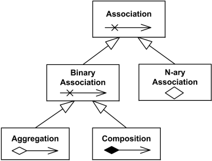
**Association** relationship overview diagram

An association is usually drawn as a solid line connecting two classifiers or a single classifier to itself. Name of the association can be shown somewhere near the middle of the association line but not too close to any of the ends of the line. Each end of the line could be decorated with the name of the [association end](https://www.uml-diagrams.org/association.html#association-end).

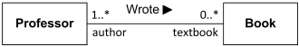
Association **Wrote** between **Professor** and **Book**  
 with association ends **author** and **textbook**.

## Association End

**Association end** is a connection between the line depicting an [association](https://www.uml-diagrams.org/association.html) and the icon depicting the connected [classifier](https://www.uml-diagrams.org/classifier.html). Name of the association end may be placed near the end of the line. The association end name is commonly referred to as **role** name (but it is not defined as such in the UML 2.4 standard). The role name is optional and suppressible.

**Professor** "playing the role" of **author** is associated  
 with **textbook** end typed as **Book**.

The idea of the **role** is that the same classifier can play the same or different roles in other associations. For example, Professor could be an author of some Books or an editor.

Association end could be **owned** either by

*   **end classifier**, or
*   **association** itself

Association ends of associations with **more than two ends** must be **owned by the association**.

Ownership of association ends by an associated **classifier** may be indicated graphically by a **small filled circle** (aka **dot**). The dot is drawn at the point where line meets the classifier. It could be interpreted as showing that the model includes a property of the type represented by the classifier touched by the dot. This property is owned by the classifier **at the other end**.

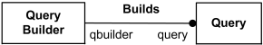
Association end **query** is owned by classifier **QueryBuilder**  
 and association end **qbuilder** is owned by association **Builds** itself

The "ownership" dot may be used in combination with the other graphic line-path notations for properties of associations and association ends. These include aggregation type and navigability.

UML standard does not mandate the use of explicit end-ownership notation, but defines a notation which shall apply in models where such use is elected. The dot notation must be applied at the level of complete associations or higher, so that the **absence of the dot signifies ownership by the association**. In other words, in binary associations the dot will be omitted only for the ends which are **not owned by a classifier**.

Attribute notation can be used for an association end **owned by a class**, because an association end owned by a class is also an **attribute**. This notation may be used in conjunction with the line arrow notation to make it perfectly clear that the attribute is also an **association end**.

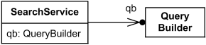
**Association end** qb is an **attribute** of SearchService class  
 and is **owned** by the class.

## Navigability

End property of association is **navigable** from the opposite end(s) of association if instances of the classifier at this end of the [link](https://www.uml-diagrams.org/association.html#link) can be accessed efficiently at runtime from instances at the other ends of the link.

UML specification does not dictate how efficient this access should be or any specific mechanism to achieve the efficiency. It is implementation specific.

When end property of association is marked as **not navigable**, in [[UML 2.4]](https://www.uml-diagrams.org/references.html#ref-uml-24-super "UML 2.4 - Superstructure") it means that "access from the other ends may or may not be possible, and if it is, it might not be efficient." The problem with this definition of **not navigable** is that it actually means "whatever" or "who cares?" navigability.

**UML 2.4** also provides another definition of **navigability**:

An end property of association that is owned by an end class, or that is a navigable owned end of the association indicates that the association is **navigable** from the opposite ends; otherwise, the association is **not navigable** from the opposite ends.

This definition is odd because it makes **navigability** strongly dependent on **ownership**, while these are assumed to be **orthogonal** concepts; some examples in UML 2.4 specs show end properties owned by a class as **not navigable**, which contradicts to the definition above; and navigability is defined using "**navigable** owned end of the association".

**Deprecated navigability convention:**

*   non-navigable ends were assumed to be owned by the association 
*   navigable ends were assumed to be owned by the classifier at the opposite end. 

**Notation:**

*   **navigable** end is indicated by an **open arrowhead** on the end of an association
*   **not navigable** end is indicated with a **small x** on the end of an association
*   no adornment on the end of an association means **unspecified navigability**

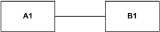
Both ends of association have **unspecified navigability**.

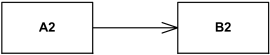
A2 has **unspecified navigability** while B2 is **navigable** from A2.

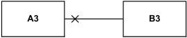
A3 is **not navigable** from B3 while B3 has **unspecified navigability**.

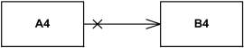
A4 is **not navigable** from B4 while B4 is **navigable** from A4.

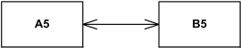
A5 is **navigable** from B5 and B5 is **navigable** from A5.

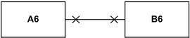
A6 is **not navigable** from B6 and B6 is **not navigable** from A6.

A **visibility** symbol can be added as an adornment on a navigable end to show the end’s visibility as an attribute of the featuring classifier.

## Arity

Each association has specific **arity** as it could relate two or more items.

#### Binary Association

**Binary association** relates **two** typed instances. It is normally rendered as a solid line connecting two classifiers, or a solid line connecting a single classifier to itself (the two ends are distinct). The line may consist of one or more connected segments.

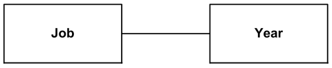
Job and Year classifiers are associated

A small solid triangle could be placed next to or in place of the name of **binary association** (drawn as a solid line) to show the **order of the ends** of the association. The arrow points along the line in the direction of **the last end** in the order of the association ends. This notation also indicates that the association is to be **read** from the first end to the last end.

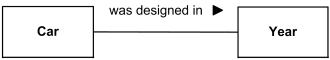
Order of the ends and reading: **Car** - **was designed in** - **Year**

UML 2.4 specification states that this arrow is used **for documentation purposes only** and **has no general semantic interpretation**. This is an odd clarification as UML diagrams are in fact used mostly for documentation purposes but even more important, this arrow according to the UML spec defines the **order** of association ends - which does belong to semantics.

#### N-ary Association

Any association may be drawn as a **diamond** (larger than a terminator on a line) with a solid line for each association end connecting the diamond to the classifier that is the end’s type. **N-ary association** with more than two ends can **only** be drawn this way.

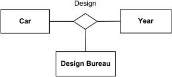
**Ternary association****Design** relates three classifiers

## Shared and Composite Aggregation

**Aggregation** is a [binary association](https://www.uml-diagrams.org/association.html#binary-association) representing some **whole/part relationship**. Aggregation type could be either:

*   [shared aggregation](https://www.uml-diagrams.org/aggregation.html) (aka **aggregation**), or
*   [composite aggregation](https://www.uml-diagrams.org/composition.html) (aka **composition**).

## Association Class

An association may be refined to have its **own set of features**; that is, features that do not belong to any of the connected classifiers but rather to the association itself. Such an association is called an **association class**. It is both an association, connecting a set of classifiers and a class, and as such could have features and might be included in other associations.

An association class can be seen as an association that also has class properties, or as a class that also has association properties.

An association class is shown as a class symbol attached to the association path by a dashed line. The association path and the association class symbol represent the same underlying model element, which has a single name. The association name may be placed on the path, in the class symbol, or on both, but they must be the same name.

## Link

**Link** is an instance of an [association](https://www.uml-diagrams.org/association.html). It is a tuple with one value for the each end of the association, where each value is an instance of the type of the end. Association has at least two ends, represented by properties (**end properties**).

Link is rendered using the same notation as for an association. Solid line connects [instances](https://www.uml-diagrams.org/uml-core.html#instance-core) rather than classifiers. Name of the link could be shown underlined though it is not required. End names ([roles](https://www.uml-diagrams.org/association.html#association-end)) and navigation arrows can be shown.

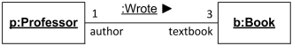
Link **Wrote** between instance **p** of **Professor** playing **author** role  
 and instance **b** of **Book** in the **textbook** role.

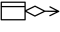[Aggregation](https://www.uml-diagrams.org/aggregation.html "UML aggregation")

  

This document describes UML versions up to **[UML 2.5](https://www.uml-diagrams.org/references.html#ref-uml-25 "UML 2.5 Specification")** and is based on the corresponding **OMG™ Unified Modeling Language™ (OMG UML®)** specifications. UML diagrams were created in **Microsoft® Visio®** 2007-2016 using **[UML 2.x Visio Stencils](http://softwarestencils.com/uml/index.html "Visio Stencil and Template for UML 2.5")**. You can send your comments and suggestions to [webmaster](mailto:webmaster@uml-diagrams.org). [Privacy policy](https://www.uml-diagrams.org/privacy-policy.html).

_Copyright © 2009-2026 uml-diagrams.org. All rights reserved. Authored by Kirill Fakhroutdinov._

[Former Governor Nikki Haley Says Georgia-Born Senator Raphael Warnock Should Be Deported Blavity.com | [Sponsored](https://popup.taboola.com/en/?template=colorbox&utm_source=uml-diagrams&utm_medium=referral&utm_content=next-up-a-delta:Next%20Up:)[Sponsored](https://popup.taboola.com/en/?template=colorbox&utm_source=uml-diagrams&utm_medium=referral&utm_content=next-up-a-delta:Next%20Up:) Read Next Story](https://blavity.com/former-governor-nikki-haley-senator-raphael-warnock-deported-herschel-walker "Former Governor Nikki Haley Says Georgia-Born Senator Raphael Warnock Should Be Deported")
