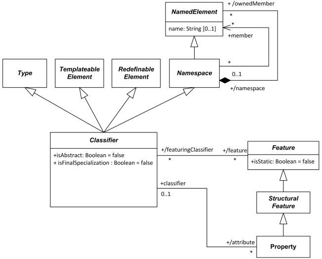
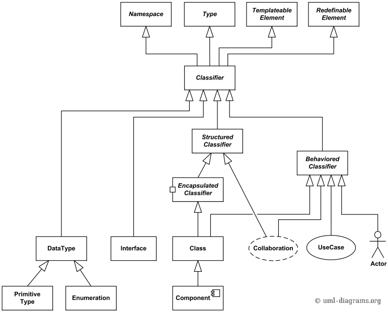

Title: UML classifier is an abstract metaclass describing (classifying) set of instances which have common features.

URL Source: https://www.uml-diagrams.org/classifier.html

Warning: Target URL returned error 400: Bad Request

Markdown Content:
Menu►
*   [UML diagrams](https://www.uml-diagrams.org/ "UML graphical notation overview, examples, and reference.")
*   [UML and OOAD](https://www.uml-diagrams.org/uml-object-oriented-concepts.html "Object-oriented development concepts in UML")
*   [UML core elements](https://www.uml-diagrams.org/uml-core.html "UML core elements")
*   [Frame](https://www.uml-diagrams.org/frame.html "UML frame")
*   [Namespace](https://www.uml-diagrams.org/namespace.html "UML namespace")
*   [Type](https://www.uml-diagrams.org/uml-core.html#type "UML type")
*   [Classifier](https://www.uml-diagrams.org/classifier.html "UML classifier")
*   [Property](https://www.uml-diagrams.org/property.html "UML property")
*   [Multiplicity](https://www.uml-diagrams.org/multiplicity.html "UML multiplicity")
*   [Visibility](https://www.uml-diagrams.org/visibility.html "UML visibility")
*   [Constraint](https://www.uml-diagrams.org/constraint.html "UML constraint")
*   [Association](https://www.uml-diagrams.org/association.html "UML association")
*   [Aggregation](https://www.uml-diagrams.org/aggregation.html "UML aggregation")
*   [Composition](https://www.uml-diagrams.org/composition.html "UML composition")
*   [Generalization](https://www.uml-diagrams.org/generalization.html "UML generalization")
*   [Dependency](https://www.uml-diagrams.org/dependency.html "UML dependency")
*   [Abstraction](https://www.uml-diagrams.org/abstraction.html "UML abstraction")
*   [Realization](https://www.uml-diagrams.org/realization.html "UML realization")
*   [Template](https://www.uml-diagrams.org/template.html "UML template")
*   [UML core reference](https://www.uml-diagrams.org/uml-core-reference.html "UML core elements graphical notation reference")
*   [UML Index](https://www.uml-diagrams.org/index-references.html "Index of UML Elements")

# UML Classifier

**Classifier** is an abstract metaclass which describes (classifies) set of instances having common [features](https://www.uml-diagrams.org/uml-core.html#feature). A **feature** declares a structural or behavioral characteristic of instances of classifiers.

More formally, **classifier** is (extends):

*   [type](https://www.uml-diagrams.org/uml-core.html#type),
*   [templateable element](https://www.uml-diagrams.org/template.html#templateable-element),
*   [redefinable element](https://www.uml-diagrams.org/uml-core.html#redefinable-element),
*   [namespace](https://www.uml-diagrams.org/namespace.html).

UML classifier is type, templateable element, redefinable element, and a namespace.

[Namespace](https://www.uml-diagrams.org/namespace.html) is a named element that can own (contain) other named elements. As a namespace, classifier can have [features](https://www.uml-diagrams.org/uml-core.html#feature).

[Type](https://www.uml-diagrams.org/uml-core.html#type) represents a set of values. A typed element that has this type is constrained to represent values within this set. As a **Type**, classifier can own **generalizations**, thereby making it possible to define generalization relationships to other classifiers.

**Redefinable element** is an element that, when defined in the context of a classifier, can be redefined more specifically or differently in the context of another classifier that specializes (directly or indirectly) the context classifier. As a **redefinable element**, it is possible for classifier to redefine nested classifiers.

Though classifier is an **abstract** model element and thus needs no graphical notation, **UML** provides notation which is used as **default notation** for any concrete subclass of classifier. Some specializations of classifier have their own notations.

The default notation for **classifier** is a solid-outline rectangle containing the classifier’s name, and optionally with compartments separated by horizontal lines containing features or other members of the classifier. The specific type of classifier can be shown in guillemets above the name.

Capitalize classifier name (i.e., begin with an uppercase character), use boldface and center the name. Center keyword (including stereotype names) in plain face within guillemets above the classifier name.

Any compartment may be suppressed. A separator line is not drawn for a suppressed compartment. If a compartment is suppressed, no inference can be drawn about the presence or absence of elements in it. Compartment names can be used to remove ambiguity, if necessary.

Begin attribute and operation names with a lowercase letter. Multi-word names are often formed by concatenating the words and using lowercase for all letters except for upcasing the first letter of each word but the first. Left justify attributes and operations in plain face.

The type, visibility, default, multiplicity, property string may be suppressed from being displayed, even if there are values in the model. The individual properties of an attribute can be shown in columns rather than as a continuous string.

Some examples of **classifiers** are: [class](https://www.uml-diagrams.org/class.html), [interface](https://www.uml-diagrams.org/interface.html), [association](https://www.uml-diagrams.org/association.html), [data type](https://www.uml-diagrams.org/data-type.html), [actor](https://www.uml-diagrams.org/use-case-actor.html) (subclass of [behaviored classifier](https://www.uml-diagrams.org/common-behaviors.html#behaviored-classifier)), [use case](https://www.uml-diagrams.org/use-case.html) (subclass of [behaviored classifier](https://www.uml-diagrams.org/common-behaviors.html#behaviored-classifier)), [component](https://www.uml-diagrams.org/component.html) (subclass of class), [collaboration](https://www.uml-diagrams.org/collaboration-diagrams/collaboration.html), [artifact](https://www.uml-diagrams.org/artifact.html), [node](https://www.uml-diagrams.org/deployment-diagrams.html#node), [signal](https://www.uml-diagrams.org/common-behaviors.html#signal).

The most important UML 2.5 classifiers - [class](https://www.uml-diagrams.org/class.html), [interface](https://www.uml-diagrams.org/interface.html), [data type](https://www.uml-diagrams.org/data-type.html), [component](https://www.uml-diagrams.org/component.html), [collaboration](https://www.uml-diagrams.org/collaboration-diagrams/collaboration.html), [use case](https://www.uml-diagrams.org/use-case.html), etc.

## Abstract Classifier

**Abstract classifier** does not provide a complete description of features and usually can't be instantiated. It is intended to be specialized (subclassed) by other classifiers. Classifiers by default are concrete (not abstract).

The name of an abstract classifier is shown in italics. An abstract classifier can be also shown using the keyword **{abstract}** after or below the name of the classifier.

## Final Classifier

In UML 2.4 classifier has Boolean attribute **isFinalSpecialization**. If true, the classifier cannot be specialized by generalization and is called **final classifier**.

**Final classifier** can't be specialized (subclassed) with [generalization](https://www.uml-diagrams.org/generalization.html) by other classifiers. Classifiers by default are not final. The parents of a classifier must be non-final.

UML provides no visual notation for **final classifiers**. What is even more confusing is that classifier is [redefinable element](https://www.uml-diagrams.org/uml-core.html#redefinable-element) and as such inherits Boolean attribute **isLeaf** - which indicates whether it is possible to redefine the element in subclasses or not. The need to have both **isFinalSpecialization** and **isLeaf** is a mystery.

[Property](https://www.uml-diagrams.org/property.html "UML property")

This document describes **UML 2.5** and is based on **OMG™ Unified Modeling Language™ (OMG UML®) 2.5** specification [[UML 2.5 FTF - Beta 1]](https://www.uml-diagrams.org/references.html#ref-uml-25-b1 "UML 2.5 Specification FTF Beta 1"). All UML diagrams were created in **Microsoft Visio** 2007-2016 using [UML 2.2 stencils](http://softwarestencils.com/uml/index.html "Visio Stencil and Template for UML 2.2"). You can send your comments and suggestions to [webmaster](mailto:webmaster@uml-diagrams.org). [Privacy policy](https://www.uml-diagrams.org/privacy-policy.html).

_Copyright © 2009-2026 uml-diagrams.org. All rights reserved. Authored by Kirill Fakhroutdinov._

[Inside the 7-Minute Miracle at Tokyo Station wovana | [Sponsored](https://popup.taboola.com/en/?template=colorbox&utm_source=uml-diagrams&utm_medium=referral&utm_content=next-up-a-delta:Next%20Up:)[Sponsored](https://popup.taboola.com/en/?template=colorbox&utm_source=uml-diagrams&utm_medium=referral&utm_content=next-up-a-delta:Next%20Up:) Read Next Story](https://kitchen-gardens.info/story/shinkansen-seven-minute-cleaning-crew "Inside the 7-Minute Miracle at Tokyo Station")
