Title: UML dependency is directed, supplier-client relationship which shows that some element requires other model elements.

URL Source: https://www.uml-diagrams.org/dependency.html

Markdown Content:
Menu►
*   [UML diagrams](https://www.uml-diagrams.org/ "UML graphical notation overview, examples, and reference.")
*   [UML and OOAD](https://www.uml-diagrams.org/uml-object-oriented-concepts.html "Object-oriented development concepts in UML")
*   [UML core elements](https://www.uml-diagrams.org/uml-core.html "UML core elements")
*   [Frame](https://www.uml-diagrams.org/frame.html "UML frame")
*   [Namespace](https://www.uml-diagrams.org/namespace.html "UML namespace")
*   [Type](https://www.uml-diagrams.org/uml-core.html#type "UML type")
*   [Classifier](https://www.uml-diagrams.org/classifier.html "UML classifier")
*   [Property](https://www.uml-diagrams.org/property.html "UML property")
*   [Multiplicity](https://www.uml-diagrams.org/multiplicity.html "UML multiplicity")
*   [Visibility](https://www.uml-diagrams.org/visibility.html "UML visibility")
*   [Constraint](https://www.uml-diagrams.org/constraint.html "UML constraint")
*   [Association](https://www.uml-diagrams.org/association.html "UML association")
*   [Aggregation](https://www.uml-diagrams.org/aggregation.html "UML aggregation")
*   [Composition](https://www.uml-diagrams.org/composition.html "UML composition")
*   [Generalization](https://www.uml-diagrams.org/generalization.html "UML generalization")
*   [Dependency](https://www.uml-diagrams.org/dependency.html "UML dependency")
*   [Abstraction](https://www.uml-diagrams.org/abstraction.html "UML abstraction")
*   [Realization](https://www.uml-diagrams.org/realization.html "UML realization")
*   [Template](https://www.uml-diagrams.org/template.html "UML template")
*   [UML core reference](https://www.uml-diagrams.org/uml-core-reference.html "UML core elements graphical notation reference")
*   [UML Index](https://www.uml-diagrams.org/index-references.html "Index of UML Elements")

# Dependency in UML

**Dependency** is a [directed relationship](https://www.uml-diagrams.org/uml-core.html#directed-relationship) which is used to show that some UML element or a set of elements requires, needs or depends on other model elements for **specification** or **implementation**. Because of this, dependency is called a **supplier** - **client** relationship, where supplier provides something to the client, and thus the client is in some sense incomplete while semantically or structurally dependent on the supplier element(s). Modification of the supplier may impact the client elements.

Dependency is a relationship between [named elements](https://www.uml-diagrams.org/uml-core.html#named-element), which in UML includes a lot of different elements, e.g. [classes](https://www.uml-diagrams.org/class.html), [interfaces](https://www.uml-diagrams.org/interface.html), [components](https://www.uml-diagrams.org/component.html), [artifacts](https://www.uml-diagrams.org/artifact.html), [packages](https://www.uml-diagrams.org/package-diagrams.html#package), etc. There are several kinds of dependencies shown on the diagram below.

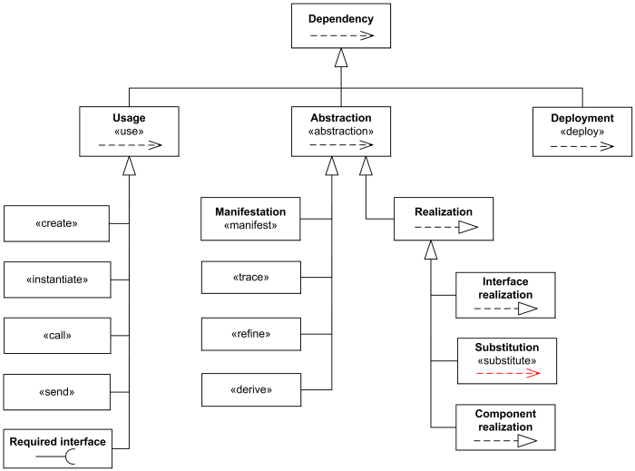
**Dependency** relationship overview diagram - usage, abstraction, deployment.

[Usage](https://www.uml-diagrams.org/dependency.html#usage) is a dependency in which one [named element](https://www.uml-diagrams.org/uml-core.html#named-element) (client) requires another named element (supplier) for its full **definition** or **implementation**.

The [abstraction](https://www.uml-diagrams.org/abstraction.html) relates two elements representing the same concept but at different levels of abstraction.

The [deployment](https://www.uml-diagrams.org/deployment-diagrams.html#deployment) is a dependency which shows allocation (deployment) of an artifact to a deployment target. (It is not very clear why UML 2.4.1 defines deployment as a dependency but not as an [association](https://www.uml-diagrams.org/association.html) or just a [directed relationship](https://www.uml-diagrams.org/uml-core.html#directed-relationship).)

Note, that **UML 2.4.1** specification has some confusing clarification that "the presence of dependency relationships in a model does not have any runtime semantics implications, it is all given in terms of the model-elements that participate in the relationship, not in terms of their instances."

This clarification contradicts to the definition of [usage](https://www.uml-diagrams.org/dependency.html#usage) dependency which is implementation dependency. An experienced software developer knows what happens at runtime when some dependency is missing, with application killed by LinkageError or ClassNotFoundException from the class loader. So dependency could in fact have some grave runtime semantics implications.

A dependency is generally shown as a dashed arrow pointing from the **client** (dependent) at the tail to the **supplier** (provider) at the arrowhead. The arrow may be labeled with an optional stereotype and an optional name. Because the direction of the arrow goes opposite to what we would normally expect, I usually stereotype it as client «depends on» supplier.

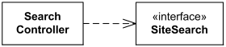
Class SearchController depends on (requires) SiteSearch interface.

For many years UML specifications provide contradictory example of the dependency shown below. The explanation for the Figure 7.38 of UML 2.4.1 specification states: "In the example below, the Car class has a dependency on the CarFactory class. In this case, the dependency is an instantiate dependency, where the Car class is an instance of the CarFactory class."

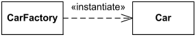
Wrong: Car class has a dependency on the CarFactory class.  
 Right: CarFactory class depends on the Car class.

This example in fact shows opposite to what UML specification states. CarFactory depends on the Car class. Car class could be defined without the knowledge of CarFactory class, but CarFactory requires Car for its definition because it produces Cars. It is also wrong to say that "... the Car class is an instance of the CarFactory class." The Car class is **instantiated** by the CarFactory class.

It is possible to have a set of elements for the client or supplier. In this case, one or more arrows with their tails on the clients are connected to the tails of one or more arrows with their heads on the suppliers. A small dot can be placed on the junction if desired. A note on the dependency should be attached at the junction point.

Dependency could be used on several kinds of UML diagrams:

*   [class diagram](https://www.uml-diagrams.org/class-diagrams-overview.html)
*   [composite structure diagram](https://www.uml-diagrams.org/composite-structure-diagrams.html)
*   [package diagram](https://www.uml-diagrams.org/package-diagrams-overview.html)
*   [component diagram](https://www.uml-diagrams.org/component-diagrams.html)
*   [deployment diagram](https://www.uml-diagrams.org/deployment-diagrams-overview.html)

Here's some examples of dependencies:

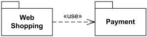
Web Shopping package uses (depends on) Payment package.

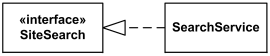
**Interface** SiteSearch is **realized** (implemented) by SearchService.

Note, that [abstraction](https://www.uml-diagrams.org/abstraction.html) dependency has a convention to have more abstract element as supplier and more specific or implementation element as client but UML specification also allows to draw it the opposite way.

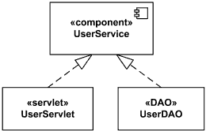
Component UserService realized by UserServlet and UserDAO.

## Usage

A **usage** is a [dependency](https://www.uml-diagrams.org/dependency.html) relationship in which one element (**client**) requires another element (or set of elements) (**supplier**) for its full **implementation** or **operation**.

The usage dependency does not specify how the client uses the supplier other than the fact that the supplier is used by the definition or implementation of the client. For example, it could mean that some method(s) within a (**client**) class uses objects (e.g. parameters) of the another (**supplier**) class.

A usage dependency is shown as a dependency with a **«use»** keyword attached to it.

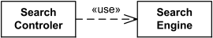
Class SearchController **uses** SearchEngine class.

### Create

**Create** is a [usage dependency](https://www.uml-diagrams.org/dependency.html#usage) denoting that the client classifier creates instances of the supplier classifier. It is denoted with the standard stereotype **«create»**.

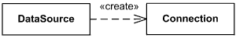
Class DataSource creates Connection.

Create could also specify that the designated [feature](https://www.uml-diagrams.org/uml-core.html#feature) creates an instance of the classifier to which the feature is attached. This dependency may be promoted to the classifier containing the feature.

**Create** may relate an instance value to a constructor for a class, describing the single value returned by the constructor operation. The operation is the client, the created instance the supplier. The instance value may reference parameters declared by the operation.

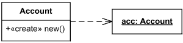
Account constructor creates new instances of Account

**Instantiate** is another [usage dependency](https://www.uml-diagrams.org/dependency.html#usage) among classifiers indicating that operations on the client create instances of the supplier. It is denoted with the standard stereotype **«instantiate»**.

It is not very clear why **UML 2.4** standard has both **«create»** and **«instantiate»**.

### Call

**Call** is a [usage dependency](https://www.uml-diagrams.org/dependency.html#usage) that specifies that the source operation invokes the target operation. This dependency may connect a source operation to any target operation that is within the scope including, but not limited to, operations of the enclosing classifier and operations of other visible classifiers.

**Call** is denoted with the standard stereotype **«call»** whose source is an [operation](https://www.uml-diagrams.org/operation.html) and whose target is also an [operation](https://www.uml-diagrams.org/operation.html).

This relationship may also be applied to the [class](https://www.uml-diagrams.org/class.html) containing an operation, with the meaning that there exists an operation in the class to which the dependency applies.

### Send

**Send** is a [usage dependency](https://www.uml-diagrams.org/dependency.html#usage) whose source is an [operation](https://www.uml-diagrams.org/operation.html) and whose target is a [signal](https://www.uml-diagrams.org/common-behaviors.html#signal), specifying that the source sends the target signal.

**Send** is denoted with the standard stereotype **«send»**.

### Required Interface

**Required interface** specifies services that a classifier needs in order to perform its function and fulfill its own obligations to its clients. It is specified by a [usage dependency](https://www.uml-diagrams.org/dependency.html#usage) between the [classifier](https://www.uml-diagrams.org/classifier.html) and the corresponding [interface](https://www.uml-diagrams.org/interface.html).

The **usage dependency** from a classifier to an interface is shown by representing the interface by a half-circle or socket, labeled with the name of the interface, attached by a solid line to the classifier that requires this interface.

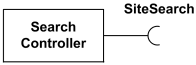
**Interface** SiteSearch is **used** (required) by SearchController.

If interface is represented using the rectangle notation, **interface usage** dependency is denoted with dependency arrow. The classifier at the tail of the arrow **uses** (requires) the interface at the head of the arrow.

Interface SiteSearch is **used** (required) by SearchController.

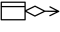[Abstraction](https://www.uml-diagrams.org/abstraction.html "UML abstraction")

This document describes UML versions up to **[UML 2.5](https://www.uml-diagrams.org/references.html#ref-uml-25 "UML 2.5 Specification")** and is based on the corresponding **OMG™ Unified Modeling Language™ (OMG UML®)** specifications. UML diagrams were created in **Microsoft® Visio®** 2007-2016 using **[UML 2.x Visio Stencils](http://softwarestencils.com/uml/index.html "Visio Stencil and Template for UML 2.5")**. You can send your comments and suggestions to [webmaster](mailto:webmaster@uml-diagrams.org). [Privacy policy](https://www.uml-diagrams.org/privacy-policy.html).

_Copyright © 2009-2026 uml-diagrams.org. All rights reserved. Authored by Kirill Fakhroutdinov._

[Savannah James Says It’s Important For Her To Bootstrap Something From The Ground Up — ‘Let Me Figure It Out’Afrotech | [Sponsored](https://popup.taboola.com/en/?template=colorbox&utm_source=uml-diagrams&utm_medium=referral&utm_content=next-up-a-delta:Next%20Up:)[Sponsored](https://popup.taboola.com/en/?template=colorbox&utm_source=uml-diagrams&utm_medium=referral&utm_content=next-up-a-delta:Next%20Up:) Read Next Story](https://afrotech.com/savannah-james-says-its-important-for-her-to-bootstrap-her-business "Savannah James Says It’s Important For Her To Bootstrap Something From The Ground Up — ‘Let Me Figure It Out’")
